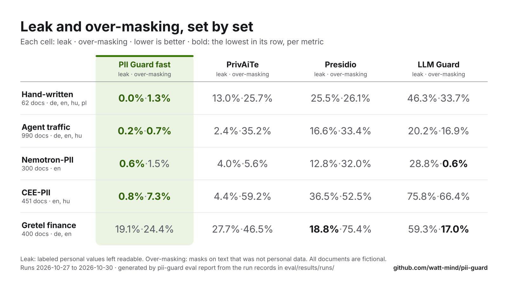

# PII Guard

<picture>
  <source media="(max-width: 600px)" srcset="docs/assets/banner-narrow.svg">
  
</picture>

[](https://guard.watt-mind.com)
[](https://github.com/watt-mind/pii-guard/actions/workflows/ci.yml)
[](https://huggingface.co/watt-mind/pii-guard-ner-xlmr-base)
[](LICENSE)

**Status:** built for the Meta Global AI Developer Hackathon (Oct 26 – Nov 4, 2026); live at
[guard.watt-mind.com](https://guard.watt-mind.com). Version 0.1.0, no tagged release yet: install
from git. Known gaps: [why-pii-guard.md](docs/why-pii-guard.md#what-is-not-here-yet).

<!-- intro:start -->
<!-- Generated by `pii-guard eval report` from the run records and the `readme.intro` section of docs/benchmarks/config.json; edit those, not this block. -->

- **What it does.** An OpenAI-compatible gateway for AI agents: change one base URL, and the names, addresses, IDs and faces it detects (with rules and an NER distilled from Meta's Muse Glimmer 30B into XLM-RoBERTa base, running on CPU) become reversible placeholders (`[[PERSON_7f3a]]`) before the request leaves, then come back in the answer, mid-stream and inside tool calls.
- **How well.** On 990 fictional agent-traffic documents (de, en, hu), 0.2 % of personal values reached the model and 0.7 % of masks hit text that was not personal data. The lowest-leak alternative, PrivAiTe, leaked 2.4 % and over-masked 35.2 % on the same documents; the chart below has every tool.
- **How fast.** The NER takes 43 ms per message (p50, laptop CPU, [measurement](eval/results/2026-10-30-lab-1625-ner-v42/latency-cpu-local.json)); the whole gateway adds 55 ms per request (p50, one client, measured on a busy shared laptop, [record](eval/results/runs/2026-10-30-lab-1656-gateway-latency-cpu-v42-b3-fast.json)).
- **Where your data goes.** In fast mode, the default (rules plus the on-device NER, no LLM call), the original text is processed only on your machine. The hosted demo receives what you type, so use fictional data there; the optional audit and SAM 3.1 endpoints receive the original text or pixels. Anything the detectors miss passes through: pseudonymization, not anonymization or a compliance guarantee.

<picture>
  <source media="(prefers-color-scheme: dark)" srcset="docs/benchmarks/leak-vs-overmasking-dark.svg">
  
</picture>

<p align="center"><sub>Lower-left is better. 990 fictional documents (de, en, hu), drawn by <code>pii-guard eval report</code> from the <a href="eval/results/runs/">run records</a>. <a href="#results">All sets</a> · <a href="docs/benchmarks/README.md">shareable PNGs</a></sub></p>
<!-- intro:end -->

## Quickstart

**No install:** [guard.watt-mind.com](https://guard.watt-mind.com) runs a guest demo with no
sign-up (fictional data only; capped sponsored allowance).

**On your machine** (needs [uv](https://docs.astral.sh/uv/)): the API and the gateway on
http://127.0.0.1:8787, with a mock model that echoes what it receives, so no key is needed:

```bash
uvx --python 3.12 \
  --from 'wattmind-pii-guard[ner] @ git+https://github.com/watt-mind/pii-guard' \
  pii-guard up
```

- **First run:** installs PyTorch and downloads the NER once (1.1 GB,
  [which model](docs/models.md#which-ner-model-fast-mode-runs)). The server answers at once and
  loads the NER in the background: `/healthz` says `"ner": "loading"` until `"ready"`, and a
  request sent meanwhile waits up to 120 s (`PII_GUARD_NER_WARMUP_TIMEOUT`), then gets
  `503 detector_loading`.
- **Browser:** a git install opens a status page, not the console; the web console needs
  `make demo` from a checkout (below). `--no-browser` skips the page.
- **Rules only**, no model download: drop `[ner]`. Free-text names are then masked only as
  [known values](docs/api.md#sessions-and-restore), the values your app already knows are
  sensitive and registers with a session.
- **A real model:** `pii-guard up --upstream meta` with the key in `META_API_KEY` (Meta Model
  API); `openai` reads `OPENAI_API_KEY`, `fireworks` `FIREWORKS_API_KEY`, `openrouter`
  `OPENROUTER_API_KEY` (from the environment or `./.env`). Anything else OpenAI-compatible:
  `--upstream-url <base URL> --api-key-env <VAR>`.
- **No authentication by default.** It binds 127.0.0.1; set `PII_GUARD_API_TOKEN` before you
  expose it ([operations.md](docs/operations.md#exposure-and-authentication)).

With the web console (also needs Node 22+ and [pnpm](https://pnpm.io/)), from a checkout:

```bash
git clone https://github.com/watt-mind/pii-guard.git && cd pii-guard
uv sync --extra ner --extra local-vision
make demo    # console on http://localhost:5173, gateway on http://127.0.0.1:8787
```

Docker, demo traffic and smoke tests: [docs/operations.md](docs/operations.md#the-demo-stack).

## Results

<!-- results:start -->
<!-- Generated by `pii-guard eval report` from the run records and the `readme` section of docs/benchmarks/config.json; edit those, not this block. -->

<picture>
  <source media="(prefers-color-scheme: dark)" srcset="docs/benchmarks/results-table-dark.svg">
  
</picture>

<details><summary>Table as text</summary>

| Leak · over-masking | **PII Guard fast** | PrivAiTe | Presidio | LLM Guard |
|---|---:|---:|---:|---:|
| Hand-written · 62 docs (de+en+hu+pl) | **0.0%**&nbsp;·&nbsp;**1.3%** | 13.0%&nbsp;·&nbsp;25.7% | 25.5%&nbsp;·&nbsp;26.1% | 46.3%&nbsp;·&nbsp;33.7% |
| Agent traffic · 990 docs (de+en+hu) | **0.2%**&nbsp;·&nbsp;**0.7%** | 2.4%&nbsp;·&nbsp;35.2% | 16.6%&nbsp;·&nbsp;33.4% | 20.2%&nbsp;·&nbsp;16.9% |
| Nemotron-PII · 300 docs (en) | **0.6%**&nbsp;·&nbsp;1.5% | 4.0%&nbsp;·&nbsp;5.6% | 12.8%&nbsp;·&nbsp;32.0% | 28.8%&nbsp;·&nbsp;**0.6%** |
| CEE-PII · 451 docs (en+hu) | **0.8%**&nbsp;·&nbsp;**7.3%** | 4.4%&nbsp;·&nbsp;59.2% | 36.5%&nbsp;·&nbsp;52.5% | 75.8%&nbsp;·&nbsp;66.4% |
| Gretel finance · 400 docs (de+en) | 19.1%&nbsp;·&nbsp;24.4% | 27.7%&nbsp;·&nbsp;46.5% | **18.8%**&nbsp;·&nbsp;75.4% | 59.3%&nbsp;·&nbsp;**17.0%** |

</details>

Leak: labeled personal values left fully readable in what the model receives. A value with only part left readable (a surname, the tail of a number) is a partial leak, counted separately: PII Guard fast 0.0 % on agent traffic, 1.4 % on the hand-written set. Over-masking: masks on text that was not personal data. Lower is better for both; the lowest in each row is bold.

**Caveats**

- The sets are small (tens to hundreds of documents per language): a point or two of difference is noise. Agent traffic is written by Muse models from fictional seeds, which can flatter a detector taught by Muse labels; that is why the hand-written and public sets sit next to it.
- Finance text is the weak spot. On Gretel finance's own labels PII Guard leaks 19.1 %, about level with Presidio's 18.8 %; on corrected labels ([why](docs/datasets.md)) 2.4 % against 14.8 %. Over-masking is high on Gretel finance (24.4 %) and CEE-PII (7.3 %), where reference numbers without a cue word come out as IDs.
- NER v4.2 trails the previous v2.0 on CEE-PII (0.8 % against 0.4 %) and the Polish pl-pii-bench (4.2 % against 3.5 %), and beats it on the hand-written sets, agent traffic and EU languages ([model notes](docs/models.md)).

<details><summary>How this is measured</summary>

Every tool ran on the same documents (byte-identical files) and was scored by the same code; comparison tools use their documented defaults ([configurations](eval/results/2026-10-27-comparison/README.md#systems)). All data is fictional. PII Guard fast is rules plus the published NER `v4.2` ([model card](training/ner/model-card.md)). The hand-written set pools de, en, hu, pl; the full tables, per-language numbers, Ai4Privacy (in-distribution for the NER, so not a win) and the corrected finance labels are in [docs/benchmarks.md](docs/benchmarks.md#results-by-fixture-set).

NER model time per message on CPU (the model alone, not the whole gateway): p50 43 ms, p95 50 ms (122 messages of about 382 characters, arm64 macOS-26.5.2-arm64-arm-64bit, 8 threads; [measurement](eval/results/2026-10-30-lab-1625-ner-v42/latency-cpu-local.json)).

Records behind the PII Guard fast column: Hand-written ([1](eval/results/runs/2026-10-30-lab-1625-pl-smoke-v42-b3.json) · [2](eval/results/runs/2026-10-30-lab-1625-smoke-v42-b3.json)), [Agent traffic](eval/results/runs/2026-10-30-lab-1625-agent-traffic-v42-b3.json), [Nemotron-PII](eval/results/runs/2026-10-30-lab-1625-nemotron-pii-v42-b3.json), [CEE-PII](eval/results/runs/2026-10-30-lab-1625-cee-pii-v42-b3.json), [Gretel finance](eval/results/runs/2026-10-30-lab-1625-gretel-finance-v42-b3.json); every other cell is in the [run log](docs/benchmarks.md#run-log).

</details>
<!-- results:end -->

Every fixture set, per-language numbers, the open NER models compared behind the same rules and
latency: [docs/benchmarks.md](docs/benchmarks.md). Every chart as a shareable PNG:
[docs/benchmarks/README.md](docs/benchmarks/README.md).

## Meta models: large ones teach, a small open one runs

Muse Glimmer 30B labeled fictional text; its labels were distilled into **XLM-RoBERTa base**, the
small open model that runs on CPU in fast mode, published as
[`watt-mind/pii-guard-ner-xlmr-base`](https://huggingface.co/watt-mind/pii-guard-ner-xlmr-base) `v4.2`.

> In the default fast mode, every model that sees original personal data runs on your machine.
> Audit mode (Muse Spark Open) and SAM 3.1 are opt-in and receive originals at the endpoint you
> configure.

| Job | Meta model | Evidence |
|---|---|---|
| Finds names, addresses and dates in fast mode, on CPU | **XLM-RoBERTa base** (FacebookAI, MIT), fine-tuned | [model card](training/ner/model-card.md), [training](docs/models.md#ner-v4-v41-and-v42-v42-is-published) |
| Teacher: labels the fictional training text | **Muse Glimmer 30B** (open weights, Apache-2.0) | [distillation](docs/models.md#distilled-from-muse-glimmer) |
| Writes the fictional benchmark; the demo's downstream model | **Muse Spark** (Meta Model API) | [models](docs/models.md#which-model-does-what) |
| Audit mode (opt-in) and red-teaming | **Muse Spark Open** (open weights) | [audit runs](docs/benchmarks.md#smoke), [red team](eval/results/2026-10-27-redteam/README.md) |
| Signatures in images (optional) | **SAM 3.1** (Meta Model API, decoded with Meta's `meta_sam_parser`); faces on the device (YuNet) | [specimen results](eval/results/visual/specimens.md) |

## How it works

<picture>
  <source media="(prefers-color-scheme: dark)" srcset="docs/benchmarks/how-it-works-dark.svg">
  
</picture>

The gateway speaks the OpenAI Chat Completions and Responses APIs. It masks messages, **tool
definitions, tool-call arguments, tool results** and images, restores placeholders in streams,
keeps one placeholder per person per session, and fails closed on anything it can't mask; the
mapping never leaves PII Guard.

| Mode | Detection | What leaves your machine | Use it for |
|---|---|---|---|
| `fast` (default) | Rules + on-device NER, no model call | Only the masked request, to your LLM provider | Everyday agent traffic |
| `fast` without the `ner` extra | Rules only; free-text names only as [known values](docs/api.md#sessions-and-restore) | Only the masked request | Offline runs, CI, structured data |
| `audit` (opt-in, `X-PII-Guard-Mode: audit`) | Rules + NER + an LLM detector; fails closed if that call fails | The original text, to the audit endpoint you configure | Measuring the upper bound and making training labels, not production traffic |

**What it detects:** people, addresses, emails, phone numbers, dates of birth, national and
document IDs (including Hungarian tax and TAJ numbers), bank accounts and payment cards,
vehicle plates, parcel numbers and secrets such as API keys, plus faces, ID photos and
signatures in images ([docs/entities.md](docs/entities.md)).

**Real agents behind it.** Four coding agents (pi, OpenCode, Codex, Muse Code), unmodified, ran a
two-turn task on a fictional customer file through the gateway on 2026-10-29:

- 115 agent requests went through; none of the file's 9 fictional values reached the model.
- 8 of 10 turns finished, with the real values restored in the answers and in the files on disk.
  The other 2 were Codex turns that stopped on gateway bugs, not refusals.
- 0 of 10 turns were refused once the gateway added a system note telling the model the
  placeholders are intentional (and stopped the NER masking file names). In the earlier
  2026-10-28 run, without either, 7 of 15 were.
- Ten turns is a small sample, not a benchmark ([harness matrix](docs/integrations/harness-matrix-2026-10-29.md)).

[Architecture](docs/architecture.md) · [sessions and modes](docs/architecture-gateway.md) ·
[threat model](docs/privacy-model.md) · [GDPR context](docs/eu-regulation.md)

## Use it from code

### Round trip

Mask, then unmask with the session the guard keeps. With `pii-guard up` running, this script
takes the session id and the person placeholder from the first response (output from fast mode):

```bash
R=$(curl -sS http://127.0.0.1:8787/v1/mask -H 'Content-Type: application/json' \
  -d '{"text": "Please email Jane Placeholder at jane.placeholder@example.net about her refund.", "language": "en"}')
echo "$R"
# {"masked_text":"Please email [[PERSON_6a9b4e]] at [[EMAIL_aa65f8]] about her refund.",
#  "session_id":"s_405e5b0dfff4b3c55d5da1cb996d758e","entities":[...],"kept":[]}
SID=$(echo "$R" | python3 -c 'import json,sys; print(json.load(sys.stdin)["session_id"])')
P=$(echo "$R" | grep -o '\[\[PERSON_[0-9a-f]*\]\]' | head -1)
curl -sS http://127.0.0.1:8787/v1/unmask -H 'Content-Type: application/json' \
  -d "{\"text\": \"Done: I emailed $P about the refund.\", \"session_id\": \"$SID\"}"
# {"text":"Done: I emailed Jane Placeholder about the refund.","unresolved":[]}
```

The session id and the placeholders differ on every run: each new session gets its own.

### Python client

Put it in front of an existing client; only the base URL changes:

```python
# pip install openai
from openai import OpenAI

client = OpenAI(base_url="http://127.0.0.1:8787/v1", api_key="unused")  # mock upstream
stream = client.chat.completions.create(
    model="mock",
    stream=True,
    messages=[
        {"role": "user", "content": "Refund Jane Placeholder, jane.placeholder@example.net."}
    ],
)
for chunk in stream:  # the mock echoes the masked text it got; the gateway restores the values
    print(chunk.choices[0].delta.content or "", end="")
# Echo: Refund Jane Placeholder, jane.placeholder@example.net.
```

What the model actually received: `curl -sS 'http://127.0.0.1:8787/v1/traffic?limit=1'` shows
the last gateway request as sent upstream, with placeholders (`pii-guard up` keeps a masked-only
[traffic log](docs/operations.md#traffic-log)). [API guide](docs/api.md) ·
[agents and harnesses](docs/integrations.md).

## Why PII Guard

- **Reversible, not redacted.** The answer names the real person, and every document in the
  hand-written set unmasks back to its original exactly.
- **Grammar-aware.** In languages like Hungarian a name changes with every case; the ending
  stays outside the placeholder, so the model still writes grammatical text:

  | | Hungarian (real output) | English gloss |
  |---|---|---|
  | You send | Kérem, írjon Próba Zsuzsannának a zsuzsa.proba@example.com címre. | Please write *to Zsuzsanna Próba* at … |
  | The model sees | Kérem, írjon [[PERSON_968e29]]nak a [[EMAIL_e7038b]] címre. | … *to [[PERSON]]* … |
  | You get back | Megírtam a levelet Próba Zsuzsannának. | I wrote *to Zsuzsanna Próba*. |

- **Language packs.** Hungarian, English, German and Polish each ship validated identifier
  rules, cue words and case handling; a new language is one package
  ([docs/languages.md](docs/languages.md)).
- **Measured in the open.** Every benchmark number on this page is generated from a committed
  [run record](eval/results/runs/) and checked in CI (`pii-guard eval report --check`).

Capabilities and evidence: [docs/why-pii-guard.md](docs/why-pii-guard.md).

## See it

<p align="center">
  
</p>

<p align="center"><sub>Console tour, recorded in fast mode (rules + NER) with fictional data.
More screens: <a href="ui/README.md#screens">ui/README.md</a>.</sub></p>

## Contributing, security, license

See [CONTRIBUTING.md](CONTRIBUTING.md); the rule that matters most: **never commit real
personal data**, not even in a test. **No authentication by default:** keep PII Guard on
loopback or behind an authenticating proxy, or set `PII_GUARD_API_TOKEN`
([operations.md](docs/operations.md#exposure-and-authentication)). Found a way to make personal
data leak past the guard? Report it privately: [SECURITY.md](SECURITY.md).
Licensed [Apache-2.0](LICENSE).
