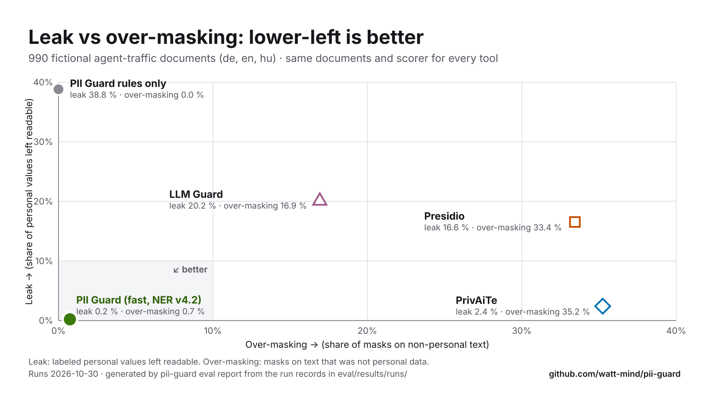
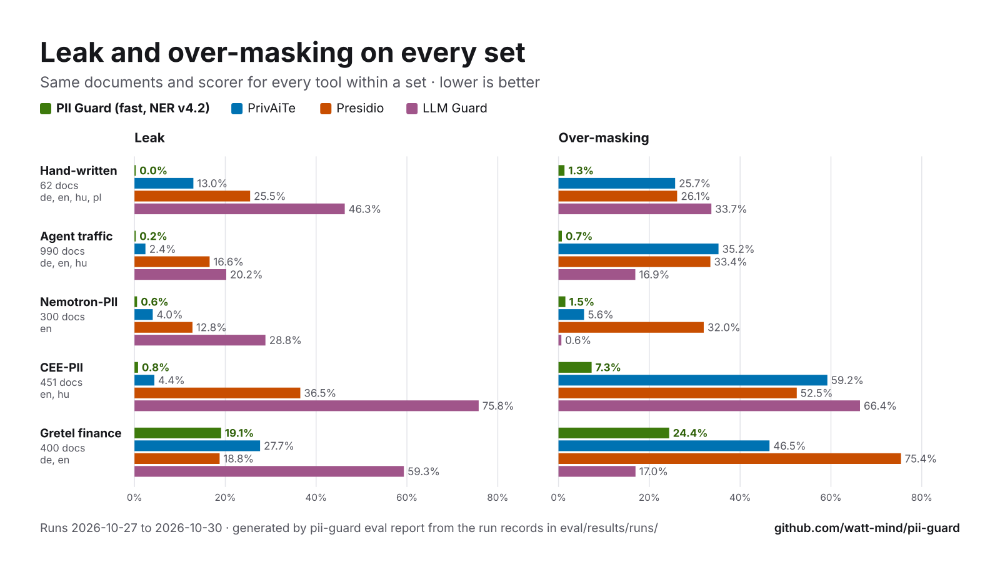
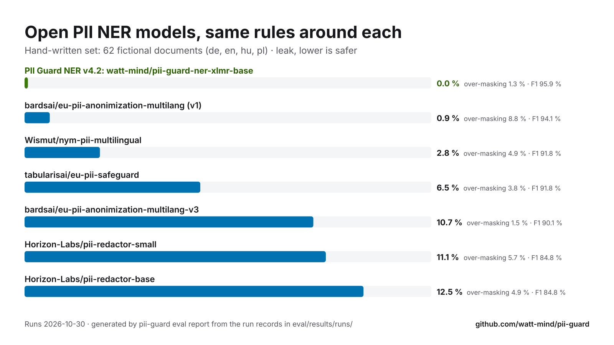

# PII Guard

**Mask personal data before it reaches the LLM. Put it back in the answer.**
Open source (Apache-2.0), runs on your machine, built on Meta's open models.

[](https://guard.watt-mind.com)
[](https://github.com/watt-mind/pii-guard/actions/workflows/ci.yml)
[](https://huggingface.co/watt-mind/pii-guard-ner-xlmr-base)
[](LICENSE)

<!-- intro:start -->
<!-- Generated by `pii-guard eval report` from the run records and the `readme.intro` section of docs/benchmarks/config.json; edit those, not this block. -->

- **What it does.** An OpenAI-compatible gateway for AI agents: change one base URL, and detected names, addresses, IDs and faces become reversible placeholders (`[[PERSON_7f3a]]`) before the request leaves, then come back in the answer, mid-stream and inside tool calls.
- **How well.** On 990 fictional agent-traffic documents (de, en, hu), 0.2 % of personal values reached the model and 0.7 % of masks hit text that was not personal data. Same documents and scorer: PrivAiTe 2.4 % / 35.2 %, Presidio 16.6 % / 33.4 %, LLM Guard 20.2 % / 16.9 %.
- **Where your data goes.** In the default fast mode, rules and a small NER model process the original text on your machine. The hosted demo receives what you type, so use fictional data there; the optional audit and SAM 3.1 endpoints receive the original text or pixels. Anything the detectors miss passes through: pseudonymization, not anonymization or a compliance guarantee.

<picture>
  <source media="(prefers-color-scheme: dark)" srcset="docs/benchmarks/leak-vs-overmasking-dark.svg">
  
</picture>

<p align="center"><sub>Lower-left is better. 990 fictional documents (de, en, hu), drawn by <code>pii-guard eval report</code> from the <a href="eval/results/runs/">run records</a>. <a href="#results">All sets</a> · <a href="docs/benchmarks/README.md">shareable PNGs</a></sub></p>
<!-- intro:end -->

## Quickstart

Needs [uv](https://docs.astral.sh/uv/). API and gateway on http://127.0.0.1:8787, with a mock
model that echoes what it receives (no key); the first run fetches PyTorch and the NER (~1 GB each):

```bash
uvx --python 3.12 --from 'wattmind-pii-guard[ner] @ git+https://github.com/watt-mind/pii-guard' pii-guard up
```

Rules only, with no model download (names then need known values):
`uvx --python 3.12 --from git+https://github.com/watt-mind/pii-guard pii-guard up`.

With the web console (also needs Node 22+ and [pnpm](https://pnpm.io/)), from a checkout:

```bash
git clone https://github.com/watt-mind/pii-guard.git && cd pii-guard
uv sync --extra ner --extra local-vision
make demo    # console on http://localhost:5173, gateway on http://127.0.0.1:8787
```

Or skip the install: **[guard.watt-mind.com](https://guard.watt-mind.com)** runs a guest demo
with no sign-up (fictional data only; capped sponsored allowance). Docker, demo traffic and
smoke tests: [docs/operations.md](docs/operations.md#the-demo-stack).

## Round trip

Mask, then unmask with the session the guard keeps (output from fast mode):

```bash
curl -sS http://127.0.0.1:8787/v1/mask -H 'Content-Type: application/json' \
  -d '{"text": "Teszt Elek írt Teszt Eleknek.", "language": "hu"}'
# {"masked_text": "[[PERSON_f8eb32]] írt [[PERSON_f8eb32]]nek.", "session_id": "s_…", …}

curl -sS http://127.0.0.1:8787/v1/unmask -H 'Content-Type: application/json' \
  -d '{"text": "Kedves [[PERSON_f8eb32]]!", "session_id": "s_…"}'
# {"text": "Kedves Teszt Elek!", "unresolved": []}
```

Or put it in front of an existing client; only the base URL changes:

```python
from openai import OpenAI

client = OpenAI(base_url="http://127.0.0.1:8787/v1", api_key="unused")  # mock upstream
stream = client.chat.completions.create(
    model="mock",
    stream=True,
    messages=[{"role": "user", "content": "Refund Jane Placeholder, jane.placeholder@example.net."}],
)
for chunk in stream:  # the model saw [[PERSON_…]] and [[EMAIL_…]]; you get the real values
    print(chunk.choices[0].delta.content or "", end="")
```

A real model: `pii-guard up --upstream meta` (or `openai`, `fireworks`, `openrouter`,
`--upstream-url`). [API guide](docs/api.md) · [agents and harnesses](docs/integrations.md).

## Results

<!-- results:start -->
<!-- Generated by `pii-guard eval report` from the run records and the `readme` section of docs/benchmarks/config.json; edit those, not this block. -->

| Leak · over-masking | **PII Guard fast** | PrivAiTe | Presidio | LLM Guard |
|---|---:|---:|---:|---:|
| Hand-written · 62 docs (de+en+hu+pl) | **0.0%**&nbsp;·&nbsp;**1.3%** | 13.0%&nbsp;·&nbsp;25.7% | 25.5%&nbsp;·&nbsp;26.1% | 46.3%&nbsp;·&nbsp;33.7% |
| Agent traffic · 990 docs (de+en+hu) | **0.2%**&nbsp;·&nbsp;**0.7%** | 2.4%&nbsp;·&nbsp;35.2% | 16.6%&nbsp;·&nbsp;33.4% | 20.2%&nbsp;·&nbsp;16.9% |
| Nemotron-PII · 300 docs (en) | **0.6%**&nbsp;·&nbsp;1.5% | 4.0%&nbsp;·&nbsp;5.6% | 12.8%&nbsp;·&nbsp;32.0% | 28.8%&nbsp;·&nbsp;**0.6%** |
| CEE-PII · 451 docs (en+hu) | **0.8%**&nbsp;·&nbsp;**7.3%** | 4.4%&nbsp;·&nbsp;59.2% | 36.5%&nbsp;·&nbsp;52.5% | 75.8%&nbsp;·&nbsp;66.4% |
| Gretel finance · 400 docs (de+en) | 19.1%&nbsp;·&nbsp;24.4% | 27.7%&nbsp;·&nbsp;46.5% | **18.8%**&nbsp;·&nbsp;75.4% | 59.3%&nbsp;·&nbsp;**17.0%** |

Leak: labeled personal values left fully readable in what the model receives. A value with only part left readable (a surname, the tail of a number) is a partial leak, counted separately: PII Guard fast 0.0 % on agent traffic, 1.4 % on the hand-written set. Over-masking: masks on text that was not personal data. Lower is better for both; the lowest in each row is bold.

**Caveats**

- The sets are small (tens to hundreds of documents per language): a point or two of difference is noise. Agent traffic is written by Muse models from fictional seeds, which can flatter a detector taught by Muse labels; that is why the hand-written and public sets sit next to it.
- Finance text is the weak spot. On Gretel finance's own labels PII Guard leaks 19.1 %, about level with Presidio's 18.8 %; on corrected labels ([why](docs/datasets.md)) 2.4 % against 14.8 %. Over-masking is high on Gretel finance (24.4 %) and CEE-PII (7.3 %), where reference numbers without a cue word come out as IDs.
- NER v4.2 is behind the previous v2.0 in two places, with the rules in front: CEE-PII 0.8 % against 0.4 %, and the Polish pl-pii-bench 4.2 % against 3.5 %. Neither was a release gate; v4.2 won on the hand-written sets, agent traffic and EU languages ([model notes](docs/models.md)).

<details><summary>How this is measured</summary>

Every tool ran on the same documents (same fixture hashes) and was scored by the same code; comparison tools use their documented defaults ([configurations](eval/results/2026-10-27-comparison/README.md#systems)). All data is fictional. PII Guard fast is rules plus the published NER `v4.2` ([model card](training/ner/model-card.md)). The hand-written set pools de, en, hu, pl; the full tables, per-language numbers, Ai4Privacy (in-distribution for the NER, so not a win) and the corrected finance labels are in [docs/benchmarks.md](docs/benchmarks.md#results-by-fixture-set).

NER model time per message on CPU (the model alone, not the whole gateway): p50 43 ms, p95 50 ms (122 messages of about 382 characters, arm64 macOS-26.5.2-arm64-arm-64bit, 8 threads; [measurement](eval/results/2026-10-30-lab-1625-ner-v42/latency-cpu-local.json)).

Records behind the PII Guard fast column: Hand-written ([1](eval/results/runs/2026-10-30-lab-1625-pl-smoke-v42-b3.json) · [2](eval/results/runs/2026-10-30-lab-1625-smoke-v42-b3.json)), [Agent traffic](eval/results/runs/2026-10-30-lab-1625-agent-traffic-v42-b3.json), [Nemotron-PII](eval/results/runs/2026-10-30-lab-1625-nemotron-pii-v42-b3.json), [CEE-PII](eval/results/runs/2026-10-30-lab-1625-cee-pii-v42-b3.json), [Gretel finance](eval/results/runs/2026-10-30-lab-1625-gretel-finance-v42-b3.json); every other cell is in the [run log](docs/benchmarks.md#run-log).

</details>
<!-- results:end -->

<picture>
  <source media="(prefers-color-scheme: dark)" srcset="docs/benchmarks/results-by-set-dark.svg">
  
</picture>

Why train our own NER: the open PII NER models, each behind the same rules.

<picture>
  <source media="(prefers-color-scheme: dark)" srcset="docs/benchmarks/open-ner-models-dark.svg">
  
</picture>

Every chart, plus a stat card, as PNG for sharing (three sizes, two themes):
[docs/benchmarks/README.md](docs/benchmarks/README.md).

## Meta models: large ones teach, a small open one runs

Muse Glimmer 30B labeled fictional text, and we distilled its labels into **XLM-RoBERTa base**,
a small open-weight model that runs on CPU in the fast path. It is published as
[`watt-mind/pii-guard-ner-xlmr-base`](https://huggingface.co/watt-mind/pii-guard-ner-xlmr-base)
`v4.2`. Muse Spark writes the fictional benchmark data and answers the masked requests in the
hosted demo; Muse Spark Open audits and red-teams the masking; SAM 3.1 finds signatures in
images.

> In production, every model that touches real personal data runs on your own machine. Spark
> Open, also open-weight, is used for audit mode and red-teaming.

| Job | Meta model | Evidence |
|---|---|---|
| Finds names, addresses and dates in the fast path, on CPU | **XLM-RoBERTa base** (FacebookAI, MIT), fine-tuned | [model card](training/ner/model-card.md), [training](docs/models.md#ner-v4-v41-and-v42-v42-is-published) |
| Teacher: labels the fictional training text | **Muse Glimmer 30B** (open weights, Apache-2.0) | [distillation](docs/models.md#distilled-from-muse-glimmer) |
| Writes the fictional benchmark; the demo's downstream model | **Muse Spark** (Meta Model API) | [models](docs/models.md#which-model-does-what) |
| Audit mode (opt-in) and red-teaming | **Muse Spark Open** (open weights) | [audit runs](docs/benchmarks.md#smoke), [red team](eval/results/2026-10-27-redteam/README.md) |
| Signatures in images (optional) | **SAM 3.1** (Meta Model API); faces on the device (YuNet) | [specimen results](eval/results/visual/specimens.md) |

## How it works

```
 your app / agent ──► pii-guard ──────────────────────────────► LLM provider
                      │ 1. extract text, tool calls, image regions    │
                      │ 2. detect (rules → NER → optional audit LLM)  │
                      │ 3. apply policies, pseudonymize (keyed)       │
                      │ 4. mask image regions (faces, SAM 3.1, OCR)   │
                      │◄──────────────── response (streamed) ─────────┘
                      │ 5. restore placeholders, chunk by chunk
 your app / agent ◄───┘
```

The gateway speaks the OpenAI Chat Completions and Responses APIs. It masks messages, **tool
definitions, tool-call arguments, tool results** and images, restores placeholders in streams,
keeps one placeholder per person per session, and fails closed on anything it can't mask; the
mapping never leaves PII Guard. Coding agents (pi, OpenCode, Codex, Muse Code) run behind it
unmodified ([harness matrix](docs/integrations/harness-matrix-2026-10-29.md)).
[Architecture](docs/architecture.md) · [sessions and modes](docs/architecture-gateway.md) ·
[threat model](docs/privacy-model.md) · [GDPR context](docs/eu-regulation.md)

## Why PII Guard

- **Reversible, not redacted.** The answer names the real person, and every document in the
  hand-written set unmasks back to its original exactly.
- **Grammar-aware.** In languages like Hungarian a name changes with every case; the ending
  stays outside the placeholder, so the model still writes grammatical text:

  | | Hungarian (real output) | English gloss |
  |---|---|---|
  | You send | Kérem, írjon Próba Zsuzsannának a zsuzsa.proba@example.com címre. | Please write *to Zsuzsanna Próba* at … |
  | The model sees | Kérem, írjon [[PERSON_968e29]]nak a [[EMAIL_e7038b]] címre. | … *to [[PERSON]]* … |
  | You get back | Megírtam a levelet Próba Zsuzsannának. | I wrote *to Zsuzsanna Próba*. |

- **Language packs.** Hungarian, English, German and Polish each ship validated identifier
  rules, cue words and case handling; a new language is one package
  ([docs/languages.md](docs/languages.md)).
- **Measured in the open.** Every number on this page is generated from a committed
  [run record](eval/results/runs/) and checked in CI (`pii-guard eval report --check`).

Capabilities and evidence: [docs/why-pii-guard.md](docs/why-pii-guard.md).

## See it

<p align="center">
  
</p>

<p align="center"><sub>Console tour, recorded in rules-only mode (no NER), so free-text names
stay readable in it; fast mode, the one measured above, masks them. More screens:
<a href="ui/README.md#screens">ui/README.md</a>.</sub></p>

> **Status: hackathon build** for the Meta Global AI Developer Hackathon (October 26 –
> November 4, 2026). It works end to end; it is not production-hardened yet. What is missing:
> [docs/why-pii-guard.md](docs/why-pii-guard.md#what-is-not-here-yet), [docs/roadmap.md](docs/roadmap.md).

## Contributing, security, license

See [CONTRIBUTING.md](CONTRIBUTING.md); the rule that matters most: **never commit real
personal data**, not even in a test. **No authentication by default:** keep PII Guard on
loopback or behind an authenticating proxy, or set `PII_GUARD_API_TOKEN`
([operations.md](docs/operations.md#exposure-and-authentication)). Found a way to make personal
data leak past the guard? Report it privately: [SECURITY.md](SECURITY.md).
Licensed [Apache-2.0](LICENSE).
