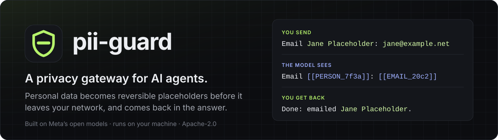
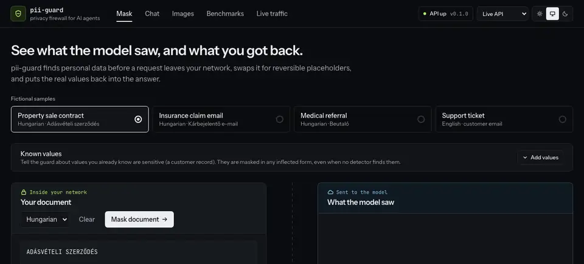
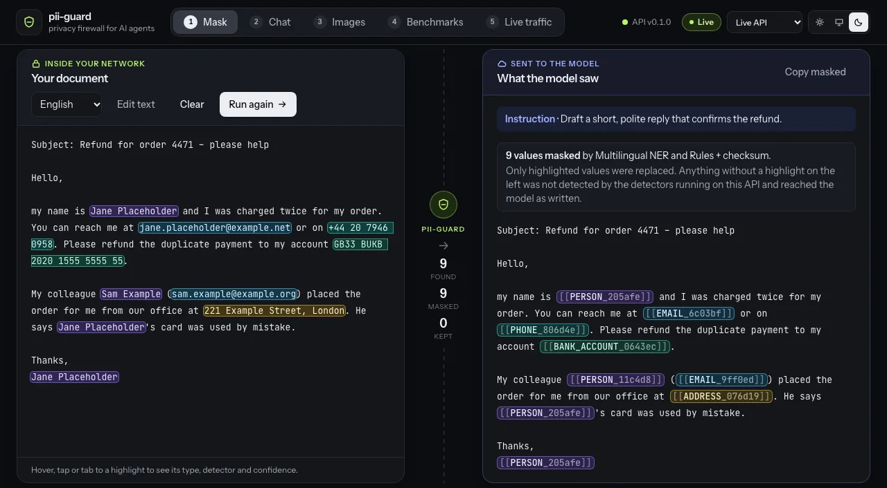
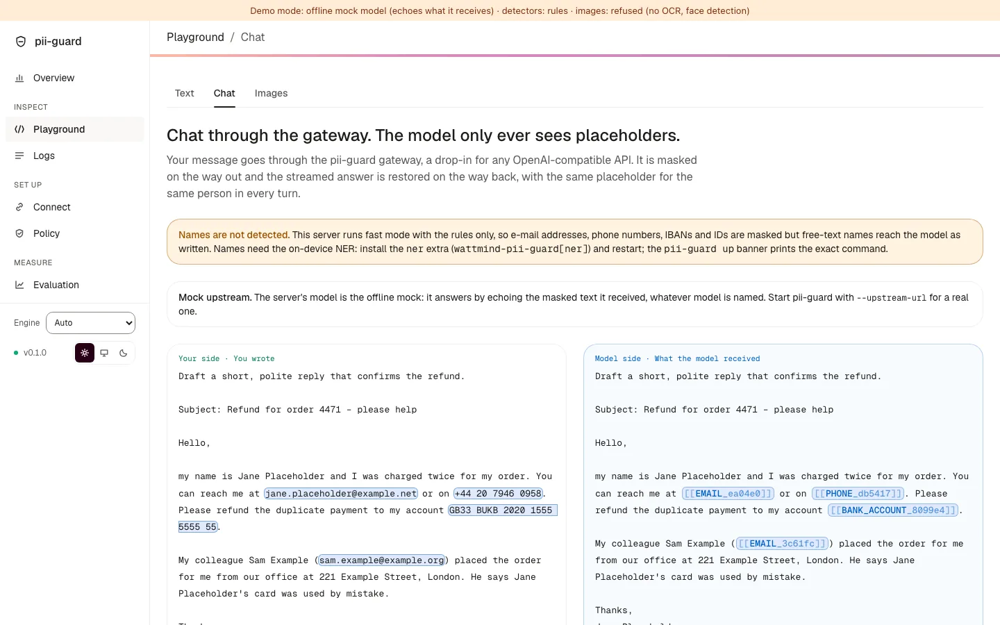
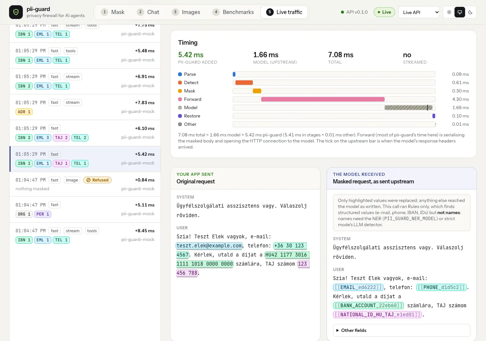
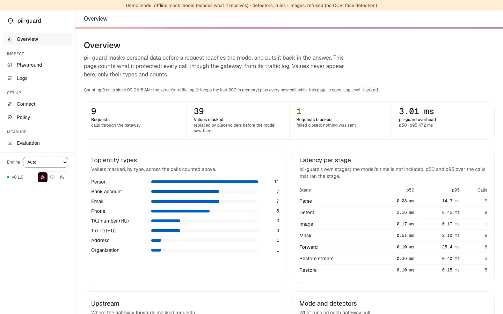
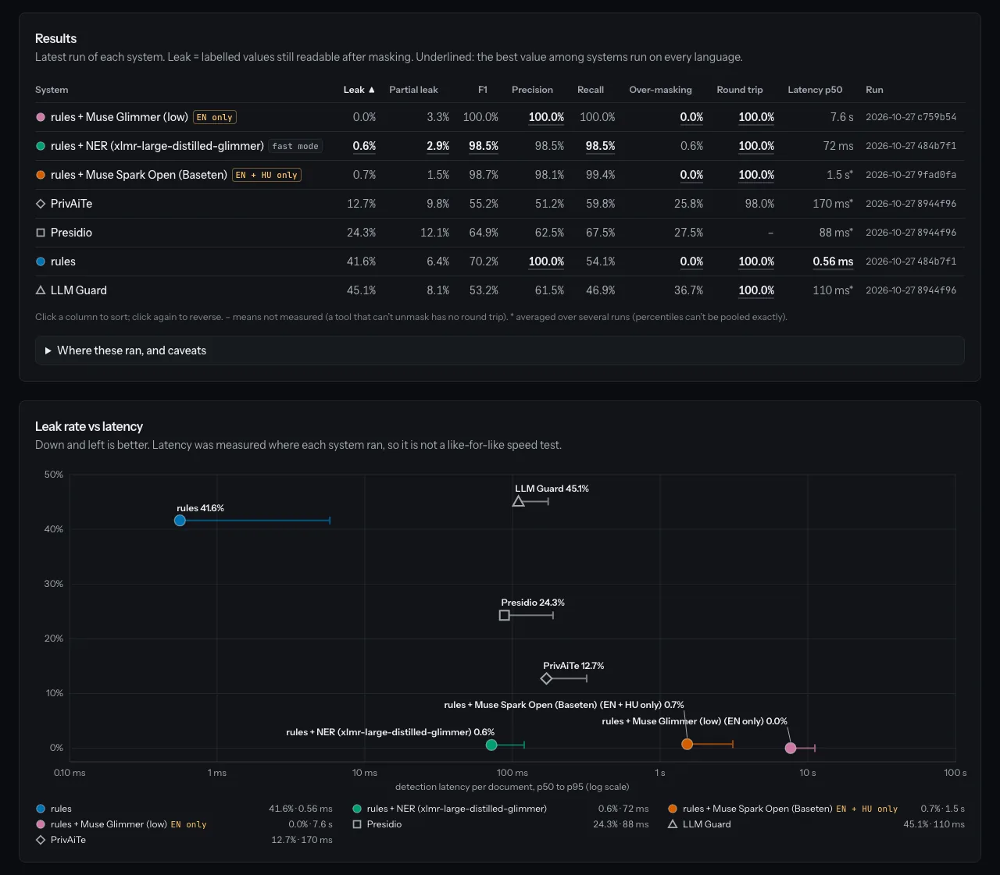

<p align="center">
  
</p>

<p align="center"><b>Mask personal data before it reaches the LLM, and put it back in the answer. Built on Meta's open models; runs on your machine.</b></p>

<p align="center">
  <a href="https://guard.watt-mind.com"></a>
  <a href="https://github.com/watt-mind/pii-guard/actions/workflows/ci.yml"></a>
  <a href="https://huggingface.co/watt-mind/pii-guard-ner-xlmr-base"></a>
  <a href="LICENSE"></a>
  <a href="pyproject.toml"></a>
  <a href="docs/decisions/0005-synthetic-data-only.md"></a>
</p>

**For teams building AI agents in Europe's regulated professions** (legal, health, finance, HR,
public sector). Their useful data is personal data: a case file, a referral letter, an HR
folder. Under GDPR, sending it to a third-party model is a legal risk; not sending it means the
agent can't do the job. PII Guard is a drop-in proxy in between: change one base URL, and every
name, address, ID and face is swapped for a reversible placeholder before the request leaves
your network, then restored in the answer, even mid-stream and inside tool calls.

**Try it live: https://guard.watt-mind.com**. Run the guest demo with no sign-up and no key, or sign in with Google for your own gateway endpoint. Use fictional data only; it is a hackathon demo with a capped sponsored allowance.

**Why it matters in the EU.** The GDPR requires data minimization (Art. 5) and lists
pseudonymization among example by-design and security measures (Art. 25, 32). Placeholders
reduce the personal data that reaches a model provider outside the EU, though they don't by
themselves settle Chapter V transfer obligations. Pseudonymized data stay personal data for
whoever holds the mapping: a technical measure, not a compliance certificate. Sources, the 2025
CJEU ruling, DORA and the AI Act: [docs/eu-regulation.md](docs/eu-regulation.md).

**Try it offline** (no key; needs [uv](https://docs.astral.sh/uv/) and
[pnpm](https://pnpm.io/)): `git clone https://github.com/watt-mind/pii-guard.git && cd pii-guard && make demo`,
then open http://localhost:5173. Once the package is on PyPI (it is not yet), one command
will do it without a clone: `uvx --from wattmind-pii-guard pii-guard up`.
[More ways to run it](#try-it).

<p align="center">
  
</p>

<p align="center"><sub>Recorded from <code>pii-guard up</code> in fast mode (rules only, no NER, so free-text names pass); the offline mock upstream echoes the masked text back (with a key, the same flow runs on Muse Spark). <b>▶ Video walkthrough:</b> <i>link coming with the submission</i><!-- LAB-1123: video link --></sub></p>

## Meta's large models teach, Meta's small open model runs

| Job | Meta model | Evidence |
|---|---|---|
| **Runs in production (fast mode):** finds names, addresses and dates in process; no API call, nothing leaves the machine | **XLM-RoBERTa base** (FacebookAI, open weights, MIT), fine-tuned on Muse Glimmer's labels, Ai4Privacy OpenPII train rows and hard negatives; published as [`watt-mind/pii-guard-ner-xlmr-base`](https://huggingface.co/watt-mind/pii-guard-ner-xlmr-base) `v2.0`. 18 ms p50 per document on the hand-written set (Apple MPS), 47 ms NER-only on a loaded M1 CPU | [model card](training/ner/model-card.md), [latency](eval/results/2026-10-27-ner-v21/latency/xlmr-base-v2-hn.json), [training](docs/models.md#ner-v2-wider-labels-openpii-train-split-hard-negatives), [selection](eval/results/2026-10-27-ner-v21/README.md) |
| **Teaches it, and audits:** labels 4,964 fictional documents for distillation; the optional audit mode and upper bound | **Muse Glimmer 30B** (open weights, Apache-2.0); **Muse Spark Open** (open weights) on Baseten partner inference | [Glimmer run](eval/results/runs/2026-10-27-glimmer-zero-shot-rules-llm-low.json), [audit runs](docs/benchmarks.md#smoke) |
| **Sees images:** faces, ID photos and signatures, filled before the image leaves | **SAM 3.1** (Meta Model API) for signatures; faces and ID photos on-device (YuNet); OCR for printed text | [specimen results](eval/results/visual/specimens.md) |

**Muse** (Wonder, Spark 1.3) also writes the fictional benchmark ([models](docs/models.md#which-model-does-what)),
**Muse Spark Open** red-teams the masking ([red team](eval/results/2026-10-27-redteam/README.md)), and
**Muse Spark 1.3** is the demo's downstream model, which only ever sees placeholders.
We also fine-tuned **Muse Glimmer** itself as an answer-only detector (LoRA): 2.2x faster than
zero-shot Glimmer but leakier (1.0 % vs 0.4 % of agent-traffic values with the rules in front),
so the small NER stays the product ([results](eval/results/2026-10-28-glimmer-lora/README.md)).

The rule behind it: anything that sees real personal data is an open-weight model you can run
yourself; hosted models only see fictional or already-masked text. All jobs, with status:
[docs/why-pii-guard.md](docs/why-pii-guard.md#3-built-on-metas-models-end-to-end).

## Results

Leak = labelled personal values still readable in what the model receives (lower is safer).
Fast mode is the published NER `v2.0` (`NER v2 base + hard negatives` in the reports). Copied
from the generated [docs/benchmarks.md](docs/benchmarks.md): the hand-written set from
[results by fixture set](docs/benchmarks.md#smoke), the public and agent-traffic test splits
(none of them trained on) from [results per dataset](docs/benchmarks.md#results-per-dataset),
with 95 % intervals there.

| Leak | Hand-written (de+en+hu, 51 docs) | Agent traffic (990) | Nemotron-PII (300) | CEE-PII (451) | Gretel finance (400) | Ai4Privacy (600) |
|---|---:|---:|---:|---:|---:|---:|
| **PII Guard fast** (rules + NER, on-device, $0) | **0.0 %** | **0.2 %** | **0.7 %** | **0.4 %** | 19.0 % | 0.4 % † |
| PrivAiTe | 12.7 % | 2.4 % | 4.0 % | 4.4 % | 27.7 % | 9.5 % |
| Presidio | 24.3 % | 12.4 % | 12.8 % | 36.5 % | **18.8 %** | 29.6 % |
| LLM Guard | 45.1 % | 20.2 % | 28.8 % | 75.8 % | 59.3 % | 43.8 % ‡ |
| PII Guard rules only (no name detection) | 41.6 % | 45.3 % | 56.0 % | 41.3 % | 80.8 % | 62.9 % |

† **In-distribution:** the NER was trained on other rows of the same dataset (the OpenPII
train split; no evaluated row was trained on). The same recipe trained without those rows
leaks **13.8 %** ([ablation](docs/benchmarks.md#ai4privacy)), so on unseen text in that style
**PrivAiTe leaks less than fast mode** (9.5 %). ‡ LLM Guard's model was fine-tuned on
Ai4Privacy data too ([configurations](eval/results/2026-10-27-comparison/README.md#systems)).

- **Where fast mode is weak:** finance text (19.0 %, level with Presidio's 18.8 %), and over-masking:
  1.1 % on the hand-written set and 1.7 % on agent traffic, but 26.4 % on CEE-PII, where
  reference numbers without a cue word come out as IDs
  ([model card](training/ner/model-card.md#limitations)).
- **Audit mode** (opt-in: rules + NER + Muse Spark Open, one hosted Baseten call per message,
  fails closed when the call fails): 0.6 % on the hand-written set at 1.9 s p50. It is the
  upper bound and the teacher, not the production path.
- **Detection p50** on the hand-written set: fast 18 ms, Presidio 88 ms, LLM Guard 110 ms,
  PrivAiTe 170 ms, averaged over runs on a loaded laptop: compare loosely.
- **Caveats:** the sets are small (tens to hundreds of documents per language); headline sets
  are hand-written or public because Muse-generated fixtures flatter Muse-based detection.
  Run records: fast on the hand-written set
  ([de](eval/results/runs/2026-10-27-ner-v21-de-smoke-xlmr-base-v2-hn.json) ·
  [en](eval/results/runs/2026-10-27-ner-v21-en-smoke-xlmr-base-v2-hn.json) ·
  [hu](eval/results/runs/2026-10-27-ner-v21-hu-smoke-xlmr-base-v2-hn.json)), per-dataset
  counts in [eval/datasets/results/](eval/datasets/results/), everything else in the
  [run log](docs/benchmarks.md#run-log).

## Built for agents: tool calls and streaming

The gateway speaks the OpenAI chat API, so an agent framework only changes its base URL. It
masks every message, **tool definitions, tool-call arguments and tool results**, restores
placeholders in streamed answers chunk by chunk (also when one is split across chunks), keeps
the same placeholder for the same person across a whole session, masks inline images, and
fails closed on anything it can't mask ([field table](docs/contracts.md#gateway-request-fields-implemented)).
Clients that can't send a session header still get one sticky session: from the URL path
that `pii-guard connect` writes, the `prompt_cache_key`, or one per client key
([sessions](docs/architecture-gateway.md#sessions)).

```python
from openai import OpenAI

client = OpenAI(base_url="http://127.0.0.1:8787/v1", api_key="unused")
stream = client.chat.completions.create(
    model="muse-spark-1.3",
    stream=True,
    tools=my_tools,  # your agent's tools, unchanged
    messages=[
        {"role": "user", "content": "Refund Jane Placeholder, jane.placeholder@example.net."}
    ],
    extra_headers={"X-PII-Guard-Mode": "fast"},
)  # the model sees [[PERSON_…]] and [[EMAIL_…]]; your code gets the real values back
```

It also serves the Responses API, so coding agents run behind it: with **Muse Code 1.4.14**
on the Meta Model API, 0 of 16 fictional values reached the upstream and no request was
refused ([LAB-1299](docs/journey/2026-10-27-lab-1299-muse-1-4-14.md),
[guide](docs/integrations/muse-code.md)). Sessions, headers, modes and settings:
[docs/architecture-gateway.md](docs/architecture-gateway.md).

## Why PII Guard

- **Reversible, not redacted.** The answer names the real person, and every document in the
  hand-written set unmasks back to its original exactly.
- **Grammar-aware.** In languages like Hungarian a name changes with every case; the ending
  stays outside the placeholder, so the model still writes grammatical text:

  | | Hungarian (real output) | English gloss |
  |---|---|---|
  | You send | Kérem, írjon Próba Zsuzsannának a zsuzsa.proba@example.com címre. | Please write *to Zsuzsanna Próba* at … |
  | The model sees | Kérem, írjon [[PERSON_968e29]]nak a [[EMAIL_e7038b]] címre. | … *to [[PERSON]]* … |
  | You get back | Megírtam a levelet Próba Zsuzsannának. | I wrote *to Zsuzsanna Próba*. |

  Inflected-name leaks went [18/30 → 0/30](docs/journey.md#10-hungarian-inflection-in-the-vault-2026-10-26-2333).
- **Language packs.** Hungarian, English, German and Polish (`hu`, `en`, `de`, `pl`) each ship
  validated identifier rules, cue words and case handling; a new language is one package
  ([docs/languages.md](docs/languages.md)).
- **Measured in the open.** Every number is a committed [run record](eval/results/runs/); the
  report is regenerated and checked in CI; all data is fictional.

All 13 differentiators, with evidence and status: **[docs/why-pii-guard.md](docs/why-pii-guard.md)**.

## What you can see in the demo

The console has six sections: **Overview**, **Playground** (Text, Chat, Images), **Logs**,
**Connect**, **Policy** and **Evaluation** ([ui/README.md](ui/README.md#screens)). These
screenshots were taken in fast mode without the NER, so free-text names stay readable in them.

| **Text:** every value found, and what the model saw | **Gateway:** a chat, masked out and restored back |
|---|---|
| [](docs/assets/demo/1-mask.webp) | [](docs/assets/demo/2-chat.webp) |
| **Images:** face, photo, signature and printed values covered | **Logs:** every call, its masks and its timing |
| [](docs/assets/demo/3-images.webp) | [](docs/assets/demo/6-traffic.webp) |
| **Overview:** what the guard protected, from real calls only | **Evaluation:** leak against latency, from the run records |
| [](docs/assets/demo/7-traffic-charts.webp) | [](docs/assets/demo/4-benchmarks.webp) |

At phone width: [Text](docs/assets/demo/5-mask-mobile.webp) ·
[Logs](docs/assets/demo/8-traffic-mobile.webp). Connect: [copyable commands per client](docs/assets/demo/9-connect.webp). The screens: [ui/README.md](ui/README.md#screens).

## Try it

**Once the package is published** (there is no PyPI package or GitHub release yet), one
command, with no clone, Node or Docker, only [uv](https://docs.astral.sh/uv/), starts the
API, the OpenAI-compatible gateway and the web UI with the live dashboard on
http://localhost:8787, with an offline mock upstream unless you pass `--upstream-url`:

```bash
uvx --from wattmind-pii-guard pii-guard up           # rules only
uvx --from 'wattmind-pii-guard[ner]' pii-guard up    # fast mode with the NER (about 1.1 GB, downloaded once)
```

Today, from source, `uvx --from git+https://github.com/watt-mind/pii-guard pii-guard up` runs
the API and gateway without the UI. To put an agent behind it, run `pii-guard connect pi`
with the same `uvx --from` prefix ([operations.md](docs/operations.md#one-command-pii-guard-up)).

From a checkout:

```bash
make demo           # API + gateway + UI on a mock upstream, fast mode (rules + NER): http://localhost:5173
make demo-traffic   # second terminal: fictional calls (with tools and streaming) through the gateway
make smoke-fast     # the same as a pass/fail check, with the NER
make smoke          # rules only, offline (CI runs it)
```

`make demo` runs **fast mode with the NER** from a clean checkout: it installs the `ner` extra
and, without `PII_GUARD_NER_MODEL`, downloads a NER model once (about 1.1 GB, pinned
revision, SHA-256 checked, into `~/.cache/pii-guard/models`; the banner says which model
runs): PII Guard's own NER, [`watt-mind/pii-guard-ner-xlmr-base`](https://huggingface.co/watt-mind/pii-guard-ner-xlmr-base)
`v2.0` (XLM-R base, Apache-2.0; [model card](training/ner/model-card.md)). Free-text names are then masked with no known values, in the gateway and on the Mask and
Images screens alike. `make demo MODE=rules` is rules only: offline, no download, names need
known values. Which model and why: [models.md](docs/models.md#which-ner-model-fast-mode-runs).
A set `PII_GUARD_NER_MODEL` without the extra stops startup instead of quietly running rules
only. Docker: `docker compose --profile demo up --build` (the demo image is 1.9 GB on arm64
with CPU-only torch; [operations.md](docs/operations.md#docker)). More:
[docs/operations.md](docs/operations.md).

## How it works

```
 your app / agent ──► pii-guard ──────────────────────────────► LLM provider
                      │ 1. extract text, tool calls, image regions    │
                      │ 2. detect (rules → NER → optional audit LLM)  │
                      │ 3. apply policies, pseudonymize (keyed)       │
                      │ 4. mask image regions (SAM 3.1 + OCR)         │
                      │◄──────────────── response (streamed) ─────────┘
                      │ 5. restore placeholders, chunk by chunk
 your app / agent ◄───┘
```

The mapping between real values and placeholders **never leaves PII Guard**. Design and
engineering choices: [docs/architecture.md](docs/architecture.md); threat model:
[docs/privacy-model.md](docs/privacy-model.md); everything else: [docs/INDEX.md](docs/INDEX.md).

> **Status: hackathon build** for the Meta Global AI Developer Hackathon (October 26 –
> November 4, 2026). It works end to end; it is not production-hardened yet. What is missing:
> [docs/why-pii-guard.md](docs/why-pii-guard.md#what-is-not-here-yet), [docs/roadmap.md](docs/roadmap.md).

## Contributing, security, license

See [CONTRIBUTING.md](CONTRIBUTING.md); the rule that matters most: **never commit real
personal data**, not even in a test. **No authentication by default:** keep PII Guard on
loopback or behind an authenticating proxy, or set `PII_GUARD_API_TOKEN`
([operations.md](docs/operations.md#exposure-and-authentication)). Found a way to make personal
data leak past the guard? Report it privately: [SECURITY.md](SECURITY.md).
Licensed [Apache-2.0](LICENSE).
