<!-- Generated by `pii-guard eval report` from eval/results/runs/; do not edit. -->

# Benchmarks

Every evaluation run of pii-guard and of the open-source tools it is compared with, on fictional data only. Each run is one JSON record in [`eval/results/runs/`](../eval/results/runs/) (format: [evaluation.md](evaluation.md#run-records)); this page, the charts and the index (`eval/results/index.json`, written locally) are generated from them. The same data is browsable in the UI's **Benchmarks** tab.

Headline fixture set: **smoke** (hand-written; documents: de 10 + en 10 + hu 31 + pl 11). Default pipeline in **bold**.

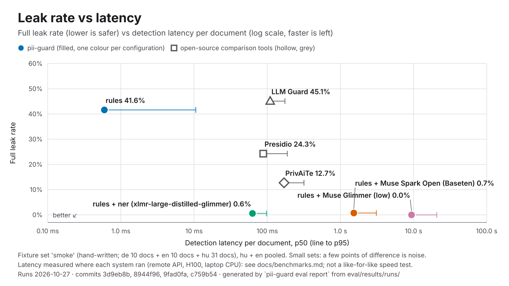

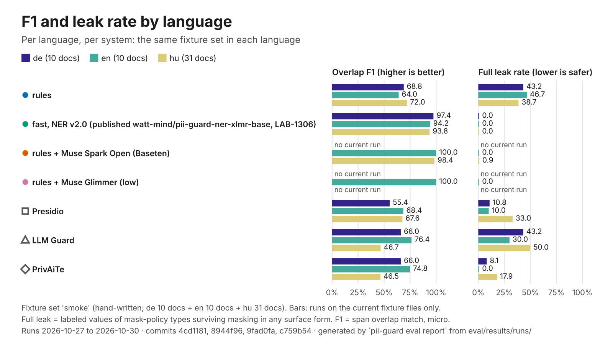

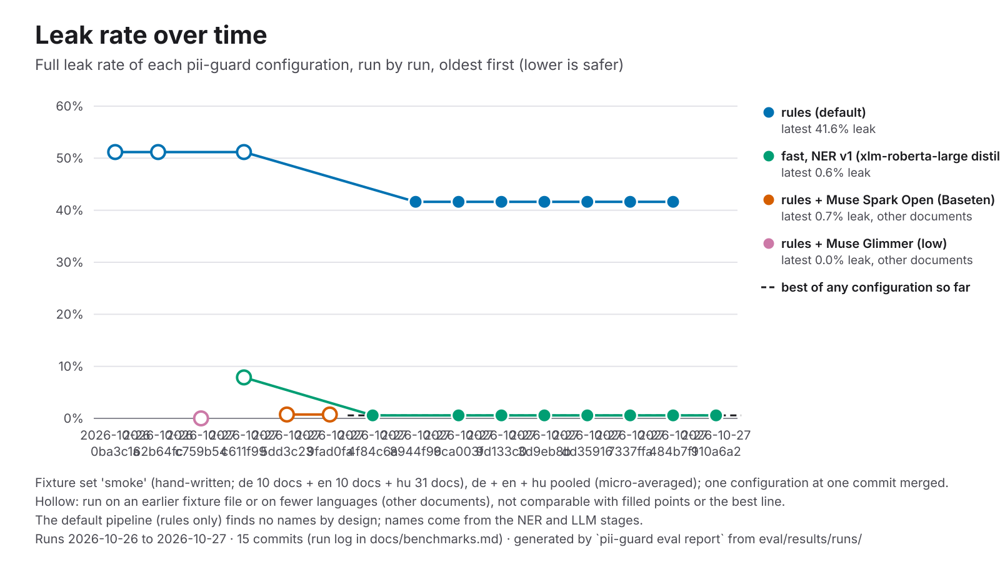

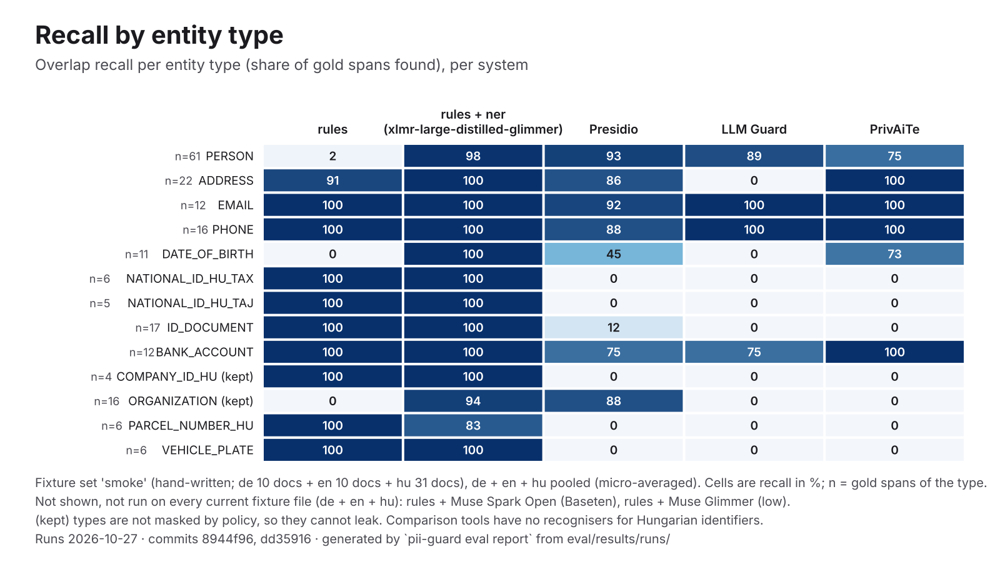

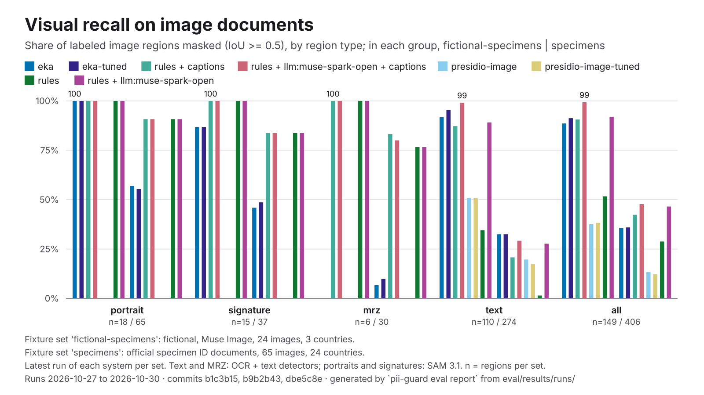

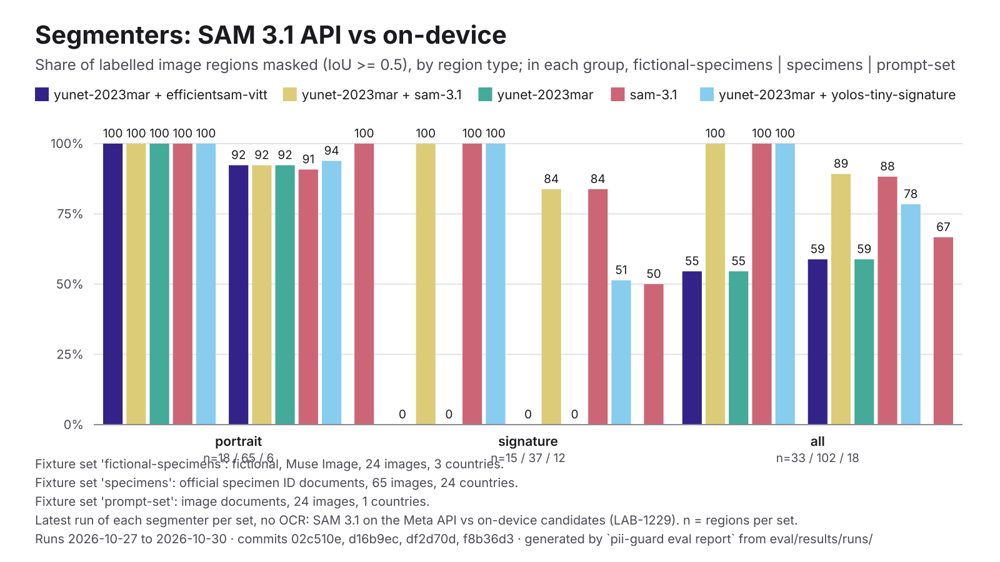

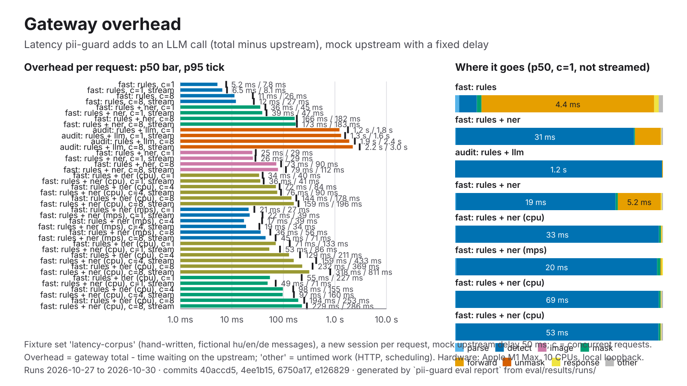

## How to read this

- **Leak rate** is the share of labeled values that still appear, in any surface form, in
  the text the model would receive after masking (case- and whitespace-insensitive, through
  the language's inflected forms, structured identifiers by their letters and digits with any
  separators). Lower is safer; it is the number that matters most. **Partial leak** counts
  values not leaked whole but with an identifying token left (the street of an address whose
  postcode alone was masked). Details: [evaluation.md](evaluation.md#leak-rate-in-practice).
- **Precision, recall, F1** are span-level with overlap matching (a prediction counts if it
  overlaps a gold span of the same type); the run records also keep exact-match numbers.
  **Over-masking** is the share of masked spans that overlap no gold span of any type (spans,
  not characters). A prediction on text the set labels but pii-guard's policy doesn't score
  (Ai4Privacy's dates, titles and bare towns) is left out of precision and over-masking.
  **Round trip** is the share of documents that unmask back to the original text exactly
  (comparison tools that can't unmask show —).
- **Hand-written vs generated sets.** `smoke` is written by hand with inline labels and has
  adversarial look-alikes; `synth-*` sets are written by a Meta Muse model around fictional
  identities and labeled automatically. **Muse-generated sets flatter Muse-based detectors**: the
  same model family wrote the text and reads it, so its phrasing and its idea of what an
  entity is match. Converted third-party (`public`) sets carry no such advantage.
  The headline charts use the hand-written set for that reason.
- **Small sets.** The sets have tens of documents per language: differences of a few points
  are noise. Every number below says which set, which run date and which commit it came from.
- **Latency** is detection time per document (p50) on the hardware in the run log; it is not
  comparable across machines. `*` marks a value averaged over several runs (percentiles
  can't be pooled exactly).
- **Pooling.** Every count-based metric is pooled exactly over languages by summing counts,
  so `all` is **micro-averaged**: each span or value weighs the same, and a language with
  more documents weighs more. Only runs on the current version of each fixture file are
  pooled or charted; results on an earlier version are listed separately under their set.
- `rules` is the rules-only pass with no name detection; names and addresses come from the
  NER and LLM passes. Compare it with the other tools on structured identifiers.

## Results by fixture set

Latest run of each system on each set, on the current version of each fixture file; `all` pools the languages (micro-averaged).

### `smoke`

hand-written; documents: de 10 + en 10 + hu 31 + pl 11.

| System | Docs | Precision | Recall | F1 | Leak | Partial leak | Over-masking | Round trip | Detect p50 | Run | Commit |
|---|---:|---:|---:|---:|---:|---:|---:|---:|---:|---|---|
| **pii-guard rules** | 62 | 99.2% | 54.4% | 70.2% | 40.7% | 6.5% | 0.0% | 100.0% | 0.46 ms* | 2026-10-30 | `18edc24`, `252b680` |
| pii-guard fast, NER v4.2 (published, LAB-1625) | 62 | 95.5% | 96.3% | 95.9% | 0.0% | 1.4% | 1.3% | 100.0% | 37 ms* | 2026-10-30 | `357175c`, `40accd5` |
| pii-guard rules + Muse Spark Open (Baseten) † | 10 | 100.0% | 100.0% | 100.0% | 0.0% | 3.3% | 0.0% | 100.0% | 1.2 s | 2026-10-27 | `9fad0fa` |
| pii-guard rules + Muse Glimmer (low) † | 10 | 100.0% | 100.0% | 100.0% | 0.0% | 3.3% | 0.0% | 100.0% | 7.6 s | 2026-10-27 | `c759b54` |
| pii-guard Muse Glimmer (low) † | 10 | 97.1% | 97.1% | 97.1% | 0.0% | 3.3% | 0.0% | 100.0% | 7.7 s | 2026-10-27 | `c759b54` |
| pii-guard Muse Glimmer (medium) † | 10 | 84.6% | 97.1% | 90.4% | 0.0% | 3.3% | 11.8% | 100.0% | 13.1 s | 2026-10-27 | `c759b54` |
| bardsai/eu-pii-anonimization-multilang-v3 alone (comparison) | 62 | 89.8% | 69.7% | 78.5% | 22.2% | 5.1% | 1.7% | 100.0% | 109 ms* | 2026-10-30 | `18edc24`, `252b680` |
| tabularisai/eu-pii-safeguard alone (comparison, LAB-1386) † | 10 | 68.6% | 70.6% | 69.6% | 10.0% | 30.0% | 3.1% | 90.0% | 107 ms | 2026-10-28 | `36a78e3` |
| tabularisai/eu-pii-safeguard alone (comparison) | 62 | 80.7% | 73.4% | 76.9% | 14.3% | 16.7% | 3.9% | 96.8% | 194 ms* | 2026-10-30 | `18edc24`, `252b680` |
| Horizon-Labs/pii-redactor-base alone (comparison) | 62 | 84.7% | 65.1% | 73.7% | 20.8% | 10.7% | 5.3% | 98.4% | 119 ms* | 2026-10-30 | `18edc24`, `252b680` |
| Horizon-Labs/pii-redactor-small alone (comparison) | 62 | 82.5% | 68.5% | 74.8% | 16.2% | 8.3% | 5.4% | 100.0% | 55 ms* | 2026-10-30 | `18edc24`, `252b680` |
| pii-guard NER v4.2 (B3) alone (no rules) (LAB-1625) | 62 | 94.2% | 92.5% | 93.3% | 3.2% | 2.8% | 1.4% | 100.0% | 40 ms* | 2026-10-30 | `40accd5` |
| Wismut/nym-pii-multilingual alone (comparison) | 62 | 85.2% | 81.7% | 83.5% | 9.3% | 2.3% | 5.1% | 100.0% | 103 ms* | 2026-10-30 | `18edc24`, `252b680` |
| pii-guard NER v2.0 alone (no rules) | 62 | 91.7% | 88.0% | 89.8% | 3.7% | 6.5% | 0.9% | 100.0% | 39 ms* | 2026-10-30 | `40accd5` |
| pii-guard rules + Muse Spark 1.3 † | 10 | 94.4% | 100.0% | 97.1% | 0.0% | 3.3% | 3.2% | 100.0% | 7.0 s | 2026-10-26 | `62b64fc` |
| rules + the public fallback bardsai/eu-pii-anonimization-multilang v1 (reference) | 62 | 90.1% | 98.3% | 94.1% | 0.9% | 2.8% | 8.8% | 100.0% | 71 ms* | 2026-10-30 | `18edc24`, `252b680` |
| rules + bardsai/eu-pii-anonimization-multilang-v3 in place of pii-guard NER (comparison) | 62 | 95.4% | 85.5% | 90.1% | 10.7% | 6.0% | 1.5% | 100.0% | 103 ms* | 2026-10-30 | `18edc24`, `252b680` |
| pii-guard fast, public fallback NER (bardsai/eu-pii-anonimization-multilang) † | 10 | 79.1% | 100.0% | 88.3% | 0.0% | 3.3% | 23.1% | 100.0% | 24 ms | 2026-10-27 | `e126829` |
| rules + tabularisai/eu-pii-safeguard in place of pii-guard NER (comparison, LAB-1386) † | 10 | 97.0% | 94.1% | 95.5% | 3.3% | 20.0% | 3.3% | 100.0% | 104 ms | 2026-10-28 | `36a78e3` |
| rules + tabularisai/eu-pii-safeguard in place of pii-guard NER (comparison) | 62 | 93.5% | 90.0% | 91.8% | 6.5% | 8.8% | 3.8% | 100.0% | 200 ms* | 2026-10-30 | `18edc24`, `252b680` |
| rules + Horizon-Labs/pii-redactor-base in place of pii-guard NER (comparison) | 62 | 92.2% | 78.4% | 84.8% | 12.5% | 9.3% | 4.9% | 100.0% | 112 ms* | 2026-10-30 | `18edc24`, `252b680` |
| rules + Horizon-Labs/pii-redactor-small in place of pii-guard NER (comparison) | 62 | 90.6% | 79.7% | 84.8% | 11.1% | 3.7% | 5.7% | 100.0% | 53 ms* | 2026-10-30 | `18edc24`, `252b680` |
| pii-guard fast, NER v3 candidate: mmBERT-base on the v3 mix (LAB-1393) † | 10 | 93.5% | 85.3% | 89.2% | 6.7% | 3.3% | 6.7% | 100.0% | 49 ms | 2026-10-28 | `da9883e` |
| pii-guard fast, NER v3 candidate: XLM-R base on the v3 mix (LAB-1393) † | 10 | 94.3% | 97.1% | 95.7% | 0.0% | 3.3% | 6.2% | 100.0% | 31 ms | 2026-10-28 | `da9883e` |
| pii-guard fast, NER v3.1 candidate A: v3 mix minus agent-traffic (LAB-1410) † | 10 | 97.0% | 91.2% | 94.0% | 6.7% | 6.7% | 3.3% | 100.0% | 35 ms | 2026-10-28 | `72026a5` |
| pii-guard fast, NER v3.1 candidate B: A + hu/s11 gold, Privy halved (LAB-1410) † | 10 | 97.1% | 97.1% | 97.1% | 0.0% | 3.3% | 3.2% | 100.0% | 34 ms | 2026-10-28 | `72026a5` |
| pii-guard fast, NER v3.1 candidate C: B without Wismut (LAB-1410) † | 10 | 94.1% | 94.1% | 94.1% | 0.0% | 3.3% | 3.1% | 100.0% | 35 ms | 2026-10-28 | `72026a5` |
| pii-guard fast, NER v3.2 soup S30: 0.7 v2.0 + 0.3 v3.1-B (LAB-1494) † | 10 | 94.1% | 94.1% | 94.1% | 0.0% | 0.0% | 3.1% | 100.0% | 107 ms | 2026-10-29 | `2b3c7ba` |
| pii-guard fast, NER v3.2 soup S50: 0.5 v2.0 + 0.5 v3.1-B (LAB-1494) † | 10 | 97.1% | 97.1% | 97.1% | 0.0% | 3.3% | 3.1% | 100.0% | 75 ms | 2026-10-29 | `2b3c7ba` |
| pii-guard fast, NER v3.2 soup S70: 0.3 v2.0 + 0.7 v3.1-B (LAB-1494) † | 10 | 97.1% | 97.1% | 97.1% | 0.0% | 3.3% | 3.1% | 100.0% | 64 ms | 2026-10-29 | `2b3c7ba` |
| pii-guard fast, NER v3.3 candidate T1: S30 + targeted add-on, 1 epoch (LAB-1512) † | 10 | 97.1% | 97.1% | 97.1% | 0.0% | 6.7% | 3.2% | 100.0% | 140 ms | 2026-10-29 | `d22908a` |
| pii-guard fast, NER v3.3 candidate T2: S30 + targeted add-on, 2 epochs (LAB-1512) † | 10 | 97.1% | 97.1% | 97.1% | 0.0% | 3.3% | 3.2% | 100.0% | 67 ms | 2026-10-29 | `d22908a` |
| pii-guard fast, NER v4 candidate A: v2.0 + EU phase-1 data, 1 epoch (LAB-1535) † | 10 | 94.1% | 91.2% | 92.6% | 0.0% | 3.3% | 3.0% | 100.0% | 32 ms | 2026-10-29 | `51fdc76` |
| pii-guard fast, NER v4 candidate B: 0.5 v2.0 + 0.5 B-raw soup (LAB-1535) † | 10 | 94.1% | 91.2% | 92.6% | 0.0% | 0.0% | 3.0% | 100.0% | 48 ms | 2026-10-29 | `51fdc76` |
| pii-guard fast, NER v4 candidate B-raw: v2.0 + EU data, 2 epochs (LAB-1535) † | 10 | 96.9% | 88.2% | 92.3% | 0.0% | 0.0% | 3.1% | 100.0% | 32 ms | 2026-10-29 | `51fdc76` |
| pii-guard fast, NER v4.1 candidate A1: v4-A recipe + v4.1 data, loose ADDRESS kept out of the loss (LAB-1547) † | 10 | 94.6% | 97.1% | 95.8% | 0.0% | 3.3% | 5.9% | 100.0% | 33 ms | 2026-10-30 | `251926c` |
| pii-guard fast, NER v4.1 candidate A2: v4-A recipe + v4.1 data, loose ADDRESS taught as O (LAB-1547) † | 10 | 97.0% | 94.1% | 95.5% | 3.3% | 3.3% | 3.3% | 100.0% | 33 ms | 2026-10-30 | `251926c` |
| pii-guard fast, NER v4.2 candidate B1: v4.1-A1 mix, implausible third-party birth dates taught as O, v4.2 targeted data (LAB-1625) † | 51 | 94.5% | 95.9% | 95.2% | 0.0% | 1.2% | 1.6% | 100.0% | 57 ms | 2026-10-30 | `357175c` |
| pii-guard fast, NER v4.2 candidate B2: v4.1-A1 mix, uncued third-party birth dates out of the loss, v4.2 targeted data (LAB-1625) † | 51 | 94.5% | 96.4% | 95.4% | 0.0% | 1.2% | 2.2% | 100.0% | 34 ms | 2026-10-30 | `357175c` |
| pii-guard fast, NER v4.2 B3 with dev-calibrated thresholds, post-hoc, not a protocol candidate (LAB-1625) † | 51 | 95.9% | 94.8% | 95.3% | 0.6% | 2.3% | 0.6% | 100.0% | 35 ms | 2026-10-30 | `357175c` |
| pii-guard fast, NER v4.2 candidate B4: soup 0.5 v2.0 + 0.5 B1 (LAB-1625) † | 51 | 94.9% | 95.4% | 95.1% | 0.0% | 2.3% | 1.1% | 100.0% | 34 ms | 2026-10-30 | `357175c` |
| rules + Wismut/nym-pii-multilingual in place of pii-guard NER (comparison) | 62 | 91.1% | 92.5% | 91.8% | 2.8% | 1.4% | 4.9% | 100.0% | 109 ms* | 2026-10-30 | `18edc24`, `252b680` |
| pii-guard fast, built-in zero-shot NER (Davlan/xlm-roberta-base-ner-hrl) † | 10 | 90.2% | 91.2% | 90.7% | 10.0% | 13.3% | 10.8% | 100.0% | 17 ms | 2026-10-27 | `910a6a2` |
| pii-guard rules + NER (distilled base) † | 10 | 100.0% | 97.1% | 98.5% | 3.3% | 3.3% | 0.0% | 100.0% | 35 ms | 2026-10-27 | `c611f99` |
| pii-guard rules + NER (fine-tuned) † | 10 | 80.0% | 94.1% | 86.5% | 3.3% | 6.7% | 16.2% | 100.0% | 14 ms | 2026-10-26 | `0ba3c1a` |
| pii-guard fast, NER v2 base (xlm-roberta-base, LAB-1150) † | 10 | 86.5% | 91.2% | 88.8% | 0.0% | 0.0% | 8.3% | 100.0% | 17 ms | 2026-10-27 | `910a6a2` |
| pii-guard fast, NER v2.0 (published watt-mind/pii-guard-ner-xlmr-base, LAB-1306) | 62 | 96.2% | 94.6% | 95.4% | 0.0% | 1.8% | 0.9% | 100.0% | 23 ms* | 2026-10-30 | `18edc24`, `252b680` |
| pii-guard audit (rules + NER v2.0 + Muse Spark Open, Baseten) † | 51 | 95.0% | 97.4% | 96.2% | 0.0% | 0.0% | 1.1% | 100.0% | 1.6 s | 2026-10-30 | `18edc24` |
| pii-guard fast, NER v2 base + hard negatives, union with GLiNER (LAB-1150) † | 10 | 91.7% | 97.1% | 94.3% | 0.0% | 0.0% | 6.1% | 100.0% | 69 ms | 2026-10-27 | `910a6a2` |
| pii-guard fast, NER v2.0 (selection-only re-score, LAB-1494) † | 10 | 94.3% | 94.1% | 94.2% | 0.0% | 0.0% | 3.0% | 100.0% | 69 ms | 2026-10-29 | `2b3c7ba` |
| pii-guard fast, NER v2.0 (selection-only re-score, LAB-1512) † | 10 | 94.3% | 94.1% | 94.2% | 0.0% | 0.0% | 3.0% | 100.0% | 41 ms | 2026-10-29 | `d22908a` |
| pii-guard fast, NER v2.0 (selection-only re-score, LAB-1535) † | 10 | 94.3% | 94.1% | 94.2% | 0.0% | 0.0% | 3.0% | 100.0% | 42 ms | 2026-10-29 | `51fdc76` |
| pii-guard fast, NER v2.0 (selection-only re-score, LAB-1547) † | 10 | 94.3% | 94.1% | 94.2% | 0.0% | 0.0% | 3.0% | 100.0% | 35 ms | 2026-10-30 | `251926c` |
| pii-guard fast, NER v2.0 (selection-only re-score, LAB-1625) | 62 | 96.2% | 94.6% | 95.4% | 0.0% | 1.8% | 0.9% | 100.0% | 41 ms* | 2026-10-30 | `357175c`, `40accd5` |
| pii-guard fast, NER v2.0 with dev-calibrated thresholds, candidate H (LAB-1512) † | 10 | 94.1% | 91.2% | 92.6% | 0.0% | 0.0% | 3.0% | 100.0% | 59 ms | 2026-10-29 | `ffe349b` |
| pii-guard fast, NER v2 base without Ai4Privacy rows (LAB-1150) † | 10 | 97.1% | 100.0% | 98.6% | 0.0% | 6.7% | 3.2% | 100.0% | 14 ms | 2026-10-27 | `910a6a2` |
| pii-guard fast, NER v2 base, OpenPII cut to 1k rows/language (LAB-1150) † | 10 | 83.8% | 91.2% | 87.3% | 0.0% | 3.3% | 11.1% | 100.0% | 13 ms | 2026-10-27 | `910a6a2` |
| pii-guard fast, NER v2.1 base, epoch 1 of 5 (LAB-1306) † | 10 | 94.6% | 97.1% | 95.8% | 0.0% | 3.3% | 5.9% | 100.0% | 13 ms | 2026-10-27 | `477196a` |
| pii-guard fast, NER v2.1 base, epoch 2 of 5 (LAB-1306) † | 10 | 91.4% | 94.1% | 92.8% | 0.0% | 0.0% | 6.1% | 100.0% | 14 ms | 2026-10-27 | `477196a` |
| pii-guard fast, NER v2.1 base, epoch 3 of 5 (LAB-1306) † | 10 | 100.0% | 94.1% | 97.0% | 0.0% | 3.3% | 0.0% | 100.0% | 11 ms | 2026-10-27 | `477196a` |
| pii-guard fast, NER v2.1 base, epoch 4 of 5 (LAB-1306) † | 10 | 97.1% | 97.1% | 97.1% | 0.0% | 6.7% | 3.1% | 100.0% | 14 ms | 2026-10-27 | `477196a` |
| pii-guard fast, NER v2.1 base, epoch 5 of 5 (LAB-1306) † | 10 | 94.6% | 97.1% | 95.8% | 0.0% | 3.3% | 3.0% | 100.0% | 14 ms | 2026-10-27 | `477196a` |
| pii-guard rules + ner (xlmr-large-distilled-glimmer) † | 10 | 100.0% | 97.1% | 98.5% | 0.0% | 6.7% | 0.0% | 100.0% | 23 ms | 2026-10-27 | `752ff9a` |
| pii-guard audit (rules + NER + Muse Spark Open, Baseten) † | 10 | 100.0% | 100.0% | 100.0% | 0.0% | 3.3% | 0.0% | 100.0% | 1.9 s | 2026-10-27 | `4f84c6a` |
| pii-guard fast, NER v2 large (xlm-roberta-large, LAB-1150) † | 10 | 91.4% | 91.2% | 91.3% | 0.0% | 0.0% | 6.1% | 100.0% | 23 ms | 2026-10-27 | `910a6a2` |
| pii-guard fast, NER v2 large + hard negatives (LAB-1150) † | 10 | 93.9% | 88.2% | 91.0% | 0.0% | 3.3% | 3.0% | 100.0% | 22 ms | 2026-10-27 | `910a6a2` |
| pii-guard fast, NER v2 large without Ai4Privacy rows (ablation, LAB-1150) † | 10 | 100.0% | 100.0% | 100.0% | 0.0% | 3.3% | 0.0% | 100.0% | 23 ms | 2026-10-27 | `910a6a2` |
| pii-guard fast, NER v2 large, OpenPII cut to 1k rows/language (LAB-1150) † | 10 | 91.9% | 97.1% | 94.4% | 0.0% | 6.7% | 6.1% | 100.0% | 23 ms | 2026-10-27 | `910a6a2` |
| pii-guard rules + NER (zero-shot) † | 10 | 90.2% | 91.2% | 90.7% | 10.0% | 13.3% | 10.8% | 100.0% | 45 ms | 2026-10-26 | `0ba3c1a` |
| pii-guard fast, GLiNER multi fine-tuned (LAB-1150) † | 10 | 80.5% | 97.1% | 88.0% | 0.0% | 3.3% | 21.1% | 100.0% | 60 ms | 2026-10-27 | `910a6a2` |
| pii-guard fast, GLiNER multi v2.1 zero-shot (LAB-1150) † | 10 | 94.7% | 94.1% | 94.4% | 3.3% | 10.0% | 5.7% | 100.0% | 70 ms | 2026-10-27 | `910a6a2` |
| Presidio | 62 | 62.3% | 63.5% | 62.9% | 25.5% | 14.3% | 26.1% | — | 42 ms* | 2026-10-30 | `18edc24`, `252b680` |
| LLM Guard | 62 | 63.6% | 46.9% | 54.0% | 46.3% | 7.4% | 33.7% | 100.0% | 60 ms* | 2026-10-30 | `18edc24`, `252b680` |
| PrivAiTe | 62 | 52.0% | 59.3% | 55.4% | 13.0% | 8.8% | 25.7% | 96.8% | 60 ms* | 2026-10-30 | `18edc24`, `252b680` |

† Not run on every language of the current fixture files (de + en + hu + pl): its `all` pools fewer documents, so compare it by language, not with the other rows. rules + Muse Spark Open (Baseten) (no de, hu, pl); rules + Muse Glimmer (low) (no de, hu, pl); Muse Glimmer (low) (no de, hu, pl); Muse Glimmer (medium) (no de, hu, pl); tabularisai/eu-pii-safeguard alone (comparison, LAB-1386) (no de, hu, pl); rules + Muse Spark 1.3 (no de, hu, pl); fast, public fallback NER (bardsai/eu-pii-anonimization-multilang) (no de, hu, pl); rules + tabularisai/eu-pii-safeguard in place of pii-guard NER (comparison, LAB-1386) (no de, hu, pl); fast, NER v3 candidate: mmBERT-base on the v3 mix (LAB-1393) (no de, hu, pl); fast, NER v3 candidate: XLM-R base on the v3 mix (LAB-1393) (no de, hu, pl); fast, NER v3.1 candidate A: v3 mix minus agent-traffic (LAB-1410) (no de, hu, pl); fast, NER v3.1 candidate B: A + hu/s11 gold, Privy halved (LAB-1410) (no de, hu, pl); fast, NER v3.1 candidate C: B without Wismut (LAB-1410) (no de, hu, pl); fast, NER v3.2 soup S30: 0.7 v2.0 + 0.3 v3.1-B (LAB-1494) (no de, hu, pl); fast, NER v3.2 soup S50: 0.5 v2.0 + 0.5 v3.1-B (LAB-1494) (no de, hu, pl); fast, NER v3.2 soup S70: 0.3 v2.0 + 0.7 v3.1-B (LAB-1494) (no de, hu, pl); fast, NER v3.3 candidate T1: S30 + targeted add-on, 1 epoch (LAB-1512) (no de, hu, pl); fast, NER v3.3 candidate T2: S30 + targeted add-on, 2 epochs (LAB-1512) (no de, hu, pl); fast, NER v4 candidate A: v2.0 + EU phase-1 data, 1 epoch (LAB-1535) (no de, hu, pl); fast, NER v4 candidate B: 0.5 v2.0 + 0.5 B-raw soup (LAB-1535) (no de, hu, pl); fast, NER v4 candidate B-raw: v2.0 + EU data, 2 epochs (LAB-1535) (no de, hu, pl); fast, NER v4.1 candidate A1: v4-A recipe + v4.1 data, loose ADDRESS kept out of the loss (LAB-1547) (no de, hu, pl); fast, NER v4.1 candidate A2: v4-A recipe + v4.1 data, loose ADDRESS taught as O (LAB-1547) (no de, hu, pl); fast, NER v4.2 candidate B1: v4.1-A1 mix, implausible third-party birth dates taught as O, v4.2 targeted data (LAB-1625) (no pl); fast, NER v4.2 candidate B2: v4.1-A1 mix, uncued third-party birth dates out of the loss, v4.2 targeted data (LAB-1625) (no pl); fast, NER v4.2 B3 with dev-calibrated thresholds, post-hoc, not a protocol candidate (LAB-1625) (no pl); fast, NER v4.2 candidate B4: soup 0.5 v2.0 + 0.5 B1 (LAB-1625) (no pl); fast, built-in zero-shot NER (Davlan/xlm-roberta-base-ner-hrl) (no de, hu, pl); rules + NER (distilled base) (no de, hu, pl); rules + NER (fine-tuned) (no de, hu, pl); fast, NER v2 base (xlm-roberta-base, LAB-1150) (no de, hu, pl); audit (rules + NER v2.0 + Muse Spark Open, Baseten) (no pl); fast, NER v2 base + hard negatives, union with GLiNER (LAB-1150) (no de, hu, pl); fast, NER v2.0 (selection-only re-score, LAB-1494) (no de, hu, pl); fast, NER v2.0 (selection-only re-score, LAB-1512) (no de, hu, pl); fast, NER v2.0 (selection-only re-score, LAB-1535) (no de, hu, pl); fast, NER v2.0 (selection-only re-score, LAB-1547) (no de, hu, pl); fast, NER v2.0 with dev-calibrated thresholds, candidate H (LAB-1512) (no de, hu, pl); fast, NER v2 base without Ai4Privacy rows (LAB-1150) (no de, hu, pl); fast, NER v2 base, OpenPII cut to 1k rows/language (LAB-1150) (no de, hu, pl); fast, NER v2.1 base, epoch 1 of 5 (LAB-1306) (no de, hu, pl); fast, NER v2.1 base, epoch 2 of 5 (LAB-1306) (no de, hu, pl); fast, NER v2.1 base, epoch 3 of 5 (LAB-1306) (no de, hu, pl); fast, NER v2.1 base, epoch 4 of 5 (LAB-1306) (no de, hu, pl); fast, NER v2.1 base, epoch 5 of 5 (LAB-1306) (no de, hu, pl); rules + ner (xlmr-large-distilled-glimmer) (no de, hu, pl); audit (rules + NER + Muse Spark Open, Baseten) (no de, hu, pl); fast, NER v2 large (xlm-roberta-large, LAB-1150) (no de, hu, pl); fast, NER v2 large + hard negatives (LAB-1150) (no de, hu, pl); fast, NER v2 large without Ai4Privacy rows (ablation, LAB-1150) (no de, hu, pl); fast, NER v2 large, OpenPII cut to 1k rows/language (LAB-1150) (no de, hu, pl); rules + NER (zero-shot) (no de, hu, pl); fast, GLiNER multi fine-tuned (LAB-1150) (no de, hu, pl); fast, GLiNER multi v2.1 zero-shot (LAB-1150) (no de, hu, pl).

By language:

| System | de F1 | en F1 | hu F1 | pl F1 | de leak | en leak | hu leak | pl leak |
|---|---:|---:|---:|---:|---:|---:|---:|---:|
| **pii-guard rules** | 68.8% | 64.0% | 72.0% | 71.2% | 43.2% | 46.7% | 38.7% | 39.5% |
| pii-guard fast, NER v4.2 (published, LAB-1625) | 100.0% | 97.1% | 93.0% | 99.0% | 0.0% | 0.0% | 0.0% | 0.0% |
| pii-guard rules + Muse Spark Open (Baseten) | — | 100.0% | — | — | — | 0.0% | — | — |
| pii-guard rules + Muse Glimmer (low) | — | 100.0% | — | — | — | 0.0% | — | — |
| pii-guard Muse Glimmer (low) | — | 97.1% | — | — | — | 0.0% | — | — |
| pii-guard Muse Glimmer (medium) | — | 90.4% | — | — | — | 0.0% | — | — |
| bardsai/eu-pii-anonimization-multilang-v3 alone (comparison) | 89.2% | 78.0% | 73.0% | 83.3% | 16.2% | 23.3% | 22.6% | 25.6% |
| tabularisai/eu-pii-safeguard alone (comparison, LAB-1386) | — | 69.6% | — | — | — | 10.0% | — | — |
| tabularisai/eu-pii-safeguard alone (comparison) | 78.5% | 69.6% | 76.3% | 82.9% | 16.2% | 10.0% | 13.2% | 18.6% |
| Horizon-Labs/pii-redactor-base alone (comparison) | 85.4% | 72.1% | 70.0% | 73.5% | 13.5% | 20.0% | 19.8% | 30.2% |
| Horizon-Labs/pii-redactor-small alone (comparison) | 85.9% | 83.9% | 69.7% | 71.6% | 10.8% | 13.3% | 16.0% | 23.3% |
| pii-guard NER v4.2 (B3) alone (no rules) (LAB-1625) | 100.0% | 94.2% | 88.5% | 99.0% | 0.0% | 0.0% | 6.6% | 0.0% |
| Wismut/nym-pii-multilingual alone (comparison) | 96.4% | 85.7% | 72.4% | 97.8% | 0.0% | 6.7% | 16.0% | 2.3% |
| pii-guard NER v2.0 alone (no rules) | 96.2% | 87.2% | 88.4% | 89.8% | 0.0% | 0.0% | 7.5% | 0.0% |
| pii-guard rules + Muse Spark 1.3 | — | 97.1% | — | — | — | 0.0% | — | — |
| rules + the public fallback bardsai/eu-pii-anonimization-multilang v1 (reference) | 100.0% | 89.5% | 92.1% | 97.9% | 0.0% | 0.0% | 1.9% | 0.0% |
| rules + bardsai/eu-pii-anonimization-multilang-v3 in place of pii-guard NER (comparison) | 90.7% | 87.1% | 90.9% | 89.9% | 13.5% | 13.3% | 7.5% | 14.0% |
| pii-guard fast, public fallback NER (bardsai/eu-pii-anonimization-multilang) | — | 88.3% | — | — | — | 0.0% | — | — |
| rules + tabularisai/eu-pii-safeguard in place of pii-guard NER (comparison, LAB-1386) | — | 95.5% | — | — | — | 3.3% | — | — |
| rules + tabularisai/eu-pii-safeguard in place of pii-guard NER (comparison) | 91.1% | 95.5% | 91.1% | 91.1% | 10.8% | 3.3% | 4.7% | 9.3% |
| rules + Horizon-Labs/pii-redactor-base in place of pii-guard NER (comparison) | 86.9% | 85.7% | 85.8% | 79.0% | 10.8% | 10.0% | 8.5% | 25.6% |
| rules + Horizon-Labs/pii-redactor-small in place of pii-guard NER (comparison) | 86.9% | 90.6% | 84.2% | 80.0% | 10.8% | 6.7% | 8.5% | 20.9% |
| pii-guard fast, NER v3 candidate: mmBERT-base on the v3 mix (LAB-1393) | — | 89.2% | — | — | — | 6.7% | — | — |
| pii-guard fast, NER v3 candidate: XLM-R base on the v3 mix (LAB-1393) | — | 95.7% | — | — | — | 0.0% | — | — |
| pii-guard fast, NER v3.1 candidate A: v3 mix minus agent-traffic (LAB-1410) | — | 94.0% | — | — | — | 6.7% | — | — |
| pii-guard fast, NER v3.1 candidate B: A + hu/s11 gold, Privy halved (LAB-1410) | — | 97.1% | — | — | — | 0.0% | — | — |
| pii-guard fast, NER v3.1 candidate C: B without Wismut (LAB-1410) | — | 94.1% | — | — | — | 0.0% | — | — |
| pii-guard fast, NER v3.2 soup S30: 0.7 v2.0 + 0.3 v3.1-B (LAB-1494) | — | 94.1% | — | — | — | 0.0% | — | — |
| pii-guard fast, NER v3.2 soup S50: 0.5 v2.0 + 0.5 v3.1-B (LAB-1494) | — | 97.1% | — | — | — | 0.0% | — | — |
| pii-guard fast, NER v3.2 soup S70: 0.3 v2.0 + 0.7 v3.1-B (LAB-1494) | — | 97.1% | — | — | — | 0.0% | — | — |
| pii-guard fast, NER v3.3 candidate T1: S30 + targeted add-on, 1 epoch (LAB-1512) | — | 97.1% | — | — | — | 0.0% | — | — |
| pii-guard fast, NER v3.3 candidate T2: S30 + targeted add-on, 2 epochs (LAB-1512) | — | 97.1% | — | — | — | 0.0% | — | — |
| pii-guard fast, NER v4 candidate A: v2.0 + EU phase-1 data, 1 epoch (LAB-1535) | — | 92.6% | — | — | — | 0.0% | — | — |
| pii-guard fast, NER v4 candidate B: 0.5 v2.0 + 0.5 B-raw soup (LAB-1535) | — | 92.6% | — | — | — | 0.0% | — | — |
| pii-guard fast, NER v4 candidate B-raw: v2.0 + EU data, 2 epochs (LAB-1535) | — | 92.3% | — | — | — | 0.0% | — | — |
| pii-guard fast, NER v4.1 candidate A1: v4-A recipe + v4.1 data, loose ADDRESS kept out of the loss (LAB-1547) | — | 95.8% | — | — | — | 0.0% | — | — |
| pii-guard fast, NER v4.1 candidate A2: v4-A recipe + v4.1 data, loose ADDRESS taught as O (LAB-1547) | — | 95.5% | — | — | — | 3.3% | — | — |
| pii-guard fast, NER v4.2 candidate B1: v4.1-A1 mix, implausible third-party birth dates taught as O, v4.2 targeted data (LAB-1625) | 100.0% | 95.7% | 93.4% | — | 0.0% | 0.0% | 0.0% | — |
| pii-guard fast, NER v4.2 candidate B2: v4.1-A1 mix, uncued third-party birth dates out of the loss, v4.2 targeted data (LAB-1625) | 100.0% | 95.7% | 93.8% | — | 0.0% | 0.0% | 0.0% | — |
| pii-guard fast, NER v4.2 B3 with dev-calibrated thresholds, post-hoc, not a protocol candidate (LAB-1625) | 98.7% | 97.1% | 93.7% | — | 2.7% | 0.0% | 0.0% | — |
| pii-guard fast, NER v4.2 candidate B4: soup 0.5 v2.0 + 0.5 B1 (LAB-1625) | 100.0% | 97.1% | 93.0% | — | 0.0% | 0.0% | 0.0% | — |
| rules + Wismut/nym-pii-multilingual in place of pii-guard NER (comparison) | 96.4% | 90.1% | 88.0% | 98.9% | 0.0% | 3.3% | 4.7% | 0.0% |
| pii-guard fast, built-in zero-shot NER (Davlan/xlm-roberta-base-ner-hrl) | — | 90.7% | — | — | — | 10.0% | — | — |
| pii-guard rules + NER (distilled base) | — | 98.5% | — | — | — | 3.3% | — | — |
| pii-guard rules + NER (fine-tuned) | — | 86.5% | — | — | — | 3.3% | — | — |
| pii-guard fast, NER v2 base (xlm-roberta-base, LAB-1150) | — | 88.8% | — | — | — | 0.0% | — | — |
| pii-guard fast, NER v2.0 (published watt-mind/pii-guard-ner-xlmr-base, LAB-1306) | 97.4% | 94.2% | 93.8% | 98.9% | 0.0% | 0.0% | 0.0% | 0.0% |
| pii-guard audit (rules + NER v2.0 + Muse Spark Open, Baseten) | 100.0% | 97.1% | 94.7% | — | 0.0% | 0.0% | 0.0% | — |
| pii-guard fast, NER v2 base + hard negatives, union with GLiNER (LAB-1150) | — | 94.3% | — | — | — | 0.0% | — | — |
| pii-guard fast, NER v2.0 (selection-only re-score, LAB-1494) | — | 94.2% | — | — | — | 0.0% | — | — |
| pii-guard fast, NER v2.0 (selection-only re-score, LAB-1512) | — | 94.2% | — | — | — | 0.0% | — | — |
| pii-guard fast, NER v2.0 (selection-only re-score, LAB-1535) | — | 94.2% | — | — | — | 0.0% | — | — |
| pii-guard fast, NER v2.0 (selection-only re-score, LAB-1547) | — | 94.2% | — | — | — | 0.0% | — | — |
| pii-guard fast, NER v2.0 (selection-only re-score, LAB-1625) | 97.4% | 94.2% | 93.8% | 98.9% | 0.0% | 0.0% | 0.0% | 0.0% |
| pii-guard fast, NER v2.0 with dev-calibrated thresholds, candidate H (LAB-1512) | — | 92.6% | — | — | — | 0.0% | — | — |
| pii-guard fast, NER v2 base without Ai4Privacy rows (LAB-1150) | — | 98.6% | — | — | — | 0.0% | — | — |
| pii-guard fast, NER v2 base, OpenPII cut to 1k rows/language (LAB-1150) | — | 87.3% | — | — | — | 0.0% | — | — |
| pii-guard fast, NER v2.1 base, epoch 1 of 5 (LAB-1306) | — | 95.8% | — | — | — | 0.0% | — | — |
| pii-guard fast, NER v2.1 base, epoch 2 of 5 (LAB-1306) | — | 92.8% | — | — | — | 0.0% | — | — |
| pii-guard fast, NER v2.1 base, epoch 3 of 5 (LAB-1306) | — | 97.0% | — | — | — | 0.0% | — | — |
| pii-guard fast, NER v2.1 base, epoch 4 of 5 (LAB-1306) | — | 97.1% | — | — | — | 0.0% | — | — |
| pii-guard fast, NER v2.1 base, epoch 5 of 5 (LAB-1306) | — | 95.8% | — | — | — | 0.0% | — | — |
| pii-guard rules + ner (xlmr-large-distilled-glimmer) | — | 98.5% | — | — | — | 0.0% | — | — |
| pii-guard audit (rules + NER + Muse Spark Open, Baseten) | — | 100.0% | — | — | — | 0.0% | — | — |
| pii-guard fast, NER v2 large (xlm-roberta-large, LAB-1150) | — | 91.3% | — | — | — | 0.0% | — | — |
| pii-guard fast, NER v2 large + hard negatives (LAB-1150) | — | 91.0% | — | — | — | 0.0% | — | — |
| pii-guard fast, NER v2 large without Ai4Privacy rows (ablation, LAB-1150) | — | 100.0% | — | — | — | 0.0% | — | — |
| pii-guard fast, NER v2 large, OpenPII cut to 1k rows/language (LAB-1150) | — | 94.4% | — | — | — | 0.0% | — | — |
| pii-guard rules + NER (zero-shot) | — | 90.7% | — | — | — | 10.0% | — | — |
| pii-guard fast, GLiNER multi fine-tuned (LAB-1150) | — | 88.0% | — | — | — | 0.0% | — | — |
| pii-guard fast, GLiNER multi v2.1 zero-shot (LAB-1150) | — | 94.4% | — | — | — | 3.3% | — | — |
| Presidio | 79.3% | 68.4% | 67.6% | 38.3% | 21.6% | 10.0% | 33.0% | 20.9% |
| LLM Guard | 66.0% | 76.4% | 46.7% | 58.0% | 43.2% | 30.0% | 50.0% | 51.2% |
| PrivAiTe | 63.8% | 74.8% | 46.5% | 59.0% | 8.1% | 0.0% | 17.9% | 14.0% |

On an earlier version of a fixture file (current: de `6203ed6b99d4`, en `5983d84d8dfc`, hu `dac0f7218698`, pl `dc8aa1cec26f`). These ran on other documents, so they stay out of the table above and the charts:

| System | Lang | Fixture | Docs | F1 | Leak | Run |
|---|---|---|---:|---:|---:|---|
| pii-guard rules + Muse Spark Open (Baseten) | hu | `3766a651708e` | 31 | 98.4% | 0.9% | 2026-10-27 |
| pii-guard rules + Muse Glimmer (low) | hu | `292c687941f2` | 28 | 99.1% | 0.0% | 2026-10-27 |
| pii-guard Muse Glimmer (low) | hu | `292c687941f2` | 28 | 98.7% | 0.0% | 2026-10-27 |
| pii-guard Muse Glimmer (medium) | hu | `292c687941f2` | 28 | 99.1% | 0.0% | 2026-10-27 |
| tabularisai/eu-pii-safeguard alone (comparison, LAB-1386) | de | `b623ca3b33af` | 10 | 78.5% | 16.2% | 2026-10-28 |
| tabularisai/eu-pii-safeguard alone (comparison, LAB-1386) | hu | `3766a651708e` | 31 | 75.6% | 12.3% | 2026-10-28 |
| pii-guard rules + Muse Spark 1.3 | hu | `292c687941f2` | 28 | 98.2% | 1.0% | 2026-10-26 |
| pii-guard fast, public fallback NER (bardsai/eu-pii-anonimization-multilang) | de | `b623ca3b33af` | 10 | 98.8% | 0.0% | 2026-10-27 |
| pii-guard fast, public fallback NER (bardsai/eu-pii-anonimization-multilang) | hu | `3766a651708e` | 31 | 91.7% | 1.9% | 2026-10-27 |
| rules + tabularisai/eu-pii-safeguard in place of pii-guard NER (comparison, LAB-1386) | de | `b623ca3b33af` | 10 | 91.1% | 10.8% | 2026-10-28 |
| rules + tabularisai/eu-pii-safeguard in place of pii-guard NER (comparison, LAB-1386) | hu | `3766a651708e` | 31 | 91.1% | 4.7% | 2026-10-28 |
| pii-guard fast, NER v3 candidate: mmBERT-base on the v3 mix (LAB-1393) | de | `b623ca3b33af` | 10 | 82.3% | 16.2% | 2026-10-28 |
| pii-guard fast, NER v3 candidate: mmBERT-base on the v3 mix (LAB-1393) | hu | `3766a651708e` | 31 | 92.4% | 1.9% | 2026-10-28 |
| pii-guard fast, NER v3 candidate: XLM-R base on the v3 mix (LAB-1393) | de | `b623ca3b33af` | 10 | 96.2% | 0.0% | 2026-10-28 |
| pii-guard fast, NER v3 candidate: XLM-R base on the v3 mix (LAB-1393) | hu | `3766a651708e` | 31 | 92.9% | 0.9% | 2026-10-28 |
| pii-guard fast, NER v3.1 candidate A: v3 mix minus agent-traffic (LAB-1410) | de | `b623ca3b33af` | 10 | 92.1% | 8.1% | 2026-10-28 |
| pii-guard fast, NER v3.1 candidate A: v3 mix minus agent-traffic (LAB-1410) | hu | `3766a651708e` | 31 | 93.6% | 4.7% | 2026-10-28 |
| pii-guard fast, NER v3.1 candidate B: A + hu/s11 gold, Privy halved (LAB-1410) | de | `b623ca3b33af` | 10 | 94.9% | 2.7% | 2026-10-28 |
| pii-guard fast, NER v3.1 candidate B: A + hu/s11 gold, Privy halved (LAB-1410) | hu | `3766a651708e` | 31 | 92.9% | 0.9% | 2026-10-28 |
| pii-guard fast, NER v3.1 candidate C: B without Wismut (LAB-1410) | de | `b623ca3b33af` | 10 | 94.7% | 2.7% | 2026-10-28 |
| pii-guard fast, NER v3.1 candidate C: B without Wismut (LAB-1410) | hu | `3766a651708e` | 31 | 91.5% | 3.8% | 2026-10-28 |
| pii-guard fast, NER v3.2 soup S30: 0.7 v2.0 + 0.3 v3.1-B (LAB-1494) | de | `b623ca3b33af` | 10 | 97.4% | 0.0% | 2026-10-29 |
| pii-guard fast, NER v3.2 soup S30: 0.7 v2.0 + 0.3 v3.1-B (LAB-1494) | hu | `3766a651708e` | 31 | 91.1% | 0.9% | 2026-10-29 |
| pii-guard fast, NER v3.2 soup S50: 0.5 v2.0 + 0.5 v3.1-B (LAB-1494) | de | `b623ca3b33af` | 10 | 95.1% | 0.0% | 2026-10-29 |
| pii-guard fast, NER v3.2 soup S50: 0.5 v2.0 + 0.5 v3.1-B (LAB-1494) | hu | `3766a651708e` | 31 | 90.8% | 0.9% | 2026-10-29 |
| pii-guard fast, NER v3.2 soup S70: 0.3 v2.0 + 0.7 v3.1-B (LAB-1494) | de | `b623ca3b33af` | 10 | 95.1% | 0.0% | 2026-10-29 |
| pii-guard fast, NER v3.2 soup S70: 0.3 v2.0 + 0.7 v3.1-B (LAB-1494) | hu | `3766a651708e` | 31 | 92.1% | 0.9% | 2026-10-29 |
| pii-guard fast, NER v3.3 candidate T1: S30 + targeted add-on, 1 epoch (LAB-1512) | de | `b623ca3b33af` | 10 | 96.2% | 0.0% | 2026-10-29 |
| pii-guard fast, NER v3.3 candidate T1: S30 + targeted add-on, 1 epoch (LAB-1512) | hu | `3766a651708e` | 31 | 92.9% | 0.9% | 2026-10-29 |
| pii-guard fast, NER v3.3 candidate T2: S30 + targeted add-on, 2 epochs (LAB-1512) | de | `b623ca3b33af` | 10 | 98.8% | 0.0% | 2026-10-29 |
| pii-guard fast, NER v3.3 candidate T2: S30 + targeted add-on, 2 epochs (LAB-1512) | hu | `3766a651708e` | 31 | 93.0% | 0.0% | 2026-10-29 |
| pii-guard fast, NER v4 candidate A: v2.0 + EU phase-1 data, 1 epoch (LAB-1535) | de | `b623ca3b33af` | 10 | 96.2% | 0.0% | 2026-10-29 |
| pii-guard fast, NER v4 candidate A: v2.0 + EU phase-1 data, 1 epoch (LAB-1535) | hu | `3766a651708e` | 31 | 89.5% | 0.9% | 2026-10-29 |
| pii-guard fast, NER v4 candidate B: 0.5 v2.0 + 0.5 B-raw soup (LAB-1535) | de | `b623ca3b33af` | 10 | 95.1% | 0.0% | 2026-10-29 |
| pii-guard fast, NER v4 candidate B: 0.5 v2.0 + 0.5 B-raw soup (LAB-1535) | hu | `3766a651708e` | 31 | 92.0% | 0.0% | 2026-10-29 |
| pii-guard fast, NER v4 candidate B-raw: v2.0 + EU data, 2 epochs (LAB-1535) | de | `b623ca3b33af` | 10 | 90.4% | 0.0% | 2026-10-29 |
| pii-guard fast, NER v4 candidate B-raw: v2.0 + EU data, 2 epochs (LAB-1535) | hu | `3766a651708e` | 31 | 92.4% | 0.0% | 2026-10-29 |
| pii-guard fast, NER v4.1 candidate A1: v4-A recipe + v4.1 data, loose ADDRESS kept out of the loss (LAB-1547) | de | `b623ca3b33af` | 10 | 98.7% | 2.7% | 2026-10-30 |
| pii-guard fast, NER v4.1 candidate A1: v4-A recipe + v4.1 data, loose ADDRESS kept out of the loss (LAB-1547) | hu | `3766a651708e` | 31 | 93.8% | 0.0% | 2026-10-30 |
| pii-guard fast, NER v4.1 candidate A2: v4-A recipe + v4.1 data, loose ADDRESS taught as O (LAB-1547) | de | `b623ca3b33af` | 10 | 97.5% | 2.7% | 2026-10-30 |
| pii-guard fast, NER v4.1 candidate A2: v4-A recipe + v4.1 data, loose ADDRESS taught as O (LAB-1547) | hu | `3766a651708e` | 31 | 93.8% | 0.0% | 2026-10-30 |
| pii-guard fast, built-in zero-shot NER (Davlan/xlm-roberta-base-ner-hrl) | de | `b623ca3b33af` | 10 | 96.1% | 8.1% | 2026-10-27 |
| pii-guard fast, built-in zero-shot NER (Davlan/xlm-roberta-base-ner-hrl) | hu | `3766a651708e` | 31 | 93.7% | 7.5% | 2026-10-27 |
| pii-guard rules + NER (distilled base) | hu | `292c687941f2` | 28 | 92.9% | 13.4% | 2026-10-27 |
| pii-guard rules + NER (fine-tuned) | hu | `292c687941f2` | 28 | 94.3% | 12.4% | 2026-10-26 |
| pii-guard fast, NER v2 base (xlm-roberta-base, LAB-1150) | de | `b623ca3b33af` | 10 | 91.7% | 0.0% | 2026-10-27 |
| pii-guard fast, NER v2 base (xlm-roberta-base, LAB-1150) | hu | `3766a651708e` | 31 | 89.3% | 1.9% | 2026-10-27 |
| pii-guard fast, NER v2 base + hard negatives, union with GLiNER (LAB-1150) | de | `b623ca3b33af` | 10 | 95.3% | 0.0% | 2026-10-27 |
| pii-guard fast, NER v2 base + hard negatives, union with GLiNER (LAB-1150) | hu | `3766a651708e` | 31 | 91.9% | 0.0% | 2026-10-27 |
| pii-guard fast, NER v2.0 (selection-only re-score, LAB-1494) | de | `b623ca3b33af` | 10 | 97.4% | 0.0% | 2026-10-29 |
| pii-guard fast, NER v2.0 (selection-only re-score, LAB-1494) | hu | `3766a651708e` | 31 | 93.3% | 0.0% | 2026-10-29 |
| pii-guard fast, NER v2.0 (selection-only re-score, LAB-1512) | de | `b623ca3b33af` | 10 | 97.4% | 0.0% | 2026-10-29 |
| pii-guard fast, NER v2.0 (selection-only re-score, LAB-1512) | hu | `3766a651708e` | 31 | 93.3% | 0.0% | 2026-10-29 |
| pii-guard fast, NER v2.0 (selection-only re-score, LAB-1535) | de | `b623ca3b33af` | 10 | 97.4% | 0.0% | 2026-10-29 |
| pii-guard fast, NER v2.0 (selection-only re-score, LAB-1535) | hu | `3766a651708e` | 31 | 93.3% | 0.0% | 2026-10-29 |
| pii-guard fast, NER v2.0 (selection-only re-score, LAB-1547) | de | `b623ca3b33af` | 10 | 97.4% | 0.0% | 2026-10-30 |
| pii-guard fast, NER v2.0 (selection-only re-score, LAB-1547) | hu | `3766a651708e` | 31 | 94.6% | 0.0% | 2026-10-30 |
| pii-guard fast, NER v2.0 with dev-calibrated thresholds, candidate H (LAB-1512) | de | `b623ca3b33af` | 10 | 97.4% | 0.0% | 2026-10-29 |
| pii-guard fast, NER v2.0 with dev-calibrated thresholds, candidate H (LAB-1512) | hu | `3766a651708e` | 31 | 94.1% | 0.9% | 2026-10-29 |
| pii-guard fast, NER v2 base without Ai4Privacy rows (LAB-1150) | de | `b623ca3b33af` | 10 | 98.8% | 0.0% | 2026-10-27 |
| pii-guard fast, NER v2 base without Ai4Privacy rows (LAB-1150) | hu | `3766a651708e` | 31 | 97.9% | 1.9% | 2026-10-27 |
| pii-guard fast, NER v2 base, OpenPII cut to 1k rows/language (LAB-1150) | de | `b623ca3b33af` | 10 | 94.0% | 0.0% | 2026-10-27 |
| pii-guard fast, NER v2 base, OpenPII cut to 1k rows/language (LAB-1150) | hu | `3766a651708e` | 31 | 90.4% | 1.9% | 2026-10-27 |
| pii-guard fast, NER v2.1 base, epoch 1 of 5 (LAB-1306) | de | `b623ca3b33af` | 10 | 96.3% | 0.0% | 2026-10-27 |
| pii-guard fast, NER v2.1 base, epoch 1 of 5 (LAB-1306) | hu | `3766a651708e` | 31 | 92.5% | 0.9% | 2026-10-27 |
| pii-guard fast, NER v2.1 base, epoch 2 of 5 (LAB-1306) | de | `b623ca3b33af` | 10 | 98.7% | 0.0% | 2026-10-27 |
| pii-guard fast, NER v2.1 base, epoch 2 of 5 (LAB-1306) | hu | `3766a651708e` | 31 | 91.3% | 0.9% | 2026-10-27 |
| pii-guard fast, NER v2.1 base, epoch 3 of 5 (LAB-1306) | de | `b623ca3b33af` | 10 | 97.4% | 0.0% | 2026-10-27 |
| pii-guard fast, NER v2.1 base, epoch 3 of 5 (LAB-1306) | hu | `3766a651708e` | 31 | 92.8% | 1.9% | 2026-10-27 |
| pii-guard fast, NER v2.1 base, epoch 4 of 5 (LAB-1306) | de | `b623ca3b33af` | 10 | 98.7% | 0.0% | 2026-10-27 |
| pii-guard fast, NER v2.1 base, epoch 4 of 5 (LAB-1306) | hu | `3766a651708e` | 31 | 92.1% | 1.9% | 2026-10-27 |
| pii-guard fast, NER v2.1 base, epoch 5 of 5 (LAB-1306) | de | `b623ca3b33af` | 10 | 97.5% | 0.0% | 2026-10-27 |
| pii-guard fast, NER v2.1 base, epoch 5 of 5 (LAB-1306) | hu | `3766a651708e` | 31 | 89.5% | 0.9% | 2026-10-27 |
| pii-guard rules + ner (xlmr-large-distilled-glimmer) | de | `b623ca3b33af` | 10 | 100.0% | 0.0% | 2026-10-27 |
| pii-guard rules + ner (xlmr-large-distilled-glimmer) | hu | `3766a651708e` | 31 | 97.9% | 0.9% | 2026-10-27 |
| pii-guard audit (rules + NER + Muse Spark Open, Baseten) | de | `b623ca3b33af` | 10 | 100.0% | 0.0% | 2026-10-27 |
| pii-guard audit (rules + NER + Muse Spark Open, Baseten) | hu | `3766a651708e` | 31 | 97.2% | 0.9% | 2026-10-27 |
| pii-guard fast, NER v2 large (xlm-roberta-large, LAB-1150) | de | `b623ca3b33af` | 10 | 93.9% | 0.0% | 2026-10-27 |
| pii-guard fast, NER v2 large (xlm-roberta-large, LAB-1150) | hu | `3766a651708e` | 31 | 90.1% | 0.0% | 2026-10-27 |
| pii-guard fast, NER v2 large + hard negatives (LAB-1150) | de | `b623ca3b33af` | 10 | 96.2% | 0.0% | 2026-10-27 |
| pii-guard fast, NER v2 large + hard negatives (LAB-1150) | hu | `3766a651708e` | 31 | 90.4% | 0.0% | 2026-10-27 |
| pii-guard fast, NER v2 large without Ai4Privacy rows (ablation, LAB-1150) | de | `b623ca3b33af` | 10 | 95.1% | 0.0% | 2026-10-27 |
| pii-guard fast, NER v2 large without Ai4Privacy rows (ablation, LAB-1150) | hu | `3766a651708e` | 31 | 97.1% | 0.0% | 2026-10-27 |
| pii-guard fast, NER v2 large, OpenPII cut to 1k rows/language (LAB-1150) | de | `b623ca3b33af` | 10 | 95.1% | 0.0% | 2026-10-27 |
| pii-guard fast, NER v2 large, OpenPII cut to 1k rows/language (LAB-1150) | hu | `3766a651708e` | 31 | 90.6% | 1.9% | 2026-10-27 |
| pii-guard rules + NER (zero-shot) | hu | `292c687941f2` | 28 | 89.6% | 17.5% | 2026-10-26 |
| pii-guard fast, GLiNER multi fine-tuned (LAB-1150) | de | `b623ca3b33af` | 10 | 95.3% | 0.0% | 2026-10-27 |
| pii-guard fast, GLiNER multi fine-tuned (LAB-1150) | hu | `3766a651708e` | 31 | 87.1% | 0.9% | 2026-10-27 |
| pii-guard fast, GLiNER multi v2.1 zero-shot (LAB-1150) | de | `b623ca3b33af` | 10 | 91.6% | 5.4% | 2026-10-27 |
| pii-guard fast, GLiNER multi v2.1 zero-shot (LAB-1150) | hu | `3766a651708e` | 31 | 95.1% | 2.8% | 2026-10-27 |

### `agent-text`

hand-written; documents: de 23 + en 23 + hu 23.

| System | Docs | Precision | Recall | F1 | Leak | Partial leak | Over-masking | Round trip | Detect p50 | Run | Commit |
|---|---:|---:|---:|---:|---:|---:|---:|---:|---:|---|---|
| pii-guard rules + ner | 69 | 100.0% | 100.0% | 100.0% | 0.0% | 0.0% | 0.0% | 100.0% | 21 ms | 2026-10-29 | `09bc709` |
| pii-guard fast, NER v2.0 (published watt-mind/pii-guard-ner-xlmr-base, LAB-1306) | 69 | 100.0% | 100.0% | 100.0% | 0.0% | 0.0% | 0.0% | 100.0% | 65 ms | 2026-10-29 | `6d02b8d` |

By language:

| System | de F1 | en F1 | hu F1 | de leak | en leak | hu leak |
|---|---:|---:|---:|---:|---:|---:|
| pii-guard rules + ner | 100.0% | 100.0% | 100.0% | 0.0% | 0.0% | 0.0% |
| pii-guard fast, NER v2.0 (published watt-mind/pii-guard-ner-xlmr-base, LAB-1306) | 100.0% | 100.0% | 100.0% | 0.0% | 0.0% | 0.0% |

On an earlier version of a fixture file (current: de `b2917668d53f`, en `6de0284c6491`, hu `bf58f3bf412c`). These ran on other documents, so they stay out of the table above and the charts:

| System | Lang | Fixture | Docs | F1 | Leak | Run |
|---|---|---|---:|---:|---:|---|
| pii-guard fast, NER v2.0, agent-text guards off (LAB-1470) | de | `f59419617848` | 13 | 83.0% | 0.0% | 2026-10-28 |
| pii-guard fast, NER v2.0, agent-text guards off (LAB-1470) | en | `a69963326859` | 13 | 84.6% | 0.0% | 2026-10-28 |
| pii-guard fast, NER v2.0, agent-text guards off (LAB-1470) | hu | `8a67c01f8745` | 13 | 83.0% | 0.0% | 2026-10-28 |

### `agent-traffic`

generated; documents: de 330 + en 330 + hu 330.

| System | Docs | Precision | Recall | F1 | Leak | Partial leak | Over-masking | Round trip | Detect p50 | Run | Commit |
|---|---:|---:|---:|---:|---:|---:|---:|---:|---:|---|---|
| **pii-guard rules** | 990 | 99.8% | 56.3% | 72.0% | 38.8% | 10.9% | 0.0% | 100.0% | 1.2 ms | 2026-10-30 | `8bf410b` |
| pii-guard fast, NER v4.2 (published, LAB-1625) | 990 | 93.4% | 98.8% | 96.0% | 0.2% | 0.0% | 0.7% | 100.0% | 72 ms | 2026-10-30 | `40accd5` |
| tabularisai/eu-pii-safeguard alone (comparison, LAB-1386) † | 660 | 75.1% | 46.1% | 57.1% | 31.3% | 26.6% | 3.2% | 91.5% | 162 ms* | 2026-10-28 | `36a78e3` |
| pii-guard NER v4.2 (B3) alone (no rules) (LAB-1625) | 990 | 92.1% | 97.3% | 94.6% | 0.4% | 0.1% | 0.8% | 100.0% | 51 ms | 2026-10-30 | `40accd5` |
| pii-guard NER v2.0 alone (no rules) | 990 | 94.6% | 96.1% | 95.4% | 0.5% | 0.0% | 1.4% | 100.0% | 52 ms | 2026-10-30 | `40accd5` |
| rules + tabularisai/eu-pii-safeguard in place of pii-guard NER (comparison, LAB-1386) † | 660 | 91.5% | 78.1% | 84.3% | 10.0% | 14.4% | 2.5% | 92.7% | 168 ms* | 2026-10-28 | `36a78e3` |
| pii-guard fast, NER v3 candidate: mmBERT-base on the v3 mix (LAB-1393) † | 660 | 99.4% | 99.5% | 99.5% | 0.0% | 0.1% | 0.0% | 100.0% | 79 ms* | 2026-10-28 | `da9883e` |
| pii-guard fast, NER v3 candidate: XLM-R base on the v3 mix (LAB-1393) † | 660 | 99.1% | 99.3% | 99.2% | 0.0% | 0.0% | 0.0% | 100.0% | 48 ms* | 2026-10-28 | `da9883e` |
| pii-guard fast, NER v3.1 candidate A: v3 mix minus agent-traffic (LAB-1410) † | 660 | 95.5% | 97.5% | 96.5% | 0.2% | 3.9% | 0.8% | 99.9% | 53 ms* | 2026-10-28 | `72026a5` |
| pii-guard fast, NER v3.1 candidate B: A + hu/s11 gold, Privy halved (LAB-1410) † | 660 | 90.6% | 94.9% | 92.7% | 0.1% | 1.1% | 2.6% | 99.7% | 52 ms* | 2026-10-28 | `72026a5` |
| pii-guard fast, NER v3.1 candidate C: B without Wismut (LAB-1410) † | 660 | 89.2% | 95.1% | 92.1% | 0.2% | 0.0% | 4.7% | 100.0% | 55 ms* | 2026-10-28 | `72026a5` |
| pii-guard fast, NER v3.2 soup S30: 0.7 v2.0 + 0.3 v3.1-B (LAB-1494) † | 660 | 94.0% | 97.7% | 95.8% | 0.1% | 0.0% | 1.8% | 100.0% | 69 ms* | 2026-10-29 | `2b3c7ba` |
| pii-guard fast, NER v3.2 soup S50: 0.5 v2.0 + 0.5 v3.1-B (LAB-1494) † | 660 | 93.3% | 97.4% | 95.3% | 0.0% | 0.0% | 1.8% | 100.0% | 80 ms* | 2026-10-29 | `2b3c7ba` |
| pii-guard fast, NER v3.2 soup S70: 0.3 v2.0 + 0.7 v3.1-B (LAB-1494) † | 660 | 92.9% | 96.8% | 94.8% | 0.0% | 0.0% | 1.7% | 100.0% | 104 ms* | 2026-10-29 | `2b3c7ba` |
| pii-guard fast, NER v3.3 candidate T1: S30 + targeted add-on, 1 epoch (LAB-1512) † | 660 | 93.6% | 97.2% | 95.4% | 0.9% | 0.0% | 1.7% | 100.0% | 170 ms* | 2026-10-29 | `d2e710a` |
| pii-guard fast, NER v3.3 candidate T2: S30 + targeted add-on, 2 epochs (LAB-1512) † | 660 | 93.9% | 96.2% | 95.0% | 1.8% | 0.0% | 1.6% | 100.0% | 169 ms* | 2026-10-29 | `d2e710a` |
| pii-guard fast, NER v4.2 candidate B3 (LAB-1625; local checkpoint, not published) | 990 | 93.4% | 98.8% | 96.0% | 0.2% | 0.0% | 0.7% | 100.0% | 49 ms | 2026-10-30 | `40accd5` |
| pii-guard fast, NER v2.0 (published watt-mind/pii-guard-ner-xlmr-base, LAB-1306) | 990 | 96.1% | 97.9% | 97.0% | 0.3% | 0.0% | 1.4% | 100.0% | 52 ms | 2026-10-30 | `40accd5` |
| pii-guard audit (rules + NER v2 + LLM) † | 20 | 81.4% | 100.0% | 89.8% | 0.0% | 0.0% | 12.5% | 100.0% | 1.9 s* | 2026-10-27 | `cd119ae` |
| pii-guard fast, NER v2.0 (selection-only re-score, LAB-1494) † | 660 | 95.6% | 96.9% | 96.2% | 0.4% | 0.0% | 1.1% | 100.0% | 72 ms* | 2026-10-29 | `2b3c7ba` |
| pii-guard fast, NER v2.0 (selection-only re-score, LAB-1512) † | 660 | 95.6% | 96.9% | 96.2% | 0.4% | 0.0% | 1.1% | 100.0% | 171 ms* | 2026-10-29 | `d2e710a` |
| pii-guard fast, NER v2.0 (selection-only re-score, LAB-1625) | 990 | 96.1% | 97.9% | 97.0% | 0.3% | 0.0% | 1.4% | 100.0% | 50 ms | 2026-10-30 | `40accd5` |
| pii-guard fast, NER v2.0 with dev-calibrated thresholds, candidate H (LAB-1512) † | 660 | 97.0% | 96.2% | 96.6% | 2.0% | 0.0% | 0.5% | 100.0% | 171 ms* | 2026-10-29 | `d2e710a` |
| pii-guard fast, NER v2.1 base, epoch 5 of 5 (LAB-1306) † | 660 | 82.3% | 93.0% | 87.3% | 3.7% | 0.6% | 13.3% | 100.0% | 15 ms* | 2026-10-27 | `477196a` |
| Presidio | 990 | 57.5% | 71.2% | 63.6% | 16.6% | 11.9% | 33.4% | — | 27 ms | 2026-10-30 | `8bf410b` |
| LLM Guard | 990 | 74.7% | 67.6% | 71.0% | 20.2% | 8.6% | 16.9% | 100.0% | 82 ms | 2026-10-30 | `8bf410b` |
| PrivAiTe | 990 | 56.0% | 84.3% | 67.3% | 2.4% | 1.9% | 35.2% | 65.1% | 155 ms | 2026-10-30 | `8bf410b` |

† Not run on every language of the current fixture files (de + en + hu): its `all` pools fewer documents, so compare it by language, not with the other rows. tabularisai/eu-pii-safeguard alone (comparison, LAB-1386) (no hu); rules + tabularisai/eu-pii-safeguard in place of pii-guard NER (comparison, LAB-1386) (no hu); fast, NER v3 candidate: mmBERT-base on the v3 mix (LAB-1393) (no hu); fast, NER v3 candidate: XLM-R base on the v3 mix (LAB-1393) (no hu); fast, NER v3.1 candidate A: v3 mix minus agent-traffic (LAB-1410) (no hu); fast, NER v3.1 candidate B: A + hu/s11 gold, Privy halved (LAB-1410) (no hu); fast, NER v3.1 candidate C: B without Wismut (LAB-1410) (no hu); fast, NER v3.2 soup S30: 0.7 v2.0 + 0.3 v3.1-B (LAB-1494) (no hu); fast, NER v3.2 soup S50: 0.5 v2.0 + 0.5 v3.1-B (LAB-1494) (no hu); fast, NER v3.2 soup S70: 0.3 v2.0 + 0.7 v3.1-B (LAB-1494) (no hu); fast, NER v3.3 candidate T1: S30 + targeted add-on, 1 epoch (LAB-1512) (no hu); fast, NER v3.3 candidate T2: S30 + targeted add-on, 2 epochs (LAB-1512) (no hu); audit (rules + NER v2 + LLM) (no hu); fast, NER v2.0 (selection-only re-score, LAB-1494) (no hu); fast, NER v2.0 (selection-only re-score, LAB-1512) (no hu); fast, NER v2.0 with dev-calibrated thresholds, candidate H (LAB-1512) (no hu); fast, NER v2.1 base, epoch 5 of 5 (LAB-1306) (no hu).

By language:

| System | de F1 | en F1 | hu F1 | de leak | en leak | hu leak |
|---|---:|---:|---:|---:|---:|---:|
| **pii-guard rules** | 74.2% | 68.1% | 73.6% | 35.2% | 43.7% | 37.6% |
| pii-guard fast, NER v4.2 (published, LAB-1625) | 96.9% | 95.4% | 95.7% | 0.0% | 0.6% | 0.0% |
| tabularisai/eu-pii-safeguard alone (comparison, LAB-1386) | 59.2% | 55.1% | — | 31.5% | 31.1% | — |
| pii-guard NER v4.2 (B3) alone (no rules) (LAB-1625) | 96.0% | 95.4% | 92.5% | 0.0% | 0.6% | 0.4% |
| pii-guard NER v2.0 alone (no rules) | 96.1% | 95.9% | 94.1% | 0.3% | 0.8% | 0.4% |
| rules + tabularisai/eu-pii-safeguard in place of pii-guard NER (comparison, LAB-1386) | 85.4% | 83.1% | — | 8.3% | 11.7% | — |
| pii-guard fast, NER v3 candidate: mmBERT-base on the v3 mix (LAB-1393) | 99.8% | 99.1% | — | 0.0% | 0.0% | — |
| pii-guard fast, NER v3 candidate: XLM-R base on the v3 mix (LAB-1393) | 99.6% | 98.8% | — | 0.0% | 0.0% | — |
| pii-guard fast, NER v3.1 candidate A: v3 mix minus agent-traffic (LAB-1410) | 97.2% | 95.9% | — | 0.1% | 0.4% | — |
| pii-guard fast, NER v3.1 candidate B: A + hu/s11 gold, Privy halved (LAB-1410) | 93.4% | 92.0% | — | 0.1% | 0.1% | — |
| pii-guard fast, NER v3.1 candidate C: B without Wismut (LAB-1410) | 92.9% | 91.2% | — | 0.1% | 0.4% | — |
| pii-guard fast, NER v3.2 soup S30: 0.7 v2.0 + 0.3 v3.1-B (LAB-1494) | 95.9% | 95.8% | — | 0.0% | 0.1% | — |
| pii-guard fast, NER v3.2 soup S50: 0.5 v2.0 + 0.5 v3.1-B (LAB-1494) | 95.2% | 95.4% | — | 0.0% | 0.0% | — |
| pii-guard fast, NER v3.2 soup S70: 0.3 v2.0 + 0.7 v3.1-B (LAB-1494) | 94.9% | 94.8% | — | 0.0% | 0.1% | — |
| pii-guard fast, NER v3.3 candidate T1: S30 + targeted add-on, 1 epoch (LAB-1512) | 95.9% | 94.9% | — | 0.2% | 1.6% | — |
| pii-guard fast, NER v3.3 candidate T2: S30 + targeted add-on, 2 epochs (LAB-1512) | 95.7% | 94.3% | — | 0.6% | 3.0% | — |
| pii-guard fast, NER v4.2 candidate B3 (LAB-1625; local checkpoint, not published) | 96.9% | 95.4% | 95.7% | 0.0% | 0.6% | 0.0% |
| pii-guard fast, NER v2.0 (published watt-mind/pii-guard-ner-xlmr-base, LAB-1306) | 97.8% | 95.9% | 97.3% | 0.1% | 0.8% | 0.0% |
| pii-guard audit (rules + NER v2 + LLM) | 88.0% | 91.5% | — | 0.0% | 0.0% | — |
| pii-guard fast, NER v2.0 (selection-only re-score, LAB-1494) | 96.6% | 95.9% | — | 0.1% | 0.7% | — |
| pii-guard fast, NER v2.0 (selection-only re-score, LAB-1512) | 96.6% | 95.9% | — | 0.1% | 0.7% | — |
| pii-guard fast, NER v2.0 (selection-only re-score, LAB-1625) | 97.8% | 95.9% | 97.3% | 0.1% | 0.8% | 0.0% |
| pii-guard fast, NER v2.0 with dev-calibrated thresholds, candidate H (LAB-1512) | 97.2% | 96.0% | — | 0.9% | 2.9% | — |
| pii-guard fast, NER v2.1 base, epoch 5 of 5 (LAB-1306) | 87.5% | 87.2% | — | 2.9% | 4.6% | — |
| Presidio | 64.7% | 62.4% | 63.7% | 20.7% | 9.3% | 19.7% |
| LLM Guard | 73.5% | 78.4% | 64.2% | 18.5% | 18.2% | 23.9% |
| PrivAiTe | 69.9% | 71.0% | 61.3% | 0.5% | 0.5% | 6.1% |

On an earlier version of a fixture file (current: de `627c4b09bcb8`, en `0923f7f3ab5f`, hu `fe41a5157042`). These ran on other documents, so they stay out of the table above and the charts:

| System | Lang | Fixture | Docs | F1 | Leak | Run |
|---|---|---|---:|---:|---:|---|
| tabularisai/eu-pii-safeguard alone (comparison, LAB-1386) | hu | `8fd6d0fa8a43` | 330 | 53.7% | 37.6% | 2026-10-28 |
| rules + tabularisai/eu-pii-safeguard in place of pii-guard NER (comparison, LAB-1386) | hu | `8fd6d0fa8a43` | 330 | 87.2% | 6.5% | 2026-10-28 |
| pii-guard fast, NER v3 candidate: mmBERT-base on the v3 mix (LAB-1393) | hu | `8fd6d0fa8a43` | 330 | 99.9% | 0.0% | 2026-10-28 |
| pii-guard fast, NER v3 candidate: XLM-R base on the v3 mix (LAB-1393) | hu | `8fd6d0fa8a43` | 330 | 99.7% | 0.0% | 2026-10-28 |
| pii-guard fast, NER v3.1 candidate A: v3 mix minus agent-traffic (LAB-1410) | hu | `8fd6d0fa8a43` | 330 | 97.1% | 0.2% | 2026-10-28 |
| pii-guard fast, NER v3.1 candidate B: A + hu/s11 gold, Privy halved (LAB-1410) | hu | `8fd6d0fa8a43` | 330 | 95.8% | 0.0% | 2026-10-28 |
| pii-guard fast, NER v3.1 candidate C: B without Wismut (LAB-1410) | hu | `8fd6d0fa8a43` | 330 | 94.2% | 0.0% | 2026-10-28 |
| pii-guard fast, NER v3.2 soup S30: 0.7 v2.0 + 0.3 v3.1-B (LAB-1494) | hu | `8fd6d0fa8a43` | 330 | 96.8% | 0.0% | 2026-10-29 |
| pii-guard fast, NER v3.2 soup S50: 0.5 v2.0 + 0.5 v3.1-B (LAB-1494) | hu | `8fd6d0fa8a43` | 330 | 96.3% | 0.0% | 2026-10-29 |
| pii-guard fast, NER v3.2 soup S70: 0.3 v2.0 + 0.7 v3.1-B (LAB-1494) | hu | `8fd6d0fa8a43` | 330 | 95.8% | 0.0% | 2026-10-29 |
| pii-guard fast, NER v3.3 candidate T1: S30 + targeted add-on, 1 epoch (LAB-1512) | hu | `8fd6d0fa8a43` | 330 | 96.8% | 0.1% | 2026-10-29 |
| pii-guard fast, NER v3.3 candidate T2: S30 + targeted add-on, 2 epochs (LAB-1512) | hu | `8fd6d0fa8a43` | 330 | 96.8% | 0.6% | 2026-10-29 |
| pii-guard audit (rules + NER v2 + LLM) | hu | `8fd6d0fa8a43` | 10 | 90.9% | 0.0% | 2026-10-27 |
| pii-guard fast, NER v2.0 (selection-only re-score, LAB-1494) | hu | `8fd6d0fa8a43` | 330 | 97.4% | 0.0% | 2026-10-29 |
| pii-guard fast, NER v2.0 (selection-only re-score, LAB-1512) | hu | `8fd6d0fa8a43` | 330 | 97.4% | 0.0% | 2026-10-29 |
| pii-guard fast, NER v2.0 with dev-calibrated thresholds, candidate H (LAB-1512) | hu | `8fd6d0fa8a43` | 330 | 98.1% | 0.2% | 2026-10-29 |
| pii-guard fast, NER v2.1 base, epoch 5 of 5 (LAB-1306) | hu | `8fd6d0fa8a43` | 330 | 87.8% | 2.7% | 2026-10-27 |

### `agent-traffic-dev`

generated; documents: de 100 + en 100 + hu 100.

| System | Docs | Precision | Recall | F1 | Leak | Partial leak | Over-masking | Round trip | Detect p50 | Run | Commit |
|---|---:|---:|---:|---:|---:|---:|---:|---:|---:|---|---|
| **pii-guard rules** | 300 | 99.9% | 57.3% | 72.8% | 37.8% | 11.2% | 0.0% | 100.0% | 0.90 ms | 2026-10-30 | `87ea986` |
| pii-guard fast, NER v4.2 (published, LAB-1625) | 300 | 93.1% | 99.1% | 96.0% | 0.1% | 0.0% | 0.7% | 100.0% | 48 ms | 2026-10-30 | `357175c` |
| bardsai/eu-pii-anonimization-multilang-v3 alone (comparison) † | 200 | 92.3% | 91.7% | 92.0% | 5.9% | 4.3% | 2.8% | 99.0% | 94 ms* | 2026-10-28 | `97ee284` |
| tabularisai/eu-pii-safeguard alone (comparison, LAB-1386) † | 200 | 77.8% | 47.3% | 58.9% | 31.8% | 26.6% | 2.7% | 90.0% | 157 ms* | 2026-10-28 | `36a78e3` |
| Horizon-Labs/pii-redactor-base alone (comparison) † | 200 | 94.5% | 78.8% | 85.9% | 16.8% | 19.1% | 2.5% | 98.5% | 86 ms* | 2026-10-28 | `97ee284` |
| Horizon-Labs/pii-redactor-small alone (comparison) † | 200 | 91.9% | 79.1% | 85.0% | 14.3% | 10.8% | 2.7% | 98.0% | 90 ms* | 2026-10-28 | `97ee284` |
| pii-guard NER v4.2 (B3) alone (no rules) (LAB-1625) | 300 | 92.5% | 98.3% | 95.3% | 0.3% | 0.1% | 0.7% | 100.0% | 52 ms | 2026-10-30 | `40accd5` |
| Wismut/nym-pii-multilingual alone (comparison) † | 200 | 79.4% | 98.7% | 88.0% | 0.4% | 3.4% | 16.4% | 99.5% | 93 ms* | 2026-10-28 | `97ee284` |
| pii-guard NER v2.0 alone (no rules) | 300 | 95.0% | 96.9% | 95.9% | 0.4% | 0.1% | 1.7% | 100.0% | 53 ms | 2026-10-30 | `40accd5` |
| pii-guard rules + ner † | 200 | 96.3% | 98.0% | 97.1% | 0.2% | 0.0% | 1.2% | 100.0% | 20 ms* | 2026-10-29 | `132b01e` |
| rules + the public fallback bardsai/eu-pii-anonimization-multilang v1 (reference) † | 200 | 86.2% | 91.5% | 88.8% | 2.5% | 11.8% | 2.5% | 100.0% | 58 ms* | 2026-10-28 | `97ee284` |
| rules + bardsai/eu-pii-anonimization-multilang-v3 in place of pii-guard NER (comparison) † | 200 | 89.4% | 94.0% | 91.6% | 4.0% | 4.2% | 6.5% | 99.0% | 81 ms* | 2026-10-28 | `97ee284` |
| rules + tabularisai/eu-pii-safeguard in place of pii-guard NER (comparison, LAB-1386) † | 200 | 91.7% | 78.9% | 84.8% | 9.5% | 14.9% | 2.2% | 92.5% | 159 ms* | 2026-10-28 | `36a78e3` |
| rules + Horizon-Labs/pii-redactor-base in place of pii-guard NER (comparison) † | 200 | 91.5% | 81.9% | 86.4% | 14.3% | 15.8% | 6.7% | 98.5% | 73 ms* | 2026-10-28 | `97ee284` |
| rules + Horizon-Labs/pii-redactor-small in place of pii-guard NER (comparison) † | 200 | 89.6% | 84.3% | 86.9% | 10.0% | 10.0% | 6.7% | 98.0% | 59 ms* | 2026-10-28 | `97ee284` |
| pii-guard fast, NER v3 candidate: mmBERT-base on the v3 mix (LAB-1393) † | 200 | 99.5% | 99.6% | 99.5% | 0.0% | 0.0% | 0.0% | 100.0% | 76 ms* | 2026-10-28 | `da9883e` |
| pii-guard fast, NER v3 candidate: XLM-R base on the v3 mix (LAB-1393) † | 200 | 99.5% | 99.6% | 99.5% | 0.0% | 0.0% | 0.0% | 100.0% | 50 ms* | 2026-10-28 | `da9883e` |
| pii-guard fast, NER v3.1 candidate A: v3 mix minus agent-traffic (LAB-1410) † | 200 | 95.4% | 97.8% | 96.6% | 0.2% | 4.2% | 0.6% | 100.0% | 50 ms* | 2026-10-28 | `72026a5` |
| pii-guard fast, NER v3.1 candidate B: A + hu/s11 gold, Privy halved (LAB-1410) † | 200 | 91.4% | 95.7% | 93.5% | 0.0% | 1.8% | 2.1% | 100.0% | 52 ms* | 2026-10-28 | `72026a5` |
| pii-guard fast, NER v3.1 candidate C: B without Wismut (LAB-1410) † | 200 | 90.2% | 95.8% | 92.9% | 0.2% | 0.0% | 4.2% | 100.0% | 52 ms* | 2026-10-28 | `72026a5` |
| pii-guard fast, NER v3.2 soup S30: 0.7 v2.0 + 0.3 v3.1-B (LAB-1494) † | 200 | 94.3% | 97.9% | 96.0% | 0.0% | 0.0% | 1.4% | 100.0% | 104 ms* | 2026-10-29 | `2b3c7ba` |
| pii-guard fast, NER v3.2 soup S50: 0.5 v2.0 + 0.5 v3.1-B (LAB-1494) † | 200 | 93.6% | 97.8% | 95.7% | 0.0% | 0.0% | 1.5% | 100.0% | 144 ms* | 2026-10-29 | `2b3c7ba` |
| pii-guard fast, NER v3.2 soup S70: 0.3 v2.0 + 0.7 v3.1-B (LAB-1494) † | 200 | 93.3% | 97.3% | 95.3% | 0.0% | 0.0% | 1.5% | 100.0% | 96 ms* | 2026-10-29 | `2b3c7ba` |
| pii-guard fast, NER v3.3 candidate T1: S30 + targeted add-on, 1 epoch (LAB-1512) † | 200 | 94.4% | 97.9% | 96.1% | 0.8% | 0.0% | 1.3% | 100.0% | 319 ms* | 2026-10-29 | `d22908a` |
| pii-guard fast, NER v3.3 candidate T2: S30 + targeted add-on, 2 epochs (LAB-1512) † | 200 | 94.0% | 97.0% | 95.5% | 1.3% | 0.0% | 1.4% | 100.0% | 72 ms* | 2026-10-29 | `d22908a` |
| pii-guard fast, NER v4 candidate A: v2.0 + EU phase-1 data, 1 epoch (LAB-1535) † | 200 | 94.0% | 97.8% | 95.8% | 0.0% | 0.0% | 3.1% | 100.0% | 51 ms* | 2026-10-29 | `51fdc76` |
| pii-guard fast, NER v4 candidate B: 0.5 v2.0 + 0.5 B-raw soup (LAB-1535) † | 200 | 94.3% | 97.9% | 96.0% | 0.0% | 0.0% | 2.6% | 100.0% | 60 ms* | 2026-10-29 | `51fdc76` |
| pii-guard fast, NER v4 candidate B-raw: v2.0 + EU data, 2 epochs (LAB-1535) † | 200 | 92.3% | 97.5% | 94.9% | 0.0% | 0.1% | 4.3% | 100.0% | 51 ms* | 2026-10-29 | `51fdc76` |
| pii-guard fast, NER v4.1 candidate A1: v4-A recipe + v4.1 data, loose ADDRESS kept out of the loss (LAB-1547) † | 200 | 91.2% | 98.9% | 94.9% | 0.0% | 0.0% | 3.6% | 100.0% | 50 ms* | 2026-10-30 | `251926c` |
| pii-guard fast, NER v4.1 candidate A2: v4-A recipe + v4.1 data, loose ADDRESS taught as O (LAB-1547) † | 200 | 91.7% | 99.0% | 95.2% | 0.0% | 0.0% | 2.9% | 100.0% | 49 ms* | 2026-10-30 | `251926c` |
| pii-guard fast, NER v4.2 candidate B1: v4.1-A1 mix, implausible third-party birth dates taught as O, v4.2 targeted data (LAB-1625) | 300 | 93.0% | 99.1% | 96.0% | 0.1% | 0.0% | 1.2% | 100.0% | 83 ms | 2026-10-30 | `357175c` |
| pii-guard fast, NER v4.2 candidate B2: v4.1-A1 mix, uncued third-party birth dates out of the loss, v4.2 targeted data (LAB-1625) | 300 | 93.4% | 99.2% | 96.2% | 0.1% | 0.0% | 1.2% | 100.0% | 53 ms | 2026-10-30 | `357175c` |
| pii-guard fast, NER v4.2 B3 with dev-calibrated thresholds, post-hoc, not a protocol candidate (LAB-1625) | 300 | 95.4% | 97.8% | 96.6% | 1.9% | 0.0% | 0.5% | 100.0% | 48 ms | 2026-10-30 | `357175c` |
| pii-guard fast, NER v4.2 candidate B4: soup 0.5 v2.0 + 0.5 B1 (LAB-1625) | 300 | 94.9% | 98.8% | 96.8% | 0.2% | 0.0% | 1.2% | 100.0% | 48 ms | 2026-10-30 | `357175c` |
| pii-guard fast, NER v4.2 candidate B3 (LAB-1625; local checkpoint, not published) | 300 | 93.1% | 99.1% | 96.0% | 0.1% | 0.0% | 0.7% | 100.0% | 48 ms | 2026-10-30 | `40accd5` |
| rules + Wismut/nym-pii-multilingual in place of pii-guard NER (comparison) † | 200 | 76.7% | 98.4% | 86.2% | 0.4% | 3.4% | 19.1% | 99.5% | 173 ms* | 2026-10-28 | `97ee284` |
| pii-guard fast, NER v2.0 (published watt-mind/pii-guard-ner-xlmr-base, LAB-1306) | 300 | 96.4% | 98.5% | 97.4% | 0.1% | 0.0% | 1.7% | 100.0% | 52 ms | 2026-10-30 | `40accd5` |
| pii-guard fast, NER v2.0 (selection-only re-score, LAB-1494) † | 200 | 96.0% | 97.6% | 96.8% | 0.2% | 0.0% | 1.2% | 100.0% | 102 ms* | 2026-10-29 | `2b3c7ba` |
| pii-guard fast, NER v2.0 (selection-only re-score, LAB-1512) † | 200 | 96.0% | 97.6% | 96.8% | 0.2% | 0.0% | 1.2% | 100.0% | 220 ms* | 2026-10-29 | `d22908a` |
| pii-guard fast, NER v2.0 (selection-only re-score, LAB-1535) † | 200 | 96.0% | 97.6% | 96.8% | 0.2% | 0.0% | 1.2% | 100.0% | 52 ms* | 2026-10-29 | `51fdc76` |
| pii-guard fast, NER v2.0 (selection-only re-score, LAB-1547) † | 200 | 96.1% | 97.5% | 96.8% | 0.2% | 0.0% | 1.1% | 100.0% | 50 ms* | 2026-10-30 | `251926c` |
| pii-guard fast, NER v2.0 (selection-only re-score, LAB-1625) | 300 | 96.4% | 98.5% | 97.4% | 0.1% | 0.0% | 1.7% | 100.0% | 53 ms | 2026-10-30 | `357175c` |
| pii-guard fast, NER v2.0 with dev-calibrated thresholds, candidate H (LAB-1512) † | 200 | 97.4% | 96.9% | 97.2% | 1.3% | 0.0% | 0.3% | 100.0% | 94 ms* | 2026-10-29 | `ffe349b` |
| pii-guard fast, NER v2.1 base, epoch 1 of 5 (LAB-1306) † | 200 | 77.4% | 91.6% | 83.9% | 2.8% | 0.7% | 16.1% | 100.0% | 15 ms* | 2026-10-27 | `477196a` |
| pii-guard fast, NER v2.1 base, epoch 2 of 5 (LAB-1306) † | 200 | 81.2% | 90.5% | 85.6% | 5.8% | 0.2% | 14.7% | 100.0% | 14 ms* | 2026-10-27 | `477196a` |
| pii-guard fast, NER v2.1 base, epoch 3 of 5 (LAB-1306) † | 200 | 83.1% | 93.5% | 88.0% | 3.3% | 1.0% | 13.6% | 100.0% | 14 ms* | 2026-10-27 | `477196a` |
| pii-guard fast, NER v2.1 base, epoch 4 of 5 (LAB-1306) † | 200 | 84.7% | 90.8% | 87.6% | 5.0% | 0.4% | 9.9% | 100.0% | 14 ms* | 2026-10-27 | `477196a` |
| pii-guard fast, NER v2.1 base, epoch 5 of 5 (LAB-1306) † | 200 | 83.0% | 93.4% | 87.9% | 2.6% | 0.4% | 11.8% | 100.0% | 19 ms* | 2026-10-27 | `477196a` |

† Not run on every language of the current fixture files (de + en + hu): its `all` pools fewer documents, so compare it by language, not with the other rows. bardsai/eu-pii-anonimization-multilang-v3 alone (comparison) (no hu); tabularisai/eu-pii-safeguard alone (comparison, LAB-1386) (no hu); Horizon-Labs/pii-redactor-base alone (comparison) (no hu); Horizon-Labs/pii-redactor-small alone (comparison) (no hu); Wismut/nym-pii-multilingual alone (comparison) (no hu); rules + ner (no hu); rules + the public fallback bardsai/eu-pii-anonimization-multilang v1 (reference) (no hu); rules + bardsai/eu-pii-anonimization-multilang-v3 in place of pii-guard NER (comparison) (no hu); rules + tabularisai/eu-pii-safeguard in place of pii-guard NER (comparison, LAB-1386) (no hu); rules + Horizon-Labs/pii-redactor-base in place of pii-guard NER (comparison) (no hu); rules + Horizon-Labs/pii-redactor-small in place of pii-guard NER (comparison) (no hu); fast, NER v3 candidate: mmBERT-base on the v3 mix (LAB-1393) (no hu); fast, NER v3 candidate: XLM-R base on the v3 mix (LAB-1393) (no hu); fast, NER v3.1 candidate A: v3 mix minus agent-traffic (LAB-1410) (no hu); fast, NER v3.1 candidate B: A + hu/s11 gold, Privy halved (LAB-1410) (no hu); fast, NER v3.1 candidate C: B without Wismut (LAB-1410) (no hu); fast, NER v3.2 soup S30: 0.7 v2.0 + 0.3 v3.1-B (LAB-1494) (no hu); fast, NER v3.2 soup S50: 0.5 v2.0 + 0.5 v3.1-B (LAB-1494) (no hu); fast, NER v3.2 soup S70: 0.3 v2.0 + 0.7 v3.1-B (LAB-1494) (no hu); fast, NER v3.3 candidate T1: S30 + targeted add-on, 1 epoch (LAB-1512) (no hu); fast, NER v3.3 candidate T2: S30 + targeted add-on, 2 epochs (LAB-1512) (no hu); fast, NER v4 candidate A: v2.0 + EU phase-1 data, 1 epoch (LAB-1535) (no hu); fast, NER v4 candidate B: 0.5 v2.0 + 0.5 B-raw soup (LAB-1535) (no hu); fast, NER v4 candidate B-raw: v2.0 + EU data, 2 epochs (LAB-1535) (no hu); fast, NER v4.1 candidate A1: v4-A recipe + v4.1 data, loose ADDRESS kept out of the loss (LAB-1547) (no hu); fast, NER v4.1 candidate A2: v4-A recipe + v4.1 data, loose ADDRESS taught as O (LAB-1547) (no hu); rules + Wismut/nym-pii-multilingual in place of pii-guard NER (comparison) (no hu); fast, NER v2.0 (selection-only re-score, LAB-1494) (no hu); fast, NER v2.0 (selection-only re-score, LAB-1512) (no hu); fast, NER v2.0 (selection-only re-score, LAB-1535) (no hu); fast, NER v2.0 (selection-only re-score, LAB-1547) (no hu); fast, NER v2.0 with dev-calibrated thresholds, candidate H (LAB-1512) (no hu); fast, NER v2.1 base, epoch 1 of 5 (LAB-1306) (no hu); fast, NER v2.1 base, epoch 2 of 5 (LAB-1306) (no hu); fast, NER v2.1 base, epoch 3 of 5 (LAB-1306) (no hu); fast, NER v2.1 base, epoch 4 of 5 (LAB-1306) (no hu); fast, NER v2.1 base, epoch 5 of 5 (LAB-1306) (no hu).

By language:

| System | de F1 | en F1 | hu F1 | de leak | en leak | hu leak |
|---|---:|---:|---:|---:|---:|---:|
| **pii-guard rules** | 74.4% | 69.6% | 74.2% | 35.3% | 41.6% | 36.7% |
| pii-guard fast, NER v4.2 (published, LAB-1625) | 96.6% | 95.8% | 95.6% | 0.0% | 0.4% | 0.0% |
| bardsai/eu-pii-anonimization-multilang-v3 alone (comparison) | 93.0% | 91.0% | — | 5.5% | 6.4% | — |
| tabularisai/eu-pii-safeguard alone (comparison, LAB-1386) | 59.5% | 58.2% | — | 33.6% | 29.9% | — |
| Horizon-Labs/pii-redactor-base alone (comparison) | 86.5% | 85.4% | — | 14.7% | 18.9% | — |
| Horizon-Labs/pii-redactor-small alone (comparison) | 83.3% | 86.8% | — | 15.1% | 13.6% | — |
| pii-guard NER v4.2 (B3) alone (no rules) (LAB-1625) | 96.6% | 95.7% | 93.7% | 0.0% | 0.4% | 0.4% |
| Wismut/nym-pii-multilingual alone (comparison) | 90.1% | 85.8% | — | 0.0% | 0.8% | — |
| pii-guard NER v2.0 alone (no rules) | 95.0% | 97.5% | 95.4% | 0.2% | 0.4% | 0.6% |
| pii-guard rules + ner | 97.4% | 96.8% | — | 0.0% | 0.4% | — |
| rules + the public fallback bardsai/eu-pii-anonimization-multilang v1 (reference) | 88.7% | 88.8% | — | 2.5% | 2.6% | — |
| rules + bardsai/eu-pii-anonimization-multilang-v3 in place of pii-guard NER (comparison) | 94.3% | 88.7% | — | 1.7% | 6.4% | — |
| rules + tabularisai/eu-pii-safeguard in place of pii-guard NER (comparison, LAB-1386) | 84.6% | 85.0% | — | 8.5% | 10.6% | — |
| rules + Horizon-Labs/pii-redactor-base in place of pii-guard NER (comparison) | 88.7% | 84.0% | — | 11.9% | 16.9% | — |
| rules + Horizon-Labs/pii-redactor-small in place of pii-guard NER (comparison) | 87.9% | 85.7% | — | 8.9% | 11.2% | — |
| pii-guard fast, NER v3 candidate: mmBERT-base on the v3 mix (LAB-1393) | 99.9% | 99.1% | — | 0.0% | 0.0% | — |
| pii-guard fast, NER v3 candidate: XLM-R base on the v3 mix (LAB-1393) | 99.9% | 99.1% | — | 0.0% | 0.0% | — |
| pii-guard fast, NER v3.1 candidate A: v3 mix minus agent-traffic (LAB-1410) | 96.8% | 96.4% | — | 0.2% | 0.2% | — |
| pii-guard fast, NER v3.1 candidate B: A + hu/s11 gold, Privy halved (LAB-1410) | 93.2% | 93.7% | — | 0.0% | 0.0% | — |
| pii-guard fast, NER v3.1 candidate C: B without Wismut (LAB-1410) | 94.3% | 91.5% | — | 0.2% | 0.2% | — |
| pii-guard fast, NER v3.2 soup S30: 0.7 v2.0 + 0.3 v3.1-B (LAB-1494) | 95.7% | 96.4% | — | 0.0% | 0.0% | — |
| pii-guard fast, NER v3.2 soup S50: 0.5 v2.0 + 0.5 v3.1-B (LAB-1494) | 95.1% | 96.3% | — | 0.0% | 0.0% | — |
| pii-guard fast, NER v3.2 soup S70: 0.3 v2.0 + 0.7 v3.1-B (LAB-1494) | 94.7% | 95.9% | — | 0.0% | 0.0% | — |
| pii-guard fast, NER v3.3 candidate T1: S30 + targeted add-on, 1 epoch (LAB-1512) | 96.1% | 96.1% | — | 0.6% | 1.0% | — |
| pii-guard fast, NER v3.3 candidate T2: S30 + targeted add-on, 2 epochs (LAB-1512) | 96.0% | 94.9% | — | 0.6% | 2.0% | — |
| pii-guard fast, NER v4 candidate A: v2.0 + EU phase-1 data, 1 epoch (LAB-1535) | 96.2% | 95.5% | — | 0.0% | 0.0% | — |
| pii-guard fast, NER v4 candidate B: 0.5 v2.0 + 0.5 B-raw soup (LAB-1535) | 96.0% | 96.1% | — | 0.0% | 0.0% | — |
| pii-guard fast, NER v4 candidate B-raw: v2.0 + EU data, 2 epochs (LAB-1535) | 94.4% | 95.3% | — | 0.0% | 0.0% | — |
| pii-guard fast, NER v4.1 candidate A1: v4-A recipe + v4.1 data, loose ADDRESS kept out of the loss (LAB-1547) | 96.0% | 93.8% | — | 0.0% | 0.0% | — |
| pii-guard fast, NER v4.1 candidate A2: v4-A recipe + v4.1 data, loose ADDRESS taught as O (LAB-1547) | 96.2% | 94.2% | — | 0.0% | 0.0% | — |
| pii-guard fast, NER v4.2 candidate B1: v4.1-A1 mix, implausible third-party birth dates taught as O, v4.2 targeted data (LAB-1625) | 96.0% | 96.5% | 95.5% | 0.0% | 0.4% | 0.0% |
| pii-guard fast, NER v4.2 candidate B2: v4.1-A1 mix, uncued third-party birth dates out of the loss, v4.2 targeted data (LAB-1625) | 96.8% | 96.3% | 95.5% | 0.0% | 0.4% | 0.0% |
| pii-guard fast, NER v4.2 B3 with dev-calibrated thresholds, post-hoc, not a protocol candidate (LAB-1625) | 97.4% | 95.5% | 96.8% | 1.1% | 4.0% | 0.6% |
| pii-guard fast, NER v4.2 candidate B4: soup 0.5 v2.0 + 0.5 B1 (LAB-1625) | 97.4% | 96.7% | 96.4% | 0.0% | 0.6% | 0.0% |
| pii-guard fast, NER v4.2 candidate B3 (LAB-1625; local checkpoint, not published) | 96.6% | 95.8% | 95.6% | 0.0% | 0.4% | 0.0% |
| rules + Wismut/nym-pii-multilingual in place of pii-guard NER (comparison) | 88.6% | 83.9% | — | 0.0% | 0.8% | — |
| pii-guard fast, NER v2.0 (published watt-mind/pii-guard-ner-xlmr-base, LAB-1306) | 97.4% | 97.5% | 97.4% | 0.0% | 0.4% | 0.0% |
| pii-guard fast, NER v2.0 (selection-only re-score, LAB-1494) | 96.7% | 96.8% | — | 0.0% | 0.4% | — |
| pii-guard fast, NER v2.0 (selection-only re-score, LAB-1512) | 96.7% | 96.8% | — | 0.0% | 0.4% | — |
| pii-guard fast, NER v2.0 (selection-only re-score, LAB-1535) | 96.7% | 96.8% | — | 0.0% | 0.4% | — |
| pii-guard fast, NER v2.0 (selection-only re-score, LAB-1547) | 96.3% | 97.3% | — | 0.0% | 0.4% | — |
| pii-guard fast, NER v2.0 (selection-only re-score, LAB-1625) | 97.4% | 97.5% | 97.4% | 0.0% | 0.4% | 0.0% |
| pii-guard fast, NER v2.0 with dev-calibrated thresholds, candidate H (LAB-1512) | 97.7% | 96.6% | — | 0.9% | 1.6% | — |
| pii-guard fast, NER v2.1 base, epoch 1 of 5 (LAB-1306) | 83.9% | 83.9% | — | 3.8% | 1.8% | — |
| pii-guard fast, NER v2.1 base, epoch 2 of 5 (LAB-1306) | 84.6% | 86.7% | — | 7.2% | 4.4% | — |
| pii-guard fast, NER v2.1 base, epoch 3 of 5 (LAB-1306) | 87.7% | 88.3% | — | 4.0% | 2.6% | — |
| pii-guard fast, NER v2.1 base, epoch 4 of 5 (LAB-1306) | 87.4% | 87.8% | — | 6.6% | 3.4% | — |
| pii-guard fast, NER v2.1 base, epoch 5 of 5 (LAB-1306) | 87.1% | 88.8% | — | 3.2% | 2.0% | — |

On an earlier version of a fixture file (current: de `2014c599aa56`, en `80ddf60dd155`, hu `1114cad0e2fc`). These ran on other documents, so they stay out of the table above and the charts:

| System | Lang | Fixture | Docs | F1 | Leak | Run |
|---|---|---|---:|---:|---:|---|
| bardsai/eu-pii-anonimization-multilang-v3 alone (comparison) | hu | `f5a0a0e3de68` | 100 | 83.1% | 3.1% | 2026-10-28 |
| tabularisai/eu-pii-safeguard alone (comparison, LAB-1386) | hu | `f5a0a0e3de68` | 100 | 55.7% | 35.2% | 2026-10-28 |
| Horizon-Labs/pii-redactor-base alone (comparison) | hu | `f5a0a0e3de68` | 100 | 77.8% | 14.0% | 2026-10-28 |
| Horizon-Labs/pii-redactor-small alone (comparison) | hu | `f5a0a0e3de68` | 100 | 79.5% | 13.4% | 2026-10-28 |
| Wismut/nym-pii-multilingual alone (comparison) | hu | `f5a0a0e3de68` | 100 | 74.5% | 1.1% | 2026-10-28 |
| pii-guard rules + ner | hu | `f5a0a0e3de68` | 100 | 97.6% | 0.0% | 2026-10-29 |
| rules + the public fallback bardsai/eu-pii-anonimization-multilang v1 (reference) | hu | `f5a0a0e3de68` | 100 | 90.4% | 1.5% | 2026-10-28 |
| rules + bardsai/eu-pii-anonimization-multilang-v3 in place of pii-guard NER (comparison) | hu | `f5a0a0e3de68` | 100 | 91.3% | 2.5% | 2026-10-28 |
| rules + tabularisai/eu-pii-safeguard in place of pii-guard NER (comparison, LAB-1386) | hu | `f5a0a0e3de68` | 100 | 88.1% | 5.7% | 2026-10-28 |
| rules + Horizon-Labs/pii-redactor-base in place of pii-guard NER (comparison) | hu | `f5a0a0e3de68` | 100 | 87.0% | 10.1% | 2026-10-28 |
| rules + Horizon-Labs/pii-redactor-small in place of pii-guard NER (comparison) | hu | `f5a0a0e3de68` | 100 | 88.4% | 8.4% | 2026-10-28 |
| pii-guard fast, NER v3 candidate: mmBERT-base on the v3 mix (LAB-1393) | hu | `f5a0a0e3de68` | 100 | 100.0% | 0.0% | 2026-10-28 |
| pii-guard fast, NER v3 candidate: XLM-R base on the v3 mix (LAB-1393) | hu | `f5a0a0e3de68` | 100 | 100.0% | 0.0% | 2026-10-28 |
| pii-guard fast, NER v3.1 candidate A: v3 mix minus agent-traffic (LAB-1410) | hu | `f5a0a0e3de68` | 100 | 97.7% | 0.0% | 2026-10-28 |
| pii-guard fast, NER v3.1 candidate B: A + hu/s11 gold, Privy halved (LAB-1410) | hu | `f5a0a0e3de68` | 100 | 96.1% | 0.0% | 2026-10-28 |
| pii-guard fast, NER v3.1 candidate C: B without Wismut (LAB-1410) | hu | `f5a0a0e3de68` | 100 | 94.2% | 0.0% | 2026-10-28 |
| pii-guard fast, NER v3.2 soup S30: 0.7 v2.0 + 0.3 v3.1-B (LAB-1494) | hu | `f5a0a0e3de68` | 100 | 97.1% | 0.0% | 2026-10-29 |
| pii-guard fast, NER v3.2 soup S50: 0.5 v2.0 + 0.5 v3.1-B (LAB-1494) | hu | `f5a0a0e3de68` | 100 | 96.3% | 0.0% | 2026-10-29 |
| pii-guard fast, NER v3.2 soup S70: 0.3 v2.0 + 0.7 v3.1-B (LAB-1494) | hu | `f5a0a0e3de68` | 100 | 95.7% | 0.0% | 2026-10-29 |
| pii-guard fast, NER v3.3 candidate T1: S30 + targeted add-on, 1 epoch (LAB-1512) | hu | `f5a0a0e3de68` | 100 | 96.7% | 0.0% | 2026-10-29 |
| pii-guard fast, NER v3.3 candidate T2: S30 + targeted add-on, 2 epochs (LAB-1512) | hu | `f5a0a0e3de68` | 100 | 96.9% | 0.2% | 2026-10-29 |
| pii-guard fast, NER v4 candidate A: v2.0 + EU phase-1 data, 1 epoch (LAB-1535) | hu | `f5a0a0e3de68` | 100 | 97.3% | 0.0% | 2026-10-29 |
| pii-guard fast, NER v4 candidate B: 0.5 v2.0 + 0.5 B-raw soup (LAB-1535) | hu | `f5a0a0e3de68` | 100 | 97.0% | 0.0% | 2026-10-29 |
| pii-guard fast, NER v4 candidate B-raw: v2.0 + EU data, 2 epochs (LAB-1535) | hu | `f5a0a0e3de68` | 100 | 95.5% | 0.0% | 2026-10-29 |
| pii-guard fast, NER v4.1 candidate A1: v4-A recipe + v4.1 data, loose ADDRESS kept out of the loss (LAB-1547) | hu | `f5a0a0e3de68` | 100 | 95.2% | 0.0% | 2026-10-30 |
| pii-guard fast, NER v4.1 candidate A2: v4-A recipe + v4.1 data, loose ADDRESS taught as O (LAB-1547) | hu | `f5a0a0e3de68` | 100 | 96.0% | 0.0% | 2026-10-30 |
| rules + Wismut/nym-pii-multilingual in place of pii-guard NER (comparison) | hu | `f5a0a0e3de68` | 100 | 82.7% | 0.2% | 2026-10-28 |
| pii-guard fast, NER v2.0 (selection-only re-score, LAB-1494) | hu | `f5a0a0e3de68` | 100 | 97.7% | 0.0% | 2026-10-29 |
| pii-guard fast, NER v2.0 (selection-only re-score, LAB-1512) | hu | `f5a0a0e3de68` | 100 | 97.7% | 0.0% | 2026-10-29 |
| pii-guard fast, NER v2.0 (selection-only re-score, LAB-1535) | hu | `f5a0a0e3de68` | 100 | 97.7% | 0.0% | 2026-10-29 |
| pii-guard fast, NER v2.0 (selection-only re-score, LAB-1547) | hu | `f5a0a0e3de68` | 100 | 97.6% | 0.0% | 2026-10-30 |
| pii-guard fast, NER v2.0 with dev-calibrated thresholds, candidate H (LAB-1512) | hu | `f5a0a0e3de68` | 100 | 98.4% | 0.0% | 2026-10-29 |
| pii-guard fast, NER v2.1 base, epoch 1 of 5 (LAB-1306) | hu | `f5a0a0e3de68` | 100 | 82.9% | 1.9% | 2026-10-27 |
| pii-guard fast, NER v2.1 base, epoch 2 of 5 (LAB-1306) | hu | `f5a0a0e3de68` | 100 | 88.5% | 2.9% | 2026-10-27 |
| pii-guard fast, NER v2.1 base, epoch 3 of 5 (LAB-1306) | hu | `f5a0a0e3de68` | 100 | 90.5% | 2.7% | 2026-10-27 |
| pii-guard fast, NER v2.1 base, epoch 4 of 5 (LAB-1306) | hu | `f5a0a0e3de68` | 100 | 89.4% | 2.9% | 2026-10-27 |
| pii-guard fast, NER v2.1 base, epoch 5 of 5 (LAB-1306) | hu | `f5a0a0e3de68` | 100 | 88.4% | 1.9% | 2026-10-27 |

### `ai4privacy`

mixed; documents: de 200 + en 200 + hu 200.

| System | Docs | Precision | Recall | F1 | Leak | Partial leak | Over-masking | Round trip | Detect p50 | Run | Commit |
|---|---:|---:|---:|---:|---:|---:|---:|---:|---:|---|---|
| **pii-guard rules** | 600 | 98.5% | 37.1% | 53.9% | 62.3% | 1.6% | 0.1% | 100.0% | 0.67 ms | 2026-10-30 | `8bf410b` |
| pii-guard fast, NER v4.2 (published, LAB-1625) | 600 | 98.9% | 98.9% | 98.9% | 0.4% | 0.1% | 0.3% | 100.0% | 73 ms | 2026-10-30 | `40accd5` |
| pii-guard NER v4.2 (B3) alone (no rules) (LAB-1625) | 600 | 99.3% | 99.2% | 99.2% | 0.4% | 0.1% | 0.3% | 100.0% | 40 ms | 2026-10-30 | `40accd5` |
| pii-guard NER v2.0 alone (no rules) | 600 | 99.3% | 99.3% | 99.3% | 0.4% | 0.1% | 0.4% | 100.0% | 43 ms | 2026-10-30 | `40accd5` |
| pii-guard fast, NER v2.0 (published watt-mind/pii-guard-ner-xlmr-base, LAB-1306) | 600 | 98.9% | 96.9% | 97.9% | 2.4% | 0.1% | 0.3% | 100.0% | 56 ms | 2026-10-29 | `323d859` |
| pii-guard fast, NER v2.0 (selection-only re-score, LAB-1625) | 600 | 98.9% | 99.0% | 98.9% | 0.4% | 0.1% | 0.4% | 100.0% | 42 ms | 2026-10-30 | `40accd5` |
| Presidio ‡ | 600 | 79.2% | 49.1% | 60.6% | 34.8% | 8.1% | 6.3% | — | 15 ms | 2026-10-30 | `8bf410b` |
| LLM Guard | 600 | 83.4% | 53.7% | 65.3% | 43.8% | 1.8% | 14.1% | 100.0% | 70 ms | 2026-10-30 | `8bf410b` |
| PrivAiTe ‡ | 600 | 68.5% | 65.4% | 66.9% | 9.5% | 2.5% | 4.7% | 98.0% | 96 ms | 2026-10-30 | `8bf410b` |

‡ Re-scored from the record's own counts after the run (LAB-1213): a change of scoring method, not a new run and not a better model. `DATE_OF_BIRTH` predictions are left out of precision and over-masking, since the set labels every date `DATE`, which pii-guard's policy excludes; a masked title or bare town still counts against precision and over-masking, because these runs kept no per-document predictions to apply ignore regions to.

By language:

| System | de F1 | en F1 | hu F1 | de leak | en leak | hu leak |
|---|---:|---:|---:|---:|---:|---:|
| **pii-guard rules** | 59.2% | 50.1% | 53.4% | 57.3% | 65.1% | 63.6% |
| pii-guard fast, NER v4.2 (published, LAB-1625) | 99.4% | 97.9% | 99.5% | 0.5% | 0.2% | 0.4% |
| pii-guard NER v4.2 (B3) alone (no rules) (LAB-1625) | 99.8% | 98.8% | 99.3% | 0.5% | 0.2% | 0.5% |
| pii-guard NER v2.0 alone (no rules) | 99.7% | 98.9% | 99.4% | 0.3% | 0.2% | 0.7% |
| pii-guard fast, NER v2.0 (published watt-mind/pii-guard-ner-xlmr-base, LAB-1306) | 99.0% | 96.9% | 98.0% | 1.0% | 2.5% | 3.6% |
| pii-guard fast, NER v2.0 (selection-only re-score, LAB-1625) | 99.3% | 98.0% | 99.6% | 0.3% | 0.2% | 0.5% |
| Presidio | 65.7% | 59.0% | 57.9% | 36.8% | 22.6% | 46.1% |
| LLM Guard | 71.5% | 67.4% | 58.7% | 39.8% | 46.2% | 44.7% |
| PrivAiTe | 68.2% | 70.4% | 62.1% | 6.5% | 7.7% | 14.0% |

**Number validity.** The headline leak above, split by whether a structured identifier passes the language packs' own validators (card Luhn, IBAN, TAJ and tax-ID check digits, phone numbering plans, ID-document checksums and formats). Invalid numbers stay in the headline: a mistyped real identifier is still personal data ([evaluation.md](evaluation.md#number-validity)). Valid values per type: `PHONE` 107/237, `NATIONAL_ID_HU_TAX` 1/41, `NATIONAL_ID_HU_TAJ` 4/42, `ID_DOCUMENT` 44/447, `BANK_ACCOUNT` 10/142.

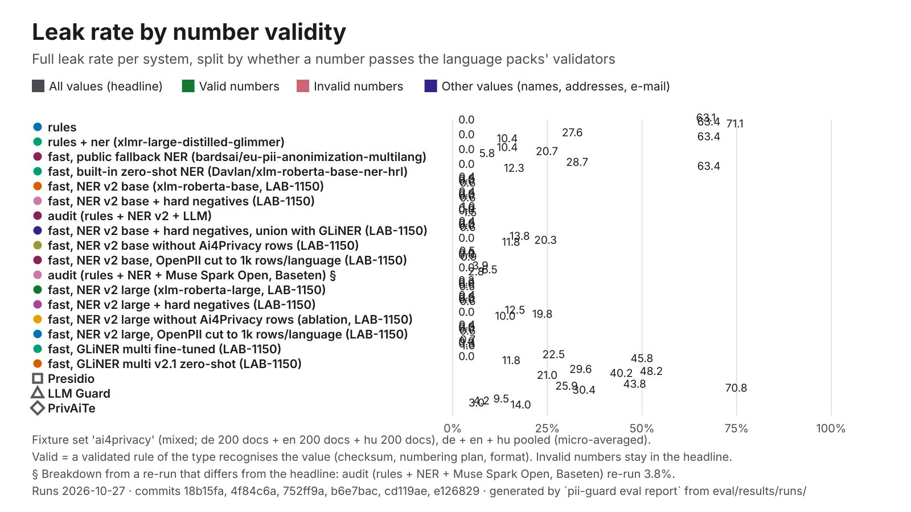

| System | Leak | Recall, valid numbers | Leak, valid numbers | Recall, invalid numbers | Leak, invalid numbers | Leak, other values |
|---|---:|---:|---:|---:|---:|---:|
| **pii-guard rules** | 62.3% | 100.0% (166/166) | 0.0% (0/166) | 37.4% (278/743) | 61.1% (454/743) | 71.2% (908/1276) |
| pii-guard fast, NER v4.2 (published, LAB-1625) | 0.4% | 100.0% (166/166) | 0.0% (0/166) | 97.8% (727/743) | 0.0% (0/743) | 0.6% (8/1276) |
| pii-guard NER v4.2 (B3) alone (no rules) (LAB-1625) | 0.4% | 98.8% (164/166) | 0.6% (1/166) | 99.1% (736/743) | 0.0% (0/743) | 0.6% (8/1276) |
| pii-guard NER v2.0 alone (no rules) | 0.4% | 98.8% (164/166) | 0.6% (1/166) | 99.2% (737/743) | 0.0% (0/743) | 0.6% (8/1276) |
| pii-guard fast, NER v2.0 (published watt-mind/pii-guard-ner-xlmr-base, LAB-1306) | 2.4% | 100.0% (166/166) | 0.0% (0/166) | 98.0% (728/743) | 0.0% (0/743) | 4.2% (53/1276) |
| pii-guard fast, NER v2.0 (selection-only re-score, LAB-1625) | 0.4% | 100.0% (166/166) | 0.0% (0/166) | 98.0% (728/743) | 0.0% (0/743) | 0.6% (8/1276) |
| Presidio | 34.8% | 30.7% (51/166) | 57.8% (96/166) | 17.1% (127/743) | 55.6% (413/743) | 19.7% (251/1276) |
| LLM Guard | 43.8% | 73.5% (122/166) | 25.9% (43/166) | 23.3% (173/743) | 70.8% (526/743) | 30.5% (389/1276) |
| PrivAiTe | 9.5% | 68.1% (113/166) | 4.2% (7/166) | 33.8% (251/743) | 3.0% (22/743) | 14.0% (179/1276) |

On an earlier version of a fixture file (current: de `2ad2850cd94c`, en `b3063862846f`, hu `aeb0edeed491`). These ran on other documents, so they stay out of the table above and the charts:

| System | Lang | Fixture | Docs | F1 | Leak | Run |
|---|---|---|---:|---:|---:|---|
| bardsai/eu-pii-anonimization-multilang-v3 alone (comparison) | de | `d0005390afa5` | 200 | 99.8% | 0.5% | 2026-10-28 |
| bardsai/eu-pii-anonimization-multilang-v3 alone (comparison) | en | `fcfc735dff40` | 200 | 99.3% | 0.6% | 2026-10-28 |
| bardsai/eu-pii-anonimization-multilang-v3 alone (comparison) | hu | `bd1901745c33` | 200 | 88.5% | 0.5% | 2026-10-28 |
| tabularisai/eu-pii-safeguard alone (comparison, LAB-1386) | de | `d0005390afa5` | 200 | 88.3% | 13.2% | 2026-10-28 |
| tabularisai/eu-pii-safeguard alone (comparison, LAB-1386) | en | `fcfc735dff40` | 200 | 87.7% | 14.5% | 2026-10-28 |
| tabularisai/eu-pii-safeguard alone (comparison, LAB-1386) | hu | `bd1901745c33` | 200 | 84.6% | 7.3% | 2026-10-28 |
| Horizon-Labs/pii-redactor-base alone (comparison) | de | `d0005390afa5` | 200 | 99.6% | 0.5% | 2026-10-28 |
| Horizon-Labs/pii-redactor-base alone (comparison) | en | `fcfc735dff40` | 200 | 98.9% | 0.9% | 2026-10-28 |
| Horizon-Labs/pii-redactor-base alone (comparison) | hu | `bd1901745c33` | 200 | 94.1% | 0.5% | 2026-10-28 |
| Horizon-Labs/pii-redactor-small alone (comparison) | de | `d0005390afa5` | 200 | 99.6% | 0.6% | 2026-10-28 |
| Horizon-Labs/pii-redactor-small alone (comparison) | en | `fcfc735dff40` | 200 | 98.7% | 1.1% | 2026-10-28 |
| Horizon-Labs/pii-redactor-small alone (comparison) | hu | `bd1901745c33` | 200 | 94.0% | 0.5% | 2026-10-28 |
| Wismut/nym-pii-multilingual alone (comparison) | de | `d0005390afa5` | 200 | 94.1% | 7.6% | 2026-10-28 |
| Wismut/nym-pii-multilingual alone (comparison) | en | `fcfc735dff40` | 200 | 91.7% | 9.8% | 2026-10-28 |
| Wismut/nym-pii-multilingual alone (comparison) | hu | `bd1901745c33` | 200 | 80.2% | 12.8% | 2026-10-28 |
| rules + the public fallback bardsai/eu-pii-anonimization-multilang v1 (reference) | de | `d0005390afa5` | 200 | 89.4% | 8.0% | 2026-10-28 |
| rules + the public fallback bardsai/eu-pii-anonimization-multilang v1 (reference) | en | `fcfc735dff40` | 200 | 88.0% | 11.2% | 2026-10-28 |
| rules + the public fallback bardsai/eu-pii-anonimization-multilang v1 (reference) | hu | `bd1901745c33` | 200 | 81.0% | 11.8% | 2026-10-28 |
| rules + bardsai/eu-pii-anonimization-multilang-v3 in place of pii-guard NER (comparison) | de | `d0005390afa5` | 200 | 99.4% | 0.5% | 2026-10-28 |
| rules + bardsai/eu-pii-anonimization-multilang-v3 in place of pii-guard NER (comparison) | en | `fcfc735dff40` | 200 | 98.4% | 0.6% | 2026-10-28 |
| rules + bardsai/eu-pii-anonimization-multilang-v3 in place of pii-guard NER (comparison) | hu | `bd1901745c33` | 200 | 91.1% | 0.4% | 2026-10-28 |
| pii-guard fast, public fallback NER (bardsai/eu-pii-anonimization-multilang) | de | `d0005390afa5` | 200 | 89.5% | 7.8% | 2026-10-27 |
| pii-guard fast, public fallback NER (bardsai/eu-pii-anonimization-multilang) | en | `fcfc735dff40` | 200 | 88.0% | 11.2% | 2026-10-27 |
| pii-guard fast, public fallback NER (bardsai/eu-pii-anonimization-multilang) | hu | `bd1901745c33` | 200 | 81.0% | 11.8% | 2026-10-27 |
| rules + tabularisai/eu-pii-safeguard in place of pii-guard NER (comparison, LAB-1386) | de | `d0005390afa5` | 200 | 91.9% | 7.2% | 2026-10-28 |
| rules + tabularisai/eu-pii-safeguard in place of pii-guard NER (comparison, LAB-1386) | en | `fcfc735dff40` | 200 | 89.9% | 10.3% | 2026-10-28 |
| rules + tabularisai/eu-pii-safeguard in place of pii-guard NER (comparison, LAB-1386) | hu | `bd1901745c33` | 200 | 87.3% | 4.8% | 2026-10-28 |
| rules + Horizon-Labs/pii-redactor-base in place of pii-guard NER (comparison) | de | `d0005390afa5` | 200 | 99.3% | 0.3% | 2026-10-28 |
| rules + Horizon-Labs/pii-redactor-base in place of pii-guard NER (comparison) | en | `fcfc735dff40` | 200 | 98.1% | 0.9% | 2026-10-28 |
| rules + Horizon-Labs/pii-redactor-base in place of pii-guard NER (comparison) | hu | `bd1901745c33` | 200 | 95.3% | 0.4% | 2026-10-28 |
| rules + Horizon-Labs/pii-redactor-small in place of pii-guard NER (comparison) | de | `d0005390afa5` | 200 | 99.2% | 0.6% | 2026-10-28 |
| rules + Horizon-Labs/pii-redactor-small in place of pii-guard NER (comparison) | en | `fcfc735dff40` | 200 | 97.9% | 1.0% | 2026-10-28 |
| rules + Horizon-Labs/pii-redactor-small in place of pii-guard NER (comparison) | hu | `bd1901745c33` | 200 | 95.2% | 0.4% | 2026-10-28 |
| pii-guard fast, NER v3 candidate: mmBERT-base on the v3 mix (LAB-1393) | de | `d0005390afa5` | 200 | 97.6% | 1.3% | 2026-10-28 |
| pii-guard fast, NER v3 candidate: mmBERT-base on the v3 mix (LAB-1393) | en | `fcfc735dff40` | 200 | 96.6% | 1.1% | 2026-10-28 |
| pii-guard fast, NER v3 candidate: mmBERT-base on the v3 mix (LAB-1393) | hu | `bd1901745c33` | 200 | 98.9% | 0.7% | 2026-10-28 |
| pii-guard fast, NER v3 candidate: XLM-R base on the v3 mix (LAB-1393) | de | `d0005390afa5` | 200 | 98.8% | 1.0% | 2026-10-28 |
| pii-guard fast, NER v3 candidate: XLM-R base on the v3 mix (LAB-1393) | en | `fcfc735dff40` | 200 | 97.3% | 0.1% | 2026-10-28 |
| pii-guard fast, NER v3 candidate: XLM-R base on the v3 mix (LAB-1393) | hu | `bd1901745c33` | 200 | 99.4% | 0.4% | 2026-10-28 |
| pii-guard fast, NER v3.1 candidate A: v3 mix minus agent-traffic (LAB-1410) | de | `d0005390afa5` | 200 | 98.6% | 1.4% | 2026-10-28 |
| pii-guard fast, NER v3.1 candidate A: v3 mix minus agent-traffic (LAB-1410) | en | `fcfc735dff40` | 200 | 97.4% | 1.0% | 2026-10-28 |
| pii-guard fast, NER v3.1 candidate A: v3 mix minus agent-traffic (LAB-1410) | hu | `bd1901745c33` | 200 | 99.4% | 0.8% | 2026-10-28 |
| pii-guard fast, NER v3.1 candidate B: A + hu/s11 gold, Privy halved (LAB-1410) | de | `d0005390afa5` | 200 | 98.8% | 0.5% | 2026-10-28 |
| pii-guard fast, NER v3.1 candidate B: A + hu/s11 gold, Privy halved (LAB-1410) | en | `fcfc735dff40` | 200 | 98.0% | 0.1% | 2026-10-28 |
| pii-guard fast, NER v3.1 candidate B: A + hu/s11 gold, Privy halved (LAB-1410) | hu | `bd1901745c33` | 200 | 99.8% | 0.1% | 2026-10-28 |
| pii-guard fast, NER v3.1 candidate C: B without Wismut (LAB-1410) | de | `d0005390afa5` | 200 | 98.8% | 0.6% | 2026-10-28 |
| pii-guard fast, NER v3.1 candidate C: B without Wismut (LAB-1410) | en | `fcfc735dff40` | 200 | 97.1% | 0.2% | 2026-10-28 |
| pii-guard fast, NER v3.1 candidate C: B without Wismut (LAB-1410) | hu | `bd1901745c33` | 200 | 99.5% | 0.1% | 2026-10-28 |
| pii-guard fast, NER v3.2 soup S30: 0.7 v2.0 + 0.3 v3.1-B (LAB-1494) | de | `d0005390afa5` | 200 | 99.1% | 0.3% | 2026-10-29 |
| pii-guard fast, NER v3.2 soup S30: 0.7 v2.0 + 0.3 v3.1-B (LAB-1494) | en | `fcfc735dff40` | 200 | 98.1% | 0.1% | 2026-10-29 |
| pii-guard fast, NER v3.2 soup S30: 0.7 v2.0 + 0.3 v3.1-B (LAB-1494) | hu | `bd1901745c33` | 200 | 99.6% | 0.4% | 2026-10-29 |
| pii-guard fast, NER v3.2 soup S50: 0.5 v2.0 + 0.5 v3.1-B (LAB-1494) | de | `d0005390afa5` | 200 | 99.1% | 0.3% | 2026-10-29 |
| pii-guard fast, NER v3.2 soup S50: 0.5 v2.0 + 0.5 v3.1-B (LAB-1494) | en | `fcfc735dff40` | 200 | 97.9% | 0.1% | 2026-10-29 |
| pii-guard fast, NER v3.2 soup S50: 0.5 v2.0 + 0.5 v3.1-B (LAB-1494) | hu | `bd1901745c33` | 200 | 99.7% | 0.4% | 2026-10-29 |
| pii-guard fast, NER v3.2 soup S70: 0.3 v2.0 + 0.7 v3.1-B (LAB-1494) | de | `d0005390afa5` | 200 | 99.1% | 0.3% | 2026-10-29 |
| pii-guard fast, NER v3.2 soup S70: 0.3 v2.0 + 0.7 v3.1-B (LAB-1494) | en | `fcfc735dff40` | 200 | 98.0% | 0.1% | 2026-10-29 |
| pii-guard fast, NER v3.2 soup S70: 0.3 v2.0 + 0.7 v3.1-B (LAB-1494) | hu | `bd1901745c33` | 200 | 99.7% | 0.4% | 2026-10-29 |
| pii-guard fast, NER v3.3 candidate T1: S30 + targeted add-on, 1 epoch (LAB-1512) | de | `d0005390afa5` | 200 | 99.2% | 0.3% | 2026-10-29 |
| pii-guard fast, NER v3.3 candidate T1: S30 + targeted add-on, 1 epoch (LAB-1512) | en | `fcfc735dff40` | 200 | 98.4% | 0.1% | 2026-10-29 |
| pii-guard fast, NER v3.3 candidate T1: S30 + targeted add-on, 1 epoch (LAB-1512) | hu | `bd1901745c33` | 200 | 99.5% | 0.4% | 2026-10-29 |
| pii-guard fast, NER v3.3 candidate T2: S30 + targeted add-on, 2 epochs (LAB-1512) | de | `d0005390afa5` | 200 | 99.1% | 0.5% | 2026-10-29 |
| pii-guard fast, NER v3.3 candidate T2: S30 + targeted add-on, 2 epochs (LAB-1512) | en | `fcfc735dff40` | 200 | 98.5% | 0.1% | 2026-10-29 |
| pii-guard fast, NER v3.3 candidate T2: S30 + targeted add-on, 2 epochs (LAB-1512) | hu | `bd1901745c33` | 200 | 99.5% | 0.4% | 2026-10-29 |
| rules + Wismut/nym-pii-multilingual in place of pii-guard NER (comparison) | de | `d0005390afa5` | 200 | 95.4% | 4.9% | 2026-10-28 |
| rules + Wismut/nym-pii-multilingual in place of pii-guard NER (comparison) | en | `fcfc735dff40` | 200 | 92.5% | 7.4% | 2026-10-28 |
| rules + Wismut/nym-pii-multilingual in place of pii-guard NER (comparison) | hu | `bd1901745c33` | 200 | 86.4% | 7.3% | 2026-10-28 |
| pii-guard fast, built-in zero-shot NER (Davlan/xlm-roberta-base-ner-hrl) | de | `d0005390afa5` | 200 | 81.3% | 24.5% | 2026-10-27 |
| pii-guard fast, built-in zero-shot NER (Davlan/xlm-roberta-base-ner-hrl) | en | `fcfc735dff40` | 200 | 79.5% | 26.8% | 2026-10-27 |
| pii-guard fast, built-in zero-shot NER (Davlan/xlm-roberta-base-ner-hrl) | hu | `bd1901745c33` | 200 | 74.4% | 34.3% | 2026-10-27 |
| pii-guard fast, NER v2 base (xlm-roberta-base, LAB-1150) | de | `d0005390afa5` | 200 | 98.6% | 0.5% | 2026-10-27 |
| pii-guard fast, NER v2 base (xlm-roberta-base, LAB-1150) | en | `fcfc735dff40` | 200 | 98.0% | 0.2% | 2026-10-27 |
| pii-guard fast, NER v2 base (xlm-roberta-base, LAB-1150) | hu | `bd1901745c33` | 200 | 99.4% | 0.4% | 2026-10-27 |
| pii-guard audit (rules + NER v2 + LLM) | de | `d0005390afa5` | 10 | 96.7% | 3.2% | 2026-10-27 |
| pii-guard audit (rules + NER v2 + LLM) | en | `fcfc735dff40` | 10 | 96.1% | 0.0% | 2026-10-27 |
| pii-guard audit (rules + NER v2 + LLM) | hu | `bd1901745c33` | 10 | 95.4% | 0.0% | 2026-10-27 |
| pii-guard fast, NER v2 base + hard negatives, union with GLiNER (LAB-1150) | de | `d0005390afa5` | 200 | 96.1% | 0.3% | 2026-10-27 |
| pii-guard fast, NER v2 base + hard negatives, union with GLiNER (LAB-1150) | en | `fcfc735dff40` | 200 | 95.3% | 0.2% | 2026-10-27 |
| pii-guard fast, NER v2 base + hard negatives, union with GLiNER (LAB-1150) | hu | `bd1901745c33` | 200 | 96.9% | 0.5% | 2026-10-27 |
| pii-guard fast, NER v2.0 (selection-only re-score, LAB-1494) | de | `d0005390afa5` | 200 | 98.4% | 0.3% | 2026-10-29 |
| pii-guard fast, NER v2.0 (selection-only re-score, LAB-1494) | en | `fcfc735dff40` | 200 | 97.7% | 0.2% | 2026-10-29 |
| pii-guard fast, NER v2.0 (selection-only re-score, LAB-1494) | hu | `bd1901745c33` | 200 | 99.3% | 0.5% | 2026-10-29 |
| pii-guard fast, NER v2.0 (selection-only re-score, LAB-1512) | de | `d0005390afa5` | 200 | 98.4% | 0.3% | 2026-10-29 |
| pii-guard fast, NER v2.0 (selection-only re-score, LAB-1512) | en | `fcfc735dff40` | 200 | 97.7% | 0.2% | 2026-10-29 |
| pii-guard fast, NER v2.0 (selection-only re-score, LAB-1512) | hu | `bd1901745c33` | 200 | 99.3% | 0.5% | 2026-10-29 |
| pii-guard fast, NER v2.0 with dev-calibrated thresholds, candidate H (LAB-1512) | de | `d0005390afa5` | 200 | 98.9% | 0.8% | 2026-10-29 |
| pii-guard fast, NER v2.0 with dev-calibrated thresholds, candidate H (LAB-1512) | en | `fcfc735dff40` | 200 | 97.8% | 0.5% | 2026-10-29 |
| pii-guard fast, NER v2.0 with dev-calibrated thresholds, candidate H (LAB-1512) | hu | `bd1901745c33` | 200 | 99.5% | 0.5% | 2026-10-29 |
| pii-guard fast, NER v2 base without Ai4Privacy rows (LAB-1150) | de | `d0005390afa5` | 200 | 82.3% | 13.5% | 2026-10-27 |
| pii-guard fast, NER v2 base without Ai4Privacy rows (LAB-1150) | en | `fcfc735dff40` | 200 | 80.1% | 15.0% | 2026-10-27 |
| pii-guard fast, NER v2 base without Ai4Privacy rows (LAB-1150) | hu | `bd1901745c33` | 200 | 88.4% | 12.6% | 2026-10-27 |
| pii-guard fast, NER v2 base, OpenPII cut to 1k rows/language (LAB-1150) | de | `d0005390afa5` | 200 | 97.7% | 0.6% | 2026-10-27 |
| pii-guard fast, NER v2 base, OpenPII cut to 1k rows/language (LAB-1150) | en | `fcfc735dff40` | 200 | 97.3% | 0.5% | 2026-10-27 |
| pii-guard fast, NER v2 base, OpenPII cut to 1k rows/language (LAB-1150) | hu | `bd1901745c33` | 200 | 99.0% | 0.4% | 2026-10-27 |
| pii-guard fast, NER v2.1 base, epoch 1 of 5 (LAB-1306) | de | `d0005390afa5` | 200 | 98.1% | 0.3% | 2026-10-27 |
| pii-guard fast, NER v2.1 base, epoch 1 of 5 (LAB-1306) | en | `fcfc735dff40` | 200 | 95.3% | 0.8% | 2026-10-27 |
| pii-guard fast, NER v2.1 base, epoch 1 of 5 (LAB-1306) | hu | `bd1901745c33` | 200 | 98.5% | 0.4% | 2026-10-27 |
| pii-guard fast, NER v2.1 base, epoch 2 of 5 (LAB-1306) | de | `d0005390afa5` | 200 | 96.7% | 0.6% | 2026-10-27 |
| pii-guard fast, NER v2.1 base, epoch 2 of 5 (LAB-1306) | en | `fcfc735dff40` | 200 | 96.2% | 0.4% | 2026-10-27 |
| pii-guard fast, NER v2.1 base, epoch 2 of 5 (LAB-1306) | hu | `bd1901745c33` | 200 | 98.8% | 0.5% | 2026-10-27 |
| pii-guard fast, NER v2.1 base, epoch 3 of 5 (LAB-1306) | de | `d0005390afa5` | 200 | 98.4% | 0.8% | 2026-10-27 |
| pii-guard fast, NER v2.1 base, epoch 3 of 5 (LAB-1306) | en | `fcfc735dff40` | 200 | 98.0% | 0.8% | 2026-10-27 |
| pii-guard fast, NER v2.1 base, epoch 3 of 5 (LAB-1306) | hu | `bd1901745c33` | 200 | 99.4% | 0.8% | 2026-10-27 |
| pii-guard fast, NER v2.1 base, epoch 4 of 5 (LAB-1306) | de | `d0005390afa5` | 200 | 98.6% | 0.6% | 2026-10-27 |
| pii-guard fast, NER v2.1 base, epoch 4 of 5 (LAB-1306) | en | `fcfc735dff40` | 200 | 97.8% | 0.2% | 2026-10-27 |
| pii-guard fast, NER v2.1 base, epoch 4 of 5 (LAB-1306) | hu | `bd1901745c33` | 200 | 99.3% | 0.4% | 2026-10-27 |
| pii-guard fast, NER v2.1 base, epoch 5 of 5 (LAB-1306) | de | `d0005390afa5` | 200 | 98.6% | 0.5% | 2026-10-27 |
| pii-guard fast, NER v2.1 base, epoch 5 of 5 (LAB-1306) | en | `fcfc735dff40` | 200 | 98.0% | 0.1% | 2026-10-27 |
| pii-guard fast, NER v2.1 base, epoch 5 of 5 (LAB-1306) | hu | `bd1901745c33` | 200 | 99.5% | 0.4% | 2026-10-27 |
| pii-guard rules + ner (xlmr-large-distilled-glimmer) | de | `d0005390afa5` | 200 | 85.1% | 23.4% | 2026-10-27 |
| pii-guard rules + ner (xlmr-large-distilled-glimmer) | en | `fcfc735dff40` | 200 | 82.9% | 25.3% | 2026-10-27 |
| pii-guard rules + ner (xlmr-large-distilled-glimmer) | hu | `bd1901745c33` | 200 | 78.6% | 33.6% | 2026-10-27 |
| pii-guard audit (rules + NER + Muse Spark Open, Baseten) | de | `d0005390afa5` | 200 | 95.3% | 4.8% | 2026-10-27 |
| pii-guard audit (rules + NER + Muse Spark Open, Baseten) | en | `fcfc735dff40` | 200 | 93.6% | 3.5% | 2026-10-27 |
| pii-guard audit (rules + NER + Muse Spark Open, Baseten) | hu | `bd1901745c33` | 200 | 95.4% | 3.7% | 2026-10-27 |
| pii-guard fast, NER v2 large (xlm-roberta-large, LAB-1150) | de | `d0005390afa5` | 200 | 98.9% | 0.5% | 2026-10-27 |
| pii-guard fast, NER v2 large (xlm-roberta-large, LAB-1150) | en | `fcfc735dff40` | 200 | 98.4% | 0.0% | 2026-10-27 |
| pii-guard fast, NER v2 large (xlm-roberta-large, LAB-1150) | hu | `bd1901745c33` | 200 | 99.5% | 0.4% | 2026-10-27 |
| pii-guard fast, NER v2 large + hard negatives (LAB-1150) | de | `d0005390afa5` | 200 | 98.7% | 0.5% | 2026-10-27 |
| pii-guard fast, NER v2 large + hard negatives (LAB-1150) | en | `fcfc735dff40` | 200 | 97.5% | 0.2% | 2026-10-27 |
| pii-guard fast, NER v2 large + hard negatives (LAB-1150) | hu | `bd1901745c33` | 200 | 99.6% | 0.4% | 2026-10-27 |
| pii-guard fast, NER v2 large without Ai4Privacy rows (ablation, LAB-1150) | de | `d0005390afa5` | 200 | 86.7% | 10.8% | 2026-10-27 |
| pii-guard fast, NER v2 large without Ai4Privacy rows (ablation, LAB-1150) | en | `fcfc735dff40` | 200 | 83.0% | 14.3% | 2026-10-27 |
| pii-guard fast, NER v2 large without Ai4Privacy rows (ablation, LAB-1150) | hu | `bd1901745c33` | 200 | 89.6% | 12.1% | 2026-10-27 |
| pii-guard fast, NER v2 large, OpenPII cut to 1k rows/language (LAB-1150) | de | `d0005390afa5` | 200 | 98.8% | 0.5% | 2026-10-27 |
| pii-guard fast, NER v2 large, OpenPII cut to 1k rows/language (LAB-1150) | en | `fcfc735dff40` | 200 | 97.3% | 0.2% | 2026-10-27 |
| pii-guard fast, NER v2 large, OpenPII cut to 1k rows/language (LAB-1150) | hu | `bd1901745c33` | 200 | 99.3% | 0.4% | 2026-10-27 |
| pii-guard fast, GLiNER multi fine-tuned (LAB-1150) | de | `d0005390afa5` | 200 | 96.6% | 0.8% | 2026-10-27 |
| pii-guard fast, GLiNER multi fine-tuned (LAB-1150) | en | `fcfc735dff40` | 200 | 95.0% | 0.8% | 2026-10-27 |
| pii-guard fast, GLiNER multi fine-tuned (LAB-1150) | hu | `bd1901745c33` | 200 | 98.1% | 0.5% | 2026-10-27 |
| pii-guard fast, GLiNER multi v2.1 zero-shot (LAB-1150) | de | `d0005390afa5` | 200 | 80.4% | 18.8% | 2026-10-27 |
| pii-guard fast, GLiNER multi v2.1 zero-shot (LAB-1150) | en | `fcfc735dff40` | 200 | 81.5% | 21.7% | 2026-10-27 |
| pii-guard fast, GLiNER multi v2.1 zero-shot (LAB-1150) | hu | `bd1901745c33` | 200 | 76.8% | 26.3% | 2026-10-27 |

### `brand-names`

hand-written; documents: de 6 + en 12 + hu 6.

| System | Docs | Precision | Recall | F1 | Leak | Partial leak | Over-masking | Round trip | Detect p50 | Run | Commit |
|---|---:|---:|---:|---:|---:|---:|---:|---:|---:|---|---|
| pii-guard rules + ner | 24 | 0.0% | — | 0.0% | — | — | 100.0% | 100.0% | 9.7 ms | 2026-10-28 | `9d800ba` |
| pii-guard fast, NER v2.0 (published watt-mind/pii-guard-ner-xlmr-base, LAB-1306) | 24 | 0.0% | — | 0.0% | — | — | 100.0% | 100.0% | 42 ms | 2026-10-29 | `10c53ad` |

By language:

| System | de F1 | en F1 | hu F1 | de leak | en leak | hu leak |
|---|---:|---:|---:|---:|---:|---:|
| pii-guard rules + ner | 0.0% | 0.0% | 0.0% | — | — | — |
| pii-guard fast, NER v2.0 (published watt-mind/pii-guard-ner-xlmr-base, LAB-1306) | 0.0% | 0.0% | 0.0% | — | — | — |

### `cee-pii`

mixed; documents: en 200 + hu 251.

| System | Docs | Precision | Recall | F1 | Leak | Partial leak | Over-masking | Round trip | Detect p50 | Run | Commit |
|---|---:|---:|---:|---:|---:|---:|---:|---:|---:|---|---|
| **pii-guard rules** | 451 | 97.3% | 56.9% | 71.8% | 41.3% | 14.1% | 0.0% | 100.0% | 0.32 ms | 2026-10-30 | `62799b5` |
| pii-guard fast, NER v4.2 (published, LAB-1625) | 451 | 86.1% | 96.8% | 91.1% | 0.8% | 0.0% | 7.3% | 100.0% | 38 ms | 2026-10-30 | `40accd5` |
| bardsai/eu-pii-anonimization-multilang-v3 alone (comparison) | 451 | 48.7% | 44.8% | 46.7% | 24.8% | 0.0% | 18.2% | 100.0% | 51 ms | 2026-10-28 | `97ee284` |
| tabularisai/eu-pii-safeguard alone (comparison, LAB-1386) | 451 | 67.8% | 85.7% | 75.7% | 8.7% | 3.0% | 26.5% | 100.0% | 118 ms | 2026-10-28 | `36a78e3` |
| Horizon-Labs/pii-redactor-base alone (comparison) | 451 | 39.0% | 44.4% | 41.5% | 19.6% | 0.8% | 30.3% | 100.0% | 58 ms | 2026-10-28 | `97ee284` |
| Horizon-Labs/pii-redactor-small alone (comparison) | 451 | 40.1% | 43.5% | 41.7% | 20.2% | 2.0% | 26.8% | 100.0% | 40 ms | 2026-10-28 | `97ee284` |
| pii-guard NER v4.2 (B3) alone (no rules) (LAB-1625) | 451 | 75.1% | 77.0% | 76.0% | 10.5% | 0.4% | 7.6% | 100.0% | 33 ms | 2026-10-30 | `40accd5` |
| Wismut/nym-pii-multilingual alone (comparison) | 451 | 51.4% | 54.6% | 52.9% | 24.8% | 0.2% | 27.7% | 100.0% | 54 ms | 2026-10-28 | `97ee284` |
| pii-guard NER v2.0 alone (no rules) | 451 | 77.0% | 86.5% | 81.5% | 1.6% | 0.4% | 12.2% | 100.0% | 34 ms | 2026-10-30 | `40accd5` |
| rules + the public fallback bardsai/eu-pii-anonimization-multilang v1 (reference) | 451 | 73.4% | 94.0% | 82.5% | 3.6% | 0.8% | 18.7% | 100.0% | 37 ms | 2026-10-28 | `97ee284` |
| rules + bardsai/eu-pii-anonimization-multilang-v3 in place of pii-guard NER (comparison) | 451 | 80.8% | 82.9% | 81.8% | 14.5% | 0.0% | 16.4% | 100.0% | 63 ms | 2026-10-28 | `97ee284` |
| rules + tabularisai/eu-pii-safeguard in place of pii-guard NER (comparison, LAB-1386) | 451 | 71.6% | 93.8% | 81.2% | 2.8% | 1.0% | 25.6% | 100.0% | 288 ms | 2026-10-28 | `36a78e3` |
| rules + Horizon-Labs/pii-redactor-base in place of pii-guard NER (comparison) | 451 | 69.0% | 82.1% | 75.0% | 15.5% | 0.6% | 29.2% | 100.0% | 53 ms | 2026-10-28 | `97ee284` |
| rules + Horizon-Labs/pii-redactor-small in place of pii-guard NER (comparison) | 451 | 72.4% | 81.5% | 76.7% | 16.3% | 1.8% | 25.8% | 100.0% | 30 ms | 2026-10-28 | `97ee284` |
| pii-guard fast, NER v3 candidate: mmBERT-base on the v3 mix (LAB-1393) | 451 | 63.4% | 91.9% | 75.1% | 5.6% | 1.8% | 34.6% | 100.0% | 56 ms | 2026-10-28 | `da9883e` |
| pii-guard fast, NER v3 candidate: XLM-R base on the v3 mix (LAB-1393) | 451 | 73.6% | 97.0% | 83.7% | 0.4% | 0.0% | 20.2% | 100.0% | 32 ms | 2026-10-28 | `da9883e` |
| pii-guard fast, NER v3.1 candidate A: v3 mix minus agent-traffic (LAB-1410) | 451 | 77.3% | 96.0% | 85.7% | 2.2% | 0.2% | 19.5% | 100.0% | 33 ms | 2026-10-28 | `72026a5` |
| pii-guard fast, NER v3.1 candidate B: A + hu/s11 gold, Privy halved (LAB-1410) | 451 | 72.2% | 97.6% | 83.0% | 0.8% | 0.2% | 25.3% | 100.0% | 35 ms | 2026-10-28 | `72026a5` |
| pii-guard fast, NER v3.1 candidate C: B without Wismut (LAB-1410) | 451 | 73.5% | 97.4% | 83.8% | 0.8% | 0.0% | 23.3% | 100.0% | 38 ms | 2026-10-28 | `72026a5` |
| pii-guard fast, NER v3.2 soup S30: 0.7 v2.0 + 0.3 v3.1-B (LAB-1494) | 451 | 70.6% | 97.6% | 81.9% | 0.4% | 0.2% | 26.5% | 100.0% | 54 ms | 2026-10-29 | `2b3c7ba` |
| pii-guard fast, NER v3.2 soup S50: 0.5 v2.0 + 0.5 v3.1-B (LAB-1494) | 451 | 70.7% | 98.0% | 82.1% | 0.2% | 0.2% | 25.8% | 100.0% | 54 ms | 2026-10-29 | `2b3c7ba` |
| pii-guard fast, NER v3.2 soup S70: 0.3 v2.0 + 0.7 v3.1-B (LAB-1494) | 451 | 72.0% | 97.8% | 82.9% | 0.4% | 0.4% | 25.0% | 100.0% | 48 ms | 2026-10-29 | `2b3c7ba` |
| pii-guard fast, NER v3.3 candidate T1: S30 + targeted add-on, 1 epoch (LAB-1512) | 451 | 71.7% | 98.2% | 82.9% | 0.2% | 0.0% | 24.8% | 100.0% | 108 ms | 2026-10-29 | `d2e710a` |
| pii-guard fast, NER v3.3 candidate T2: S30 + targeted add-on, 2 epochs (LAB-1512) | 451 | 68.8% | 97.8% | 80.8% | 0.2% | 0.2% | 27.5% | 100.0% | 107 ms | 2026-10-29 | `d2e710a` |
| rules + Wismut/nym-pii-multilingual in place of pii-guard NER (comparison) | 451 | 73.3% | 92.1% | 81.6% | 5.6% | 0.2% | 23.4% | 100.0% | 78 ms | 2026-10-28 | `97ee284` |
| pii-guard fast, NER v2.0 (published watt-mind/pii-guard-ner-xlmr-base, LAB-1306) | 451 | 72.0% | 97.2% | 82.7% | 0.4% | 0.2% | 26.3% | 100.0% | 34 ms | 2026-10-30 | `62799b5` |
| pii-guard audit (rules + NER v2 + LLM) | 20 | 54.0% | 100.0% | 70.1% | 0.0% | 0.0% | 42.5% | 100.0% | 1.6 s | 2026-10-27 | `cd119ae` |
| pii-guard fast, NER v2.0 (selection-only re-score, LAB-1494) | 451 | 71.9% | 97.2% | 82.6% | 0.4% | 0.2% | 26.4% | 100.0% | 47 ms | 2026-10-29 | `2b3c7ba` |
| pii-guard fast, NER v2.0 (selection-only re-score, LAB-1512) | 451 | 71.9% | 97.2% | 82.6% | 0.4% | 0.2% | 26.4% | 100.0% | 106 ms | 2026-10-29 | `d2e710a` |
| pii-guard fast, NER v2.0 (selection-only re-score, LAB-1625) | 451 | 85.5% | 97.2% | 91.0% | 0.4% | 0.2% | 12.4% | 100.0% | 35 ms | 2026-10-30 | `40accd5` |
| pii-guard fast, NER v2.0 with dev-calibrated thresholds, candidate H (LAB-1512) | 451 | 75.1% | 96.4% | 84.5% | 1.8% | 0.2% | 23.5% | 100.0% | 106 ms | 2026-10-29 | `d2e710a` |
| pii-guard fast, NER v2.1 base, epoch 5 of 5 (LAB-1306) | 451 | 67.9% | 98.0% | 80.2% | 0.4% | 0.0% | 29.0% | 100.0% | 17 ms* | 2026-10-27 | `477196a` |
| Presidio | 451 | 34.0% | 53.0% | 41.4% | 36.5% | 13.5% | 52.5% | — | 45 ms | 2026-10-30 | `62799b5` |
| LLM Guard | 451 | 31.3% | 20.4% | 24.7% | 75.8% | 0.6% | 66.4% | 100.0% | 60 ms | 2026-10-30 | `62799b5` |
| PrivAiTe | 451 | 24.9% | 55.0% | 34.2% | 4.4% | 1.0% | 59.2% | 96.5% | 70 ms | 2026-10-30 | `62799b5` |

By language:

| System | en F1 | hu F1 | en leak | hu leak |
|---|---:|---:|---:|---:|
| **pii-guard rules** | 68.0% | 74.3% | 41.8% | 40.9% |
| pii-guard fast, NER v4.2 (published, LAB-1625) | 84.2% | 96.0% | 0.0% | 1.3% |
| bardsai/eu-pii-anonimization-multilang-v3 alone (comparison) | 76.2% | 28.8% | 27.6% | 23.1% |
| tabularisai/eu-pii-safeguard alone (comparison, LAB-1386) | 66.2% | 81.3% | 15.8% | 4.2% |
| Horizon-Labs/pii-redactor-base alone (comparison) | 75.9% | 23.5% | 24.5% | 16.6% |
| Horizon-Labs/pii-redactor-small alone (comparison) | 76.2% | 23.3% | 24.5% | 17.5% |
| pii-guard NER v4.2 (B3) alone (no rules) (LAB-1625) | 75.1% | 76.8% | 5.1% | 14.0% |
| Wismut/nym-pii-multilingual alone (comparison) | 74.5% | 39.7% | 24.0% | 25.3% |
| pii-guard NER v2.0 alone (no rules) | 77.5% | 84.0% | 3.1% | 0.7% |
| rules + the public fallback bardsai/eu-pii-anonimization-multilang v1 (reference) | 73.3% | 88.8% | 8.2% | 0.7% |
| rules + bardsai/eu-pii-anonimization-multilang-v3 in place of pii-guard NER (comparison) | 80.7% | 82.5% | 13.8% | 14.9% |
| rules + tabularisai/eu-pii-safeguard in place of pii-guard NER (comparison, LAB-1386) | 78.0% | 83.1% | 5.6% | 1.0% |
| rules + Horizon-Labs/pii-redactor-base in place of pii-guard NER (comparison) | 81.5% | 71.3% | 13.8% | 16.6% |
| rules + Horizon-Labs/pii-redactor-small in place of pii-guard NER (comparison) | 82.3% | 73.6% | 14.8% | 17.2% |
| pii-guard fast, NER v3 candidate: mmBERT-base on the v3 mix (LAB-1393) | 79.0% | 72.7% | 11.2% | 1.9% |
| pii-guard fast, NER v3 candidate: XLM-R base on the v3 mix (LAB-1393) | 80.9% | 85.5% | 0.0% | 0.7% |
| pii-guard fast, NER v3.1 candidate A: v3 mix minus agent-traffic (LAB-1410) | 85.0% | 86.1% | 0.0% | 3.6% |
| pii-guard fast, NER v3.1 candidate B: A + hu/s11 gold, Privy halved (LAB-1410) | 84.0% | 82.4% | 0.0% | 1.3% |
| pii-guard fast, NER v3.1 candidate C: B without Wismut (LAB-1410) | 83.4% | 84.0% | 0.5% | 1.0% |
| pii-guard fast, NER v3.2 soup S30: 0.7 v2.0 + 0.3 v3.1-B (LAB-1494) | 80.5% | 82.8% | 0.0% | 0.7% |
| pii-guard fast, NER v3.2 soup S50: 0.5 v2.0 + 0.5 v3.1-B (LAB-1494) | 80.8% | 83.0% | 0.0% | 0.3% |
| pii-guard fast, NER v3.2 soup S70: 0.3 v2.0 + 0.7 v3.1-B (LAB-1494) | 82.7% | 83.0% | 0.0% | 0.7% |
| pii-guard fast, NER v3.3 candidate T1: S30 + targeted add-on, 1 epoch (LAB-1512) | 81.6% | 83.7% | 0.0% | 0.3% |
| pii-guard fast, NER v3.3 candidate T2: S30 + targeted add-on, 2 epochs (LAB-1512) | 77.8% | 82.8% | 0.0% | 0.3% |
| rules + Wismut/nym-pii-multilingual in place of pii-guard NER (comparison) | 78.7% | 83.4% | 10.2% | 2.6% |
| pii-guard fast, NER v2.0 (published watt-mind/pii-guard-ner-xlmr-base, LAB-1306) | 83.2% | 82.4% | 0.0% | 0.7% |
| pii-guard audit (rules + NER v2 + LLM) | 68.4% | 71.8% | 0.0% | 0.0% |
| pii-guard fast, NER v2.0 (selection-only re-score, LAB-1494) | 83.1% | 82.4% | 0.0% | 0.7% |
| pii-guard fast, NER v2.0 (selection-only re-score, LAB-1512) | 83.1% | 82.4% | 0.0% | 0.7% |
| pii-guard fast, NER v2.0 (selection-only re-score, LAB-1625) | 86.6% | 93.9% | 0.0% | 0.7% |
| pii-guard fast, NER v2.0 with dev-calibrated thresholds, candidate H (LAB-1512) | 85.6% | 83.8% | 2.5% | 1.3% |
| pii-guard fast, NER v2.1 base, epoch 5 of 5 (LAB-1306) | 75.1% | 83.8% | 0.5% | 0.3% |
| Presidio | 36.4% | 50.6% | 11.2% | 52.6% |
| LLM Guard | 20.6% | 27.4% | 78.1% | 74.4% |
| PrivAiTe | 51.9% | 22.9% | 3.1% | 5.2% |

**Number validity.** The headline leak above, split by whether a structured identifier passes the language packs' own validators (card Luhn, IBAN, TAJ and tax-ID check digits, phone numbering plans, ID-document checksums and formats). Invalid numbers stay in the headline: a mistyped real identifier is still personal data ([evaluation.md](evaluation.md#number-validity)). Valid values per type: `PHONE` 12/12, `NATIONAL_ID_HU_TAJ` 172/172, `ID_DOCUMENT` 0/40, `BANK_ACCOUNT` 14/14, `VEHICLE_PLATE` 21/21.

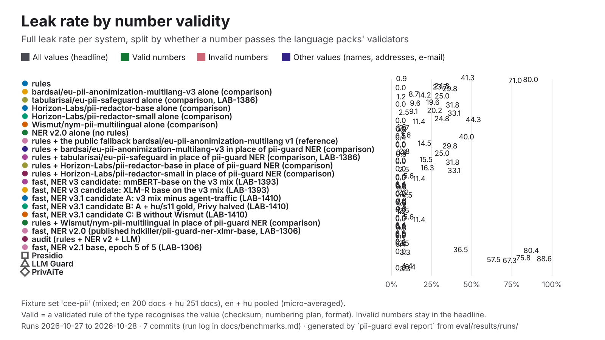

| System | Leak | Recall, valid numbers | Leak, valid numbers | Recall, invalid numbers | Leak, invalid numbers | Leak, other values |
|---|---:|---:|---:|---:|---:|---:|
| **pii-guard rules** | 41.3% | 99.1% (217/219) | 0.9% (2/219) | 0.0% (0/40) | 80.0% (32/40) | 71.0% (174/245) |
| pii-guard fast, NER v4.2 (published, LAB-1625) | 0.8% | 100.0% (219/219) | 0.0% (0/219) | 70.0% (28/40) | 0.0% (0/40) | 1.6% (4/245) |
| bardsai/eu-pii-anonimization-multilang-v3 alone (comparison) | 24.8% | 7.8% (17/219) | 23.7% (52/219) | 92.5% (37/40) | 0.0% (0/40) | 29.8% (73/245) |
| tabularisai/eu-pii-safeguard alone (comparison, LAB-1386) | 8.7% | 80.8% (177/219) | 14.2% (31/219) | 35.0% (14/40) | 25.0% (10/40) | 1.2% (3/245) |
| Horizon-Labs/pii-redactor-base alone (comparison) | 19.6% | 8.7% (19/219) | 9.6% (21/219) | 97.5% (39/40) | 0.0% (0/40) | 31.8% (78/245) |
| Horizon-Labs/pii-redactor-small alone (comparison) | 20.2% | 7.8% (17/219) | 9.1% (20/219) | 97.5% (39/40) | 2.5% (1/40) | 33.1% (81/245) |
| pii-guard NER v4.2 (B3) alone (no rules) (LAB-1625) | 10.5% | 53.0% (116/219) | 22.4% (49/219) | 77.5% (31/40) | 0.0% (0/40) | 1.6% (4/245) |
| Wismut/nym-pii-multilingual alone (comparison) | 24.8% | 9.1% (20/219) | 44.3% (97/219) | 97.5% (39/40) | 0.0% (0/40) | 11.4% (28/245) |
| pii-guard NER v2.0 alone (no rules) | 1.6% | 73.1% (160/219) | 2.7% (6/219) | 82.5% (33/40) | 0.0% (0/40) | 0.8% (2/245) |
| rules + the public fallback bardsai/eu-pii-anonimization-multilang v1 (reference) | 3.6% | 99.1% (217/219) | 0.5% (1/219) | 35.0% (14/40) | 40.0% (16/40) | 0.4% (1/245) |
| rules + bardsai/eu-pii-anonimization-multilang-v3 in place of pii-guard NER (comparison) | 14.5% | 99.1% (217/219) | 0.0% (0/219) | 72.5% (29/40) | 0.0% (0/40) | 29.8% (73/245) |
| rules + tabularisai/eu-pii-safeguard in place of pii-guard NER (comparison, LAB-1386) | 2.8% | 99.1% (217/219) | 0.9% (2/219) | 35.0% (14/40) | 25.0% (10/40) | 0.8% (2/245) |
| rules + Horizon-Labs/pii-redactor-base in place of pii-guard NER (comparison) | 15.5% | 99.1% (217/219) | 0.0% (0/219) | 77.5% (31/40) | 0.0% (0/40) | 31.8% (78/245) |
| rules + Horizon-Labs/pii-redactor-small in place of pii-guard NER (comparison) | 16.3% | 99.1% (217/219) | 0.0% (0/219) | 77.5% (31/40) | 2.5% (1/40) | 33.1% (81/245) |
| pii-guard fast, NER v3 candidate: mmBERT-base on the v3 mix (LAB-1393) | 5.6% | 100.0% (219/219) | 0.0% (0/219) | 77.5% (31/40) | 0.0% (0/40) | 11.4% (28/245) |
| pii-guard fast, NER v3 candidate: XLM-R base on the v3 mix (LAB-1393) | 0.4% | 100.0% (219/219) | 0.0% (0/219) | 72.5% (29/40) | 0.0% (0/40) | 0.8% (2/245) |
| pii-guard fast, NER v3.1 candidate A: v3 mix minus agent-traffic (LAB-1410) | 2.2% | 100.0% (219/219) | 0.0% (0/219) | 77.5% (31/40) | 0.0% (0/40) | 4.5% (11/245) |
| pii-guard fast, NER v3.1 candidate B: A + hu/s11 gold, Privy halved (LAB-1410) | 0.8% | 100.0% (219/219) | 0.0% (0/219) | 80.0% (32/40) | 0.0% (0/40) | 1.6% (4/245) |
| pii-guard fast, NER v3.1 candidate C: B without Wismut (LAB-1410) | 0.8% | 100.0% (219/219) | 0.0% (0/219) | 75.0% (30/40) | 2.5% (1/40) | 1.2% (3/245) |
| pii-guard fast, NER v3.2 soup S30: 0.7 v2.0 + 0.3 v3.1-B (LAB-1494) | 0.4% | 100.0% (219/219) | 0.0% (0/219) | 75.0% (30/40) | 0.0% (0/40) | 0.8% (2/245) |
| pii-guard fast, NER v3.2 soup S50: 0.5 v2.0 + 0.5 v3.1-B (LAB-1494) | 0.2% | 100.0% (219/219) | 0.0% (0/219) | 77.5% (31/40) | 0.0% (0/40) | 0.4% (1/245) |
| pii-guard fast, NER v3.2 soup S70: 0.3 v2.0 + 0.7 v3.1-B (LAB-1494) | 0.4% | 100.0% (219/219) | 0.0% (0/219) | 77.5% (31/40) | 0.0% (0/40) | 0.8% (2/245) |
| pii-guard fast, NER v3.3 candidate T1: S30 + targeted add-on, 1 epoch (LAB-1512) | 0.2% | 100.0% (219/219) | 0.0% (0/219) | 80.0% (32/40) | 0.0% (0/40) | 0.4% (1/245) |
| pii-guard fast, NER v3.3 candidate T2: S30 + targeted add-on, 2 epochs (LAB-1512) | 0.2% | 100.0% (219/219) | 0.0% (0/219) | 75.0% (30/40) | 0.0% (0/40) | 0.4% (1/245) |
| rules + Wismut/nym-pii-multilingual in place of pii-guard NER (comparison) | 5.6% | 99.1% (217/219) | 0.0% (0/219) | 77.5% (31/40) | 0.0% (0/40) | 11.4% (28/245) |
| pii-guard fast, NER v2.0 (published watt-mind/pii-guard-ner-xlmr-base, LAB-1306) | 0.4% | 100.0% (219/219) | 0.0% (0/219) | 70.0% (28/40) | 0.0% (0/40) | 0.8% (2/245) |
| pii-guard audit (rules + NER v2 + LLM) | 0.0% | 100.0% (9/9) | 0.0% (0/9) | 100.0% (2/2) | 0.0% (0/2) | 0.0% (0/16) |
| pii-guard fast, NER v2.0 (selection-only re-score, LAB-1494) | 0.4% | 100.0% (219/219) | 0.0% (0/219) | 70.0% (28/40) | 0.0% (0/40) | 0.8% (2/245) |
| pii-guard fast, NER v2.0 (selection-only re-score, LAB-1512) | 0.4% | 100.0% (219/219) | 0.0% (0/219) | 70.0% (28/40) | 0.0% (0/40) | 0.8% (2/245) |
| pii-guard fast, NER v2.0 (selection-only re-score, LAB-1625) | 0.4% | 100.0% (219/219) | 0.0% (0/219) | 70.0% (28/40) | 0.0% (0/40) | 0.8% (2/245) |
| pii-guard fast, NER v2.0 with dev-calibrated thresholds, candidate H (LAB-1512) | 1.8% | 100.0% (219/219) | 0.0% (0/219) | 65.0% (26/40) | 12.5% (5/40) | 1.6% (4/245) |
| pii-guard fast, NER v2.1 base, epoch 5 of 5 (LAB-1306) | 0.4% | 100.0% (219/219) | 0.0% (0/219) | 77.5% (31/40) | 2.5% (1/40) | 0.4% (1/245) |
| Presidio | 36.5% | 11.4% (25/219) | 80.4% (176/219) | 40.0% (16/40) | 0.0% (0/40) | 3.3% (8/245) |
| LLM Guard | 75.8% | 11.0% (24/219) | 88.6% (194/219) | 0.0% (0/40) | 57.5% (23/40) | 67.3% (165/245) |
| PrivAiTe | 4.4% | 10.5% (23/219) | 6.4% (14/219) | 50.0% (20/40) | 0.0% (0/40) | 3.3% (8/245) |

### `company-names`

hand-written; documents: hu 44.

| System | Docs | Precision | Recall | F1 | Leak | Partial leak | Over-masking | Round trip | Detect p50 | Run | Commit |
|---|---:|---:|---:|---:|---:|---:|---:|---:|---:|---|---|
| **pii-guard rules** | 44 | 100.0% | 61.3% | 76.0% | 2.5% | 5.0% | 0.0% | 100.0% | 0.34 ms | 2026-10-30 | `4cd1181` |
| pii-guard fast, public fallback NER (bardsai/eu-pii-anonimization-multilang) | 44 | 74.4% | 100.0% | 85.3% | 0.0% | 2.5% | 1.6% | 100.0% | 22 ms | 2026-10-27 | `e126829` |
| pii-guard fast, built-in zero-shot NER (Davlan/xlm-roberta-base-ner-hrl) | 44 | 70.5% | 97.9% | 82.0% | 0.0% | 2.5% | 1.6% | 100.0% | 15 ms | 2026-10-27 | `910a6a2` |
| pii-guard fast, NER v2 base (xlm-roberta-base, LAB-1150) | 44 | 78.8% | 95.7% | 86.4% | 0.0% | 2.5% | 5.6% | 100.0% | 28 ms | 2026-10-27 | `910a6a2` |
| pii-guard fast, NER v2.0 (published watt-mind/pii-guard-ner-xlmr-base, LAB-1306) | 44 | 76.5% | 95.7% | 85.0% | 0.0% | 0.0% | 0.0% | 100.0% | 34 ms | 2026-10-30 | `4cd1181` |
| pii-guard fast, NER v2 base + hard negatives, union with GLiNER (LAB-1150) | 44 | 64.4% | 98.9% | 78.0% | 0.0% | 2.5% | 12.0% | 100.0% | 57 ms | 2026-10-27 | `910a6a2` |
| pii-guard fast, NER v2 base without Ai4Privacy rows (LAB-1150) | 44 | 72.7% | 100.0% | 84.2% | 0.0% | 2.5% | 0.0% | 100.0% | 13 ms | 2026-10-27 | `910a6a2` |
| pii-guard fast, NER v2 base, OpenPII cut to 1k rows/language (LAB-1150) | 44 | 71.5% | 100.0% | 83.4% | 0.0% | 2.5% | 7.3% | 100.0% | 16 ms | 2026-10-27 | `910a6a2` |
| pii-guard fast, NER v2.1 base, epoch 1 of 5 (LAB-1306) | 44 | 70.5% | 100.0% | 82.7% | 0.0% | 2.5% | 1.6% | 100.0% | 13 ms | 2026-10-27 | `477196a` |
| pii-guard fast, NER v2.1 base, epoch 2 of 5 (LAB-1306) | 44 | 72.7% | 100.0% | 84.2% | 0.0% | 2.5% | 0.0% | 100.0% | 12 ms | 2026-10-27 | `477196a` |
| pii-guard fast, NER v2.1 base, epoch 3 of 5 (LAB-1306) | 44 | 72.8% | 94.6% | 82.3% | 0.0% | 2.5% | 0.0% | 100.0% | 12 ms | 2026-10-27 | `477196a` |
| pii-guard fast, NER v2.1 base, epoch 4 of 5 (LAB-1306) | 44 | 72.9% | 100.0% | 84.3% | 0.0% | 2.5% | 0.0% | 100.0% | 14 ms | 2026-10-27 | `477196a` |
| pii-guard fast, NER v2.1 base, epoch 5 of 5 (LAB-1306) | 44 | 72.1% | 100.0% | 83.8% | 0.0% | 2.5% | 0.0% | 100.0% | 17 ms | 2026-10-27 | `477196a` |
| pii-guard rules + ner (xlmr-large-distilled-glimmer) | 44 | 72.7% | 100.0% | 84.2% | 0.0% | 2.5% | 0.0% | 100.0% | 21 ms | 2026-10-27 | `910a6a2` |
| pii-guard fast, NER v2 large (xlm-roberta-large, LAB-1150) | 44 | 83.2% | 78.5% | 80.8% | 0.0% | 2.5% | 4.5% | 97.7% | 21 ms | 2026-10-27 | `910a6a2` |
| pii-guard fast, NER v2 large + hard negatives (LAB-1150) | 44 | 77.0% | 72.0% | 74.4% | 0.0% | 2.5% | 4.5% | 97.7% | 21 ms | 2026-10-27 | `910a6a2` |
| pii-guard fast, NER v2 large without Ai4Privacy rows (ablation, LAB-1150) | 44 | 72.7% | 100.0% | 84.2% | 0.0% | 2.5% | 3.1% | 100.0% | 21 ms | 2026-10-27 | `910a6a2` |
| pii-guard fast, NER v2 large, OpenPII cut to 1k rows/language (LAB-1150) | 44 | 76.5% | 92.5% | 83.7% | 0.0% | 0.0% | 4.5% | 100.0% | 21 ms | 2026-10-27 | `910a6a2` |
| pii-guard fast, GLiNER multi fine-tuned (LAB-1150) | 44 | 73.0% | 98.9% | 84.0% | 0.0% | 2.5% | 0.0% | 100.0% | 47 ms | 2026-10-27 | `910a6a2` |
| pii-guard fast, GLiNER multi v2.1 zero-shot (LAB-1150) | 44 | 68.7% | 98.9% | 81.1% | 0.0% | 2.5% | 7.3% | 100.0% | 46 ms | 2026-10-27 | `910a6a2` |

By language:

| System | hu F1 | hu leak |
|---|---:|---:|
| **pii-guard rules** | 76.0% | 2.5% |
| pii-guard fast, public fallback NER (bardsai/eu-pii-anonimization-multilang) | 85.3% | 0.0% |
| pii-guard fast, built-in zero-shot NER (Davlan/xlm-roberta-base-ner-hrl) | 82.0% | 0.0% |
| pii-guard fast, NER v2 base (xlm-roberta-base, LAB-1150) | 86.4% | 0.0% |
| pii-guard fast, NER v2.0 (published watt-mind/pii-guard-ner-xlmr-base, LAB-1306) | 85.0% | 0.0% |
| pii-guard fast, NER v2 base + hard negatives, union with GLiNER (LAB-1150) | 78.0% | 0.0% |
| pii-guard fast, NER v2 base without Ai4Privacy rows (LAB-1150) | 84.2% | 0.0% |
| pii-guard fast, NER v2 base, OpenPII cut to 1k rows/language (LAB-1150) | 83.4% | 0.0% |
| pii-guard fast, NER v2.1 base, epoch 1 of 5 (LAB-1306) | 82.7% | 0.0% |
| pii-guard fast, NER v2.1 base, epoch 2 of 5 (LAB-1306) | 84.2% | 0.0% |
| pii-guard fast, NER v2.1 base, epoch 3 of 5 (LAB-1306) | 82.3% | 0.0% |
| pii-guard fast, NER v2.1 base, epoch 4 of 5 (LAB-1306) | 84.3% | 0.0% |
| pii-guard fast, NER v2.1 base, epoch 5 of 5 (LAB-1306) | 83.8% | 0.0% |
| pii-guard rules + ner (xlmr-large-distilled-glimmer) | 84.2% | 0.0% |
| pii-guard fast, NER v2 large (xlm-roberta-large, LAB-1150) | 80.8% | 0.0% |
| pii-guard fast, NER v2 large + hard negatives (LAB-1150) | 74.4% | 0.0% |
| pii-guard fast, NER v2 large without Ai4Privacy rows (ablation, LAB-1150) | 84.2% | 0.0% |
| pii-guard fast, NER v2 large, OpenPII cut to 1k rows/language (LAB-1150) | 83.7% | 0.0% |
| pii-guard fast, GLiNER multi fine-tuned (LAB-1150) | 84.0% | 0.0% |
| pii-guard fast, GLiNER multi v2.1 zero-shot (LAB-1150) | 81.1% | 0.0% |

### `demo-which-parties`

generated by muse-image; documents: all 1 + hu 1.

| System | Docs | Precision | Recall | F1 | Leak | Partial leak | Over-masking | Round trip | Detect p50 | Run | Commit |
|---|---:|---:|---:|---:|---:|---:|---:|---:|---:|---|---|
| pii-guard gateway, labels images, Muse Spark Open (Baseten) | 1 | 100.0% | 100.0% | 100.0% | 0.0% | 0.0% | — | — | — | 2026-10-27 | `8b57e15` |
| pii-guard gateway, labels images, mock upstream | 1 | 100.0% | 100.0% | 100.0% | 0.0% | 0.0% | — | — | — | 2026-10-27 | `8b57e15` |
| pii-guard gateway, opaque images, Muse Spark Open (Baseten) | 1 | 33.3% | 33.3% | 33.3% | 0.0% | 0.0% | — | — | — | 2026-10-27 | `8b57e15` |
| pii-guard gateway, opaque images, mock upstream | 1 | 33.3% | 33.3% | 33.3% | 0.0% | 0.0% | — | — | — | 2026-10-27 | `8b57e15` |

By language:

| System | hu F1 | hu leak |
|---|---:|---:|
| pii-guard gateway, labels images, Muse Spark Open (Baseten) | 100.0% | 0.0% |
| pii-guard gateway, labels images, mock upstream | 100.0% | 0.0% |
| pii-guard gateway, opaque images, Muse Spark Open (Baseten) | 33.3% | 0.0% |
| pii-guard gateway, opaque images, mock upstream | 33.3% | 0.0% |

### `distill-dev`

generated by muse-spark-1.3-contributor; documents: en 373 + hu 368.

| System | Docs | Precision | Recall | F1 | Leak | Partial leak | Over-masking | Round trip | Detect p50 | Run | Commit |
|---|---:|---:|---:|---:|---:|---:|---:|---:|---:|---|---|
| pii-guard fast, built-in zero-shot NER (Davlan/xlm-roberta-base-ner-hrl) | 741 | 95.2% | 94.2% | 94.7% | 7.5% | 4.1% | 3.0% | 99.1% | 28 ms* | 2026-10-27 | `910a6a2` |
| pii-guard fast, NER v2 base (xlm-roberta-base, LAB-1150) | 741 | 97.7% | 97.8% | 97.8% | 0.1% | 0.6% | 0.1% | 99.9% | 24 ms* | 2026-10-27 | `910a6a2` |
| pii-guard fast, NER v2.0 (published watt-mind/pii-guard-ner-xlmr-base, LAB-1306) | 741 | 97.7% | 97.8% | 97.8% | 0.1% | 0.6% | 0.1% | 99.9% | 27 ms* | 2026-10-27 | `910a6a2` |
| pii-guard fast, NER v2 base + hard negatives, union with GLiNER (LAB-1150) | 741 | 77.8% | 97.9% | 86.7% | 0.1% | 0.6% | 19.7% | 86.8% | 145 ms* | 2026-10-27 | `910a6a2` |
| pii-guard fast, NER v2 base without Ai4Privacy rows (LAB-1150) | 741 | 98.1% | 98.0% | 98.1% | 0.1% | 0.6% | 0.1% | 99.9% | 24 ms* | 2026-10-27 | `910a6a2` |
| pii-guard fast, NER v2 base, OpenPII cut to 1k rows/language (LAB-1150) | 741 | 97.9% | 97.9% | 97.9% | 0.2% | 0.6% | 0.1% | 99.9% | 25 ms* | 2026-10-27 | `910a6a2` |
| pii-guard rules + ner (xlmr-large-distilled-glimmer) | 741 | 98.8% | 99.5% | 99.2% | 0.5% | 0.6% | 1.2% | 99.7% | 76 ms* | 2026-10-27 | `910a6a2` |
| pii-guard fast, NER v2 large (xlm-roberta-large, LAB-1150) | 741 | 97.6% | 97.7% | 97.7% | 0.1% | 0.6% | 0.1% | 99.9% | 73 ms* | 2026-10-27 | `910a6a2` |
| pii-guard fast, NER v2 large + hard negatives (LAB-1150) | 741 | 97.9% | 98.1% | 98.0% | 0.2% | 0.6% | 0.1% | 100.0% | 77 ms* | 2026-10-27 | `910a6a2` |
| pii-guard fast, NER v2 large without Ai4Privacy rows (ablation, LAB-1150) | 741 | 97.9% | 97.9% | 97.9% | 0.2% | 0.6% | 0.2% | 99.9% | 81 ms* | 2026-10-27 | `910a6a2` |
| pii-guard fast, NER v2 large, OpenPII cut to 1k rows/language (LAB-1150) | 741 | 97.7% | 97.7% | 97.7% | 0.2% | 0.6% | 0.1% | 99.9% | 66 ms* | 2026-10-27 | `910a6a2` |
| pii-guard fast, GLiNER multi fine-tuned (LAB-1150) | 741 | 94.3% | 97.9% | 96.1% | 0.1% | 0.6% | 3.7% | 99.9% | 134 ms* | 2026-10-27 | `910a6a2` |
| pii-guard fast, GLiNER multi v2.1 zero-shot (LAB-1150) | 741 | 79.0% | 91.5% | 84.8% | 7.7% | 14.1% | 20.3% | 86.8% | 148 ms* | 2026-10-27 | `910a6a2` |

By language:

| System | en F1 | hu F1 | en leak | hu leak |
|---|---:|---:|---:|---:|
| pii-guard fast, built-in zero-shot NER (Davlan/xlm-roberta-base-ner-hrl) | 94.2% | 95.1% | 7.2% | 7.7% |
| pii-guard fast, NER v2 base (xlm-roberta-base, LAB-1150) | 99.5% | 96.3% | 0.2% | 0.0% |
| pii-guard fast, NER v2.0 (published watt-mind/pii-guard-ner-xlmr-base, LAB-1306) | 99.5% | 96.4% | 0.2% | 0.0% |
| pii-guard fast, NER v2 base + hard negatives, union with GLiNER (LAB-1150) | 87.1% | 86.4% | 0.2% | 0.0% |
| pii-guard fast, NER v2 base without Ai4Privacy rows (LAB-1150) | 99.6% | 96.9% | 0.3% | 0.0% |
| pii-guard fast, NER v2 base, OpenPII cut to 1k rows/language (LAB-1150) | 99.5% | 96.6% | 0.3% | 0.1% |
| pii-guard rules + ner (xlmr-large-distilled-glimmer) | 98.6% | 99.6% | 0.5% | 0.5% |
| pii-guard fast, NER v2 large (xlm-roberta-large, LAB-1150) | 99.5% | 96.2% | 0.3% | 0.0% |
| pii-guard fast, NER v2 large + hard negatives (LAB-1150) | 99.5% | 96.8% | 0.4% | 0.0% |
| pii-guard fast, NER v2 large without Ai4Privacy rows (ablation, LAB-1150) | 99.4% | 96.8% | 0.4% | 0.1% |
| pii-guard fast, NER v2 large, OpenPII cut to 1k rows/language (LAB-1150) | 99.6% | 96.2% | 0.4% | 0.0% |
| pii-guard fast, GLiNER multi fine-tuned (LAB-1150) | 97.0% | 95.4% | 0.2% | 0.1% |
| pii-guard fast, GLiNER multi v2.1 zero-shot (LAB-1150) | 83.3% | 86.0% | 7.8% | 7.6% |

On an earlier version of a fixture file (current: en `b13f9983ca99`, hu `f6dca4b60ca8`). These ran on other documents, so they stay out of the table above and the charts:

| System | Lang | Fixture | Docs | F1 | Leak | Run |
|---|---|---|---:|---:|---:|---|
| **pii-guard rules** | en | `52844202fd84` | 373 | 60.2% | 44.8% | 2026-10-27 |
| **pii-guard rules** | hu | `cf04e3fb4e47` | 368 | 58.8% | 49.1% | 2026-10-27 |
| pii-guard rules + NER (distilled base) | en | `52844202fd84` | 373 | 99.3% | 0.1% | 2026-10-27 |
| pii-guard rules + NER (distilled base) | hu | `cf04e3fb4e47` | 368 | 97.7% | 5.2% | 2026-10-27 |

### `en-court-smoke`

hand-written; documents: en 6.

| System | Docs | Precision | Recall | F1 | Leak | Partial leak | Over-masking | Round trip | Detect p50 | Run | Commit |
|---|---:|---:|---:|---:|---:|---:|---:|---:|---:|---|---|
| pii-guard fast, NER v4.2 (published, LAB-1625) | 6 | 100.0% | 100.0% | 100.0% | 0.0% | 0.0% | 0.0% | 100.0% | 32 ms | 2026-10-30 | `357175c` |
| pii-guard fast, NER v4 candidate A: v2.0 + EU phase-1 data, 1 epoch (LAB-1535) | 6 | 100.0% | 100.0% | 100.0% | 0.0% | 0.0% | 0.0% | 100.0% | 31 ms | 2026-10-29 | `4c4ad56` |
| pii-guard fast, NER v4 candidate B: 0.5 v2.0 + 0.5 B-raw soup (LAB-1535) | 6 | 100.0% | 100.0% | 100.0% | 0.0% | 0.0% | 0.0% | 100.0% | 31 ms | 2026-10-29 | `4c4ad56` |
| pii-guard fast, NER v4 candidate B-raw: v2.0 + EU data, 2 epochs (LAB-1535) | 6 | 100.0% | 100.0% | 100.0% | 0.0% | 0.0% | 0.0% | 100.0% | 31 ms | 2026-10-29 | `4c4ad56` |
| pii-guard fast, NER v4.1 candidate A1: v4-A recipe + v4.1 data, loose ADDRESS kept out of the loss (LAB-1547) | 6 | 100.0% | 100.0% | 100.0% | 0.0% | 0.0% | 0.0% | 100.0% | 35 ms | 2026-10-30 | `251926c` |
| pii-guard fast, NER v4.1 candidate A2: v4-A recipe + v4.1 data, loose ADDRESS taught as O (LAB-1547) | 6 | 100.0% | 100.0% | 100.0% | 0.0% | 0.0% | 0.0% | 100.0% | 33 ms | 2026-10-30 | `251926c` |
| pii-guard fast, NER v4.2 candidate B1: v4.1-A1 mix, implausible third-party birth dates taught as O, v4.2 targeted data (LAB-1625) | 6 | 100.0% | 100.0% | 100.0% | 0.0% | 0.0% | 0.0% | 100.0% | 49 ms | 2026-10-30 | `357175c` |
| pii-guard fast, NER v4.2 candidate B2: v4.1-A1 mix, uncued third-party birth dates out of the loss, v4.2 targeted data (LAB-1625) | 6 | 100.0% | 100.0% | 100.0% | 0.0% | 0.0% | 0.0% | 100.0% | 43 ms | 2026-10-30 | `357175c` |
| pii-guard fast, NER v4.2 B3 with dev-calibrated thresholds, post-hoc, not a protocol candidate (LAB-1625) | 6 | 100.0% | 100.0% | 100.0% | 0.0% | 0.0% | 0.0% | 100.0% | 32 ms | 2026-10-30 | `357175c` |
| pii-guard fast, NER v4.2 candidate B4: soup 0.5 v2.0 + 0.5 B1 (LAB-1625) | 6 | 100.0% | 100.0% | 100.0% | 0.0% | 0.0% | 0.0% | 100.0% | 33 ms | 2026-10-30 | `357175c` |
| pii-guard fast, NER v2.0 (selection-only re-score, LAB-1535) | 6 | 100.0% | 93.3% | 96.5% | 0.0% | 0.0% | 0.0% | 100.0% | 31 ms | 2026-10-29 | `4c4ad56` |
| pii-guard fast, NER v2.0 (selection-only re-score, LAB-1547) | 6 | 100.0% | 93.3% | 96.5% | 0.0% | 0.0% | 0.0% | 100.0% | 33 ms | 2026-10-30 | `251926c` |
| pii-guard fast, NER v2.0 (selection-only re-score, LAB-1625) | 6 | 100.0% | 93.3% | 96.5% | 0.0% | 0.0% | 0.0% | 100.0% | 31 ms | 2026-10-30 | `357175c` |

By language:

| System | en F1 | en leak |
|---|---:|---:|
| pii-guard fast, NER v4.2 (published, LAB-1625) | 100.0% | 0.0% |
| pii-guard fast, NER v4 candidate A: v2.0 + EU phase-1 data, 1 epoch (LAB-1535) | 100.0% | 0.0% |
| pii-guard fast, NER v4 candidate B: 0.5 v2.0 + 0.5 B-raw soup (LAB-1535) | 100.0% | 0.0% |
| pii-guard fast, NER v4 candidate B-raw: v2.0 + EU data, 2 epochs (LAB-1535) | 100.0% | 0.0% |
| pii-guard fast, NER v4.1 candidate A1: v4-A recipe + v4.1 data, loose ADDRESS kept out of the loss (LAB-1547) | 100.0% | 0.0% |
| pii-guard fast, NER v4.1 candidate A2: v4-A recipe + v4.1 data, loose ADDRESS taught as O (LAB-1547) | 100.0% | 0.0% |
| pii-guard fast, NER v4.2 candidate B1: v4.1-A1 mix, implausible third-party birth dates taught as O, v4.2 targeted data (LAB-1625) | 100.0% | 0.0% |
| pii-guard fast, NER v4.2 candidate B2: v4.1-A1 mix, uncued third-party birth dates out of the loss, v4.2 targeted data (LAB-1625) | 100.0% | 0.0% |
| pii-guard fast, NER v4.2 B3 with dev-calibrated thresholds, post-hoc, not a protocol candidate (LAB-1625) | 100.0% | 0.0% |
| pii-guard fast, NER v4.2 candidate B4: soup 0.5 v2.0 + 0.5 B1 (LAB-1625) | 100.0% | 0.0% |
| pii-guard fast, NER v2.0 (selection-only re-score, LAB-1535) | 96.5% | 0.0% |
| pii-guard fast, NER v2.0 (selection-only re-score, LAB-1547) | 96.5% | 0.0% |
| pii-guard fast, NER v2.0 (selection-only re-score, LAB-1625) | 96.5% | 0.0% |

### `eu-inflection`

hand-written; documents: es 4 + fr 4 + ga 4 + hr 5 + it 4 + lt 5 + lv 5 + mt 4 + nl 4 + ro 4 + sl 5.

| System | Docs | Precision | Recall | F1 | Leak | Partial leak | Over-masking | Round trip | Detect p50 | Run | Commit |
|---|---:|---:|---:|---:|---:|---:|---:|---:|---:|---|---|
| pii-guard fast, NER v4.2 (published, LAB-1625) | 48 | 100.0% | 99.2% | 99.6% | 0.8% | 0.8% | 0.0% | 100.0% | 34 ms | 2026-10-30 | `357175c` |
| pii-guard fast, NER v4 candidate A: v2.0 + EU phase-1 data, 1 epoch (LAB-1535) | 48 | 98.3% | 96.7% | 97.5% | 1.7% | 1.7% | 0.0% | 100.0% | 31 ms | 2026-10-29 | `4c4ad56` |
| pii-guard fast, NER v4 candidate B: 0.5 v2.0 + 0.5 B-raw soup (LAB-1535) | 48 | 98.4% | 97.5% | 97.9% | 1.7% | 0.8% | 0.8% | 100.0% | 31 ms | 2026-10-29 | `4c4ad56` |
| pii-guard fast, NER v4 candidate B-raw: v2.0 + EU data, 2 epochs (LAB-1535) | 48 | 99.2% | 97.5% | 98.4% | 1.7% | 0.8% | 0.0% | 100.0% | 31 ms | 2026-10-29 | `4c4ad56` |
| pii-guard fast, NER v4.1 candidate A1: v4-A recipe + v4.1 data, loose ADDRESS kept out of the loss (LAB-1547) | 48 | 99.2% | 99.2% | 99.2% | 0.8% | 0.8% | 0.8% | 100.0% | 33 ms | 2026-10-30 | `251926c` |
| pii-guard fast, NER v4.1 candidate A2: v4-A recipe + v4.1 data, loose ADDRESS taught as O (LAB-1547) | 48 | 98.4% | 98.4% | 98.4% | 1.7% | 0.8% | 0.8% | 100.0% | 33 ms | 2026-10-30 | `251926c` |
| pii-guard fast, NER v4.2 candidate B1: v4.1-A1 mix, implausible third-party birth dates taught as O, v4.2 targeted data (LAB-1625) | 48 | 100.0% | 99.2% | 99.6% | 0.8% | 0.8% | 0.0% | 100.0% | 47 ms | 2026-10-30 | `357175c` |
| pii-guard fast, NER v4.2 candidate B2: v4.1-A1 mix, uncued third-party birth dates out of the loss, v4.2 targeted data (LAB-1625) | 48 | 100.0% | 99.2% | 99.6% | 0.8% | 0.8% | 0.0% | 100.0% | 36 ms | 2026-10-30 | `357175c` |
| pii-guard fast, NER v4.2 B3 with dev-calibrated thresholds, post-hoc, not a protocol candidate (LAB-1625) | 48 | 100.0% | 99.2% | 99.6% | 0.8% | 0.8% | 0.0% | 100.0% | 32 ms | 2026-10-30 | `357175c` |
| pii-guard fast, NER v4.2 candidate B4: soup 0.5 v2.0 + 0.5 B1 (LAB-1625) | 48 | 99.2% | 99.2% | 99.2% | 0.8% | 0.8% | 0.8% | 100.0% | 32 ms | 2026-10-30 | `357175c` |
| pii-guard fast, NER v2.0 (selection-only re-score, LAB-1535) | 48 | 98.4% | 98.4% | 98.4% | 1.7% | 1.7% | 1.6% | 100.0% | 33 ms | 2026-10-29 | `4c4ad56` |
| pii-guard fast, NER v2.0 (selection-only re-score, LAB-1547) | 48 | 98.4% | 98.4% | 98.4% | 1.7% | 1.7% | 1.6% | 100.0% | 33 ms | 2026-10-30 | `251926c` |
| pii-guard fast, NER v2.0 (selection-only re-score, LAB-1625) | 48 | 98.4% | 98.4% | 98.4% | 1.7% | 1.7% | 1.6% | 100.0% | 33 ms | 2026-10-30 | `357175c` |

By language:

| System | es F1 | fr F1 | ga F1 | hr F1 | it F1 | lt F1 | lv F1 | mt F1 | nl F1 | ro F1 | sl F1 | es leak | fr leak | ga leak | hr leak | it leak | lt leak | lv leak | mt leak | nl leak | ro leak | sl leak |
|---|---:|---:|---:|---:|---:|---:|---:|---:|---:|---:|---:|---:|---:|---:|---:|---:|---:|---:|---:|---:|---:|---:|
| pii-guard fast, NER v4.2 (published, LAB-1625) | 100.0% | 94.7% | 100.0% | 100.0% | 100.0% | 100.0% | 100.0% | 100.0% | 100.0% | 100.0% | 100.0% | 0.0% | 10.0% | 0.0% | 0.0% | 0.0% | 0.0% | 0.0% | 0.0% | 0.0% | 0.0% | 0.0% |
| pii-guard fast, NER v4 candidate A: v2.0 + EU phase-1 data, 1 epoch (LAB-1535) | 100.0% | 94.7% | 82.3% | 100.0% | 100.0% | 100.0% | 100.0% | 100.0% | 88.9% | 100.0% | 100.0% | 0.0% | 10.0% | 11.1% | 0.0% | 0.0% | 0.0% | 0.0% | 0.0% | 0.0% | 0.0% | 0.0% |
| pii-guard fast, NER v4 candidate B: 0.5 v2.0 + 0.5 B-raw soup (LAB-1535) | 100.0% | 94.7% | 94.1% | 100.0% | 100.0% | 100.0% | 100.0% | 95.2% | 88.9% | 100.0% | 100.0% | 0.0% | 10.0% | 11.1% | 0.0% | 0.0% | 0.0% | 0.0% | 0.0% | 0.0% | 0.0% | 0.0% |
| pii-guard fast, NER v4 candidate B-raw: v2.0 + EU data, 2 epochs (LAB-1535) | 100.0% | 94.7% | 94.1% | 100.0% | 100.0% | 100.0% | 100.0% | 100.0% | 88.9% | 100.0% | 100.0% | 0.0% | 10.0% | 11.1% | 0.0% | 0.0% | 0.0% | 0.0% | 0.0% | 0.0% | 0.0% | 0.0% |
| pii-guard fast, NER v4.1 candidate A1: v4-A recipe + v4.1 data, loose ADDRESS kept out of the loss (LAB-1547) | 100.0% | 94.7% | 94.7% | 100.0% | 100.0% | 100.0% | 100.0% | 100.0% | 100.0% | 100.0% | 100.0% | 0.0% | 10.0% | 0.0% | 0.0% | 0.0% | 0.0% | 0.0% | 0.0% | 0.0% | 0.0% | 0.0% |
| pii-guard fast, NER v4.1 candidate A2: v4-A recipe + v4.1 data, loose ADDRESS taught as O (LAB-1547) | 100.0% | 94.7% | 95.2% | 100.0% | 100.0% | 100.0% | 100.0% | 100.0% | 88.9% | 100.0% | 100.0% | 0.0% | 10.0% | 0.0% | 0.0% | 0.0% | 0.0% | 0.0% | 0.0% | 11.1% | 0.0% | 0.0% |
| pii-guard fast, NER v4.2 candidate B1: v4.1-A1 mix, implausible third-party birth dates taught as O, v4.2 targeted data (LAB-1625) | 100.0% | 94.7% | 100.0% | 100.0% | 100.0% | 100.0% | 100.0% | 100.0% | 100.0% | 100.0% | 100.0% | 0.0% | 10.0% | 0.0% | 0.0% | 0.0% | 0.0% | 0.0% | 0.0% | 0.0% | 0.0% | 0.0% |
| pii-guard fast, NER v4.2 candidate B2: v4.1-A1 mix, uncued third-party birth dates out of the loss, v4.2 targeted data (LAB-1625) | 100.0% | 94.7% | 100.0% | 100.0% | 100.0% | 100.0% | 100.0% | 100.0% | 100.0% | 100.0% | 100.0% | 0.0% | 10.0% | 0.0% | 0.0% | 0.0% | 0.0% | 0.0% | 0.0% | 0.0% | 0.0% | 0.0% |
| pii-guard fast, NER v4.2 B3 with dev-calibrated thresholds, post-hoc, not a protocol candidate (LAB-1625) | 100.0% | 94.7% | 100.0% | 100.0% | 100.0% | 100.0% | 100.0% | 100.0% | 100.0% | 100.0% | 100.0% | 0.0% | 10.0% | 0.0% | 0.0% | 0.0% | 0.0% | 0.0% | 0.0% | 0.0% | 0.0% | 0.0% |
| pii-guard fast, NER v4.2 candidate B4: soup 0.5 v2.0 + 0.5 B1 (LAB-1625) | 100.0% | 94.7% | 100.0% | 100.0% | 100.0% | 100.0% | 100.0% | 95.2% | 100.0% | 100.0% | 100.0% | 0.0% | 10.0% | 0.0% | 0.0% | 0.0% | 0.0% | 0.0% | 0.0% | 0.0% | 0.0% | 0.0% |
| pii-guard fast, NER v2.0 (selection-only re-score, LAB-1535) | 100.0% | 94.7% | 94.1% | 100.0% | 100.0% | 100.0% | 100.0% | 90.9% | 100.0% | 100.0% | 100.0% | 0.0% | 10.0% | 11.1% | 0.0% | 0.0% | 0.0% | 0.0% | 0.0% | 0.0% | 0.0% | 0.0% |
| pii-guard fast, NER v2.0 (selection-only re-score, LAB-1547) | 100.0% | 94.7% | 94.1% | 100.0% | 100.0% | 100.0% | 100.0% | 90.9% | 100.0% | 100.0% | 100.0% | 0.0% | 10.0% | 11.1% | 0.0% | 0.0% | 0.0% | 0.0% | 0.0% | 0.0% | 0.0% | 0.0% |
| pii-guard fast, NER v2.0 (selection-only re-score, LAB-1625) | 100.0% | 94.7% | 94.1% | 100.0% | 100.0% | 100.0% | 100.0% | 90.9% | 100.0% | 100.0% | 100.0% | 0.0% | 10.0% | 11.1% | 0.0% | 0.0% | 0.0% | 0.0% | 0.0% | 0.0% | 0.0% | 0.0% |

### `eu-smoke`

hand-written; documents: es 5 + fr 5 + ga 5 + hr 5 + it 5 + lt 5 + lv 5 + mt 5 + nl 5 + ro 5 + sl 5.

| System | Docs | Precision | Recall | F1 | Leak | Partial leak | Over-masking | Round trip | Detect p50 | Run | Commit |
|---|---:|---:|---:|---:|---:|---:|---:|---:|---:|---|---|
| pii-guard fast, NER v4.2 (published, LAB-1625) | 55 | 100.0% | 99.0% | 99.5% | 0.0% | 0.0% | 0.0% | 100.0% | 36 ms | 2026-10-30 | `357175c` |
| pii-guard fast, NER v4 candidate A: v2.0 + EU phase-1 data, 1 epoch (LAB-1535) | 55 | 97.5% | 93.8% | 95.6% | 0.5% | 0.0% | 1.0% | 100.0% | 31 ms | 2026-10-29 | `4c4ad56` |
| pii-guard fast, NER v4 candidate B: 0.5 v2.0 + 0.5 B-raw soup (LAB-1535) | 55 | 97.5% | 92.8% | 95.1% | 1.1% | 0.5% | 1.0% | 100.0% | 35 ms | 2026-10-29 | `4c4ad56` |
| pii-guard fast, NER v4 candidate B-raw: v2.0 + EU data, 2 epochs (LAB-1535) | 55 | 94.4% | 94.3% | 94.3% | 0.5% | 0.0% | 2.5% | 100.0% | 34 ms | 2026-10-29 | `4c4ad56` |
| pii-guard fast, NER v4.1 candidate A1: v4-A recipe + v4.1 data, loose ADDRESS kept out of the loss (LAB-1547) | 55 | 99.5% | 98.6% | 99.0% | 0.0% | 0.0% | 0.5% | 100.0% | 34 ms | 2026-10-30 | `251926c` |
| pii-guard fast, NER v4.1 candidate A2: v4-A recipe + v4.1 data, loose ADDRESS taught as O (LAB-1547) | 55 | 99.5% | 98.6% | 99.0% | 0.0% | 0.0% | 0.5% | 100.0% | 35 ms | 2026-10-30 | `251926c` |
| pii-guard fast, NER v4.2 candidate B1: v4.1-A1 mix, implausible third-party birth dates taught as O, v4.2 targeted data (LAB-1625) | 55 | 100.0% | 98.6% | 99.3% | 0.0% | 0.0% | 0.0% | 100.0% | 55 ms | 2026-10-30 | `357175c` |
| pii-guard fast, NER v4.2 candidate B2: v4.1-A1 mix, uncued third-party birth dates out of the loss, v4.2 targeted data (LAB-1625) | 55 | 100.0% | 99.0% | 99.5% | 0.0% | 0.0% | 0.0% | 100.0% | 39 ms | 2026-10-30 | `357175c` |
| pii-guard fast, NER v4.2 B3 with dev-calibrated thresholds, post-hoc, not a protocol candidate (LAB-1625) | 55 | 100.0% | 99.0% | 99.5% | 0.0% | 0.0% | 0.0% | 100.0% | 33 ms | 2026-10-30 | `357175c` |
| pii-guard fast, NER v4.2 candidate B4: soup 0.5 v2.0 + 0.5 B1 (LAB-1625) | 55 | 99.5% | 94.7% | 97.1% | 0.0% | 0.0% | 0.5% | 100.0% | 33 ms | 2026-10-30 | `357175c` |
| pii-guard fast, NER v2.0 (selection-only re-score, LAB-1535) | 55 | 98.0% | 92.8% | 95.4% | 0.5% | 1.1% | 2.1% | 100.0% | 36 ms | 2026-10-29 | `4c4ad56` |
| pii-guard fast, NER v2.0 (selection-only re-score, LAB-1547) | 55 | 98.0% | 92.8% | 95.4% | 0.5% | 1.1% | 2.1% | 100.0% | 37 ms | 2026-10-30 | `251926c` |
| pii-guard fast, NER v2.0 (selection-only re-score, LAB-1625) | 55 | 98.0% | 92.8% | 95.4% | 0.5% | 1.1% | 2.1% | 100.0% | 37 ms | 2026-10-30 | `357175c` |

By language:

| System | es F1 | fr F1 | ga F1 | hr F1 | it F1 | lt F1 | lv F1 | mt F1 | nl F1 | ro F1 | sl F1 | es leak | fr leak | ga leak | hr leak | it leak | lt leak | lv leak | mt leak | nl leak | ro leak | sl leak |
|---|---:|---:|---:|---:|---:|---:|---:|---:|---:|---:|---:|---:|---:|---:|---:|---:|---:|---:|---:|---:|---:|---:|
| pii-guard fast, NER v4.2 (published, LAB-1625) | 100.0% | 97.3% | 100.0% | 100.0% | 100.0% | 100.0% | 100.0% | 97.3% | 100.0% | 100.0% | 100.0% | 0.0% | 0.0% | 0.0% | 0.0% | 0.0% | 0.0% | 0.0% | 0.0% | 0.0% | 0.0% | 0.0% |
| pii-guard fast, NER v4 candidate A: v2.0 + EU phase-1 data, 1 epoch (LAB-1535) | 94.7% | 97.3% | 94.1% | 97.4% | 97.3% | 97.3% | 97.3% | 85.0% | 97.3% | 97.3% | 97.3% | 0.0% | 0.0% | 0.0% | 0.0% | 0.0% | 0.0% | 0.0% | 6.2% | 0.0% | 0.0% | 0.0% |
| pii-guard fast, NER v4 candidate B: 0.5 v2.0 + 0.5 B-raw soup (LAB-1535) | 94.7% | 97.3% | 94.1% | 97.4% | 97.3% | 97.3% | 97.3% | 85.0% | 91.4% | 97.3% | 97.3% | 0.0% | 0.0% | 0.0% | 0.0% | 0.0% | 0.0% | 0.0% | 6.2% | 6.2% | 0.0% | 0.0% |
| pii-guard fast, NER v4 candidate B-raw: v2.0 + EU data, 2 epochs (LAB-1535) | 92.3% | 94.4% | 91.6% | 100.0% | 97.3% | 100.0% | 100.0% | 72.7% | 94.4% | 97.3% | 100.0% | 0.0% | 0.0% | 0.0% | 0.0% | 0.0% | 0.0% | 0.0% | 6.2% | 0.0% | 0.0% | 0.0% |
| pii-guard fast, NER v4.1 candidate A1: v4-A recipe + v4.1 data, loose ADDRESS kept out of the loss (LAB-1547) | 100.0% | 97.3% | 97.1% | 100.0% | 100.0% | 100.0% | 100.0% | 94.7% | 100.0% | 100.0% | 100.0% | 0.0% | 0.0% | 0.0% | 0.0% | 0.0% | 0.0% | 0.0% | 0.0% | 0.0% | 0.0% | 0.0% |
| pii-guard fast, NER v4.1 candidate A2: v4-A recipe + v4.1 data, loose ADDRESS taught as O (LAB-1547) | 100.0% | 97.3% | 97.1% | 100.0% | 100.0% | 100.0% | 100.0% | 94.7% | 100.0% | 100.0% | 100.0% | 0.0% | 0.0% | 0.0% | 0.0% | 0.0% | 0.0% | 0.0% | 0.0% | 0.0% | 0.0% | 0.0% |
| pii-guard fast, NER v4.2 candidate B1: v4.1-A1 mix, implausible third-party birth dates taught as O, v4.2 targeted data (LAB-1625) | 100.0% | 97.3% | 97.1% | 100.0% | 100.0% | 100.0% | 100.0% | 97.3% | 100.0% | 100.0% | 100.0% | 0.0% | 0.0% | 0.0% | 0.0% | 0.0% | 0.0% | 0.0% | 0.0% | 0.0% | 0.0% | 0.0% |
| pii-guard fast, NER v4.2 candidate B2: v4.1-A1 mix, uncued third-party birth dates out of the loss, v4.2 targeted data (LAB-1625) | 100.0% | 100.0% | 97.1% | 100.0% | 100.0% | 100.0% | 100.0% | 97.3% | 100.0% | 100.0% | 100.0% | 0.0% | 0.0% | 0.0% | 0.0% | 0.0% | 0.0% | 0.0% | 0.0% | 0.0% | 0.0% | 0.0% |
| pii-guard fast, NER v4.2 B3 with dev-calibrated thresholds, post-hoc, not a protocol candidate (LAB-1625) | 100.0% | 97.3% | 100.0% | 100.0% | 100.0% | 100.0% | 100.0% | 97.3% | 100.0% | 100.0% | 100.0% | 0.0% | 0.0% | 0.0% | 0.0% | 0.0% | 0.0% | 0.0% | 0.0% | 0.0% | 0.0% | 0.0% |
| pii-guard fast, NER v4.2 candidate B4: soup 0.5 v2.0 + 0.5 B1 (LAB-1625) | 97.3% | 97.3% | 94.1% | 97.4% | 97.3% | 97.3% | 97.3% | 94.7% | 97.3% | 100.0% | 97.3% | 0.0% | 0.0% | 0.0% | 0.0% | 0.0% | 0.0% | 0.0% | 0.0% | 0.0% | 0.0% | 0.0% |
| pii-guard fast, NER v2.0 (selection-only re-score, LAB-1535) | 97.3% | 97.3% | 88.9% | 97.4% | 97.3% | 97.3% | 94.4% | 92.3% | 91.4% | 97.3% | 97.3% | 0.0% | 0.0% | 0.0% | 0.0% | 0.0% | 0.0% | 0.0% | 0.0% | 6.2% | 0.0% | 0.0% |
| pii-guard fast, NER v2.0 (selection-only re-score, LAB-1547) | 97.3% | 97.3% | 88.9% | 97.4% | 97.3% | 97.3% | 94.4% | 92.3% | 91.4% | 97.3% | 97.3% | 0.0% | 0.0% | 0.0% | 0.0% | 0.0% | 0.0% | 0.0% | 0.0% | 6.2% | 0.0% | 0.0% |
| pii-guard fast, NER v2.0 (selection-only re-score, LAB-1625) | 97.3% | 97.3% | 88.9% | 97.4% | 97.3% | 97.3% | 94.4% | 92.3% | 91.4% | 97.3% | 97.3% | 0.0% | 0.0% | 0.0% | 0.0% | 0.0% | 0.0% | 0.0% | 0.0% | 6.2% | 0.0% | 0.0% |

### `gretel-finance`

mixed; documents: de 200 + en 200.

| System | Docs | Precision | Recall | F1 | Leak | Partial leak | Over-masking | Round trip | Detect p50 | Run | Commit |
|---|---:|---:|---:|---:|---:|---:|---:|---:|---:|---|---|
| **pii-guard rules** | 400 | 77.2% | 12.1% | 20.9% | 80.8% | 5.6% | 21.7% | 100.0% | 2.6 ms | 2026-10-28 | `26975e8` |
| pii-guard fast, NER v4.2 (published, LAB-1625) | 400 | 75.3% | 77.2% | 76.3% | 19.1% | 3.5% | 24.4% | 99.8% | 87 ms | 2026-10-30 | `40accd5` |
| bardsai/eu-pii-anonimization-multilang-v3 alone (comparison) | 400 | 83.6% | 60.8% | 70.4% | 27.8% | 4.9% | 15.1% | 100.0% | 132 ms | 2026-10-28 | `97ee284` |
| tabularisai/eu-pii-safeguard alone (comparison, LAB-1386) | 400 | 74.3% | 41.7% | 53.4% | 35.1% | 14.3% | 25.7% | 99.5% | 286 ms | 2026-10-28 | `36a78e3` |
| Horizon-Labs/pii-redactor-base alone (comparison) | 400 | 81.8% | 61.8% | 70.4% | 27.7% | 7.0% | 17.9% | 100.0% | 146 ms | 2026-10-28 | `97ee284` |
| Horizon-Labs/pii-redactor-small alone (comparison) | 400 | 80.6% | 59.0% | 68.1% | 27.0% | 6.5% | 18.1% | 100.0% | 133 ms | 2026-10-28 | `97ee284` |
| pii-guard NER v4.2 (B3) alone (no rules) (LAB-1625) | 400 | 75.4% | 76.1% | 75.8% | 20.2% | 3.5% | 24.5% | 99.8% | 75 ms | 2026-10-30 | `40accd5` |
| Wismut/nym-pii-multilingual alone (comparison) | 400 | 72.4% | 71.7% | 72.0% | 23.8% | 5.2% | 26.6% | 100.0% | 147 ms | 2026-10-28 | `97ee284` |
| pii-guard NER v2.0 alone (no rules) | 400 | 74.8% | 67.5% | 71.0% | 20.4% | 2.6% | 21.9% | 99.5% | 82 ms | 2026-10-30 | `40accd5` |
| rules + the public fallback bardsai/eu-pii-anonimization-multilang v1 (reference) | 400 | 63.5% | 79.4% | 70.6% | 21.2% | 6.8% | 32.4% | 99.5% | 98 ms | 2026-10-28 | `97ee284` |
| rules + bardsai/eu-pii-anonimization-multilang-v3 in place of pii-guard NER (comparison) | 400 | 82.3% | 64.2% | 72.2% | 23.3% | 4.7% | 16.4% | 100.0% | 173 ms | 2026-10-28 | `97ee284` |
| rules + tabularisai/eu-pii-safeguard in place of pii-guard NER (comparison, LAB-1386) | 400 | 74.6% | 46.6% | 57.3% | 29.8% | 14.2% | 25.6% | 99.8% | 843 ms | 2026-10-28 | `36a78e3` |
| rules + Horizon-Labs/pii-redactor-base in place of pii-guard NER (comparison) | 400 | 80.7% | 64.4% | 71.7% | 23.9% | 7.1% | 19.0% | 100.0% | 138 ms | 2026-10-28 | `97ee284` |
| rules + Horizon-Labs/pii-redactor-small in place of pii-guard NER (comparison) | 400 | 79.8% | 61.6% | 69.5% | 23.7% | 6.2% | 18.8% | 100.0% | 94 ms | 2026-10-28 | `97ee284` |
| pii-guard fast, NER v3 candidate: mmBERT-base on the v3 mix (LAB-1393) | 400 | 72.0% | 57.7% | 64.1% | 26.5% | 10.0% | 24.4% | 98.5% | 183 ms | 2026-10-28 | `da9883e` |
| pii-guard fast, NER v3 candidate: XLM-R base on the v3 mix (LAB-1393) | 400 | 75.4% | 67.2% | 71.1% | 21.2% | 4.5% | 22.0% | 99.8% | 92 ms | 2026-10-28 | `da9883e` |
| pii-guard fast, NER v3.1 candidate A: v3 mix minus agent-traffic (LAB-1410) | 400 | 80.3% | 68.5% | 74.0% | 21.6% | 4.2% | 19.1% | 99.5% | 81 ms | 2026-10-28 | `72026a5` |
| pii-guard fast, NER v3.1 candidate B: A + hu/s11 gold, Privy halved (LAB-1410) | 400 | 78.7% | 69.0% | 73.5% | 21.8% | 3.0% | 21.4% | 100.0% | 88 ms | 2026-10-28 | `72026a5` |
| pii-guard fast, NER v3.1 candidate C: B without Wismut (LAB-1410) | 400 | 80.4% | 69.8% | 74.7% | 21.6% | 3.7% | 17.2% | 100.0% | 90 ms | 2026-10-28 | `72026a5` |
| pii-guard fast, NER v3.2 soup S30: 0.7 v2.0 + 0.3 v3.1-B (LAB-1494) | 400 | 77.2% | 73.1% | 75.1% | 18.9% | 2.4% | 22.2% | 99.5% | 176 ms | 2026-10-29 | `2b3c7ba` |
| pii-guard fast, NER v3.2 soup S50: 0.5 v2.0 + 0.5 v3.1-B (LAB-1494) | 400 | 78.1% | 73.5% | 75.7% | 19.2% | 3.1% | 22.0% | 99.8% | 157 ms | 2026-10-29 | `2b3c7ba` |
| pii-guard fast, NER v3.2 soup S70: 0.3 v2.0 + 0.7 v3.1-B (LAB-1494) | 400 | 78.7% | 72.1% | 75.3% | 20.5% | 2.5% | 22.3% | 100.0% | 135 ms | 2026-10-29 | `2b3c7ba` |
| pii-guard fast, NER v3.3 candidate T1: S30 + targeted add-on, 1 epoch (LAB-1512) | 400 | 80.2% | 74.4% | 77.2% | 20.4% | 2.5% | 20.5% | 100.0% | 329 ms | 2026-10-29 | `d2e710a` |
| pii-guard fast, NER v3.3 candidate T2: S30 + targeted add-on, 2 epochs (LAB-1512) | 400 | 80.2% | 71.8% | 75.7% | 20.8% | 3.3% | 20.0% | 100.0% | 333 ms | 2026-10-29 | `d2e710a` |
| rules + Wismut/nym-pii-multilingual in place of pii-guard NER (comparison) | 400 | 71.9% | 73.3% | 72.6% | 21.8% | 5.2% | 27.2% | 100.0% | 187 ms | 2026-10-28 | `97ee284` |
| pii-guard fast, NER v2.0 (published watt-mind/pii-guard-ner-xlmr-base, LAB-1306) | 400 | 74.2% | 68.8% | 71.4% | 19.0% | 2.5% | 22.6% | 99.5% | 93 ms | 2026-10-28 | `72026a5` |
| pii-guard audit (rules + NER v2 + LLM) | 20 | 62.2% | 75.0% | 68.0% | 26.7% | 0.0% | 36.6% | 100.0% | 2.2 s | 2026-10-27 | `18b15fa` |
| pii-guard fast, NER v2.0 (selection-only re-score, LAB-1494) | 400 | 74.8% | 68.8% | 71.7% | 19.1% | 2.5% | 21.8% | 99.5% | 145 ms | 2026-10-29 | `2b3c7ba` |
| pii-guard fast, NER v2.0 (selection-only re-score, LAB-1512) | 400 | 74.8% | 68.8% | 71.7% | 19.1% | 2.5% | 21.8% | 99.5% | 332 ms | 2026-10-29 | `d2e710a` |
| pii-guard fast, NER v2.0 (selection-only re-score, LAB-1625) | 400 | 75.0% | 68.9% | 71.8% | 19.1% | 2.6% | 21.8% | 99.5% | 85 ms | 2026-10-30 | `40accd5` |
| pii-guard fast, NER v2.0 with dev-calibrated thresholds, candidate H (LAB-1512) | 400 | 76.9% | 63.2% | 69.4% | 20.0% | 2.6% | 19.0% | 99.5% | 331 ms | 2026-10-29 | `d2e710a` |
| pii-guard fast, NER v2.1 base, epoch 5 of 5 (LAB-1306) | 400 | 73.7% | 69.1% | 71.3% | 19.9% | 3.5% | 24.4% | 99.0% | 29 ms* | 2026-10-27 | `477196a` |
| Presidio | 400 | 19.1% | 64.3% | 29.4% | 18.8% | 16.8% | 75.4% | — | 25 ms | 2026-10-27 | `18b15fa` |
| LLM Guard | 400 | 76.0% | 27.7% | 40.6% | 59.3% | 8.3% | 17.0% | 100.0% | 130 ms | 2026-10-27 | `18b15fa` |
| PrivAiTe | 400 | 46.6% | 48.9% | 47.8% | 27.7% | 5.8% | 46.5% | 94.8% | 180 ms | 2026-10-27 | `18b15fa` |

By language:

| System | de F1 | en F1 | de leak | en leak |
|---|---:|---:|---:|---:|
| **pii-guard rules** | 20.0% | 22.0% | 82.7% | 78.2% |
| pii-guard fast, NER v4.2 (published, LAB-1625) | 72.0% | 80.9% | 29.1% | 5.1% |
| bardsai/eu-pii-anonimization-multilang-v3 alone (comparison) | 71.9% | 68.5% | 34.4% | 18.5% |
| tabularisai/eu-pii-safeguard alone (comparison, LAB-1386) | 50.6% | 56.6% | 43.7% | 23.0% |
| Horizon-Labs/pii-redactor-base alone (comparison) | 66.4% | 75.0% | 35.1% | 17.2% |
| Horizon-Labs/pii-redactor-small alone (comparison) | 64.5% | 72.3% | 34.6% | 16.5% |
| pii-guard NER v4.2 (B3) alone (no rules) (LAB-1625) | 71.6% | 80.3% | 29.9% | 6.8% |
| Wismut/nym-pii-multilingual alone (comparison) | 68.4% | 76.0% | 31.9% | 12.7% |
| pii-guard NER v2.0 alone (no rules) | 63.8% | 78.8% | 30.0% | 7.1% |
| rules + the public fallback bardsai/eu-pii-anonimization-multilang v1 (reference) | 69.2% | 71.9% | 30.8% | 7.8% |
| rules + bardsai/eu-pii-anonimization-multilang-v3 in place of pii-guard NER (comparison) | 72.5% | 71.7% | 31.9% | 11.4% |
| rules + tabularisai/eu-pii-safeguard in place of pii-guard NER (comparison, LAB-1386) | 53.9% | 61.1% | 39.2% | 16.7% |
| rules + Horizon-Labs/pii-redactor-base in place of pii-guard NER (comparison) | 67.1% | 76.9% | 32.8% | 11.7% |
| rules + Horizon-Labs/pii-redactor-small in place of pii-guard NER (comparison) | 65.1% | 74.6% | 33.3% | 10.4% |
| pii-guard fast, NER v3 candidate: mmBERT-base on the v3 mix (LAB-1393) | 61.8% | 66.7% | 35.7% | 13.7% |
| pii-guard fast, NER v3 candidate: XLM-R base on the v3 mix (LAB-1393) | 67.2% | 75.3% | 29.9% | 9.1% |
| pii-guard fast, NER v3.1 candidate A: v3 mix minus agent-traffic (LAB-1410) | 69.4% | 79.1% | 31.0% | 8.6% |
| pii-guard fast, NER v3.1 candidate B: A + hu/s11 gold, Privy halved (LAB-1410) | 67.2% | 80.5% | 30.2% | 10.1% |
| pii-guard fast, NER v3.1 candidate C: B without Wismut (LAB-1410) | 70.1% | 79.8% | 30.8% | 8.9% |
| pii-guard fast, NER v3.2 soup S30: 0.7 v2.0 + 0.3 v3.1-B (LAB-1494) | 68.8% | 81.9% | 29.1% | 4.6% |
| pii-guard fast, NER v3.2 soup S50: 0.5 v2.0 + 0.5 v3.1-B (LAB-1494) | 68.8% | 83.2% | 29.0% | 5.6% |
| pii-guard fast, NER v3.2 soup S70: 0.3 v2.0 + 0.7 v3.1-B (LAB-1494) | 68.0% | 83.3% | 29.5% | 8.1% |
| pii-guard fast, NER v3.3 candidate T1: S30 + targeted add-on, 1 epoch (LAB-1512) | 70.7% | 84.3% | 30.4% | 6.6% |
| pii-guard fast, NER v3.3 candidate T2: S30 + targeted add-on, 2 epochs (LAB-1512) | 70.3% | 81.8% | 30.0% | 7.8% |
| rules + Wismut/nym-pii-multilingual in place of pii-guard NER (comparison) | 68.4% | 77.1% | 31.0% | 9.1% |
| pii-guard fast, NER v2.0 (published watt-mind/pii-guard-ner-xlmr-base, LAB-1306) | 64.2% | 79.3% | 29.1% | 4.8% |
| pii-guard audit (rules + NER v2 + LLM) | 75.7% | 56.3% | 35.7% | 11.8% |
| pii-guard fast, NER v2.0 (selection-only re-score, LAB-1494) | 64.4% | 79.6% | 29.1% | 5.1% |
| pii-guard fast, NER v2.0 (selection-only re-score, LAB-1512) | 64.4% | 79.6% | 29.1% | 5.1% |
| pii-guard fast, NER v2.0 (selection-only re-score, LAB-1625) | 64.4% | 79.9% | 29.1% | 5.1% |
| pii-guard fast, NER v2.0 with dev-calibrated thresholds, candidate H (LAB-1512) | 63.2% | 76.2% | 30.4% | 5.6% |
| pii-guard fast, NER v2.1 base, epoch 5 of 5 (LAB-1306) | 66.6% | 76.4% | 30.4% | 5.3% |
| Presidio | 22.9% | 41.3% | 20.2% | 16.7% |
| LLM Guard | 40.3% | 41.2% | 61.2% | 56.7% |
| PrivAiTe | 45.1% | 51.1% | 36.1% | 16.0% |

**Number validity.** The headline leak above, split by whether a structured identifier passes the language packs' own validators (card Luhn, IBAN, TAJ and tax-ID check digits, phone numbering plans, ID-document checksums and formats). Invalid numbers stay in the headline: a mistyped real identifier is still personal data ([evaluation.md](evaluation.md#number-validity)). Valid values per type: `PHONE` 32/51, `ID_DOCUMENT` 8/33, `BANK_ACCOUNT` 11/33.

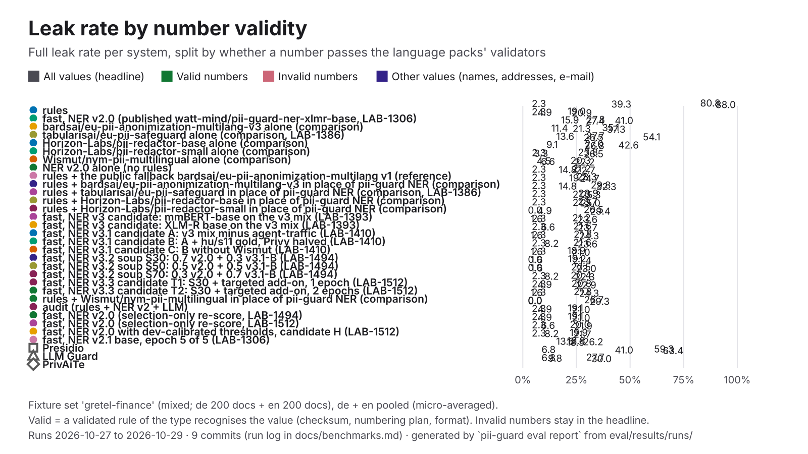

| System | Leak | Recall, valid numbers | Leak, valid numbers | Recall, invalid numbers | Leak, invalid numbers | Leak, other values |
|---|---:|---:|---:|---:|---:|---:|
| **pii-guard rules** | 80.8% | 98.0% (50/51) | 2.3% (1/44) | 54.5% (36/66) | 39.3% (24/61) | 88.0% (738/839) |
| pii-guard fast, NER v4.2 (published, LAB-1625) | 19.1% | 98.0% (50/51) | 2.3% (1/44) | 92.4% (61/66) | 3.3% (2/61) | 21.1% (177/839) |
| bardsai/eu-pii-anonimization-multilang-v3 alone (comparison) | 27.8% | 82.4% (42/51) | 15.9% (7/44) | 59.1% (39/66) | 41.0% (25/61) | 27.4% (230/839) |
| tabularisai/eu-pii-safeguard alone (comparison, LAB-1386) | 35.1% | 74.5% (38/51) | 11.4% (5/44) | 69.7% (46/66) | 21.3% (13/61) | 37.3% (313/839) |
| Horizon-Labs/pii-redactor-base alone (comparison) | 27.7% | 80.4% (41/51) | 13.6% (6/44) | 40.9% (27/66) | 54.1% (33/61) | 26.5% (222/839) |
| Horizon-Labs/pii-redactor-small alone (comparison) | 27.0% | 88.2% (45/51) | 9.1% (4/44) | 54.5% (36/66) | 42.6% (26/61) | 26.8% (225/839) |
| pii-guard NER v4.2 (B3) alone (no rules) (LAB-1625) | 20.2% | 92.2% (47/51) | 4.5% (2/44) | 92.4% (61/66) | 3.3% (2/61) | 22.3% (187/839) |
| Wismut/nym-pii-multilingual alone (comparison) | 23.8% | 96.1% (49/51) | 2.3% (1/44) | 92.4% (61/66) | 3.3% (2/61) | 26.5% (222/839) |
| pii-guard NER v2.0 alone (no rules) | 20.4% | 88.2% (45/51) | 4.5% (2/44) | 86.4% (57/66) | 6.6% (4/61) | 22.3% (187/839) |
| rules + the public fallback bardsai/eu-pii-anonimization-multilang v1 (reference) | 21.2% | 92.2% (47/51) | 2.3% (1/44) | 75.8% (50/66) | 14.8% (9/61) | 22.6% (190/839) |
| rules + bardsai/eu-pii-anonimization-multilang-v3 in place of pii-guard NER (comparison) | 23.3% | 98.0% (50/51) | 2.3% (1/44) | 78.8% (52/66) | 19.7% (12/61) | 24.7% (207/839) |
| rules + tabularisai/eu-pii-safeguard in place of pii-guard NER (comparison, LAB-1386) | 29.8% | 96.1% (49/51) | 2.3% (1/44) | 77.3% (51/66) | 14.8% (9/61) | 32.3% (271/839) |
| rules + Horizon-Labs/pii-redactor-base in place of pii-guard NER (comparison) | 23.9% | 98.0% (50/51) | 2.3% (1/44) | 71.2% (47/66) | 21.3% (13/61) | 25.3% (212/839) |
| rules + Horizon-Labs/pii-redactor-small in place of pii-guard NER (comparison) | 23.7% | 98.0% (50/51) | 2.3% (1/44) | 74.2% (49/66) | 21.3% (13/61) | 25.0% (210/839) |
| pii-guard fast, NER v3 candidate: mmBERT-base on the v3 mix (LAB-1393) | 26.5% | 100.0% (51/51) | 0.0% (0/44) | 87.9% (58/66) | 4.9% (3/61) | 29.4% (247/839) |
| pii-guard fast, NER v3 candidate: XLM-R base on the v3 mix (LAB-1393) | 21.2% | 98.0% (50/51) | 2.3% (1/44) | 97.0% (64/66) | 1.6% (1/61) | 23.6% (198/839) |
| pii-guard fast, NER v3.1 candidate A: v3 mix minus agent-traffic (LAB-1410) | 21.6% | 98.0% (50/51) | 2.3% (1/44) | 92.4% (61/66) | 6.6% (4/61) | 23.7% (199/839) |
| pii-guard fast, NER v3.1 candidate B: A + hu/s11 gold, Privy halved (LAB-1410) | 21.8% | 98.0% (50/51) | 2.3% (1/44) | 95.5% (63/66) | 1.6% (1/61) | 24.3% (204/839) |
| pii-guard fast, NER v3.1 candidate C: B without Wismut (LAB-1410) | 21.6% | 98.0% (50/51) | 2.3% (1/44) | 86.4% (57/66) | 8.2% (5/61) | 23.6% (198/839) |
| pii-guard fast, NER v3.2 soup S30: 0.7 v2.0 + 0.3 v3.1-B (LAB-1494) | 18.9% | 96.1% (49/51) | 2.3% (1/44) | 95.5% (63/66) | 1.6% (1/61) | 21.0% (176/839) |
| pii-guard fast, NER v3.2 soup S50: 0.5 v2.0 + 0.5 v3.1-B (LAB-1494) | 19.2% | 100.0% (51/51) | 0.0% (0/44) | 95.5% (63/66) | 1.6% (1/61) | 21.5% (180/839) |
| pii-guard fast, NER v3.2 soup S70: 0.3 v2.0 + 0.7 v3.1-B (LAB-1494) | 20.5% | 100.0% (51/51) | 0.0% (0/44) | 95.5% (63/66) | 1.6% (1/61) | 23.0% (193/839) |
| pii-guard fast, NER v3.3 candidate T1: S30 + targeted add-on, 1 epoch (LAB-1512) | 20.4% | 98.0% (50/51) | 2.3% (1/44) | 89.4% (59/66) | 8.2% (5/61) | 22.3% (187/839) |
| pii-guard fast, NER v3.3 candidate T2: S30 + targeted add-on, 2 epochs (LAB-1512) | 20.8% | 98.0% (50/51) | 2.3% (1/44) | 90.9% (60/66) | 4.9% (3/61) | 22.9% (192/839) |
| rules + Wismut/nym-pii-multilingual in place of pii-guard NER (comparison) | 21.8% | 98.0% (50/51) | 2.3% (1/44) | 93.9% (62/66) | 1.6% (1/61) | 24.3% (204/839) |
| pii-guard fast, NER v2.0 (published watt-mind/pii-guard-ner-xlmr-base, LAB-1306) | 19.0% | 96.1% (49/51) | 2.3% (1/44) | 87.9% (58/66) | 4.9% (3/61) | 20.9% (175/839) |
| pii-guard audit (rules + NER v2 + LLM) | 26.7% | 0.0% (0/1) | 0.0% (0/1) | 100.0% (3/3) | 0.0% (0/3) | 29.3% (12/41) |
| pii-guard fast, NER v2.0 (selection-only re-score, LAB-1494) | 19.1% | 96.1% (49/51) | 2.3% (1/44) | 87.9% (58/66) | 4.9% (3/61) | 21.0% (176/839) |
| pii-guard fast, NER v2.0 (selection-only re-score, LAB-1512) | 19.1% | 96.1% (49/51) | 2.3% (1/44) | 87.9% (58/66) | 4.9% (3/61) | 21.0% (176/839) |
| pii-guard fast, NER v2.0 (selection-only re-score, LAB-1625) | 19.1% | 98.0% (50/51) | 2.3% (1/44) | 89.4% (59/66) | 4.9% (3/61) | 21.0% (176/839) |
| pii-guard fast, NER v2.0 with dev-calibrated thresholds, candidate H (LAB-1512) | 20.0% | 98.0% (50/51) | 2.3% (1/44) | 86.4% (57/66) | 6.6% (4/61) | 21.9% (184/839) |
| pii-guard fast, NER v2.1 base, epoch 5 of 5 (LAB-1306) | 19.9% | 98.0% (50/51) | 2.3% (1/44) | 89.4% (59/66) | 8.2% (5/61) | 21.7% (182/839) |
| Presidio | 18.8% | 66.7% (34/51) | 13.6% (6/44) | 43.9% (29/66) | 26.2% (16/61) | 18.5% (155/839) |
| LLM Guard | 59.3% | 90.2% (46/51) | 6.8% (3/44) | 34.8% (23/66) | 41.0% (25/61) | 63.4% (532/839) |
| PrivAiTe | 27.7% | 82.4% (42/51) | 6.8% (3/44) | 54.5% (36/66) | 9.8% (6/61) | 30.0% (252/839) |

### `gretel-finance-corrected`

hand-written; documents: de 200 + en 200.

| System | Docs | Precision | Recall | F1 | Leak | Partial leak | Over-masking | Round trip | Detect p50 | Run | Commit |
|---|---:|---:|---:|---:|---:|---:|---:|---:|---:|---|---|
| **pii-guard rules** | 400 | 77.5% | 13.5% | 23.0% | 77.1% | 6.7% | 21.8% | 100.0% | 4.1 ms | 2026-10-29 | `e6e2fc1` |
| pii-guard fast, NER v4.2 (published, LAB-1625) | 400 | 75.4% | 86.2% | 80.4% | 2.4% | 4.0% | 24.4% | 99.8% | 113 ms | 2026-10-30 | `40accd5` |
| bardsai/eu-pii-anonimization-multilang-v3 alone (comparison) | 400 | 83.9% | 67.8% | 75.0% | 12.7% | 5.8% | 14.7% | 100.0% | 593 ms | 2026-10-29 | `e6e2fc1` |
| tabularisai/eu-pii-safeguard alone (comparison) | 400 | 74.3% | 46.5% | 57.2% | 21.7% | 17.2% | 25.7% | 99.5% | 377 ms | 2026-10-29 | `e6e2fc1` |
| Horizon-Labs/pii-redactor-base alone (comparison) | 400 | 81.8% | 68.9% | 74.8% | 12.6% | 8.3% | 17.9% | 100.0% | 949 ms | 2026-10-29 | `e6e2fc1` |
| Horizon-Labs/pii-redactor-small alone (comparison) | 400 | 80.5% | 65.8% | 72.4% | 11.8% | 7.7% | 18.1% | 100.0% | 645 ms | 2026-10-29 | `e6e2fc1` |
| pii-guard NER v4.2 (B3) alone (no rules) (LAB-1625) | 400 | 75.5% | 85.0% | 80.0% | 3.9% | 4.0% | 24.5% | 99.8% | 87 ms | 2026-10-30 | `40accd5` |
| Wismut/nym-pii-multilingual alone (comparison) | 400 | 72.6% | 79.9% | 76.1% | 8.2% | 6.2% | 26.4% | 100.0% | 571 ms | 2026-10-29 | `e6e2fc1` |
| pii-guard NER v2.0 alone (no rules) | 400 | 74.9% | 75.3% | 75.1% | 4.1% | 3.1% | 21.9% | 99.5% | 81 ms | 2026-10-30 | `40accd5` |
| rules + the public fallback bardsai/eu-pii-anonimization-multilang v1 (reference) | 400 | 65.3% | 87.9% | 74.9% | 6.6% | 8.1% | 31.0% | 99.5% | 112 ms | 2026-10-29 | `e6e2fc1` |
| rules + bardsai/eu-pii-anonimization-multilang-v3 in place of pii-guard NER (comparison) | 400 | 83.1% | 71.6% | 76.9% | 7.5% | 5.5% | 15.6% | 100.0% | 965 ms | 2026-10-29 | `e6e2fc1` |
| rules + tabularisai/eu-pii-safeguard in place of pii-guard NER (comparison) | 400 | 75.1% | 51.9% | 61.4% | 15.3% | 17.1% | 25.2% | 99.8% | 368 ms | 2026-10-29 | `e6e2fc1` |
| rules + Horizon-Labs/pii-redactor-base in place of pii-guard NER (comparison) | 400 | 81.2% | 71.9% | 76.2% | 8.2% | 8.5% | 18.5% | 100.0% | 856 ms | 2026-10-29 | `e6e2fc1` |
| rules + Horizon-Labs/pii-redactor-small in place of pii-guard NER (comparison) | 400 | 80.2% | 68.7% | 74.0% | 8.0% | 7.5% | 18.4% | 100.0% | 855 ms | 2026-10-29 | `e6e2fc1` |
| rules + Wismut/nym-pii-multilingual in place of pii-guard NER (comparison) | 400 | 72.3% | 81.7% | 76.7% | 5.8% | 6.2% | 26.8% | 100.0% | 416 ms | 2026-10-29 | `e6e2fc1` |
| pii-guard fast, NER v2.0 (published watt-mind/pii-guard-ner-xlmr-base, LAB-1306) | 400 | 74.9% | 76.7% | 75.8% | 2.4% | 3.0% | 21.8% | 99.5% | 329 ms | 2026-10-29 | `f2f9818` |
| pii-guard fast, NER v2.0 (selection-only re-score, LAB-1625) | 400 | 75.0% | 76.8% | 75.9% | 2.4% | 3.1% | 21.8% | 99.5% | 87 ms | 2026-10-30 | `40accd5` |
| Presidio | 400 | 18.3% | 67.5% | 28.8% | 14.8% | 20.2% | 76.7% | — | 38 ms | 2026-10-29 | `e6e2fc1` |
| LLM Guard | 400 | 76.0% | 30.9% | 43.9% | 51.3% | 9.9% | 17.0% | 100.0% | 193 ms | 2026-10-29 | `e6e2fc1` |
| PrivAiTe | 400 | 46.5% | 54.2% | 50.1% | 13.2% | 6.8% | 46.6% | 94.8% | 504 ms | 2026-10-29 | `e6e2fc1` |

By language:

| System | de F1 | en F1 | de leak | en leak |
|---|---:|---:|---:|---:|
| **pii-guard rules** | 23.7% | 22.4% | 76.2% | 78.1% |
| pii-guard fast, NER v4.2 (published, LAB-1625) | 79.2% | 81.6% | 2.0% | 2.9% |
| bardsai/eu-pii-anonimization-multilang-v3 alone (comparison) | 80.0% | 69.4% | 9.1% | 16.4% |
| tabularisai/eu-pii-safeguard alone (comparison) | 57.1% | 57.3% | 22.3% | 21.1% |
| Horizon-Labs/pii-redactor-base alone (comparison) | 74.0% | 75.7% | 10.1% | 15.1% |
| Horizon-Labs/pii-redactor-small alone (comparison) | 72.0% | 72.9% | 9.4% | 14.4% |
| pii-guard NER v4.2 (B3) alone (no rules) (LAB-1625) | 78.9% | 81.0% | 3.0% | 4.7% |
| Wismut/nym-pii-multilingual alone (comparison) | 75.4% | 76.7% | 5.8% | 10.7% |
| pii-guard NER v2.0 alone (no rules) | 70.6% | 79.6% | 3.5% | 4.7% |
| rules + the public fallback bardsai/eu-pii-anonimization-multilang v1 (reference) | 76.6% | 73.4% | 5.3% | 7.8% |
| rules + bardsai/eu-pii-anonimization-multilang-v3 in place of pii-guard NER (comparison) | 80.6% | 72.8% | 5.6% | 9.4% |
| rules + tabularisai/eu-pii-safeguard in place of pii-guard NER (comparison) | 60.8% | 62.0% | 16.0% | 14.6% |
| rules + Horizon-Labs/pii-redactor-base in place of pii-guard NER (comparison) | 74.8% | 77.8% | 6.8% | 9.7% |
| rules + Horizon-Labs/pii-redactor-small in place of pii-guard NER (comparison) | 72.6% | 75.4% | 7.6% | 8.4% |
| rules + Wismut/nym-pii-multilingual in place of pii-guard NER (comparison) | 75.4% | 78.0% | 4.6% | 7.0% |
| pii-guard fast, NER v2.0 (published watt-mind/pii-guard-ner-xlmr-base, LAB-1306) | 71.2% | 80.3% | 2.3% | 2.6% |
| pii-guard fast, NER v2.0 (selection-only re-score, LAB-1625) | 71.2% | 80.7% | 2.3% | 2.6% |
| Presidio | 21.5% | 41.5% | 14.7% | 14.9% |
| LLM Guard | 46.2% | 41.7% | 47.1% | 55.6% |
| PrivAiTe | 48.8% | 51.5% | 12.7% | 13.8% |

**Number validity.** The headline leak above, split by whether a structured identifier passes the language packs' own validators (card Luhn, IBAN, TAJ and tax-ID check digits, phone numbering plans, ID-document checksums and formats). Invalid numbers stay in the headline: a mistyped real identifier is still personal data ([evaluation.md](evaluation.md#number-validity)). Valid values per type: `PHONE` 32/50, `ID_DOCUMENT` 8/33, `BANK_ACCOUNT` 11/33.

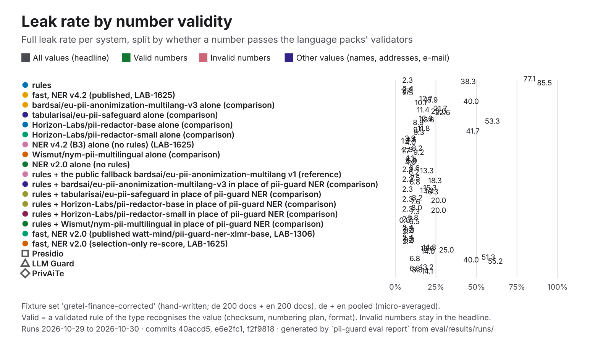

| System | Leak | Recall, valid numbers | Leak, valid numbers | Recall, invalid numbers | Leak, invalid numbers | Leak, other values |
|---|---:|---:|---:|---:|---:|---:|
| **pii-guard rules** | 77.1% | 98.0% (50/51) | 2.3% (1/44) | 55.4% (36/65) | 38.3% (23/60) | 85.5% (576/674) |
| pii-guard fast, NER v4.2 (published, LAB-1625) | 2.4% | 98.0% (50/51) | 2.3% (1/44) | 93.8% (61/65) | 1.7% (1/60) | 2.5% (17/674) |
| bardsai/eu-pii-anonimization-multilang-v3 alone (comparison) | 12.7% | 82.4% (42/51) | 15.9% (7/44) | 60.0% (39/65) | 40.0% (24/60) | 10.1% (68/674) |
| tabularisai/eu-pii-safeguard alone (comparison) | 21.7% | 74.5% (38/51) | 11.4% (5/44) | 70.8% (46/65) | 20.0% (12/60) | 22.6% (152/674) |
| Horizon-Labs/pii-redactor-base alone (comparison) | 12.6% | 80.4% (41/51) | 13.6% (6/44) | 41.5% (27/65) | 53.3% (32/60) | 8.9% (60/674) |
| Horizon-Labs/pii-redactor-small alone (comparison) | 11.8% | 88.2% (45/51) | 9.1% (4/44) | 55.4% (36/65) | 41.7% (25/60) | 9.3% (63/674) |
| pii-guard NER v4.2 (B3) alone (no rules) (LAB-1625) | 3.9% | 92.2% (47/51) | 4.5% (2/44) | 93.8% (61/65) | 1.7% (1/60) | 4.0% (27/674) |
| Wismut/nym-pii-multilingual alone (comparison) | 8.2% | 96.1% (49/51) | 2.3% (1/44) | 93.8% (61/65) | 1.7% (1/60) | 9.2% (62/674) |
| pii-guard NER v2.0 alone (no rules) | 4.1% | 88.2% (45/51) | 4.5% (2/44) | 87.7% (57/65) | 5.0% (3/60) | 4.0% (27/674) |
| rules + the public fallback bardsai/eu-pii-anonimization-multilang v1 (reference) | 6.6% | 92.2% (47/51) | 2.3% (1/44) | 76.9% (50/65) | 13.3% (8/60) | 6.2% (42/674) |
| rules + bardsai/eu-pii-anonimization-multilang-v3 in place of pii-guard NER (comparison) | 7.5% | 98.0% (50/51) | 2.3% (1/44) | 80.0% (52/65) | 18.3% (11/60) | 6.8% (46/674) |
| rules + tabularisai/eu-pii-safeguard in place of pii-guard NER (comparison) | 15.3% | 96.1% (49/51) | 2.3% (1/44) | 78.5% (51/65) | 13.3% (8/60) | 16.3% (110/674) |
| rules + Horizon-Labs/pii-redactor-base in place of pii-guard NER (comparison) | 8.2% | 98.0% (50/51) | 2.3% (1/44) | 72.3% (47/65) | 20.0% (12/60) | 7.6% (51/674) |
| rules + Horizon-Labs/pii-redactor-small in place of pii-guard NER (comparison) | 8.0% | 98.0% (50/51) | 2.3% (1/44) | 75.4% (49/65) | 20.0% (12/60) | 7.3% (49/674) |
| rules + Wismut/nym-pii-multilingual in place of pii-guard NER (comparison) | 5.8% | 98.0% (50/51) | 2.3% (1/44) | 95.4% (62/65) | 0.0% (0/60) | 6.5% (44/674) |
| pii-guard fast, NER v2.0 (published watt-mind/pii-guard-ner-xlmr-base, LAB-1306) | 2.4% | 96.1% (49/51) | 2.3% (1/44) | 89.2% (58/65) | 3.3% (2/60) | 2.4% (16/674) |
| pii-guard fast, NER v2.0 (selection-only re-score, LAB-1625) | 2.4% | 98.0% (50/51) | 2.3% (1/44) | 90.8% (59/65) | 3.3% (2/60) | 2.4% (16/674) |
| Presidio | 14.8% | 66.7% (34/51) | 13.6% (6/44) | 44.6% (29/65) | 25.0% (15/60) | 13.9% (94/674) |
| LLM Guard | 51.3% | 90.2% (46/51) | 6.8% (3/44) | 35.4% (23/65) | 40.0% (24/60) | 55.2% (372/674) |
| PrivAiTe | 13.2% | 82.4% (42/51) | 6.8% (3/44) | 55.4% (36/65) | 8.3% (5/60) | 14.1% (95/674) |

### `inflection`

hand-written; documents: hu 12.

| System | Docs | Precision | Recall | F1 | Leak | Partial leak | Over-masking | Round trip | Detect p50 | Run | Commit |
|---|---:|---:|---:|---:|---:|---:|---:|---:|---:|---|---|
| **pii-guard rules** | 12 | 100.0% | 14.8% | 25.7% | 84.0% | 4.0% | 0.0% | 100.0% | 0.29 ms | 2026-10-28 | `cce2b66` |
| pii-guard fast, NER v4.2 (published, LAB-1625) | 12 | 100.0% | 100.0% | 100.0% | 0.0% | 2.0% | 0.0% | 100.0% | 35 ms | 2026-10-30 | `357175c` |
| bardsai/eu-pii-anonimization-multilang-v3 alone (comparison) | 12 | 88.9% | 52.5% | 66.0% | 40.0% | 24.0% | 0.0% | 100.0% | 65 ms | 2026-10-28 | `97ee284` |
| tabularisai/eu-pii-safeguard alone (comparison, LAB-1386) | 12 | 91.7% | 34.4% | 50.0% | 22.0% | 24.0% | 0.0% | 100.0% | 110 ms | 2026-10-28 | `36a78e3` |
| Horizon-Labs/pii-redactor-base alone (comparison) | 12 | 94.6% | 57.4% | 71.4% | 20.0% | 42.0% | 0.0% | 100.0% | 51 ms | 2026-10-28 | `97ee284` |
| Horizon-Labs/pii-redactor-small alone (comparison) | 12 | 90.9% | 65.6% | 76.2% | 16.0% | 60.0% | 0.0% | 100.0% | 43 ms | 2026-10-28 | `97ee284` |
| Wismut/nym-pii-multilingual alone (comparison) | 12 | 96.5% | 91.8% | 94.1% | 4.0% | 10.0% | 0.0% | 100.0% | 62 ms | 2026-10-28 | `97ee284` |
| pii-guard NER v2.0 alone (no rules) | 12 | 98.2% | 88.5% | 93.1% | 4.0% | 30.0% | 0.0% | 100.0% | 70 ms | 2026-10-28 | `97ee284` |
| rules + the public fallback bardsai/eu-pii-anonimization-multilang v1 (reference) | 12 | 96.8% | 98.4% | 97.6% | 0.0% | 4.0% | 1.6% | 100.0% | 47 ms | 2026-10-28 | `97ee284` |
| rules + bardsai/eu-pii-anonimization-multilang-v3 in place of pii-guard NER (comparison) | 12 | 90.0% | 59.0% | 71.3% | 34.0% | 26.0% | 0.0% | 100.0% | 55 ms | 2026-10-28 | `97ee284` |
| rules + tabularisai/eu-pii-safeguard in place of pii-guard NER (comparison, LAB-1386) | 12 | 100.0% | 39.3% | 56.5% | 22.0% | 22.0% | 0.0% | 100.0% | 102 ms | 2026-10-28 | `36a78e3` |
| rules + Horizon-Labs/pii-redactor-base in place of pii-guard NER (comparison) | 12 | 97.4% | 62.3% | 76.0% | 18.0% | 42.0% | 0.0% | 100.0% | 48 ms | 2026-10-28 | `97ee284` |
| rules + Horizon-Labs/pii-redactor-small in place of pii-guard NER (comparison) | 12 | 95.6% | 70.5% | 81.1% | 16.0% | 60.0% | 2.2% | 100.0% | 30 ms | 2026-10-28 | `97ee284` |
| pii-guard fast, NER v3 candidate: mmBERT-base on the v3 mix (LAB-1393) | 12 | 100.0% | 75.4% | 86.0% | 12.0% | 36.0% | 0.0% | 91.7% | 53 ms | 2026-10-28 | `da9883e` |
| pii-guard fast, NER v3 candidate: XLM-R base on the v3 mix (LAB-1393) | 12 | 100.0% | 100.0% | 100.0% | 0.0% | 8.0% | 0.0% | 100.0% | 33 ms | 2026-10-28 | `da9883e` |
| pii-guard fast, NER v3.1 candidate A: v3 mix minus agent-traffic (LAB-1410) | 12 | 100.0% | 90.2% | 94.8% | 4.0% | 28.0% | 0.0% | 100.0% | 34 ms | 2026-10-28 | `72026a5` |
| pii-guard fast, NER v3.1 candidate B: A + hu/s11 gold, Privy halved (LAB-1410) | 12 | 100.0% | 100.0% | 100.0% | 0.0% | 26.0% | 0.0% | 100.0% | 35 ms | 2026-10-28 | `72026a5` |
| pii-guard fast, NER v3.1 candidate C: B without Wismut (LAB-1410) | 12 | 100.0% | 91.8% | 95.7% | 4.0% | 24.0% | 0.0% | 100.0% | 36 ms | 2026-10-28 | `72026a5` |
| pii-guard fast, NER v3.2 soup S30: 0.7 v2.0 + 0.3 v3.1-B (LAB-1494) | 12 | 100.0% | 96.7% | 98.3% | 0.0% | 32.0% | 0.0% | 100.0% | 68 ms | 2026-10-29 | `2b3c7ba` |
| pii-guard fast, NER v3.2 soup S50: 0.5 v2.0 + 0.5 v3.1-B (LAB-1494) | 12 | 100.0% | 96.7% | 98.3% | 0.0% | 26.0% | 0.0% | 100.0% | 68 ms | 2026-10-29 | `2b3c7ba` |
| pii-guard fast, NER v3.2 soup S70: 0.3 v2.0 + 0.7 v3.1-B (LAB-1494) | 12 | 100.0% | 100.0% | 100.0% | 0.0% | 22.0% | 0.0% | 100.0% | 70 ms | 2026-10-29 | `2b3c7ba` |
| pii-guard fast, NER v3.3 candidate T1: S30 + targeted add-on, 1 epoch (LAB-1512) | 12 | 100.0% | 100.0% | 100.0% | 0.0% | 22.0% | 0.0% | 100.0% | 235 ms | 2026-10-29 | `d22908a` |
| pii-guard fast, NER v3.3 candidate T2: S30 + targeted add-on, 2 epochs (LAB-1512) | 12 | 100.0% | 100.0% | 100.0% | 0.0% | 20.0% | 0.0% | 100.0% | 133 ms | 2026-10-29 | `d22908a` |
| pii-guard fast, NER v4 candidate A: v2.0 + EU phase-1 data, 1 epoch (LAB-1535) | 12 | 100.0% | 96.7% | 98.3% | 0.0% | 24.0% | 0.0% | 100.0% | 32 ms | 2026-10-29 | `51fdc76` |
| pii-guard fast, NER v4 candidate B: 0.5 v2.0 + 0.5 B-raw soup (LAB-1535) | 12 | 100.0% | 93.4% | 96.6% | 2.0% | 22.0% | 0.0% | 100.0% | 79 ms | 2026-10-29 | `51fdc76` |
| pii-guard fast, NER v4 candidate B-raw: v2.0 + EU data, 2 epochs (LAB-1535) | 12 | 100.0% | 90.2% | 94.8% | 2.0% | 16.0% | 0.0% | 100.0% | 31 ms | 2026-10-29 | `51fdc76` |
| pii-guard fast, NER v4.1 candidate A1: v4-A recipe + v4.1 data, loose ADDRESS kept out of the loss (LAB-1547) | 12 | 100.0% | 100.0% | 100.0% | 0.0% | 14.0% | 0.0% | 100.0% | 34 ms | 2026-10-30 | `251926c` |
| pii-guard fast, NER v4.1 candidate A2: v4-A recipe + v4.1 data, loose ADDRESS taught as O (LAB-1547) | 12 | 100.0% | 100.0% | 100.0% | 0.0% | 14.0% | 0.0% | 100.0% | 35 ms | 2026-10-30 | `251926c` |
| pii-guard fast, NER v4.2 candidate B1: v4.1-A1 mix, implausible third-party birth dates taught as O, v4.2 targeted data (LAB-1625) | 12 | 100.0% | 100.0% | 100.0% | 0.0% | 2.0% | 0.0% | 100.0% | 52 ms | 2026-10-30 | `357175c` |
| pii-guard fast, NER v4.2 candidate B2: v4.1-A1 mix, uncued third-party birth dates out of the loss, v4.2 targeted data (LAB-1625) | 12 | 100.0% | 100.0% | 100.0% | 0.0% | 2.0% | 0.0% | 100.0% | 37 ms | 2026-10-30 | `357175c` |
| pii-guard fast, NER v4.2 B3 with dev-calibrated thresholds, post-hoc, not a protocol candidate (LAB-1625) | 12 | 100.0% | 100.0% | 100.0% | 0.0% | 2.0% | 0.0% | 100.0% | 33 ms | 2026-10-30 | `357175c` |
| pii-guard fast, NER v4.2 candidate B4: soup 0.5 v2.0 + 0.5 B1 (LAB-1625) | 12 | 100.0% | 100.0% | 100.0% | 0.0% | 14.0% | 0.0% | 100.0% | 33 ms | 2026-10-30 | `357175c` |
| rules + Wismut/nym-pii-multilingual in place of pii-guard NER (comparison) | 12 | 96.7% | 96.7% | 96.7% | 0.0% | 10.0% | 0.0% | 100.0% | 105 ms | 2026-10-28 | `97ee284` |
| pii-guard fast, NER v2.0 (published watt-mind/pii-guard-ner-xlmr-base, LAB-1306) | 12 | 100.0% | 93.4% | 96.6% | 2.0% | 30.0% | 0.0% | 100.0% | 37 ms | 2026-10-28 | `72026a5` |
| pii-guard fast, NER v2.0 (selection-only re-score, LAB-1494) | 12 | 100.0% | 93.4% | 96.6% | 2.0% | 30.0% | 0.0% | 100.0% | 119 ms | 2026-10-29 | `2b3c7ba` |
| pii-guard fast, NER v2.0 (selection-only re-score, LAB-1512) | 12 | 100.0% | 93.4% | 96.6% | 2.0% | 30.0% | 0.0% | 100.0% | 47 ms | 2026-10-29 | `d22908a` |
| pii-guard fast, NER v2.0 (selection-only re-score, LAB-1535) | 12 | 100.0% | 93.4% | 96.6% | 2.0% | 30.0% | 0.0% | 100.0% | 36 ms | 2026-10-29 | `51fdc76` |
| pii-guard fast, NER v2.0 (selection-only re-score, LAB-1547) | 12 | 100.0% | 93.4% | 96.6% | 2.0% | 30.0% | 0.0% | 100.0% | 34 ms | 2026-10-30 | `251926c` |
| pii-guard fast, NER v2.0 (selection-only re-score, LAB-1625) | 12 | 100.0% | 93.4% | 96.6% | 2.0% | 30.0% | 0.0% | 100.0% | 45 ms | 2026-10-30 | `357175c` |
| pii-guard fast, NER v2.0 with dev-calibrated thresholds, candidate H (LAB-1512) | 12 | 100.0% | 90.2% | 94.8% | 4.0% | 30.0% | 0.0% | 100.0% | 60 ms | 2026-10-29 | `ffe349b` |

By language:

| System | hu F1 | hu leak |
|---|---:|---:|
| **pii-guard rules** | 25.7% | 84.0% |
| pii-guard fast, NER v4.2 (published, LAB-1625) | 100.0% | 0.0% |
| bardsai/eu-pii-anonimization-multilang-v3 alone (comparison) | 66.0% | 40.0% |
| tabularisai/eu-pii-safeguard alone (comparison, LAB-1386) | 50.0% | 22.0% |
| Horizon-Labs/pii-redactor-base alone (comparison) | 71.4% | 20.0% |
| Horizon-Labs/pii-redactor-small alone (comparison) | 76.2% | 16.0% |
| Wismut/nym-pii-multilingual alone (comparison) | 94.1% | 4.0% |
| pii-guard NER v2.0 alone (no rules) | 93.1% | 4.0% |
| rules + the public fallback bardsai/eu-pii-anonimization-multilang v1 (reference) | 97.6% | 0.0% |
| rules + bardsai/eu-pii-anonimization-multilang-v3 in place of pii-guard NER (comparison) | 71.3% | 34.0% |
| rules + tabularisai/eu-pii-safeguard in place of pii-guard NER (comparison, LAB-1386) | 56.5% | 22.0% |
| rules + Horizon-Labs/pii-redactor-base in place of pii-guard NER (comparison) | 76.0% | 18.0% |
| rules + Horizon-Labs/pii-redactor-small in place of pii-guard NER (comparison) | 81.1% | 16.0% |
| pii-guard fast, NER v3 candidate: mmBERT-base on the v3 mix (LAB-1393) | 86.0% | 12.0% |
| pii-guard fast, NER v3 candidate: XLM-R base on the v3 mix (LAB-1393) | 100.0% | 0.0% |
| pii-guard fast, NER v3.1 candidate A: v3 mix minus agent-traffic (LAB-1410) | 94.8% | 4.0% |
| pii-guard fast, NER v3.1 candidate B: A + hu/s11 gold, Privy halved (LAB-1410) | 100.0% | 0.0% |
| pii-guard fast, NER v3.1 candidate C: B without Wismut (LAB-1410) | 95.7% | 4.0% |
| pii-guard fast, NER v3.2 soup S30: 0.7 v2.0 + 0.3 v3.1-B (LAB-1494) | 98.3% | 0.0% |
| pii-guard fast, NER v3.2 soup S50: 0.5 v2.0 + 0.5 v3.1-B (LAB-1494) | 98.3% | 0.0% |
| pii-guard fast, NER v3.2 soup S70: 0.3 v2.0 + 0.7 v3.1-B (LAB-1494) | 100.0% | 0.0% |
| pii-guard fast, NER v3.3 candidate T1: S30 + targeted add-on, 1 epoch (LAB-1512) | 100.0% | 0.0% |
| pii-guard fast, NER v3.3 candidate T2: S30 + targeted add-on, 2 epochs (LAB-1512) | 100.0% | 0.0% |
| pii-guard fast, NER v4 candidate A: v2.0 + EU phase-1 data, 1 epoch (LAB-1535) | 98.3% | 0.0% |
| pii-guard fast, NER v4 candidate B: 0.5 v2.0 + 0.5 B-raw soup (LAB-1535) | 96.6% | 2.0% |
| pii-guard fast, NER v4 candidate B-raw: v2.0 + EU data, 2 epochs (LAB-1535) | 94.8% | 2.0% |
| pii-guard fast, NER v4.1 candidate A1: v4-A recipe + v4.1 data, loose ADDRESS kept out of the loss (LAB-1547) | 100.0% | 0.0% |
| pii-guard fast, NER v4.1 candidate A2: v4-A recipe + v4.1 data, loose ADDRESS taught as O (LAB-1547) | 100.0% | 0.0% |
| pii-guard fast, NER v4.2 candidate B1: v4.1-A1 mix, implausible third-party birth dates taught as O, v4.2 targeted data (LAB-1625) | 100.0% | 0.0% |
| pii-guard fast, NER v4.2 candidate B2: v4.1-A1 mix, uncued third-party birth dates out of the loss, v4.2 targeted data (LAB-1625) | 100.0% | 0.0% |
| pii-guard fast, NER v4.2 B3 with dev-calibrated thresholds, post-hoc, not a protocol candidate (LAB-1625) | 100.0% | 0.0% |
| pii-guard fast, NER v4.2 candidate B4: soup 0.5 v2.0 + 0.5 B1 (LAB-1625) | 100.0% | 0.0% |
| rules + Wismut/nym-pii-multilingual in place of pii-guard NER (comparison) | 96.7% | 0.0% |
| pii-guard fast, NER v2.0 (published watt-mind/pii-guard-ner-xlmr-base, LAB-1306) | 96.6% | 2.0% |
| pii-guard fast, NER v2.0 (selection-only re-score, LAB-1494) | 96.6% | 2.0% |
| pii-guard fast, NER v2.0 (selection-only re-score, LAB-1512) | 96.6% | 2.0% |
| pii-guard fast, NER v2.0 (selection-only re-score, LAB-1535) | 96.6% | 2.0% |
| pii-guard fast, NER v2.0 (selection-only re-score, LAB-1547) | 96.6% | 2.0% |
| pii-guard fast, NER v2.0 (selection-only re-score, LAB-1625) | 96.6% | 2.0% |
| pii-guard fast, NER v2.0 with dev-calibrated thresholds, candidate H (LAB-1512) | 94.8% | 4.0% |

### `injection`

hand-written; documents: en 31 + hu 31.

| System | Docs | Precision | Recall | F1 | Leak | Partial leak | Over-masking | Round trip | Detect p50 | Run | Commit |
|---|---:|---:|---:|---:|---:|---:|---:|---:|---:|---|---|
| **pii-guard rules** | 62 | 100.0% | 45.7% | 62.7% | 54.3% | 20.0% | 0.0% | 100.0% | 0.63 ms | 2026-10-29 | `2165bc3` |
| pii-guard rules + Muse Spark Open (Baseten) | 62 | 100.0% | 100.0% | 100.0% | 0.0% | 0.0% | 0.0% | 100.0% | 1.9 s | 2026-10-27 | `fb1502e` |
| pii-guard rules + Muse Spark 1.3 | 62 | 100.0% | 100.0% | 100.0% | 0.0% | 1.7% | 0.0% | 100.0% | 3.3 s | 2026-10-27 | `9fad0fa` |

By language:

| System | en F1 | hu F1 | en leak | hu leak |
|---|---:|---:|---:|---:|
| **pii-guard rules** | 60.8% | 64.6% | 56.3% | 52.3% |
| pii-guard rules + Muse Spark Open (Baseten) | 100.0% | 100.0% | 0.0% | 0.0% |
| pii-guard rules + Muse Spark 1.3 | 100.0% | 100.0% | 0.0% | 0.0% |

### `mapa-eur-lex`

hand-written; documents: bg 2 + cs 2 + da 2 + de 2 + el 2 + en 2 + es 2 + et 2 + fi 2 + fr 2 + ga 2 + hu 2 + it 2 + lt 2 + lv 2 + mt 2 + nl 2 + pt 2 + ro 2 + sk 2 + sv 2.

| System | Docs | Precision | Recall | F1 | Leak | Partial leak | Over-masking | Round trip | Detect p50 | Run | Commit |
|---|---:|---:|---:|---:|---:|---:|---:|---:|---:|---|---|
| **pii-guard rules** | 42 | 0.0% | 0.0% | 0.0% | 99.3% | 0.4% | 100.0% | 100.0% | 190 ms | 2026-10-28 | `57ab2ed` |
| pii-guard fast, NER v4.2 (published, LAB-1625) | 42 | 47.1% | 78.7% | 58.9% | 8.5% | 0.3% | 44.7% | 73.8% | 2.7 s | 2026-10-30 | `357175c` |
| bardsai/eu-pii-anonimization-multilang v1 alone (MAPA baseline, LAB-1516) | 42 | 10.6% | 71.7% | 18.5% | 29.5% | 1.1% | 60.8% | 21.4% | — | 2026-10-29 | `d3ac82e` |
| tabularisai/eu-pii-safeguard alone (MAPA baseline, LAB-1516) | 42 | 49.7% | 53.9% | 51.7% | 21.9% | 7.3% | 33.7% | 92.9% | — | 2026-10-29 | `d3ac82e` |
| pii-guard NER v4.2 (B3) alone (no rules) (LAB-1625) | 42 | 47.1% | 78.7% | 58.9% | 8.5% | 0.3% | 44.7% | 73.8% | 3.4 s | 2026-10-30 | `40accd5` |
| pii-guard NER v2.0 alone (no rules) | 42 | 41.9% | 77.5% | 54.4% | 8.2% | 0.1% | 55.4% | 83.3% | 4.6 s | 2026-10-30 | `40accd5` |
| pii-guard NER v2.0 alone (MAPA baseline, LAB-1516) | 42 | 41.9% | 77.3% | 54.3% | 8.5% | 0.1% | 55.5% | 83.3% | — | 2026-10-29 | `d3ac82e` |
| rules + bardsai/eu-pii-anonimization-multilang v1 (MAPA baseline, LAB-1516) | 42 | 10.6% | 71.7% | 18.5% | 29.5% | 1.1% | 60.8% | 21.4% | — | 2026-10-29 | `d3ac82e` |
| pii-guard fast, NER v3 candidate: mmBERT-base on the v3 mix (LAB-1393) | 42 | 16.5% | 32.5% | 21.9% | 47.7% | 7.8% | 79.3% | 7.1% | 5.1 s | 2026-10-28 | `da9883e` |
| pii-guard fast, NER v3 candidate: XLM-R base on the v3 mix (LAB-1393) | 42 | 38.5% | 72.5% | 50.3% | 15.0% | 0.3% | 46.8% | 71.4% | 2.6 s | 2026-10-28 | `da9883e` |
| pii-guard fast, NER v3.1 candidate A: v3 mix minus agent-traffic (LAB-1410) | 42 | 44.4% | 72.6% | 55.1% | 16.5% | 0.0% | 49.8% | 88.1% | 2.9 s | 2026-10-28 | `72026a5` |
| pii-guard fast, NER v3.1 candidate B: A + hu/s11 gold, Privy halved (LAB-1410) | 42 | 51.7% | 74.9% | 61.2% | 11.6% | 0.3% | 42.5% | 78.6% | 2.8 s | 2026-10-28 | `72026a5` |
| pii-guard fast, NER v3.1 candidate C: B without Wismut (LAB-1410) | 42 | 42.3% | 76.5% | 54.5% | 9.0% | 0.3% | 50.5% | 85.7% | 2.8 s | 2026-10-28 | `72026a5` |
| pii-guard fast, NER v3.2 soup S30: 0.7 v2.0 + 0.3 v3.1-B (LAB-1494) | 42 | 48.2% | 78.0% | 59.6% | 6.8% | 0.0% | 49.3% | 73.8% | 5.9 s | 2026-10-29 | `2b3c7ba` |
| pii-guard fast, NER v3.2 soup S50: 0.5 v2.0 + 0.5 v3.1-B (LAB-1494) | 42 | 52.1% | 77.8% | 62.4% | 6.9% | 0.3% | 44.8% | 69.0% | 4.6 s | 2026-10-29 | `2b3c7ba` |
| pii-guard fast, NER v3.2 soup S70: 0.3 v2.0 + 0.7 v3.1-B (LAB-1494) | 42 | 53.0% | 76.8% | 62.8% | 8.5% | 0.0% | 43.4% | 81.0% | 5.3 s | 2026-10-29 | `2b3c7ba` |
| pii-guard fast, NER v3.3 candidate T1: S30 + targeted add-on, 1 epoch (LAB-1512) | 42 | 49.3% | 73.4% | 59.0% | 14.1% | 0.0% | 40.6% | 81.0% | 12.9 s | 2026-10-29 | `d2e710a` |
| pii-guard fast, NER v3.3 candidate T2: S30 + targeted add-on, 2 epochs (LAB-1512) | 42 | 47.1% | 72.7% | 57.2% | 15.4% | 0.1% | 41.8% | 81.0% | 12.9 s | 2026-10-29 | `d2e710a` |
| pii-guard fast, NER v4 candidate A: v2.0 + EU phase-1 data, 1 epoch (LAB-1535) | 42 | 40.3% | 79.4% | 53.5% | 5.8% | 0.4% | 57.2% | 73.8% | 3.0 s | 2026-10-29 | `51fdc76` |
| pii-guard fast, NER v4 candidate B: 0.5 v2.0 + 0.5 B-raw soup (LAB-1535) | 42 | 41.7% | 78.2% | 54.4% | 7.2% | 0.1% | 55.7% | 71.4% | 3.2 s | 2026-10-29 | `51fdc76` |
| pii-guard fast, NER v4 candidate B-raw: v2.0 + EU data, 2 epochs (LAB-1535) | 42 | 43.3% | 76.7% | 55.3% | 8.5% | 0.0% | 54.1% | 64.3% | 3.0 s | 2026-10-29 | `51fdc76` |
| pii-guard fast, NER v4.1 candidate A1: v4-A recipe + v4.1 data, loose ADDRESS kept out of the loss (LAB-1547) | 42 | 43.6% | 80.7% | 56.6% | 5.9% | 0.3% | 46.7% | 78.6% | 2.7 s | 2026-10-30 | `251926c` |
| pii-guard fast, NER v4.1 candidate A2: v4-A recipe + v4.1 data, loose ADDRESS taught as O (LAB-1547) | 42 | 45.8% | 82.4% | 58.9% | 5.3% | 0.0% | 46.2% | 78.6% | 2.9 s | 2026-10-30 | `251926c` |
| pii-guard fast, NER v4.2 candidate B1: v4.1-A1 mix, implausible third-party birth dates taught as O, v4.2 targeted data (LAB-1625) | 42 | 45.5% | 76.4% | 57.0% | 8.8% | 1.4% | 45.5% | 78.6% | 3.5 s | 2026-10-30 | `357175c` |
| pii-guard fast, NER v4.2 candidate B2: v4.1-A1 mix, uncued third-party birth dates out of the loss, v4.2 targeted data (LAB-1625) | 42 | 45.3% | 76.2% | 56.8% | 9.3% | 0.8% | 45.5% | 78.6% | 2.9 s | 2026-10-30 | `357175c` |
| pii-guard fast, NER v4.2 B3 with dev-calibrated thresholds, post-hoc, not a protocol candidate (LAB-1625) | 42 | 48.4% | 78.1% | 59.8% | 8.9% | 0.3% | 44.2% | 73.8% | 2.6 s | 2026-10-30 | `357175c` |
| pii-guard fast, NER v4.2 candidate B4: soup 0.5 v2.0 + 0.5 B1 (LAB-1625) | 42 | 47.0% | 79.2% | 59.0% | 5.5% | 0.0% | 48.5% | 81.0% | 2.5 s | 2026-10-30 | `357175c` |
| pii-guard fast, NER v2.0 (published watt-mind/pii-guard-ner-xlmr-base, LAB-1306) | 42 | 41.8% | 77.3% | 54.3% | 8.5% | 0.1% | 55.5% | 83.3% | 3.5 s | 2026-10-28 | `72026a5` |
| pii-guard fast, NER v2.0 (MAPA 21-language baseline, LAB-1516) | 42 | 41.8% | 77.3% | 54.3% | 8.5% | 0.1% | 55.5% | 83.3% | — | 2026-10-29 | `d3ac82e` |
| pii-guard fast, NER v2.0 (selection-only re-score, LAB-1494) | 42 | 41.8% | 77.3% | 54.3% | 8.5% | 0.1% | 55.5% | 83.3% | 4.8 s | 2026-10-29 | `2b3c7ba` |
| pii-guard fast, NER v2.0 (selection-only re-score, LAB-1512) | 42 | 41.8% | 77.3% | 54.3% | 8.5% | 0.1% | 55.5% | 83.3% | 12.8 s | 2026-10-29 | `d2e710a` |
| pii-guard fast, NER v2.0 (selection-only re-score, LAB-1535) | 42 | 41.8% | 77.3% | 54.3% | 8.5% | 0.1% | 55.5% | 83.3% | 3.2 s | 2026-10-29 | `51fdc76` |
| pii-guard fast, NER v2.0 (selection-only re-score, LAB-1547) | 42 | 42.0% | 77.5% | 54.5% | 8.2% | 0.1% | 55.3% | 83.3% | 2.7 s | 2026-10-30 | `251926c` |
| pii-guard fast, NER v2.0 (selection-only re-score, LAB-1625) | 42 | 41.9% | 77.5% | 54.4% | 8.2% | 0.1% | 55.5% | 83.3% | 3.0 s | 2026-10-30 | `357175c` |
| pii-guard fast, NER v2.0 with dev-calibrated thresholds, candidate H (LAB-1512) | 42 | 42.1% | 76.9% | 54.4% | 9.0% | 0.1% | 55.5% | 83.3% | 13.8 s | 2026-10-29 | `d2e710a` |
| pii-guard rules alone (MAPA baseline, LAB-1516) | 42 | 0.0% | 0.0% | 0.0% | 99.3% | 0.4% | 100.0% | 100.0% | — | 2026-10-29 | `d3ac82e` |

By language:

| System | bg F1 | cs F1 | da F1 | de F1 | el F1 | en F1 | es F1 | et F1 | fi F1 | fr F1 | ga F1 | hu F1 | it F1 | lt F1 | lv F1 | mt F1 | nl F1 | pt F1 | ro F1 | sk F1 | sv F1 | bg leak | cs leak | da leak | de leak | el leak | en leak | es leak | et leak | fi leak | fr leak | ga leak | hu leak | it leak | lt leak | lv leak | mt leak | nl leak | pt leak | ro leak | sk leak | sv leak |
|---|---:|---:|---:|---:|---:|---:|---:|---:|---:|---:|---:|---:|---:|---:|---:|---:|---:|---:|---:|---:|---:|---:|---:|---:|---:|---:|---:|---:|---:|---:|---:|---:|---:|---:|---:|---:|---:|---:|---:|---:|---:|---:|
| **pii-guard rules** | 0.0% | 0.0% | 0.0% | 0.0% | 0.0% | 0.0% | 0.0% | 0.0% | 0.0% | 0.0% | 0.0% | 0.0% | 0.0% | 0.0% | 0.0% | 0.0% | 0.0% | 0.0% | 0.0% | 0.0% | 0.0% | 100.0% | 100.0% | 94.3% | 100.0% | 100.0% | 100.0% | 100.0% | 97.2% | 93.9% | 100.0% | 100.0% | 100.0% | 100.0% | 100.0% | 100.0% | 100.0% | 100.0% | 100.0% | 100.0% | 100.0% | 100.0% |
| pii-guard fast, NER v4.2 (published, LAB-1625) | 60.8% | 63.1% | 63.9% | 57.0% | 58.5% | 68.4% | 58.4% | 59.9% | 53.1% | 49.9% | 57.8% | 57.8% | 60.0% | 62.0% | 64.5% | 44.6% | 59.4% | 59.9% | 65.8% | 61.5% | 55.6% | 2.8% | 2.7% | 8.6% | 8.8% | 11.1% | 13.5% | 2.9% | 5.6% | 9.1% | 5.9% | 13.5% | 5.7% | 5.9% | 8.6% | 10.5% | 20.0% | 9.1% | 8.1% | 5.9% | 5.7% | 14.3% |
| bardsai/eu-pii-anonimization-multilang v1 alone (MAPA baseline, LAB-1516) | 14.8% | 16.2% | 23.4% | 16.3% | 18.6% | 21.5% | 16.8% | 16.8% | 18.7% | 21.1% | 19.1% | 19.7% | 20.1% | 14.2% | 20.1% | 18.2% | 24.9% | 17.8% | 21.6% | 13.7% | 21.7% | 33.3% | 32.4% | 22.9% | 52.9% | 38.9% | 32.4% | 32.4% | 25.0% | 15.2% | 20.6% | 32.4% | 17.1% | 35.3% | 45.7% | 18.4% | 42.9% | 12.1% | 24.3% | 26.5% | 22.9% | 34.3% |
| tabularisai/eu-pii-safeguard alone (MAPA baseline, LAB-1516) | 50.4% | 45.7% | 54.4% | 58.6% | 51.7% | 46.8% | 55.7% | 52.1% | 48.6% | 46.0% | 52.6% | 54.8% | 50.4% | 50.4% | 49.6% | 43.4% | 52.1% | 55.7% | 57.9% | 56.3% | 53.0% | 25.0% | 35.1% | 20.0% | 20.6% | 25.0% | 27.0% | 14.7% | 16.7% | 15.2% | 26.5% | 21.6% | 22.9% | 23.5% | 20.0% | 28.9% | 28.6% | 21.2% | 18.9% | 14.7% | 11.4% | 20.0% |
| pii-guard NER v4.2 (B3) alone (no rules) (LAB-1625) | 60.8% | 63.1% | 63.9% | 57.0% | 58.5% | 68.4% | 58.4% | 59.9% | 53.1% | 49.9% | 57.8% | 58.1% | 60.0% | 62.0% | 64.5% | 44.6% | 59.4% | 59.9% | 65.8% | 61.5% | 55.6% | 2.8% | 2.7% | 8.6% | 8.8% | 11.1% | 13.5% | 2.9% | 5.6% | 9.1% | 5.9% | 13.5% | 5.7% | 5.9% | 8.6% | 10.5% | 20.0% | 9.1% | 8.1% | 5.9% | 5.7% | 14.3% |
| pii-guard NER v2.0 alone (no rules) | 62.5% | 65.8% | 70.4% | 65.8% | 59.2% | 74.5% | 65.0% | 59.3% | 52.5% | 63.8% | 64.8% | 59.3% | 64.0% | 57.0% | 53.7% | 13.0% | 62.4% | 66.8% | 64.0% | 61.6% | 67.5% | 2.8% | 2.7% | 0.0% | 5.9% | 5.6% | 24.3% | 5.9% | 2.8% | 6.1% | 0.0% | 24.3% | 2.9% | 2.9% | 17.1% | 21.1% | 25.7% | 6.1% | 5.4% | 2.9% | 0.0% | 5.7% |
| pii-guard NER v2.0 alone (MAPA baseline, LAB-1516) | 62.5% | 64.4% | 70.4% | 65.8% | 59.2% | 74.5% | 65.0% | 59.3% | 51.5% | 63.8% | 64.8% | 59.3% | 64.0% | 57.0% | 53.7% | 13.0% | 62.4% | 66.8% | 64.0% | 61.6% | 67.5% | 2.8% | 5.4% | 0.0% | 5.9% | 5.6% | 24.3% | 5.9% | 2.8% | 9.1% | 0.0% | 24.3% | 2.9% | 2.9% | 17.1% | 21.1% | 25.7% | 6.1% | 5.4% | 2.9% | 0.0% | 5.7% |
| rules + bardsai/eu-pii-anonimization-multilang v1 (MAPA baseline, LAB-1516) | 14.8% | 16.2% | 23.4% | 16.3% | 18.6% | 21.5% | 16.8% | 16.8% | 18.7% | 21.1% | 19.1% | 19.6% | 20.1% | 14.2% | 20.1% | 18.2% | 24.9% | 17.8% | 21.6% | 13.7% | 21.7% | 33.3% | 32.4% | 22.9% | 52.9% | 38.9% | 32.4% | 32.4% | 25.0% | 15.2% | 20.6% | 32.4% | 17.1% | 35.3% | 45.7% | 18.4% | 42.9% | 12.1% | 24.3% | 26.5% | 22.9% | 34.3% |
| pii-guard fast, NER v3 candidate: mmBERT-base on the v3 mix (LAB-1393) | 22.2% | 28.3% | 33.1% | 41.1% | 7.8% | 36.5% | 25.6% | 26.9% | 21.9% | 20.5% | 4.4% | 36.7% | 16.1% | 15.8% | 15.2% | 10.6% | 26.8% | 22.5% | 36.2% | 29.1% | 16.2% | 66.7% | 37.8% | 45.7% | 41.2% | 58.3% | 48.6% | 61.8% | 36.1% | 48.5% | 55.9% | 32.4% | 42.9% | 55.9% | 28.6% | 50.0% | 51.4% | 48.5% | 56.8% | 35.3% | 48.6% | 51.4% |
| pii-guard fast, NER v3 candidate: XLM-R base on the v3 mix (LAB-1393) | 50.4% | 58.8% | 56.8% | 61.1% | 57.4% | 56.0% | 56.7% | 31.4% | 44.3% | 50.5% | 55.4% | 52.4% | 52.6% | 41.6% | 52.8% | 36.7% | 51.4% | 52.0% | 47.7% | 53.7% | 57.8% | 5.6% | 5.4% | 8.6% | 17.6% | 8.3% | 29.7% | 14.7% | 25.0% | 21.2% | 20.6% | 16.2% | 8.6% | 14.7% | 22.9% | 21.1% | 17.1% | 15.2% | 13.5% | 5.9% | 5.7% | 17.1% |
| pii-guard fast, NER v3.1 candidate A: v3 mix minus agent-traffic (LAB-1410) | 62.3% | 57.4% | 62.4% | 66.8% | 58.2% | 62.2% | 59.1% | 44.1% | 47.0% | 53.2% | 56.7% | 49.8% | 54.7% | 55.0% | 57.5% | 38.2% | 52.1% | 58.5% | 64.2% | 55.9% | 56.2% | 8.3% | 5.4% | 20.0% | 14.7% | 8.3% | 32.4% | 14.7% | 19.4% | 18.2% | 14.7% | 16.2% | 14.3% | 20.6% | 22.9% | 18.4% | 20.0% | 21.2% | 24.3% | 5.9% | 2.9% | 22.9% |
| pii-guard fast, NER v3.1 candidate B: A + hu/s11 gold, Privy halved (LAB-1410) | 70.0% | 61.8% | 72.0% | 67.0% | 59.0% | 57.9% | 62.0% | 60.0% | 52.9% | 58.2% | 65.4% | 60.1% | 60.8% | 61.2% | 58.2% | 47.7% | 58.6% | 71.0% | 62.8% | 59.3% | 65.4% | 5.6% | 5.4% | 14.3% | 8.8% | 8.3% | 18.9% | 14.7% | 11.1% | 18.2% | 14.7% | 16.2% | 5.7% | 11.8% | 11.4% | 15.8% | 20.0% | 12.1% | 8.1% | 8.8% | 8.6% | 5.7% |
| pii-guard fast, NER v3.1 candidate C: B without Wismut (LAB-1410) | 64.2% | 60.3% | 56.0% | 62.3% | 56.0% | 57.1% | 61.8% | 49.0% | 41.5% | 59.0% | 58.8% | 52.0% | 56.6% | 57.3% | 51.5% | 32.0% | 52.1% | 65.1% | 60.3% | 54.9% | 55.3% | 2.8% | 2.7% | 5.7% | 8.8% | 8.3% | 29.7% | 0.0% | 5.6% | 12.1% | 5.9% | 16.2% | 5.7% | 11.8% | 11.4% | 13.2% | 14.3% | 9.1% | 8.1% | 2.9% | 8.6% | 5.7% |
| pii-guard fast, NER v3.2 soup S30: 0.7 v2.0 + 0.3 v3.1-B (LAB-1494) | 64.5% | 64.4% | 73.6% | 63.8% | 62.7% | 70.7% | 73.7% | 62.2% | 55.2% | 60.5% | 66.2% | 58.8% | 65.0% | 59.2% | 61.9% | 22.7% | 63.7% | 70.2% | 65.4% | 62.4% | 65.0% | 2.8% | 0.0% | 0.0% | 11.8% | 2.8% | 21.6% | 5.9% | 5.6% | 12.1% | 0.0% | 13.5% | 5.7% | 2.9% | 11.4% | 13.2% | 14.3% | 6.1% | 5.4% | 0.0% | 0.0% | 5.7% |
| pii-guard fast, NER v3.2 soup S50: 0.5 v2.0 + 0.5 v3.1-B (LAB-1494) | 64.5% | 66.8% | 73.4% | 65.7% | 63.1% | 68.6% | 73.4% | 63.5% | 54.9% | 59.0% | 69.0% | 60.3% | 65.5% | 60.0% | 62.0% | 36.2% | 59.5% | 69.9% | 64.0% | 63.6% | 67.5% | 5.6% | 0.0% | 0.0% | 11.8% | 2.8% | 13.5% | 5.9% | 5.6% | 15.2% | 8.8% | 13.5% | 5.7% | 5.9% | 11.4% | 10.5% | 11.4% | 6.1% | 5.4% | 5.9% | 0.0% | 0.0% |
| pii-guard fast, NER v3.2 soup S70: 0.3 v2.0 + 0.7 v3.1-B (LAB-1494) | 66.9% | 66.4% | 72.2% | 64.3% | 61.7% | 67.7% | 71.6% | 62.6% | 57.0% | 58.8% | 65.3% | 60.7% | 64.1% | 60.8% | 59.4% | 44.2% | 59.1% | 70.2% | 63.6% | 63.7% | 67.2% | 2.8% | 0.0% | 2.9% | 11.8% | 8.3% | 18.9% | 8.8% | 8.3% | 15.2% | 11.8% | 16.2% | 5.7% | 2.9% | 11.4% | 15.8% | 17.1% | 6.1% | 8.1% | 5.9% | 0.0% | 0.0% |
| pii-guard fast, NER v3.3 candidate T1: S30 + targeted add-on, 1 epoch (LAB-1512) | 61.4% | 59.6% | 68.2% | 65.6% | 56.2% | 62.2% | 70.3% | 54.3% | 52.0% | 55.5% | 65.8% | 57.3% | 62.7% | 64.1% | 60.5% | 35.1% | 59.5% | 65.1% | 67.1% | 54.8% | 60.3% | 8.3% | 10.8% | 11.4% | 20.6% | 13.9% | 27.0% | 5.9% | 16.7% | 15.2% | 17.6% | 16.2% | 5.7% | 11.8% | 20.0% | 18.4% | 20.0% | 9.1% | 10.8% | 5.9% | 11.4% | 17.1% |
| pii-guard fast, NER v3.3 candidate T2: S30 + targeted add-on, 2 epochs (LAB-1512) | 60.9% | 62.0% | 67.2% | 65.1% | 55.0% | 63.3% | 63.3% | 49.0% | 50.3% | 54.0% | 67.1% | 56.6% | 58.6% | 57.2% | 64.3% | 24.4% | 58.1% | 68.7% | 64.4% | 60.3% | 59.7% | 11.1% | 8.1% | 11.4% | 17.6% | 13.9% | 32.4% | 14.7% | 16.7% | 15.2% | 17.6% | 16.2% | 5.7% | 14.7% | 20.0% | 18.4% | 40.0% | 12.1% | 8.1% | 5.9% | 5.7% | 17.1% |
| pii-guard fast, NER v4 candidate A: v2.0 + EU phase-1 data, 1 epoch (LAB-1535) | 64.1% | 65.2% | 66.7% | 62.2% | 63.2% | 76.1% | 65.4% | 43.2% | 48.8% | 61.2% | 64.1% | 57.0% | 65.0% | 59.6% | 58.4% | 14.7% | 60.7% | 65.7% | 61.2% | 66.2% | 65.8% | 2.8% | 0.0% | 0.0% | 8.8% | 2.8% | 16.2% | 5.9% | 2.8% | 6.1% | 2.9% | 16.2% | 0.0% | 2.9% | 11.4% | 5.3% | 17.1% | 6.1% | 2.7% | 2.9% | 0.0% | 8.6% |
| pii-guard fast, NER v4 candidate B: 0.5 v2.0 + 0.5 B-raw soup (LAB-1535) | 63.2% | 61.6% | 64.9% | 60.8% | 62.7% | 77.1% | 63.7% | 58.3% | 49.9% | 61.7% | 62.4% | 56.0% | 63.6% | 59.6% | 58.1% | 14.4% | 61.9% | 64.3% | 63.6% | 61.9% | 66.1% | 2.8% | 0.0% | 0.0% | 11.8% | 2.8% | 21.6% | 5.9% | 2.8% | 12.1% | 2.9% | 16.2% | 5.7% | 2.9% | 11.4% | 10.5% | 17.1% | 6.1% | 5.4% | 2.9% | 2.9% | 5.7% |
| pii-guard fast, NER v4 candidate B-raw: v2.0 + EU data, 2 epochs (LAB-1535) | 64.4% | 60.0% | 64.8% | 60.7% | 61.4% | 68.0% | 66.9% | 53.6% | 51.0% | 62.4% | 64.5% | 53.6% | 64.3% | 56.3% | 57.0% | 19.7% | 57.0% | 60.5% | 64.4% | 61.0% | 62.9% | 5.6% | 2.7% | 2.9% | 14.7% | 11.1% | 21.6% | 5.9% | 8.3% | 9.1% | 2.9% | 13.5% | 5.7% | 5.9% | 11.4% | 10.5% | 11.4% | 9.1% | 10.8% | 5.9% | 5.7% | 2.9% |
| pii-guard fast, NER v4.1 candidate A1: v4-A recipe + v4.1 data, loose ADDRESS kept out of the loss (LAB-1547) | 59.3% | 60.9% | 60.3% | 57.5% | 58.6% | 58.7% | 57.3% | 59.0% | 50.6% | 56.7% | 57.3% | 55.2% | 59.7% | 60.9% | 57.7% | 34.3% | 57.9% | 57.2% | 62.7% | 61.9% | 58.7% | 2.8% | 0.0% | 5.7% | 5.9% | 2.8% | 8.1% | 5.9% | 2.8% | 3.0% | 2.9% | 10.8% | 5.7% | 2.9% | 8.6% | 10.5% | 14.3% | 9.1% | 8.1% | 2.9% | 2.9% | 8.6% |
| pii-guard fast, NER v4.1 candidate A2: v4-A recipe + v4.1 data, loose ADDRESS taught as O (LAB-1547) | 58.9% | 62.0% | 62.5% | 64.6% | 62.3% | 70.0% | 60.3% | 59.7% | 50.5% | 54.1% | 61.3% | 54.2% | 60.4% | 59.8% | 60.5% | 40.1% | 56.8% | 58.1% | 65.4% | 63.3% | 61.6% | 2.8% | 0.0% | 2.9% | 5.9% | 5.6% | 10.8% | 2.9% | 2.8% | 3.0% | 5.9% | 8.1% | 8.6% | 2.9% | 8.6% | 5.3% | 14.3% | 9.1% | 8.1% | 0.0% | 0.0% | 2.9% |
| pii-guard fast, NER v4.2 candidate B1: v4.1-A1 mix, implausible third-party birth dates taught as O, v4.2 targeted data (LAB-1625) | 62.0% | 61.6% | 60.2% | 58.0% | 58.7% | 55.3% | 58.5% | 56.4% | 49.4% | 54.3% | 57.0% | 55.1% | 58.5% | 59.1% | 61.0% | 39.4% | 59.8% | 58.3% | 62.1% | 59.5% | 59.4% | 2.8% | 5.4% | 8.6% | 8.8% | 8.3% | 13.5% | 2.9% | 5.6% | 6.1% | 5.9% | 13.5% | 5.7% | 8.8% | 8.6% | 13.2% | 20.0% | 9.1% | 10.8% | 2.9% | 8.6% | 14.3% |
| pii-guard fast, NER v4.2 candidate B2: v4.1-A1 mix, uncued third-party birth dates out of the loss, v4.2 targeted data (LAB-1625) | 61.6% | 61.6% | 59.4% | 55.3% | 61.2% | 53.8% | 56.5% | 56.7% | 49.7% | 50.4% | 58.2% | 54.2% | 58.9% | 61.3% | 61.4% | 41.9% | 60.6% | 57.5% | 60.8% | 59.1% | 60.4% | 2.8% | 5.4% | 8.6% | 11.8% | 8.3% | 10.8% | 5.9% | 5.6% | 9.1% | 8.8% | 13.5% | 5.7% | 8.8% | 8.6% | 10.5% | 22.9% | 9.1% | 13.5% | 5.9% | 8.6% | 11.4% |
| pii-guard fast, NER v4.2 B3 with dev-calibrated thresholds, post-hoc, not a protocol candidate (LAB-1625) | 60.8% | 63.1% | 63.9% | 67.7% | 58.5% | 75.7% | 58.4% | 59.9% | 53.1% | 49.9% | 57.8% | 61.3% | 60.0% | 62.0% | 64.5% | 44.6% | 59.4% | 59.9% | 65.8% | 61.5% | 55.6% | 2.8% | 2.7% | 8.6% | 17.6% | 11.1% | 13.5% | 2.9% | 5.6% | 9.1% | 5.9% | 13.5% | 5.7% | 5.9% | 8.6% | 10.5% | 20.0% | 9.1% | 8.1% | 5.9% | 5.7% | 14.3% |
| pii-guard fast, NER v4.2 candidate B4: soup 0.5 v2.0 + 0.5 B1 (LAB-1625) | 60.5% | 61.8% | 64.5% | 62.4% | 61.0% | 71.0% | 64.3% | 56.8% | 52.5% | 60.7% | 62.7% | 56.0% | 62.8% | 58.5% | 59.8% | 30.6% | 61.1% | 63.6% | 64.1% | 63.2% | 64.6% | 0.0% | 0.0% | 0.0% | 2.9% | 2.8% | 13.5% | 0.0% | 5.6% | 6.1% | 0.0% | 16.2% | 5.7% | 2.9% | 11.4% | 7.9% | 22.9% | 6.1% | 5.4% | 0.0% | 0.0% | 5.7% |
| pii-guard fast, NER v2.0 (published watt-mind/pii-guard-ner-xlmr-base, LAB-1306) | 62.5% | 64.4% | 70.4% | 65.8% | 59.2% | 74.5% | 65.0% | 59.3% | 51.5% | 63.8% | 64.8% | 58.9% | 64.0% | 57.0% | 53.7% | 13.0% | 62.4% | 66.8% | 64.0% | 61.6% | 67.5% | 2.8% | 5.4% | 0.0% | 5.9% | 5.6% | 24.3% | 5.9% | 2.8% | 9.1% | 0.0% | 24.3% | 2.9% | 2.9% | 17.1% | 21.1% | 25.7% | 6.1% | 5.4% | 2.9% | 0.0% | 5.7% |
| pii-guard fast, NER v2.0 (MAPA 21-language baseline, LAB-1516) | 62.5% | 64.4% | 70.4% | 65.8% | 59.2% | 74.5% | 65.0% | 59.3% | 51.5% | 63.8% | 64.8% | 58.9% | 64.0% | 57.0% | 53.7% | 13.0% | 62.4% | 66.8% | 64.0% | 61.6% | 67.5% | 2.8% | 5.4% | 0.0% | 5.9% | 5.6% | 24.3% | 5.9% | 2.8% | 9.1% | 0.0% | 24.3% | 2.9% | 2.9% | 17.1% | 21.1% | 25.7% | 6.1% | 5.4% | 2.9% | 0.0% | 5.7% |
| pii-guard fast, NER v2.0 (selection-only re-score, LAB-1494) | 62.5% | 64.4% | 70.4% | 65.8% | 59.2% | 74.5% | 65.0% | 59.3% | 51.5% | 63.8% | 64.8% | 58.9% | 64.0% | 57.0% | 53.7% | 13.0% | 62.4% | 66.8% | 64.0% | 61.6% | 67.5% | 2.8% | 5.4% | 0.0% | 5.9% | 5.6% | 24.3% | 5.9% | 2.8% | 9.1% | 0.0% | 24.3% | 2.9% | 2.9% | 17.1% | 21.1% | 25.7% | 6.1% | 5.4% | 2.9% | 0.0% | 5.7% |
| pii-guard fast, NER v2.0 (selection-only re-score, LAB-1512) | 62.5% | 64.4% | 70.4% | 65.8% | 59.2% | 74.5% | 65.0% | 59.3% | 51.5% | 63.8% | 64.8% | 58.9% | 64.0% | 57.0% | 53.7% | 13.0% | 62.4% | 66.8% | 64.0% | 61.6% | 67.5% | 2.8% | 5.4% | 0.0% | 5.9% | 5.6% | 24.3% | 5.9% | 2.8% | 9.1% | 0.0% | 24.3% | 2.9% | 2.9% | 17.1% | 21.1% | 25.7% | 6.1% | 5.4% | 2.9% | 0.0% | 5.7% |
| pii-guard fast, NER v2.0 (selection-only re-score, LAB-1535) | 62.5% | 64.4% | 70.4% | 65.8% | 59.2% | 74.5% | 65.0% | 59.3% | 51.5% | 63.8% | 64.8% | 58.9% | 64.0% | 57.0% | 53.7% | 13.0% | 62.4% | 66.8% | 64.0% | 61.6% | 67.5% | 2.8% | 5.4% | 0.0% | 5.9% | 5.6% | 24.3% | 5.9% | 2.8% | 9.1% | 0.0% | 24.3% | 2.9% | 2.9% | 17.1% | 21.1% | 25.7% | 6.1% | 5.4% | 2.9% | 0.0% | 5.7% |
| pii-guard fast, NER v2.0 (selection-only re-score, LAB-1547) | 62.5% | 65.8% | 70.4% | 66.2% | 59.2% | 74.5% | 65.0% | 60.1% | 52.5% | 63.8% | 64.8% | 58.9% | 64.0% | 57.8% | 53.7% | 13.1% | 62.4% | 66.8% | 64.0% | 61.6% | 68.0% | 2.8% | 2.7% | 0.0% | 5.9% | 5.6% | 24.3% | 5.9% | 2.8% | 6.1% | 0.0% | 24.3% | 2.9% | 2.9% | 17.1% | 21.1% | 25.7% | 6.1% | 5.4% | 2.9% | 0.0% | 5.7% |
| pii-guard fast, NER v2.0 (selection-only re-score, LAB-1625) | 62.5% | 65.8% | 70.4% | 65.8% | 59.2% | 74.5% | 65.0% | 59.3% | 52.5% | 63.8% | 64.8% | 58.9% | 64.0% | 57.0% | 53.7% | 13.0% | 62.4% | 66.8% | 64.0% | 61.6% | 67.5% | 2.8% | 2.7% | 0.0% | 5.9% | 5.6% | 24.3% | 5.9% | 2.8% | 6.1% | 0.0% | 24.3% | 2.9% | 2.9% | 17.1% | 21.1% | 25.7% | 6.1% | 5.4% | 2.9% | 0.0% | 5.7% |
| pii-guard fast, NER v2.0 with dev-calibrated thresholds, candidate H (LAB-1512) | 62.5% | 64.4% | 70.4% | 65.2% | 59.2% | 74.6% | 65.0% | 59.3% | 51.5% | 63.8% | 64.8% | 63.2% | 64.0% | 57.0% | 53.7% | 13.0% | 62.4% | 66.8% | 64.0% | 61.6% | 67.5% | 2.8% | 5.4% | 0.0% | 14.7% | 5.6% | 27.0% | 5.9% | 2.8% | 9.1% | 0.0% | 24.3% | 2.9% | 2.9% | 17.1% | 21.1% | 25.7% | 6.1% | 5.4% | 2.9% | 0.0% | 5.7% |
| pii-guard rules alone (MAPA baseline, LAB-1516) | 0.0% | 0.0% | 0.0% | 0.0% | 0.0% | 0.0% | 0.0% | 0.0% | 0.0% | 0.0% | 0.0% | 0.0% | 0.0% | 0.0% | 0.0% | 0.0% | 0.0% | 0.0% | 0.0% | 0.0% | 0.0% | 100.0% | 100.0% | 94.3% | 100.0% | 100.0% | 100.0% | 100.0% | 97.2% | 93.9% | 100.0% | 100.0% | 100.0% | 100.0% | 100.0% | 100.0% | 100.0% | 100.0% | 100.0% | 100.0% | 100.0% | 100.0% |

**Number validity.** The headline leak above, split by whether a structured identifier passes the language packs' own validators (card Luhn, IBAN, TAJ and tax-ID check digits, phone numbering plans, ID-document checksums and formats). Invalid numbers stay in the headline: a mistyped real identifier is still personal data ([evaluation.md](evaluation.md#number-validity)). Valid values per type: .

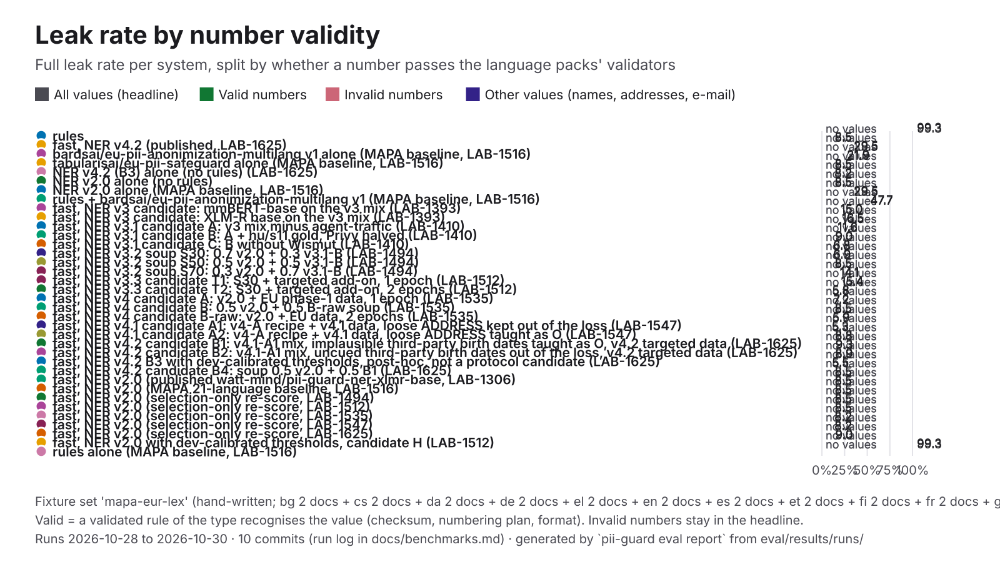

| System | Leak | Recall, valid numbers | Leak, valid numbers | Recall, invalid numbers | Leak, invalid numbers | Leak, other values |
|---|---:|---:|---:|---:|---:|---:|
| **pii-guard rules** | 99.3% | — (0/0) | — (0/0) | — (0/0) | — (0/0) | 99.3% (735/740) |
| pii-guard fast, NER v4.2 (published, LAB-1625) | 8.5% | — (0/0) | — (0/0) | — (0/0) | — (0/0) | 8.5% (63/740) |
| bardsai/eu-pii-anonimization-multilang v1 alone (MAPA baseline, LAB-1516) | 29.5% | — (0/0) | — (0/0) | — (0/0) | — (0/0) | 29.5% (218/740) |
| tabularisai/eu-pii-safeguard alone (MAPA baseline, LAB-1516) | 21.9% | — (0/0) | — (0/0) | — (0/0) | — (0/0) | 21.9% (162/740) |
| pii-guard NER v4.2 (B3) alone (no rules) (LAB-1625) | 8.5% | — (0/0) | — (0/0) | — (0/0) | — (0/0) | 8.5% (63/740) |
| pii-guard NER v2.0 alone (no rules) | 8.2% | — (0/0) | — (0/0) | — (0/0) | — (0/0) | 8.2% (61/740) |
| pii-guard NER v2.0 alone (MAPA baseline, LAB-1516) | 8.5% | — (0/0) | — (0/0) | — (0/0) | — (0/0) | 8.5% (63/740) |
| rules + bardsai/eu-pii-anonimization-multilang v1 (MAPA baseline, LAB-1516) | 29.5% | — (0/0) | — (0/0) | — (0/0) | — (0/0) | 29.5% (218/740) |
| pii-guard fast, NER v3 candidate: mmBERT-base on the v3 mix (LAB-1393) | 47.7% | — (0/0) | — (0/0) | — (0/0) | — (0/0) | 47.7% (353/740) |
| pii-guard fast, NER v3 candidate: XLM-R base on the v3 mix (LAB-1393) | 15.0% | — (0/0) | — (0/0) | — (0/0) | — (0/0) | 15.0% (111/740) |
| pii-guard fast, NER v3.1 candidate A: v3 mix minus agent-traffic (LAB-1410) | 16.5% | — (0/0) | — (0/0) | — (0/0) | — (0/0) | 16.5% (122/740) |
| pii-guard fast, NER v3.1 candidate B: A + hu/s11 gold, Privy halved (LAB-1410) | 11.6% | — (0/0) | — (0/0) | — (0/0) | — (0/0) | 11.6% (86/740) |
| pii-guard fast, NER v3.1 candidate C: B without Wismut (LAB-1410) | 9.0% | — (0/0) | — (0/0) | — (0/0) | — (0/0) | 9.1% (67/740) |
| pii-guard fast, NER v3.2 soup S30: 0.7 v2.0 + 0.3 v3.1-B (LAB-1494) | 6.8% | — (0/0) | — (0/0) | — (0/0) | — (0/0) | 6.8% (50/740) |
| pii-guard fast, NER v3.2 soup S50: 0.5 v2.0 + 0.5 v3.1-B (LAB-1494) | 6.9% | — (0/0) | — (0/0) | — (0/0) | — (0/0) | 6.9% (51/740) |
| pii-guard fast, NER v3.2 soup S70: 0.3 v2.0 + 0.7 v3.1-B (LAB-1494) | 8.5% | — (0/0) | — (0/0) | — (0/0) | — (0/0) | 8.5% (63/740) |
| pii-guard fast, NER v3.3 candidate T1: S30 + targeted add-on, 1 epoch (LAB-1512) | 14.1% | — (0/0) | — (0/0) | — (0/0) | — (0/0) | 14.1% (104/740) |
| pii-guard fast, NER v3.3 candidate T2: S30 + targeted add-on, 2 epochs (LAB-1512) | 15.4% | — (0/0) | — (0/0) | — (0/0) | — (0/0) | 15.4% (114/740) |
| pii-guard fast, NER v4 candidate A: v2.0 + EU phase-1 data, 1 epoch (LAB-1535) | 5.8% | — (0/0) | — (0/0) | — (0/0) | — (0/0) | 5.8% (43/740) |
| pii-guard fast, NER v4 candidate B: 0.5 v2.0 + 0.5 B-raw soup (LAB-1535) | 7.2% | — (0/0) | — (0/0) | — (0/0) | — (0/0) | 7.2% (53/740) |
| pii-guard fast, NER v4 candidate B-raw: v2.0 + EU data, 2 epochs (LAB-1535) | 8.5% | — (0/0) | — (0/0) | — (0/0) | — (0/0) | 8.5% (63/740) |
| pii-guard fast, NER v4.1 candidate A1: v4-A recipe + v4.1 data, loose ADDRESS kept out of the loss (LAB-1547) | 5.9% | — (0/0) | — (0/0) | — (0/0) | — (0/0) | 5.9% (44/740) |
| pii-guard fast, NER v4.1 candidate A2: v4-A recipe + v4.1 data, loose ADDRESS taught as O (LAB-1547) | 5.3% | — (0/0) | — (0/0) | — (0/0) | — (0/0) | 5.3% (39/740) |
| pii-guard fast, NER v4.2 candidate B1: v4.1-A1 mix, implausible third-party birth dates taught as O, v4.2 targeted data (LAB-1625) | 8.8% | — (0/0) | — (0/0) | — (0/0) | — (0/0) | 8.8% (65/740) |
| pii-guard fast, NER v4.2 candidate B2: v4.1-A1 mix, uncued third-party birth dates out of the loss, v4.2 targeted data (LAB-1625) | 9.3% | — (0/0) | — (0/0) | — (0/0) | — (0/0) | 9.3% (69/740) |
| pii-guard fast, NER v4.2 B3 with dev-calibrated thresholds, post-hoc, not a protocol candidate (LAB-1625) | 8.9% | — (0/0) | — (0/0) | — (0/0) | — (0/0) | 8.9% (66/740) |
| pii-guard fast, NER v4.2 candidate B4: soup 0.5 v2.0 + 0.5 B1 (LAB-1625) | 5.5% | — (0/0) | — (0/0) | — (0/0) | — (0/0) | 5.5% (41/740) |
| pii-guard fast, NER v2.0 (published watt-mind/pii-guard-ner-xlmr-base, LAB-1306) | 8.5% | — (0/0) | — (0/0) | — (0/0) | — (0/0) | 8.5% (63/740) |
| pii-guard fast, NER v2.0 (MAPA 21-language baseline, LAB-1516) | 8.5% | — (0/0) | — (0/0) | — (0/0) | — (0/0) | 8.5% (63/740) |
| pii-guard fast, NER v2.0 (selection-only re-score, LAB-1494) | 8.5% | — (0/0) | — (0/0) | — (0/0) | — (0/0) | 8.5% (63/740) |
| pii-guard fast, NER v2.0 (selection-only re-score, LAB-1512) | 8.5% | — (0/0) | — (0/0) | — (0/0) | — (0/0) | 8.5% (63/740) |
| pii-guard fast, NER v2.0 (selection-only re-score, LAB-1535) | 8.5% | — (0/0) | — (0/0) | — (0/0) | — (0/0) | 8.5% (63/740) |
| pii-guard fast, NER v2.0 (selection-only re-score, LAB-1547) | 8.2% | — (0/0) | — (0/0) | — (0/0) | — (0/0) | 8.2% (61/740) |
| pii-guard fast, NER v2.0 (selection-only re-score, LAB-1625) | 8.2% | — (0/0) | — (0/0) | — (0/0) | — (0/0) | 8.2% (61/740) |
| pii-guard fast, NER v2.0 with dev-calibrated thresholds, candidate H (LAB-1512) | 9.0% | — (0/0) | — (0/0) | — (0/0) | — (0/0) | 9.1% (67/740) |
| pii-guard rules alone (MAPA baseline, LAB-1516) | 99.3% | — (0/0) | — (0/0) | — (0/0) | — (0/0) | 99.3% (735/740) |

### `nemotron-pii`

mixed; documents: en 300.

| System | Docs | Precision | Recall | F1 | Leak | Partial leak | Over-masking | Round trip | Detect p50 | Run | Commit |
|---|---:|---:|---:|---:|---:|---:|---:|---:|---:|---|---|
| **pii-guard rules** | 300 | 98.9% | 36.8% | 53.6% | 56.0% | 8.6% | 0.8% | 100.0% | 1.5 ms | 2026-10-30 | `62799b5` |
| pii-guard fast, NER v4.2 (published, LAB-1625) | 300 | 93.3% | 94.7% | 94.0% | 0.6% | 0.6% | 1.5% | 100.0% | 281 ms | 2026-10-30 | `40accd5` |
| bardsai/eu-pii-anonimization-multilang-v3 alone (comparison) | 300 | 99.4% | 96.4% | 97.8% | 2.7% | 1.4% | 0.5% | 99.7% | 82 ms | 2026-10-28 | `97ee284` |
| tabularisai/eu-pii-safeguard alone (comparison, LAB-1386) | 300 | 87.8% | 63.1% | 73.5% | 13.1% | 8.5% | 2.0% | 97.3% | 208 ms | 2026-10-28 | `36a78e3` |
| Horizon-Labs/pii-redactor-base alone (comparison) | 300 | 98.7% | 96.4% | 97.5% | 2.9% | 1.6% | 0.5% | 99.7% | 98 ms | 2026-10-28 | `97ee284` |
| Horizon-Labs/pii-redactor-small alone (comparison) | 300 | 98.7% | 96.0% | 97.3% | 3.0% | 2.3% | 0.6% | 99.7% | 86 ms | 2026-10-28 | `97ee284` |
| pii-guard NER v4.2 (B3) alone (no rules) (LAB-1625) | 300 | 92.9% | 94.0% | 93.5% | 0.9% | 0.6% | 1.4% | 100.0% | 54 ms | 2026-10-30 | `40accd5` |
| Wismut/nym-pii-multilingual alone (comparison) | 300 | 93.5% | 88.3% | 90.8% | 3.4% | 2.0% | 1.1% | 99.7% | 92 ms | 2026-10-28 | `97ee284` |
| pii-guard NER v2.0 alone (no rules) | 300 | 90.0% | 86.3% | 88.1% | 1.3% | 0.4% | 1.2% | 100.0% | 56 ms | 2026-10-30 | `40accd5` |
| rules + the public fallback bardsai/eu-pii-anonimization-multilang v1 (reference) | 300 | 91.5% | 95.2% | 93.3% | 2.9% | 0.1% | 1.8% | 99.7% | 65 ms | 2026-10-28 | `97ee284` |
| rules + bardsai/eu-pii-anonimization-multilang-v3 in place of pii-guard NER (comparison) | 300 | 99.2% | 96.4% | 97.7% | 2.6% | 1.3% | 0.6% | 99.7% | 102 ms | 2026-10-28 | `97ee284` |
| rules + tabularisai/eu-pii-safeguard in place of pii-guard NER (comparison, LAB-1386) | 300 | 91.9% | 73.6% | 81.7% | 8.5% | 5.7% | 2.1% | 100.0% | 304 ms | 2026-10-28 | `36a78e3` |
| rules + Horizon-Labs/pii-redactor-base in place of pii-guard NER (comparison) | 300 | 98.5% | 96.6% | 97.5% | 2.6% | 1.4% | 0.6% | 99.7% | 94 ms | 2026-10-28 | `97ee284` |
| rules + Horizon-Labs/pii-redactor-small in place of pii-guard NER (comparison) | 300 | 98.6% | 96.4% | 97.4% | 2.7% | 2.1% | 0.7% | 99.7% | 64 ms | 2026-10-28 | `97ee284` |
| pii-guard fast, NER v3 candidate: mmBERT-base on the v3 mix (LAB-1393) | 300 | 94.7% | 88.5% | 91.5% | 4.5% | 2.6% | 1.5% | 100.0% | 100 ms | 2026-10-28 | `da9883e` |
| pii-guard fast, NER v3 candidate: XLM-R base on the v3 mix (LAB-1393) | 300 | 95.7% | 96.0% | 95.8% | 1.0% | 0.9% | 1.2% | 99.7% | 51 ms | 2026-10-28 | `da9883e` |
| pii-guard fast, NER v3.1 candidate A: v3 mix minus agent-traffic (LAB-1410) | 300 | 95.9% | 94.7% | 95.3% | 1.9% | 1.4% | 0.9% | 99.7% | 56 ms | 2026-10-28 | `72026a5` |
| pii-guard fast, NER v3.1 candidate B: A + hu/s11 gold, Privy halved (LAB-1410) | 300 | 95.6% | 97.4% | 96.5% | 0.7% | 0.3% | 1.1% | 100.0% | 65 ms | 2026-10-28 | `72026a5` |
| pii-guard fast, NER v3.1 candidate C: B without Wismut (LAB-1410) | 300 | 95.5% | 96.5% | 96.0% | 1.4% | 0.1% | 0.8% | 100.0% | 64 ms | 2026-10-28 | `72026a5` |
| pii-guard fast, NER v3.2 soup S30: 0.7 v2.0 + 0.3 v3.1-B (LAB-1494) | 300 | 93.4% | 93.7% | 93.5% | 0.4% | 0.3% | 1.3% | 100.0% | 91 ms | 2026-10-29 | `2b3c7ba` |
| pii-guard fast, NER v3.2 soup S50: 0.5 v2.0 + 0.5 v3.1-B (LAB-1494) | 300 | 94.7% | 95.4% | 95.1% | 0.1% | 0.3% | 0.9% | 99.7% | 95 ms | 2026-10-29 | `2b3c7ba` |
| pii-guard fast, NER v3.2 soup S70: 0.3 v2.0 + 0.7 v3.1-B (LAB-1494) | 300 | 96.0% | 97.1% | 96.5% | 0.4% | 0.4% | 0.8% | 99.7% | 84 ms | 2026-10-29 | `2b3c7ba` |
| pii-guard fast, NER v3.3 candidate T1: S30 + targeted add-on, 1 epoch (LAB-1512) | 300 | 95.2% | 96.5% | 95.8% | 0.4% | 0.3% | 0.9% | 99.7% | 209 ms | 2026-10-29 | `d2e710a` |
| pii-guard fast, NER v3.3 candidate T2: S30 + targeted add-on, 2 epochs (LAB-1512) | 300 | 96.3% | 96.5% | 96.4% | 1.1% | 0.6% | 0.7% | 99.7% | 212 ms | 2026-10-29 | `d2e710a` |
| rules + Wismut/nym-pii-multilingual in place of pii-guard NER (comparison) | 300 | 94.3% | 89.7% | 91.9% | 3.0% | 1.9% | 1.2% | 99.7% | 275 ms | 2026-10-28 | `97ee284` |
| pii-guard fast, NER v2.0 (published watt-mind/pii-guard-ner-xlmr-base, LAB-1306) | 300 | 90.9% | 87.8% | 89.4% | 0.7% | 0.4% | 1.4% | 100.0% | 66 ms | 2026-10-30 | `62799b5` |
| pii-guard audit (rules + NER v2 + LLM) | 10 | 97.6% | 100.0% | 98.8% | 0.0% | 0.0% | 0.0% | 100.0% | 2.0 s | 2026-10-27 | `18b15fa` |
| pii-guard fast, NER v2.0 (selection-only re-score, LAB-1494) | 300 | 90.9% | 87.8% | 89.4% | 0.7% | 0.4% | 1.4% | 100.0% | 91 ms | 2026-10-29 | `2b3c7ba` |
| pii-guard fast, NER v2.0 (selection-only re-score, LAB-1512) | 300 | 90.9% | 87.8% | 89.4% | 0.7% | 0.4% | 1.4% | 100.0% | 208 ms | 2026-10-29 | `d2e710a` |
| pii-guard fast, NER v2.0 (selection-only re-score, LAB-1625) | 300 | 90.9% | 87.8% | 89.4% | 0.7% | 0.4% | 1.4% | 100.0% | 57 ms | 2026-10-30 | `40accd5` |
| pii-guard fast, NER v2.0 with dev-calibrated thresholds, candidate H (LAB-1512) | 300 | 92.5% | 85.0% | 88.6% | 1.4% | 0.4% | 1.1% | 100.0% | 209 ms | 2026-10-29 | `d2e710a` |
| pii-guard fast, NER v2.1 base, epoch 5 of 5 (LAB-1306) | 300 | 91.8% | 86.8% | 89.2% | 0.7% | 0.4% | 2.4% | 99.7% | 19 ms | 2026-10-27 | `477196a` |
| Presidio | 300 | 58.7% | 76.3% | 66.4% | 12.8% | 5.3% | 32.0% | — | 18 ms | 2026-10-30 | `62799b5` |
| LLM Guard | 300 | 93.8% | 59.7% | 72.9% | 28.8% | 4.6% | 0.6% | 100.0% | 109 ms | 2026-10-30 | `62799b5` |
| PrivAiTe | 300 | 86.3% | 76.0% | 80.8% | 4.0% | 1.9% | 5.6% | 87.0% | 240 ms | 2026-10-30 | `62799b5` |

By language:

| System | en F1 | en leak |
|---|---:|---:|
| **pii-guard rules** | 53.6% | 56.0% |
| pii-guard fast, NER v4.2 (published, LAB-1625) | 94.0% | 0.6% |
| bardsai/eu-pii-anonimization-multilang-v3 alone (comparison) | 97.8% | 2.7% |
| tabularisai/eu-pii-safeguard alone (comparison, LAB-1386) | 73.5% | 13.1% |
| Horizon-Labs/pii-redactor-base alone (comparison) | 97.5% | 2.9% |
| Horizon-Labs/pii-redactor-small alone (comparison) | 97.3% | 3.0% |
| pii-guard NER v4.2 (B3) alone (no rules) (LAB-1625) | 93.5% | 0.9% |
| Wismut/nym-pii-multilingual alone (comparison) | 90.8% | 3.4% |
| pii-guard NER v2.0 alone (no rules) | 88.1% | 1.3% |
| rules + the public fallback bardsai/eu-pii-anonimization-multilang v1 (reference) | 93.3% | 2.9% |
| rules + bardsai/eu-pii-anonimization-multilang-v3 in place of pii-guard NER (comparison) | 97.7% | 2.6% |
| rules + tabularisai/eu-pii-safeguard in place of pii-guard NER (comparison, LAB-1386) | 81.7% | 8.5% |
| rules + Horizon-Labs/pii-redactor-base in place of pii-guard NER (comparison) | 97.5% | 2.6% |
| rules + Horizon-Labs/pii-redactor-small in place of pii-guard NER (comparison) | 97.4% | 2.7% |
| pii-guard fast, NER v3 candidate: mmBERT-base on the v3 mix (LAB-1393) | 91.5% | 4.5% |
| pii-guard fast, NER v3 candidate: XLM-R base on the v3 mix (LAB-1393) | 95.8% | 1.0% |
| pii-guard fast, NER v3.1 candidate A: v3 mix minus agent-traffic (LAB-1410) | 95.3% | 1.9% |
| pii-guard fast, NER v3.1 candidate B: A + hu/s11 gold, Privy halved (LAB-1410) | 96.5% | 0.7% |
| pii-guard fast, NER v3.1 candidate C: B without Wismut (LAB-1410) | 96.0% | 1.4% |
| pii-guard fast, NER v3.2 soup S30: 0.7 v2.0 + 0.3 v3.1-B (LAB-1494) | 93.5% | 0.4% |
| pii-guard fast, NER v3.2 soup S50: 0.5 v2.0 + 0.5 v3.1-B (LAB-1494) | 95.1% | 0.1% |
| pii-guard fast, NER v3.2 soup S70: 0.3 v2.0 + 0.7 v3.1-B (LAB-1494) | 96.5% | 0.4% |
| pii-guard fast, NER v3.3 candidate T1: S30 + targeted add-on, 1 epoch (LAB-1512) | 95.8% | 0.4% |
| pii-guard fast, NER v3.3 candidate T2: S30 + targeted add-on, 2 epochs (LAB-1512) | 96.4% | 1.1% |
| rules + Wismut/nym-pii-multilingual in place of pii-guard NER (comparison) | 91.9% | 3.0% |
| pii-guard fast, NER v2.0 (published watt-mind/pii-guard-ner-xlmr-base, LAB-1306) | 89.4% | 0.7% |
| pii-guard audit (rules + NER v2 + LLM) | 98.8% | 0.0% |
| pii-guard fast, NER v2.0 (selection-only re-score, LAB-1494) | 89.4% | 0.7% |
| pii-guard fast, NER v2.0 (selection-only re-score, LAB-1512) | 89.4% | 0.7% |
| pii-guard fast, NER v2.0 (selection-only re-score, LAB-1625) | 89.4% | 0.7% |
| pii-guard fast, NER v2.0 with dev-calibrated thresholds, candidate H (LAB-1512) | 88.6% | 1.4% |
| pii-guard fast, NER v2.1 base, epoch 5 of 5 (LAB-1306) | 89.2% | 0.7% |
| Presidio | 66.4% | 12.8% |
| LLM Guard | 72.9% | 28.8% |
| PrivAiTe | 80.8% | 4.0% |

**Number validity.** The headline leak above, split by whether a structured identifier passes the language packs' own validators (card Luhn, IBAN, TAJ and tax-ID check digits, phone numbering plans, ID-document checksums and formats). Invalid numbers stay in the headline: a mistyped real identifier is still personal data ([evaluation.md](evaluation.md#number-validity)). Valid values per type: `PHONE` 105/114, `ID_DOCUMENT` 24/34, `BANK_ACCOUNT` 10/76, `VEHICLE_PLATE` 0/10.

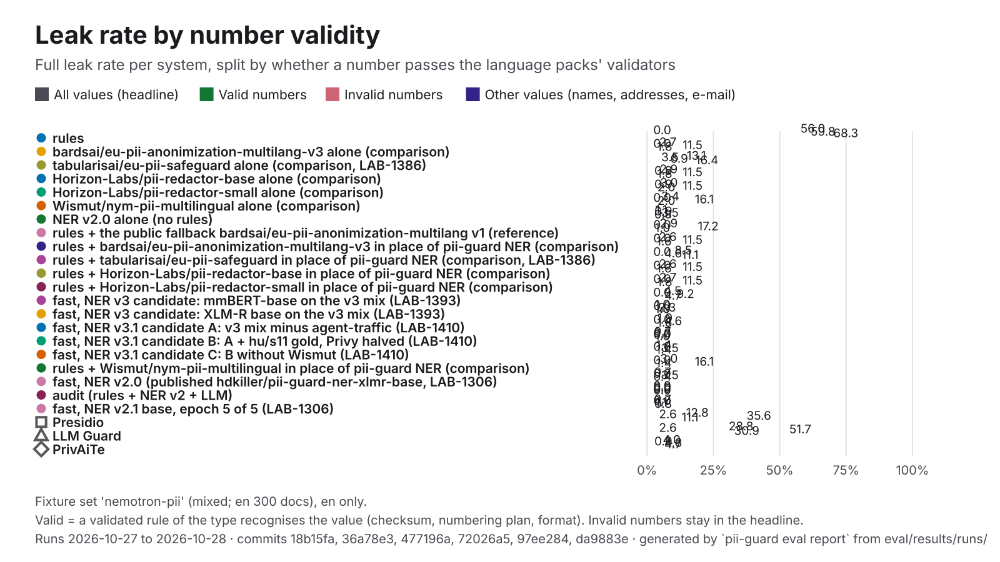

| System | Leak | Recall, valid numbers | Leak, valid numbers | Recall, invalid numbers | Leak, invalid numbers | Leak, other values |
|---|---:|---:|---:|---:|---:|---:|
| **pii-guard rules** | 56.0% | 100.0% (139/139) | 0.0% (0/115) | 40.0% (38/95) | 59.8% (52/87) | 68.3% (338/495) |
| pii-guard fast, NER v4.2 (published, LAB-1625) | 0.6% | 100.0% (139/139) | 0.0% (0/115) | 68.4% (65/95) | 1.1% (1/87) | 0.6% (3/495) |
| bardsai/eu-pii-anonimization-multilang-v3 alone (comparison) | 2.7% | 100.0% (139/139) | 0.0% (0/115) | 89.5% (85/95) | 11.5% (10/87) | 1.8% (9/495) |
| tabularisai/eu-pii-safeguard alone (comparison, LAB-1386) | 13.1% | 76.3% (106/139) | 3.5% (4/115) | 51.6% (49/95) | 6.9% (6/87) | 16.4% (81/495) |
| Horizon-Labs/pii-redactor-base alone (comparison) | 2.9% | 98.6% (137/139) | 0.9% (1/115) | 89.5% (85/95) | 11.5% (10/87) | 1.8% (9/495) |
| Horizon-Labs/pii-redactor-small alone (comparison) | 3.0% | 97.1% (135/139) | 0.9% (1/115) | 89.5% (85/95) | 11.5% (10/87) | 2.0% (10/495) |
| pii-guard NER v4.2 (B3) alone (no rules) (LAB-1625) | 0.9% | 98.6% (137/139) | 0.0% (0/115) | 65.3% (62/95) | 1.1% (1/87) | 1.0% (5/495) |
| Wismut/nym-pii-multilingual alone (comparison) | 3.4% | 100.0% (139/139) | 0.0% (0/115) | 52.6% (50/95) | 16.1% (14/87) | 2.0% (10/495) |
| pii-guard NER v2.0 alone (no rules) | 1.3% | 97.1% (135/139) | 0.9% (1/115) | 50.5% (48/95) | 3.4% (3/87) | 1.0% (5/495) |
| rules + the public fallback bardsai/eu-pii-anonimization-multilang v1 (reference) | 2.9% | 100.0% (139/139) | 0.0% (0/115) | 68.4% (65/95) | 17.2% (15/87) | 1.0% (5/495) |
| rules + bardsai/eu-pii-anonimization-multilang-v3 in place of pii-guard NER (comparison) | 2.6% | 100.0% (139/139) | 0.0% (0/115) | 88.4% (84/95) | 11.5% (10/87) | 1.6% (8/495) |
| rules + tabularisai/eu-pii-safeguard in place of pii-guard NER (comparison, LAB-1386) | 8.5% | 98.6% (137/139) | 0.0% (0/115) | 65.3% (62/95) | 4.6% (4/87) | 11.1% (55/495) |
| rules + Horizon-Labs/pii-redactor-base in place of pii-guard NER (comparison) | 2.6% | 100.0% (139/139) | 0.0% (0/115) | 88.4% (84/95) | 11.5% (10/87) | 1.6% (8/495) |
| rules + Horizon-Labs/pii-redactor-small in place of pii-guard NER (comparison) | 2.7% | 100.0% (139/139) | 0.0% (0/115) | 88.4% (84/95) | 11.5% (10/87) | 1.8% (9/495) |
| pii-guard fast, NER v3 candidate: mmBERT-base on the v3 mix (LAB-1393) | 4.5% | 100.0% (139/139) | 0.0% (0/115) | 84.2% (80/95) | 9.2% (8/87) | 4.6% (23/495) |
| pii-guard fast, NER v3 candidate: XLM-R base on the v3 mix (LAB-1393) | 1.0% | 100.0% (139/139) | 0.0% (0/115) | 81.1% (77/95) | 2.3% (2/87) | 1.0% (5/495) |
| pii-guard fast, NER v3.1 candidate A: v3 mix minus agent-traffic (LAB-1410) | 1.9% | 100.0% (139/139) | 0.0% (0/115) | 76.8% (73/95) | 4.6% (4/87) | 1.8% (9/495) |
| pii-guard fast, NER v3.1 candidate B: A + hu/s11 gold, Privy halved (LAB-1410) | 0.7% | 100.0% (139/139) | 0.0% (0/115) | 87.4% (83/95) | 0.0% (0/87) | 1.0% (5/495) |
| pii-guard fast, NER v3.1 candidate C: B without Wismut (LAB-1410) | 1.4% | 99.3% (138/139) | 0.0% (0/115) | 80.0% (76/95) | 3.4% (3/87) | 1.4% (7/495) |
| pii-guard fast, NER v3.2 soup S30: 0.7 v2.0 + 0.3 v3.1-B (LAB-1494) | 0.4% | 100.0% (139/139) | 0.0% (0/115) | 64.2% (61/95) | 2.3% (2/87) | 0.2% (1/495) |
| pii-guard fast, NER v3.2 soup S50: 0.5 v2.0 + 0.5 v3.1-B (LAB-1494) | 0.1% | 100.0% (139/139) | 0.0% (0/115) | 71.6% (68/95) | 1.1% (1/87) | 0.0% (0/495) |
| pii-guard fast, NER v3.2 soup S70: 0.3 v2.0 + 0.7 v3.1-B (LAB-1494) | 0.4% | 100.0% (139/139) | 0.0% (0/115) | 84.2% (80/95) | 1.1% (1/87) | 0.4% (2/495) |
| pii-guard fast, NER v3.3 candidate T1: S30 + targeted add-on, 1 epoch (LAB-1512) | 0.4% | 100.0% (139/139) | 0.0% (0/115) | 81.1% (77/95) | 1.1% (1/87) | 0.4% (2/495) |
| pii-guard fast, NER v3.3 candidate T2: S30 + targeted add-on, 2 epochs (LAB-1512) | 1.1% | 100.0% (139/139) | 0.0% (0/115) | 85.3% (81/95) | 2.3% (2/87) | 1.2% (6/495) |
| rules + Wismut/nym-pii-multilingual in place of pii-guard NER (comparison) | 3.0% | 100.0% (139/139) | 0.0% (0/115) | 62.1% (59/95) | 16.1% (14/87) | 1.4% (7/495) |
| pii-guard fast, NER v2.0 (published watt-mind/pii-guard-ner-xlmr-base, LAB-1306) | 0.7% | 100.0% (139/139) | 0.0% (0/115) | 58.9% (56/95) | 3.4% (3/87) | 0.4% (2/495) |
| pii-guard audit (rules + NER v2 + LLM) | 0.0% | 100.0% (5/5) | 0.0% (0/5) | 100.0% (7/7) | 0.0% (0/6) | 0.0% (0/14) |
| pii-guard fast, NER v2.0 (selection-only re-score, LAB-1494) | 0.7% | 100.0% (139/139) | 0.0% (0/115) | 58.9% (56/95) | 3.4% (3/87) | 0.4% (2/495) |
| pii-guard fast, NER v2.0 (selection-only re-score, LAB-1512) | 0.7% | 100.0% (139/139) | 0.0% (0/115) | 58.9% (56/95) | 3.4% (3/87) | 0.4% (2/495) |
| pii-guard fast, NER v2.0 (selection-only re-score, LAB-1625) | 0.7% | 100.0% (139/139) | 0.0% (0/115) | 58.9% (56/95) | 3.4% (3/87) | 0.4% (2/495) |
| pii-guard fast, NER v2.0 with dev-calibrated thresholds, candidate H (LAB-1512) | 1.4% | 100.0% (139/139) | 0.0% (0/115) | 58.9% (56/95) | 8.0% (7/87) | 0.6% (3/495) |
| pii-guard fast, NER v2.1 base, epoch 5 of 5 (LAB-1306) | 0.7% | 100.0% (139/139) | 0.0% (0/115) | 60.0% (57/95) | 1.1% (1/87) | 0.8% (4/495) |
| Presidio | 12.8% | 91.4% (127/139) | 2.6% (3/115) | 14.7% (14/95) | 35.6% (31/87) | 11.1% (55/495) |
| LLM Guard | 28.8% | 96.4% (134/139) | 2.6% (3/115) | 30.5% (29/95) | 51.7% (45/87) | 30.9% (153/495) |
| PrivAiTe | 4.0% | 77.7% (108/139) | 0.9% (1/115) | 65.3% (62/95) | 4.6% (4/87) | 4.6% (23/495) |

### `pl-pii-bench`

hand-written; documents: pl 346.

| System | Docs | Precision | Recall | F1 | Leak | Partial leak | Over-masking | Round trip | Detect p50 | Run | Commit |
|---|---:|---:|---:|---:|---:|---:|---:|---:|---:|---|---|
| **pii-guard rules** | 346 | 91.4% | 39.0% | 54.7% | 54.1% | 6.1% | 8.6% | 100.0% | 0.06 ms | 2026-10-28 | `793ddf9` |
| pii-guard fast, NER v4.2 (published, LAB-1625) | 346 | 84.2% | 95.7% | 89.6% | 4.2% | 5.5% | 10.8% | 100.0% | 35 ms | 2026-10-30 | `40accd5` |
| pii-guard NER v4.2 (B3) alone (no rules) (LAB-1625) | 346 | 84.9% | 88.6% | 86.7% | 13.3% | 7.3% | 9.5% | 100.0% | 40 ms | 2026-10-30 | `40accd5` |
| pii-guard NER v2.0 alone (no rules) | 346 | 84.0% | 69.8% | 76.3% | 22.7% | 9.1% | 10.5% | 100.0% | 35 ms | 2026-10-30 | `40accd5` |
| pii-guard fast, NER v3 candidate: mmBERT-base on the v3 mix (LAB-1393) | 346 | 40.0% | 65.7% | 49.7% | 31.8% | 8.5% | 59.3% | 100.0% | 50 ms | 2026-10-28 | `da9883e` |
| pii-guard fast, NER v3 candidate: XLM-R base on the v3 mix (LAB-1393) | 346 | 77.5% | 89.7% | 83.2% | 8.7% | 6.6% | 19.4% | 100.0% | 36 ms | 2026-10-28 | `da9883e` |
| pii-guard fast, NER v3.1 candidate A: v3 mix minus agent-traffic (LAB-1410) | 346 | 82.6% | 92.5% | 87.2% | 5.2% | 6.7% | 17.3% | 100.0% | 36 ms | 2026-10-28 | `72026a5` |
| pii-guard fast, NER v3.1 candidate B: A + hu/s11 gold, Privy halved (LAB-1410) | 346 | 74.1% | 91.0% | 81.7% | 5.5% | 6.3% | 18.6% | 100.0% | 36 ms | 2026-10-28 | `72026a5` |
| pii-guard fast, NER v3.1 candidate C: B without Wismut (LAB-1410) | 346 | 80.3% | 87.6% | 83.8% | 9.0% | 5.8% | 13.6% | 100.0% | 35 ms | 2026-10-28 | `72026a5` |
| pii-guard fast, NER v3.2 soup S30: 0.7 v2.0 + 0.3 v3.1-B (LAB-1494) | 346 | 82.4% | 94.0% | 87.8% | 0.2% | 6.8% | 12.7% | 100.0% | 62 ms | 2026-10-29 | `2b3c7ba` |
| pii-guard fast, NER v3.2 soup S50: 0.5 v2.0 + 0.5 v3.1-B (LAB-1494) | 346 | 78.8% | 93.9% | 85.7% | 0.2% | 6.4% | 15.1% | 100.0% | 46 ms | 2026-10-29 | `2b3c7ba` |
| pii-guard fast, NER v3.2 soup S70: 0.3 v2.0 + 0.7 v3.1-B (LAB-1494) | 346 | 77.8% | 93.9% | 85.1% | 1.3% | 5.3% | 16.2% | 100.0% | 45 ms | 2026-10-29 | `2b3c7ba` |
| pii-guard fast, NER v3.3 candidate T1: S30 + targeted add-on, 1 epoch (LAB-1512) | 346 | 82.2% | 94.1% | 87.8% | 0.5% | 6.2% | 10.1% | 100.0% | 85 ms | 2026-10-29 | `d2e710a` |
| pii-guard fast, NER v3.3 candidate T2: S30 + targeted add-on, 2 epochs (LAB-1512) | 346 | 83.1% | 94.0% | 88.2% | 0.9% | 7.1% | 11.1% | 100.0% | 87 ms | 2026-10-29 | `d2e710a` |
| pii-guard fast, NER v2.0 (published watt-mind/pii-guard-ner-xlmr-base, LAB-1306) | 346 | 87.2% | 91.3% | 89.2% | 3.5% | 9.1% | 11.7% | 100.0% | 39 ms | 2026-10-28 | `793ddf9` |
| pii-guard fast, NER v2.0 (selection-only re-score, LAB-1494) | 346 | 87.6% | 91.2% | 89.3% | 3.5% | 9.1% | 11.2% | 100.0% | 53 ms | 2026-10-29 | `2b3c7ba` |
| pii-guard fast, NER v2.0 (selection-only re-score, LAB-1512) | 346 | 87.6% | 91.2% | 89.3% | 3.5% | 9.1% | 11.2% | 100.0% | 81 ms | 2026-10-29 | `d2e710a` |
| pii-guard fast, NER v2.0 (selection-only re-score, LAB-1625) | 346 | 87.7% | 91.3% | 89.4% | 3.5% | 9.1% | 11.2% | 100.0% | 35 ms | 2026-10-30 | `40accd5` |
| pii-guard fast, NER v2.0 with dev-calibrated thresholds, candidate H (LAB-1512) | 346 | 87.6% | 91.2% | 89.3% | 3.5% | 9.1% | 11.2% | 100.0% | 82 ms | 2026-10-29 | `d2e710a` |

By language:

| System | pl F1 | pl leak |
|---|---:|---:|
| **pii-guard rules** | 54.7% | 54.1% |
| pii-guard fast, NER v4.2 (published, LAB-1625) | 89.6% | 4.2% |
| pii-guard NER v4.2 (B3) alone (no rules) (LAB-1625) | 86.7% | 13.3% |
| pii-guard NER v2.0 alone (no rules) | 76.3% | 22.7% |
| pii-guard fast, NER v3 candidate: mmBERT-base on the v3 mix (LAB-1393) | 49.7% | 31.8% |
| pii-guard fast, NER v3 candidate: XLM-R base on the v3 mix (LAB-1393) | 83.2% | 8.7% |
| pii-guard fast, NER v3.1 candidate A: v3 mix minus agent-traffic (LAB-1410) | 87.2% | 5.2% |
| pii-guard fast, NER v3.1 candidate B: A + hu/s11 gold, Privy halved (LAB-1410) | 81.7% | 5.5% |
| pii-guard fast, NER v3.1 candidate C: B without Wismut (LAB-1410) | 83.8% | 9.0% |
| pii-guard fast, NER v3.2 soup S30: 0.7 v2.0 + 0.3 v3.1-B (LAB-1494) | 87.8% | 0.2% |
| pii-guard fast, NER v3.2 soup S50: 0.5 v2.0 + 0.5 v3.1-B (LAB-1494) | 85.7% | 0.2% |
| pii-guard fast, NER v3.2 soup S70: 0.3 v2.0 + 0.7 v3.1-B (LAB-1494) | 85.1% | 1.3% |
| pii-guard fast, NER v3.3 candidate T1: S30 + targeted add-on, 1 epoch (LAB-1512) | 87.8% | 0.5% |
| pii-guard fast, NER v3.3 candidate T2: S30 + targeted add-on, 2 epochs (LAB-1512) | 88.2% | 0.9% |
| pii-guard fast, NER v2.0 (published watt-mind/pii-guard-ner-xlmr-base, LAB-1306) | 89.2% | 3.5% |
| pii-guard fast, NER v2.0 (selection-only re-score, LAB-1494) | 89.3% | 3.5% |
| pii-guard fast, NER v2.0 (selection-only re-score, LAB-1512) | 89.3% | 3.5% |
| pii-guard fast, NER v2.0 (selection-only re-score, LAB-1625) | 89.4% | 3.5% |
| pii-guard fast, NER v2.0 with dev-calibrated thresholds, candidate H (LAB-1512) | 89.3% | 3.5% |

**Number validity.** The headline leak above, split by whether a structured identifier passes the language packs' own validators (card Luhn, IBAN, TAJ and tax-ID check digits, phone numbering plans, ID-document checksums and formats). Invalid numbers stay in the headline: a mistyped real identifier is still personal data ([evaluation.md](evaluation.md#number-validity)). Valid values per type: `PHONE` 22/30, `ID_DOCUMENT` 139/241, `BANK_ACCOUNT` 63/88, `VEHICLE_PLATE` 0/30.

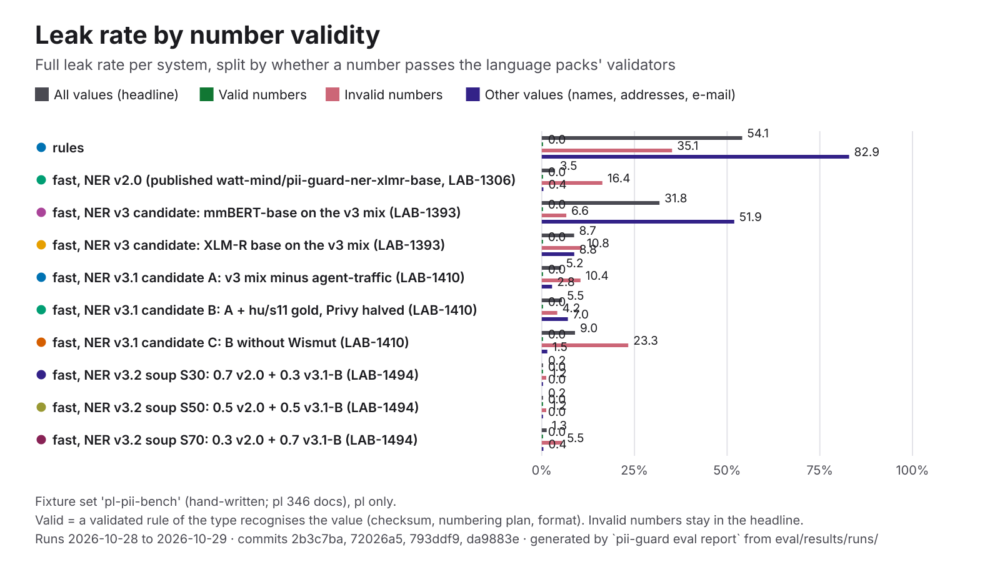

| System | Leak | Recall, valid numbers | Leak, valid numbers | Recall, invalid numbers | Leak, invalid numbers | Leak, other values |
|---|---:|---:|---:|---:|---:|---:|
| **pii-guard rules** | 54.1% | 100.0% (224/224) | 0.0% (0/192) | 64.8% (107/165) | 35.2% (58/165) | 82.9% (388/468) |
| pii-guard fast, NER v4.2 (published, LAB-1625) | 4.2% | 100.0% (224/224) | 0.0% (0/192) | 80.0% (132/165) | 20.0% (33/165) | 0.4% (2/468) |
| pii-guard NER v4.2 (B3) alone (no rules) (LAB-1625) | 13.3% | 86.6% (194/224) | 15.6% (30/192) | 72.1% (119/165) | 27.9% (46/165) | 7.3% (34/468) |
| pii-guard NER v2.0 alone (no rules) | 22.7% | 46.9% (105/224) | 28.6% (55/192) | 22.4% (37/165) | 60.6% (100/165) | 6.8% (32/468) |
| pii-guard fast, NER v3 candidate: mmBERT-base on the v3 mix (LAB-1393) | 31.8% | 100.0% (70/70) | 0.0% (0/70) | 87.5% (279/319) | 6.6% (19/287) | 51.9% (243/468) |
| pii-guard fast, NER v3 candidate: XLM-R base on the v3 mix (LAB-1393) | 8.7% | 100.0% (70/70) | 0.0% (0/70) | 89.3% (285/319) | 10.8% (31/287) | 8.8% (41/468) |
| pii-guard fast, NER v3.1 candidate A: v3 mix minus agent-traffic (LAB-1410) | 5.2% | 100.0% (70/70) | 0.0% (0/70) | 89.7% (286/319) | 10.5% (30/287) | 2.8% (13/468) |
| pii-guard fast, NER v3.1 candidate B: A + hu/s11 gold, Privy halved (LAB-1410) | 5.5% | 100.0% (70/70) | 0.0% (0/70) | 90.0% (287/319) | 4.2% (12/287) | 7.1% (33/468) |
| pii-guard fast, NER v3.1 candidate C: B without Wismut (LAB-1410) | 9.0% | 100.0% (70/70) | 0.0% (0/70) | 73.7% (235/319) | 23.3% (67/287) | 1.5% (7/468) |
| pii-guard fast, NER v3.2 soup S30: 0.7 v2.0 + 0.3 v3.1-B (LAB-1494) | 0.2% | 100.0% (224/224) | 0.0% (0/192) | 80.0% (132/165) | 1.2% (2/165) | 0.0% (0/468) |
| pii-guard fast, NER v3.2 soup S50: 0.5 v2.0 + 0.5 v3.1-B (LAB-1494) | 0.2% | 100.0% (224/224) | 0.0% (0/192) | 80.0% (132/165) | 1.2% (2/165) | 0.0% (0/468) |
| pii-guard fast, NER v3.2 soup S70: 0.3 v2.0 + 0.7 v3.1-B (LAB-1494) | 1.3% | 100.0% (224/224) | 0.0% (0/192) | 81.8% (135/165) | 5.5% (9/165) | 0.4% (2/468) |
| pii-guard fast, NER v3.3 candidate T1: S30 + targeted add-on, 1 epoch (LAB-1512) | 0.5% | 100.0% (224/224) | 0.0% (0/192) | 80.0% (132/165) | 1.2% (2/165) | 0.4% (2/468) |
| pii-guard fast, NER v3.3 candidate T2: S30 + targeted add-on, 2 epochs (LAB-1512) | 0.9% | 100.0% (224/224) | 0.0% (0/192) | 80.0% (132/165) | 3.0% (5/165) | 0.4% (2/468) |
| pii-guard fast, NER v2.0 (published watt-mind/pii-guard-ner-xlmr-base, LAB-1306) | 3.5% | 99.6% (223/224) | 0.0% (0/192) | 69.1% (114/165) | 16.4% (27/165) | 0.4% (2/468) |
| pii-guard fast, NER v2.0 (selection-only re-score, LAB-1494) | 3.5% | 99.6% (223/224) | 0.0% (0/192) | 69.1% (114/165) | 16.4% (27/165) | 0.4% (2/468) |
| pii-guard fast, NER v2.0 (selection-only re-score, LAB-1512) | 3.5% | 99.6% (223/224) | 0.0% (0/192) | 69.1% (114/165) | 16.4% (27/165) | 0.4% (2/468) |
| pii-guard fast, NER v2.0 (selection-only re-score, LAB-1625) | 3.5% | 100.0% (224/224) | 0.0% (0/192) | 69.1% (114/165) | 16.4% (27/165) | 0.4% (2/468) |
| pii-guard fast, NER v2.0 with dev-calibrated thresholds, candidate H (LAB-1512) | 3.5% | 99.6% (223/224) | 0.0% (0/192) | 69.1% (114/165) | 16.4% (27/165) | 0.4% (2/468) |

### `secrets`

hand-written; documents: en 22.

| System | Docs | Precision | Recall | F1 | Leak | Partial leak | Over-masking | Round trip | Detect p50 | Run | Commit |
|---|---:|---:|---:|---:|---:|---:|---:|---:|---:|---|---|
| **pii-guard rules** | 22 | 100.0% | 100.0% | 100.0% | 0.0% | 0.0% | 0.0% | 100.0% | 1.7 ms | 2026-10-30 | `4e4bc20` |

By language:

| System | en F1 | en leak |
|---|---:|---:|
| **pii-guard rules** | 100.0% | 0.0% |

### `synth-dev`

generated; documents: en 24 + hu 24.

| System | Docs | Precision | Recall | F1 | Leak | Partial leak | Over-masking | Round trip | Detect p50 | Run | Commit |
|---|---:|---:|---:|---:|---:|---:|---:|---:|---:|---|---|
| **pii-guard rules** | 48 | 99.6% | 41.4% | 58.5% | 48.5% | 21.8% | 0.0% | 100.0% | 0.84 ms* | 2026-10-26 | `0ba3c1a` |
| pii-guard rules + NER (fine-tuned) | 48 | 99.8% | 96.5% | 98.1% | 4.9% | 1.2% | 0.0% | 100.0% | 27 ms* | 2026-10-26 | `0ba3c1a` |
| pii-guard rules + NER (zero-shot) | 48 | 96.7% | 89.7% | 93.1% | 13.5% | 0.0% | 2.5% | 97.9% | 450 ms* | 2026-10-26 | `0ba3c1a` |

By language:

| System | en F1 | hu F1 | en leak | hu leak |
|---|---:|---:|---:|---:|
| **pii-guard rules** | 55.9% | 60.7% | 46.8% | 50.0% |
| pii-guard rules + NER (fine-tuned) | 99.5% | 96.9% | 0.5% | 8.6% |
| pii-guard rules + NER (zero-shot) | 94.8% | 91.5% | 8.1% | 18.0% |

### `synth-sample`

generated by muse-spark-1.3-contributor; documents: de 14 + en 10 + hu 20.

| System | Docs | Precision | Recall | F1 | Leak | Partial leak | Over-masking | Round trip | Detect p50 | Run | Commit |
|---|---:|---:|---:|---:|---:|---:|---:|---:|---:|---|---|
| **pii-guard rules** | 44 | 100.0% | 40.5% | 57.7% | 47.4% | 7.4% | 0.0% | 100.0% | 3.0 ms* | 2026-10-29, 2026-10-30 | `45253df`, `4cd1181` |
| pii-guard rules + Muse Spark Open (Baseten) † | 30 | 100.0% | 99.5% | 99.7% | 0.8% | 2.0% | 0.0% | 100.0% | 2.1 s* | 2026-10-27 | `5dd3c23` |
| pii-guard fast, public fallback NER (bardsai/eu-pii-anonimization-multilang) † | 30 | 94.7% | 99.2% | 96.9% | 0.4% | 1.6% | 5.9% | 100.0% | 42 ms* | 2026-10-27 | `e126829` |
| pii-guard fast, built-in zero-shot NER (Davlan/xlm-roberta-base-ner-hrl) † | 30 | 96.9% | 93.9% | 95.3% | 9.1% | 0.0% | 3.2% | 100.0% | 28 ms* | 2026-10-27 | `910a6a2` |
| pii-guard rules + NER (fine-tuned) † | 30 | 99.2% | 96.2% | 97.7% | 5.9% | 1.2% | 0.6% | 100.0% | 28 ms* | 2026-10-26 | `0ba3c1a` |
| pii-guard fast, NER v2 base (xlm-roberta-base, LAB-1150) † | 30 | 96.2% | 96.2% | 96.2% | 0.0% | 1.2% | 0.0% | 100.0% | 30 ms* | 2026-10-27 | `910a6a2` |
| pii-guard fast, NER v2.0 (published watt-mind/pii-guard-ner-xlmr-base, LAB-1306) | 44 | 96.7% | 96.4% | 96.5% | 0.3% | 0.8% | 0.0% | 100.0% | 93 ms* | 2026-10-29, 2026-10-30 | `45253df`, `4cd1181` |
| pii-guard fast, NER v2 base + hard negatives, union with GLiNER (LAB-1150) † | 30 | 74.5% | 96.4% | 84.1% | 0.0% | 1.2% | 23.3% | 63.3% | 298 ms* | 2026-10-27 | `910a6a2` |
| pii-guard fast, NER v2 base without Ai4Privacy rows (LAB-1150) † | 30 | 97.2% | 97.2% | 97.2% | 0.0% | 1.2% | 0.0% | 100.0% | 26 ms* | 2026-10-27 | `910a6a2` |
| pii-guard fast, NER v2 base, OpenPII cut to 1k rows/language (LAB-1150) † | 30 | 96.4% | 96.4% | 96.4% | 0.0% | 1.2% | 0.0% | 100.0% | 26 ms* | 2026-10-27 | `910a6a2` |
| pii-guard fast, NER v2.1 base, epoch 1 of 5 (LAB-1306) † | 30 | 95.7% | 95.9% | 95.8% | 0.0% | 1.2% | 0.3% | 100.0% | 24 ms* | 2026-10-27 | `477196a` |
| pii-guard fast, NER v2.1 base, epoch 2 of 5 (LAB-1306) † | 30 | 95.7% | 96.2% | 95.9% | 0.0% | 1.2% | 0.5% | 100.0% | 23 ms* | 2026-10-27 | `477196a` |
| pii-guard fast, NER v2.1 base, epoch 3 of 5 (LAB-1306) † | 30 | 96.7% | 96.7% | 96.7% | 0.0% | 1.2% | 0.0% | 100.0% | 23 ms* | 2026-10-27 | `477196a` |
| pii-guard fast, NER v2.1 base, epoch 4 of 5 (LAB-1306) † | 30 | 96.9% | 96.9% | 96.9% | 0.0% | 1.2% | 0.0% | 100.0% | 33 ms* | 2026-10-27 | `477196a` |
| pii-guard fast, NER v2.1 base, epoch 5 of 5 (LAB-1306) † | 30 | 96.4% | 96.4% | 96.4% | 0.0% | 1.2% | 0.0% | 100.0% | 29 ms* | 2026-10-27 | `477196a` |
| pii-guard rules + ner (xlmr-large-distilled-glimmer) † | 30 | 99.0% | 100.0% | 99.5% | 0.0% | 1.2% | 1.1% | 100.0% | 72 ms* | 2026-10-27 | `910a6a2` |
| pii-guard audit (rules + NER + Muse Spark Open, Baseten) † | 30 | 99.0% | 100.0% | 99.5% | 0.0% | 1.2% | 1.1% | 100.0% | 2.0 s* | 2026-10-27 | `4f84c6a` |
| pii-guard fast, NER v2 large (xlm-roberta-large, LAB-1150) † | 30 | 95.9% | 95.9% | 95.9% | 0.0% | 1.2% | 0.0% | 100.0% | 60 ms* | 2026-10-27 | `910a6a2` |
| pii-guard fast, NER v2 large + hard negatives (LAB-1150) † | 30 | 96.9% | 96.9% | 96.9% | 0.0% | 1.2% | 0.0% | 100.0% | 63 ms* | 2026-10-27 | `910a6a2` |
| pii-guard fast, NER v2 large without Ai4Privacy rows (ablation, LAB-1150) † | 30 | 97.4% | 97.4% | 97.4% | 0.0% | 1.2% | 0.0% | 100.0% | 60 ms* | 2026-10-27 | `910a6a2` |
| pii-guard fast, NER v2 large, OpenPII cut to 1k rows/language (LAB-1150) † | 30 | 96.4% | 96.4% | 96.4% | 0.0% | 1.2% | 0.0% | 100.0% | 56 ms* | 2026-10-27 | `910a6a2` |
| pii-guard rules + NER (zero-shot) † | 30 | 97.3% | 90.0% | 93.5% | 15.0% | 0.0% | 2.7% | 100.0% | 123 ms* | 2026-10-26 | `0ba3c1a` |
| pii-guard fast, GLiNER multi fine-tuned (LAB-1150) † | 30 | 95.4% | 96.4% | 95.9% | 0.0% | 1.2% | 1.1% | 100.0% | 286 ms* | 2026-10-27 | `910a6a2` |
| pii-guard fast, GLiNER multi v2.1 zero-shot (LAB-1150) † | 30 | 77.0% | 94.9% | 85.0% | 5.1% | 11.1% | 24.1% | 63.3% | 236 ms* | 2026-10-27 | `910a6a2` |
| Presidio † ‡ | 30 | 69.4% | 74.7% | 71.9% | 23.3% | 24.1% | 24.4% | — | 361 ms* | 2026-10-27 | `8944f96` |
| LLM Guard † ‡ | 30 | 62.7% | 41.4% | 49.9% | 56.5% | 10.7% | 34.4% | 100.0% | 581 ms* | 2026-10-27 | `8944f96` |
| PrivAiTe † ‡ | 30 | 58.5% | 59.1% | 58.8% | 19.0% | 9.1% | 24.1% | 83.3% | 388 ms* | 2026-10-27 | `8944f96` |

† Not run on every language of the current fixture files (de + en + hu): its `all` pools fewer documents, so compare it by language, not with the other rows. rules + Muse Spark Open (Baseten) (no de); fast, public fallback NER (bardsai/eu-pii-anonimization-multilang) (no de); fast, built-in zero-shot NER (Davlan/xlm-roberta-base-ner-hrl) (no de); rules + NER (fine-tuned) (no de); fast, NER v2 base (xlm-roberta-base, LAB-1150) (no de); fast, NER v2 base + hard negatives, union with GLiNER (LAB-1150) (no de); fast, NER v2 base without Ai4Privacy rows (LAB-1150) (no de); fast, NER v2 base, OpenPII cut to 1k rows/language (LAB-1150) (no de); fast, NER v2.1 base, epoch 1 of 5 (LAB-1306) (no de); fast, NER v2.1 base, epoch 2 of 5 (LAB-1306) (no de); fast, NER v2.1 base, epoch 3 of 5 (LAB-1306) (no de); fast, NER v2.1 base, epoch 4 of 5 (LAB-1306) (no de); fast, NER v2.1 base, epoch 5 of 5 (LAB-1306) (no de); rules + ner (xlmr-large-distilled-glimmer) (no de); audit (rules + NER + Muse Spark Open, Baseten) (no de); fast, NER v2 large (xlm-roberta-large, LAB-1150) (no de); fast, NER v2 large + hard negatives (LAB-1150) (no de); fast, NER v2 large without Ai4Privacy rows (ablation, LAB-1150) (no de); fast, NER v2 large, OpenPII cut to 1k rows/language (LAB-1150) (no de); rules + NER (zero-shot) (no de); fast, GLiNER multi fine-tuned (LAB-1150) (no de); fast, GLiNER multi v2.1 zero-shot (LAB-1150) (no de); Presidio (no de); LLM Guard (no de); PrivAiTe (no de).

‡ Re-scored from the record's own counts after the run (LAB-1213): a change of scoring method, not a new run and not a better model. The comparison tools' placeholder consistency is null (they don't report their replacements; it was a placeholder 0.0).

By language:

| System | de F1 | en F1 | hu F1 | de leak | en leak | hu leak |
|---|---:|---:|---:|---:|---:|---:|
| **pii-guard rules** | 49.8% | 54.5% | 63.1% | 57.0% | 46.2% | 41.6% |
| pii-guard rules + Muse Spark Open (Baseten) | — | 99.2% | 100.0% | — | 2.5% | 0.0% |
| pii-guard fast, public fallback NER (bardsai/eu-pii-anonimization-multilang) | — | 97.2% | 96.8% | — | 1.2% | 0.0% |
| pii-guard fast, built-in zero-shot NER (Davlan/xlm-roberta-base-ner-hrl) | — | 96.8% | 94.6% | — | 7.5% | 9.8% |
| pii-guard rules + NER (fine-tuned) | — | 100.0% | 96.6% | — | 0.0% | 8.7% |
| pii-guard fast, NER v2 base (xlm-roberta-base, LAB-1150) | — | 100.0% | 94.5% | — | 0.0% | 0.0% |
| pii-guard fast, NER v2.0 (published watt-mind/pii-guard-ner-xlmr-base, LAB-1306) | 96.8% | 100.0% | 94.8% | 0.9% | 0.0% | 0.0% |
| pii-guard fast, NER v2 base + hard negatives, union with GLiNER (LAB-1150) | — | 82.2% | 85.0% | — | 0.0% | 0.0% |
| pii-guard fast, NER v2 base without Ai4Privacy rows (LAB-1150) | — | 100.0% | 95.9% | — | 0.0% | 0.0% |
| pii-guard fast, NER v2 base, OpenPII cut to 1k rows/language (LAB-1150) | — | 100.0% | 94.8% | — | 0.0% | 0.0% |
| pii-guard fast, NER v2.1 base, epoch 1 of 5 (LAB-1306) | — | 100.0% | 93.9% | — | 0.0% | 0.0% |
| pii-guard fast, NER v2.1 base, epoch 2 of 5 (LAB-1306) | — | 100.0% | 94.1% | — | 0.0% | 0.0% |
| pii-guard fast, NER v2.1 base, epoch 3 of 5 (LAB-1306) | — | 100.0% | 95.2% | — | 0.0% | 0.0% |
| pii-guard fast, NER v2.1 base, epoch 4 of 5 (LAB-1306) | — | 100.0% | 95.6% | — | 0.0% | 0.0% |
| pii-guard fast, NER v2.1 base, epoch 5 of 5 (LAB-1306) | — | 100.0% | 94.8% | — | 0.0% | 0.0% |
| pii-guard rules + ner (xlmr-large-distilled-glimmer) | — | 98.8% | 99.8% | — | 0.0% | 0.0% |
| pii-guard audit (rules + NER + Muse Spark Open, Baseten) | — | 98.8% | 99.8% | — | 0.0% | 0.0% |
| pii-guard fast, NER v2 large (xlm-roberta-large, LAB-1150) | — | 100.0% | 94.1% | — | 0.0% | 0.0% |
| pii-guard fast, NER v2 large + hard negatives (LAB-1150) | — | 100.0% | 95.6% | — | 0.0% | 0.0% |
| pii-guard fast, NER v2 large without Ai4Privacy rows (ablation, LAB-1150) | — | 100.0% | 96.3% | — | 0.0% | 0.0% |
| pii-guard fast, NER v2 large, OpenPII cut to 1k rows/language (LAB-1150) | — | 100.0% | 94.8% | — | 0.0% | 0.0% |
| pii-guard rules + NER (zero-shot) | — | 96.8% | 92.0% | — | 7.5% | 18.5% |
| pii-guard fast, GLiNER multi fine-tuned (LAB-1150) | — | 100.0% | 94.1% | — | 0.0% | 0.0% |
| pii-guard fast, GLiNER multi v2.1 zero-shot (LAB-1150) | — | 80.0% | 87.5% | — | 7.5% | 4.0% |
| Presidio | — | 62.9% | 76.5% | — | 11.2% | 28.9% |
| LLM Guard | — | 63.3% | 46.8% | — | 48.8% | 60.1% |
| PrivAiTe | — | 76.8% | 50.6% | — | 7.5% | 24.3% |

### `tab-echr`

hand-written; documents: en 40.

| System | Docs | Precision | Recall | F1 | Leak | Partial leak | Over-masking | Round trip | Detect p50 | Run | Commit |
|---|---:|---:|---:|---:|---:|---:|---:|---:|---:|---|---|
| **pii-guard rules** | 40 | — | 0.0% | 0.0% | 100.0% | 0.0% | — | 100.0% | 13 ms | 2026-10-27 | `18b15fa` |
| pii-guard fast, NER v4.2 (published, LAB-1625) | 40 | 95.3% | 49.9% | 65.5% | 5.1% | 15.4% | 1.1% | 90.0% | 445 ms | 2026-10-30 | `40accd5` |
| pii-guard NER v4.2 (B3) alone (no rules) (LAB-1625) | 40 | 95.3% | 49.9% | 65.5% | 5.1% | 15.4% | 1.1% | 90.0% | 227 ms | 2026-10-30 | `40accd5` |
| pii-guard NER v2.0 alone (no rules) | 40 | 96.0% | 44.0% | 60.3% | 4.0% | 14.6% | 0.4% | 97.5% | 229 ms | 2026-10-30 | `40accd5` |
| pii-guard fast, NER v2.0 (published watt-mind/pii-guard-ner-xlmr-base, LAB-1306) | 40 | 96.0% | 44.4% | 60.7% | 3.3% | 15.4% | 0.4% | 97.5% | 187 ms | 2026-10-27 | `18b15fa` |
| pii-guard fast, NER v2.0 (selection-only re-score, LAB-1625) | 40 | 96.0% | 44.0% | 60.3% | 4.0% | 14.6% | 0.4% | 97.5% | 232 ms | 2026-10-30 | `40accd5` |
| Presidio | 40 | 58.8% | 81.5% | 68.3% | 4.8% | 7.3% | 32.2% | — | 75 ms | 2026-10-27 | `cd119ae` |
| LLM Guard | 40 | 95.2% | 18.5% | 31.0% | 37.4% | 23.1% | 0.0% | 100.0% | 566 ms | 2026-10-27 | `cd119ae` |
| PrivAiTe | 40 | 95.7% | 31.9% | 47.8% | 15.0% | 8.8% | 1.7% | 100.0% | 700 ms | 2026-10-27 | `cd119ae` |

By language:

| System | en F1 | en leak |
|---|---:|---:|
| **pii-guard rules** | 0.0% | 100.0% |
| pii-guard fast, NER v4.2 (published, LAB-1625) | 65.5% | 5.1% |
| pii-guard NER v4.2 (B3) alone (no rules) (LAB-1625) | 65.5% | 5.1% |
| pii-guard NER v2.0 alone (no rules) | 60.3% | 4.0% |
| pii-guard fast, NER v2.0 (published watt-mind/pii-guard-ner-xlmr-base, LAB-1306) | 60.7% | 3.3% |
| pii-guard fast, NER v2.0 (selection-only re-score, LAB-1625) | 60.3% | 4.0% |
| Presidio | 68.3% | 4.8% |
| LLM Guard | 31.0% | 37.4% |
| PrivAiTe | 47.8% | 15.0% |

**Number validity.** The headline leak above, split by whether a structured identifier passes the language packs' own validators (card Luhn, IBAN, TAJ and tax-ID check digits, phone numbering plans, ID-document checksums and formats). Invalid numbers stay in the headline: a mistyped real identifier is still personal data ([evaluation.md](evaluation.md#number-validity)). Valid values per type: .

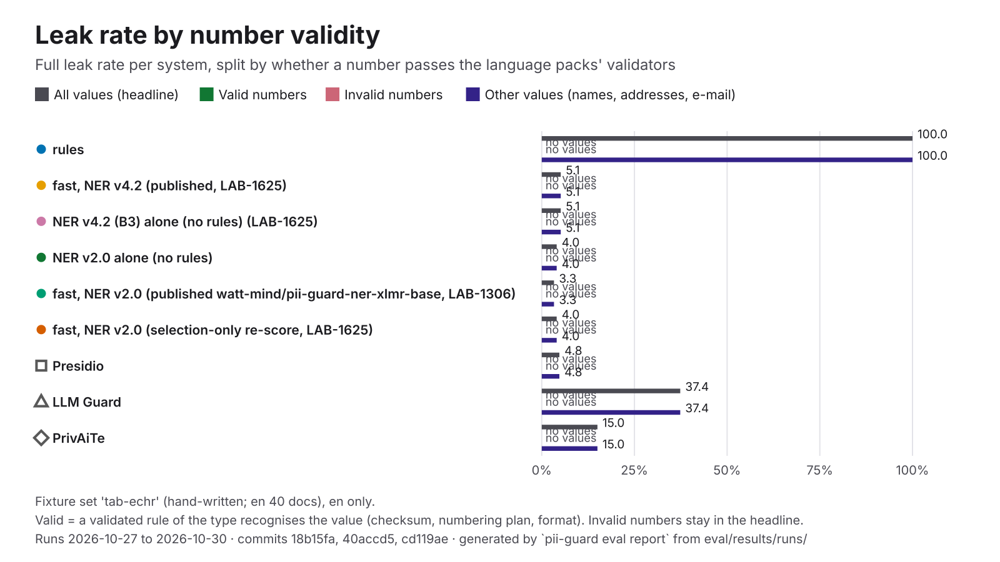

| System | Leak | Recall, valid numbers | Leak, valid numbers | Recall, invalid numbers | Leak, invalid numbers | Leak, other values |
|---|---:|---:|---:|---:|---:|---:|
| **pii-guard rules** | 100.0% | — (0/0) | — (0/0) | — (0/0) | — (0/0) | 100.0% (273/273) |
| pii-guard fast, NER v4.2 (published, LAB-1625) | 5.1% | — (0/0) | — (0/0) | — (0/0) | — (0/0) | 5.1% (14/273) |
| pii-guard NER v4.2 (B3) alone (no rules) (LAB-1625) | 5.1% | — (0/0) | — (0/0) | — (0/0) | — (0/0) | 5.1% (14/273) |
| pii-guard NER v2.0 alone (no rules) | 4.0% | — (0/0) | — (0/0) | — (0/0) | — (0/0) | 4.0% (11/273) |
| pii-guard fast, NER v2.0 (published watt-mind/pii-guard-ner-xlmr-base, LAB-1306) | 3.3% | — (0/0) | — (0/0) | — (0/0) | — (0/0) | 3.3% (9/273) |
| pii-guard fast, NER v2.0 (selection-only re-score, LAB-1625) | 4.0% | — (0/0) | — (0/0) | — (0/0) | — (0/0) | 4.0% (11/273) |
| Presidio | 4.8% | — (0/0) | — (0/0) | — (0/0) | — (0/0) | 4.8% (13/273) |
| LLM Guard | 37.4% | — (0/0) | — (0/0) | — (0/0) | — (0/0) | 37.4% (102/273) |
| PrivAiTe | 15.0% | — (0/0) | — (0/0) | — (0/0) | — (0/0) | 15.0% (41/273) |

### `uncued-numbers`

hand-written; documents: de 11 + en 13 + hu 14.

| System | Docs | Precision | Recall | F1 | Leak | Partial leak | Over-masking | Round trip | Detect p50 | Run | Commit |
|---|---:|---:|---:|---:|---:|---:|---:|---:|---:|---|---|
| **pii-guard rules** | 38 | — | — | — | — | — | — | 100.0% | 0.10 ms | 2026-10-27 | `752ff9a` |
| pii-guard fast, NER v2.0 (published watt-mind/pii-guard-ner-xlmr-base, LAB-1306) | 38 | 0.0% | — | 0.0% | — | — | 100.0% | 100.0% | 49 ms | 2026-10-29 | `10c53ad` |
| pii-guard rules + ner (xlmr-large-distilled-glimmer) | 38 | — | — | — | — | — | — | 100.0% | 20 ms | 2026-10-27 | `752ff9a` |

By language:

| System | de F1 | en F1 | hu F1 | de leak | en leak | hu leak |
|---|---:|---:|---:|---:|---:|---:|
| **pii-guard rules** | — | — | — | — | — | — |
| pii-guard fast, NER v2.0 (published watt-mind/pii-guard-ner-xlmr-base, LAB-1306) | 0.0% | 0.0% | 0.0% | — | — | — |
| pii-guard rules + ner (xlmr-large-distilled-glimmer) | — | — | — | — | — | — |

### `visual-placeholders`

generated by muse-image; documents: all 24 + de 8 + en 8 + hu 8.

| System | Docs | Precision | Recall | F1 | Leak | Partial leak | Over-masking | Round trip | Detect p50 | Run | Commit |
|---|---:|---:|---:|---:|---:|---:|---:|---:|---:|---|---|
| pii-guard image placeholders (exact matching) | 24 | 100.0% | 70.6% | 82.8% | 0.0% | 0.0% | 0.0% | 100.0% | — | 2026-10-27 | `fa1fb6f` |
| pii-guard image placeholders (fuzzy matching) | 24 | 100.0% | 98.0% | 99.0% | 0.0% | 0.0% | 0.0% | 100.0% | — | 2026-10-27 | `fa1fb6f` |

By language:

| System | de F1 | en F1 | hu F1 | de leak | en leak | hu leak |
|---|---:|---:|---:|---:|---:|---:|
| pii-guard image placeholders (exact matching) | 82.8% | 86.7% | 78.6% | 0.0% | 0.0% | 0.0% |
| pii-guard image placeholders (fuzzy matching) | 97.0% | 100.0% | 100.0% | 0.0% | 0.0% | 0.0% |

### `visual-placeholders-noisy`

generated by muse-image; documents: all 24 + de 8 + en 8 + hu 8.

| System | Docs | Precision | Recall | F1 | Leak | Partial leak | Over-masking | Round trip | Detect p50 | Run | Commit |
|---|---:|---:|---:|---:|---:|---:|---:|---:|---:|---|---|
| pii-guard image placeholders (exact matching) | 24 | 100.0% | 52.9% | 69.2% | 0.0% | 0.0% | 0.0% | 100.0% | — | 2026-10-27 | `fa1fb6f` |
| pii-guard image placeholders (fuzzy matching) | 24 | 100.0% | 96.1% | 98.0% | 0.0% | 0.0% | 0.0% | 100.0% | — | 2026-10-27 | `fa1fb6f` |

By language:

| System | de F1 | en F1 | hu F1 | de leak | en leak | hu leak |
|---|---:|---:|---:|---:|---:|---:|
| pii-guard image placeholders (exact matching) | 74.1% | 78.6% | 52.2% | 0.0% | 0.0% | 0.0% |
| pii-guard image placeholders (fuzzy matching) | 97.0% | 100.0% | 97.0% | 0.0% | 0.0% | 0.0% |

## Results per dataset

Every registered dataset ([datasets.md](datasets.md): licences, splits, label mapping) with the latest run of each system. Rates in %, pooled over the set's languages; in brackets the 95 % bootstrap interval (1,000 resamples of documents, seed 1226, from the per-document counts in [`eval/datasets/results/`](../eval/datasets/results/)). Precision, recall and F1 by overlap. Latency: detection per document on the machine in each run's record. Only `test` splits are headline numbers.

### `ai4privacy`: Ai4Privacy OpenPII 1M (test split)

| System | Docs | Leak | Precision | Recall | F1 | Over-masking | p50 ms | p95 ms |
|---|---:|---:|---:|---:|---:|---:|---:|---:|
| pii-guard rules | 600 | 63.1 (61.0-65.1) | 98.5 (97.7-99.2) | 36.3 (34.4-38.4) | 53.1 (50.9-55.3) | 0.1 (0.0-0.4) | 0.4 | 1.4 |
| pii-guard fast, NER v2 base + hard negatives (LAB-1150) | 600 | 0.4 (0.1-0.7) | 97.9 (97.2-98.5) | 98.9 (98.5-99.4) | 98.4 (97.9-98.8) | 1.4 (0.9-2.0) | 27.7 | 69.2 |
| pii-guard audit (rules + NER v2 + LLM) | 30 | 1.0 (0.0-3.2) | 91.4 (86.7-95.6) | 97.1 (93.3-100.0) | 94.2 (90.3-97.2) | 3.0 (0.0-5.6) | 2,218 | 4,321 |
| Presidio | 600 | 29.6 (27.3-31.8) | 38.6 (36.3-41.2) | 49.5 (47.5-51.6) | 43.4 (41.5-45.4) | 49.1 (46.0-51.9) | 12.1 | 152 |
| LLM Guard | 600 | 43.8 (41.8-46.0) | 79.4 (76.9-81.9) | 53.7 (51.4-55.8) | 64.1 (62.2-65.9) | 18.2 (15.7-20.8) | 61.5 | 128 |
| PrivAiTe | 600 | 9.5 (8.1-11.0) | 64.8 (62.7-67.1) | 65.4 (63.1-67.9) | 65.1 (63.2-67.3) | 9.6 (8.4-10.8) | 91.7 | 207 |

### `gretel-finance`: Gretel synthetic PII finance (multilingual) (test split)

| System | Docs | Leak | Precision | Recall | F1 | Over-masking | p50 ms | p95 ms |
|---|---:|---:|---:|---:|---:|---:|---:|---:|
| pii-guard rules | 400 | 80.7 (77.2-84.1) | 75.2 (68.5-81.4) | 12.2 (10.1-14.5) | 21.0 (17.6-24.5) | 23.8 (17.6-30.7) | 2.2 | 7.0 |
| pii-guard fast, NER v2 base + hard negatives (LAB-1150) | 400 | 19.1 (15.4-23.0) | 73.4 (69.8-77.2) | 68.9 (65.4-72.3) | 71.1 (68.1-73.9) | 23.4 (19.5-27.6) | 97.4 | 323 |
| pii-guard audit (rules + NER v2 + LLM) | 20 | 26.7 (12.1-40.0) | 62.2 (46.1-78.4) | 75.0 (60.8-86.1) | 68.0 (54.0-79.0) | 36.6 (18.1-56.3) | 2,255 | 4,196 |
| Presidio | 400 | 18.8 (16.2-21.7) | 19.1 (17.2-21.0) | 64.3 (61.5-67.1) | 29.4 (27.0-31.9) | 75.4 (73.1-77.6) | 24.9 | 50.9 |
| LLM Guard | 400 | 59.3 (55.8-62.6) | 76.0 (71.7-80.8) | 27.7 (25.1-30.7) | 40.6 (37.6-44.0) | 17.0 (13.2-20.9) | 130 | 323 |
| PrivAiTe | 400 | 27.6 (23.6-31.9) | 46.6 (42.2-51.2) | 48.9 (45.1-52.8) | 47.8 (44.2-51.3) | 46.5 (41.9-51.2) | 180 | 245 |

### `gretel-finance-corrected`: Gretel synthetic PII finance (multilingual), corrected labels (test split)

| System | Docs | Leak | Precision | Recall | F1 | Over-masking | p50 ms | p95 ms |
|---|---:|---:|---:|---:|---:|---:|---:|---:|
| pii-guard rules | 400 | 77.1 (73.3-80.7) | 77.5 (70.9-83.5) | 13.5 (11.1-16.1) | 23.0 (19.4-26.8) | 21.8 (15.7-28.1) | 4.1 | 7.4 |
| pii-guard fast, NER v2.0 (published watt-mind/pii-guard-ner-xlmr-base, LAB-1306) | 400 | 2.4 (1.4-3.7) | 74.9 (71.4-78.6) | 76.7 (73.1-80.1) | 75.8 (72.8-78.6) | 21.8 (18.0-25.8) | 329 | 572 |
| Presidio | 400 | 14.8 (12.3-17.5) | 18.3 (16.4-20.3) | 67.5 (64.6-70.4) | 28.8 (26.3-31.3) | 76.7 (74.3-78.9) | 37.8 | 67.3 |
| LLM Guard | 400 | 51.3 (47.8-54.9) | 76.0 (71.7-80.8) | 30.9 (28.0-34.2) | 43.9 (40.7-47.6) | 17.0 (13.2-20.9) | 193 | 342 |
| PrivAiTe | 400 | 13.2 (10.3-16.3) | 46.5 (42.0-51.0) | 54.2 (50.0-58.2) | 50.1 (46.1-53.8) | 46.6 (42.0-51.4) | 504 | 1,296 |

### `nemotron-pii`: NVIDIA Nemotron-PII (test split)

| System | Docs | Leak | Precision | Recall | F1 | Over-masking | p50 ms | p95 ms |
|---|---:|---:|---:|---:|---:|---:|---:|---:|
| pii-guard rules | 300 | 56.0 (52.4-59.4) | 98.9 (97.7-99.8) | 36.8 (33.5-40.2) | 53.6 (50.0-57.1) | 0.8 (0.0-1.8) | 1.2 | 3.4 |
| pii-guard fast, NER v2 base + hard negatives (LAB-1150) | 300 | 0.7 (0.1-1.4) | 91.0 (88.4-93.3) | 87.9 (85.3-90.4) | 89.4 (87.2-91.5) | 1.4 (0.6-2.2) | 61.8 | 188 |
| pii-guard audit (rules + NER v2 + LLM) | 10 | 0.0 (0.0-0.0) | 97.6 (92.1-100.0) | 100.0 (100.0-100.0) | 98.8 (95.9-100.0) | 0.0 (0.0-0.0) | 2,063 | 3,861 |
| Presidio | 300 | 12.8 (10.2-15.6) | 58.7 (55.0-63.0) | 76.3 (73.0-79.2) | 66.4 (63.1-69.6) | 32.0 (27.4-35.8) | 15.5 | 41.8 |
| LLM Guard | 300 | 28.8 (25.7-32.1) | 93.8 (90.8-96.6) | 59.7 (55.9-63.1) | 72.9 (69.7-75.8) | 0.6 (0.1-1.4) | 61.8 | 160 |
| PrivAiTe | 300 | 4.0 (2.5-5.4) | 86.3 (83.9-88.6) | 76.0 (72.4-79.3) | 80.8 (78.2-83.1) | 5.6 (4.1-7.3) | 99.1 | 214 |

### `cee-pii`: CEE-PII-Bench v0.2 (test split)

| System | Docs | Leak | Precision | Recall | F1 | Over-masking | p50 ms | p95 ms |
|---|---:|---:|---:|---:|---:|---:|---:|---:|
| pii-guard rules | 451 | 40.9 (36.8-44.2) | 96.3 (94.2-98.4) | 57.3 (53.8-61.5) | 71.9 (68.8-75.3) | 1.0 (0.0-2.3) | 0.3 | 0.5 |
| pii-guard fast, NER v2 base + hard negatives (LAB-1150) | 451 | 0.4 (0.0-1.0) | 70.4 (67.5-73.8) | 97.2 (95.8-98.6) | 81.7 (79.5-84.1) | 27.9 (24.6-30.7) | 26.2 | 47.4 |
| pii-guard audit (rules + NER v2 + LLM) | 20 | 0.0 (0.0-0.0) | 54.0 (43.4-66.7) | 100.0 (100.0-100.0) | 70.1 (60.5-80.0) | 42.6 (30.9-53.2) | 1,623 | 2,510 |
| Presidio | 451 | 36.5 (32.8-40.5) | 34.0 (30.5-37.6) | 53.0 (48.7-57.0) | 41.4 (37.8-44.8) | 52.5 (48.6-56.1) | 41.7 | 74.0 |
| LLM Guard | 451 | 75.8 (72.7-78.9) | 31.3 (25.4-37.6) | 20.4 (17.3-23.6) | 24.7 (21.0-28.3) | 66.4 (60.3-72.2) | 54.8 | 95.2 |
| PrivAiTe | 451 | 4.4 (2.8-6.3) | 24.8 (21.9-28.0) | 55.0 (50.7-59.2) | 34.2 (30.7-37.7) | 59.2 (56.2-62.2) | 82.1 | 128 |

### `tab-echr`: TAB: Text Anonymization Benchmark (ECHR) (test split)

| System | Docs | Leak | Precision | Recall | F1 | Over-masking | p50 ms | p95 ms |
|---|---:|---:|---:|---:|---:|---:|---:|---:|
| pii-guard rules | 40 | 100.0 (100.0-100.0) | - | 0.0 (0.0-0.0) | - | - | 12.9 | 39.3 |
| pii-guard fast, NER v2 base + hard negatives (LAB-1150) | 40 | 3.3 (0.3-8.4) | 96.0 (91.8-98.9) | 44.4 (37.2-51.0) | 60.7 (53.5-66.9) | 0.4 (0.0-1.3) | 192 | 736 |
| Presidio | 40 | 4.8 (1.9-9.5) | 58.8 (55.4-62.7) | 81.5 (77.4-85.2) | 68.3 (65.6-71.1) | 32.2 (27.7-36.0) | 78.6 | 202 |
| LLM Guard | 40 | 37.4 (25.9-45.9) | 95.2 (89.1-99.4) | 18.5 (14.5-22.9) | 31.0 (25.2-36.8) | 0.0 (0.0-0.0) | 588 | 4,005 |
| PrivAiTe | 40 | 15.0 (8.4-22.0) | 95.7 (93.1-97.8) | 31.9 (24.3-38.3) | 47.8 (38.6-54.9) | 1.7 (0.5-3.0) | 701 | 1,957 |

### `pl-pii-bench`: pl-pii-bench v1.0.0 (test split)

| System | Docs | Leak | Precision | Recall | F1 | Over-masking | p50 ms | p95 ms |
|---|---:|---:|---:|---:|---:|---:|---:|---:|
| pii-guard rules | 346 | 84.1 (73.3-95.1) | 98.5 (95.3-100.0) | 12.3 (3.5-21.3) | 21.8 (6.8-35.0) | 0.0 (0.0-0.0) | 0.1 | 7.4 |
| pii-guard fast, NER v2 base + hard negatives (LAB-1150) | 346 | 17.5 (6.4-27.8) | 84.4 (75.9-92.6) | 75.3 (65.8-84.9) | 79.6 (72.3-86.8) | 10.4 (1.0-20.3) | 21.0 | 87.9 |

### `mapa-eur-lex`: MAPA EUR-Lex PII (test split)

| System | Docs | Leak | Precision | Recall | F1 | Over-masking | p50 ms | p95 ms |
|---|---:|---:|---:|---:|---:|---:|---:|---:|
| pii-guard rules | 42 | 99.3 (98.5-100.0) | 0.0 (0.0-0.0) | 0.0 (0.0-0.0) | 0.0 (0.0-0.0) | 100.0 (100.0-100.0) | 190 | 277 |
| pii-guard fast, NER v2 base + hard negatives (LAB-1150) | 42 | 8.5 (6.0-11.3) | 41.8 (30.6-54.1) | 77.3 (73.5-81.7) | 54.3 (43.6-64.4) | 55.6 (42.7-67.4) | 1,588 | 2,480 |

### `agent-traffic`: pii-guard synthetic agent traffic (test split)

| System | Docs | Leak | Precision | Recall | F1 | Over-masking | p50 ms | p95 ms |
|---|---:|---:|---:|---:|---:|---:|---:|---:|
| pii-guard rules | 990 | 38.8 (38.0-39.7) | 99.8 (99.6-99.9) | 56.3 (55.4-57.2) | 72.0 (71.2-72.7) | 0.0 (0.0-0.0) | 0.9 | 1.8 |
| pii-guard fast, NER v4.2 candidate B3 (LAB-1625; local checkpoint, not published) | 990 | 0.2 (0.1-0.4) | 93.4 (92.8-93.9) | 98.8 (98.4-99.1) | 96.0 (95.6-96.4) | 0.7 (0.5-1.0) | 49.3 | 92.9 |
| pii-guard fast, NER v2.0 (published watt-mind/pii-guard-ner-xlmr-base, LAB-1306) | 990 | 0.3 (0.1-0.5) | 96.3 (95.8-96.8) | 98.0 (97.6-98.4) | 97.1 (96.7-97.6) | 1.3 (1.1-1.6) | 16.1 | 29.5 |
| pii-guard audit (rules + NER v2 + LLM) | 30 | 0.0 (0.0-0.0) | 82.0 (77.0-86.8) | 100.0 (100.0-100.0) | 90.1 (87.0-92.9) | 11.2 (7.5-14.9) | 1,938 | 2,603 |
| Presidio | 990 | 12.4 (11.4-13.4) | 52.1 (50.8-53.4) | 71.8 (70.4-73.1) | 60.4 (59.2-61.5) | 36.8 (35.4-38.3) | 15.4 | 203 |
| LLM Guard | 990 | 20.2 (18.8-21.6) | 74.7 (73.1-76.3) | 67.6 (66.2-69.0) | 71.0 (69.9-72.1) | 16.9 (15.3-18.6) | 58.9 | 98.3 |
| PrivAiTe | 990 | 2.4 (1.7-3.1) | 56.0 (54.9-57.2) | 84.3 (83.0-85.5) | 67.3 (66.2-68.4) | 35.2 (34.1-36.3) | 107 | 303 |

Leak by construction (values in brackets): identifiers whose checksum passes, those altered to fail it, and values with an adversarial perturbation.

| System | Valid checksum | Invalid checksum | Perturbed |
|---|---:|---:|---:|
| pii-guard rules | 0.5 (781) | 77.5 (129) | 45.9 (859) |
| pii-guard fast, NER v4.2 candidate B3 (LAB-1625; local checkpoint, not published) | 0.0 (781) | 0.0 (129) | 0.3 (859) |
| pii-guard fast, NER v2.0 (published watt-mind/pii-guard-ner-xlmr-base, LAB-1306) | 0.1 (781) | 0.0 (129) | 0.3 (859) |
| pii-guard audit (rules + NER v2 + LLM) | 0.0 (27) | 0.0 (1) | 0.0 (23) |
| Presidio | 15.2 (781) | 37.2 (129) | 31.5 (859) |
| LLM Guard | 27.3 (781) | 41.1 (129) | 26.7 (859) |
| PrivAiTe | 3.1 (781) | 0.8 (129) | 2.4 (859) |

### `agent-traffic-dev`: pii-guard synthetic agent traffic (dev) (dev split)

| System | Docs | Leak | Precision | Recall | F1 | Over-masking | p50 ms | p95 ms |
|---|---:|---:|---:|---:|---:|---:|---:|---:|
| pii-guard rules | 300 | 37.8 (36.4-39.3) | 99.9 (99.7-100.0) | 57.3 (55.5-59.0) | 72.8 (71.4-74.2) | 0.0 (0.0-0.0) | 0.9 | 1.9 |
| pii-guard fast, NER v4.2 candidate B3 (LAB-1625; local checkpoint, not published) | 300 | 0.1 (0.0-0.3) | 93.1 (92.1-94.2) | 99.1 (98.5-99.6) | 96.0 (95.3-96.7) | 0.7 (0.4-1.1) | 48.0 | 78.1 |
| pii-guard fast, NER v2.0 (published watt-mind/pii-guard-ner-xlmr-base, LAB-1306) | 300 | 0.1 (0.0-0.3) | 96.4 (95.6-97.3) | 98.5 (97.8-99.1) | 97.4 (96.7-98.1) | 1.5 (1.0-2.1) | 16.1 | 30.1 |

Leak by construction (values in brackets): identifiers whose checksum passes, those altered to fail it, and values with an adversarial perturbation.

| System | Valid checksum | Invalid checksum | Perturbed |
|---|---:|---:|---:|
| pii-guard rules | 1.2 (244) | 80.0 (35) | 45.6 (285) |
| pii-guard fast, NER v4.2 candidate B3 (LAB-1625; local checkpoint, not published) | 0.0 (244) | 0.0 (35) | 0.4 (285) |
| pii-guard fast, NER v2.0 (published watt-mind/pii-guard-ner-xlmr-base, LAB-1306) | 0.0 (244) | 0.0 (35) | 0.4 (285) |

## Recall per entity type (`smoke`)

Featured systems run on every language of the current fixture files, pooled (micro-averaged).

| Type | Gold | rules | fast, NER v4.2 (published, LAB-1625) | Presidio | LLM Guard | PrivAiTe |
|---|---:|---:|---:|---:|---:|---:|
| `PERSON` | 76 | 1.3% | 100.0% | 90.8% | 88.2% | 76.3% |
| `ADDRESS` | 27 | 92.6% | 100.0% | 70.4% | 0.0% | 92.6% |
| `EMAIL` | 15 | 100.0% | 100.0% | 86.7% | 100.0% | 100.0% |
| `PHONE` | 20 | 100.0% | 100.0% | 80.0% | 95.0% | 95.0% |
| `DATE_OF_BIRTH` | 14 | 0.0% | 100.0% | 57.1% | 0.0% | 78.6% |
| `NATIONAL_ID_HU_TAX` | 6 | 100.0% | 100.0% | 0.0% | 0.0% | 0.0% |
| `NATIONAL_ID_HU_TAJ` | 5 | 100.0% | 100.0% | 0.0% | 0.0% | 0.0% |
| `ID_DOCUMENT` | 28 | 100.0% | 100.0% | 10.7% | 0.0% | 0.0% |
| `BANK_ACCOUNT` | 15 | 100.0% | 100.0% | 80.0% | 80.0% | 100.0% |
| `PAYMENT_CARD` | 0 | — | — | — | — | — |
| `COMPANY_ID_HU` | 4 | 100.0% | 0.0% | 0.0% | 0.0% | 0.0% |
| `ORGANIZATION` | 19 | 0.0% | 89.5% | 68.4% | 0.0% | 0.0% |
| `PARCEL_NUMBER_HU` | 6 | 100.0% | 50.0% | 0.0% | 0.0% | 0.0% |
| `VEHICLE_PLATE` | 6 | 100.0% | 100.0% | 0.0% | 0.0% | 0.0% |

## Image masking

Share of labeled regions masked with IoU >= 0.5. `specimens` are official specimen ID documents published by their issuers; `fictional-specimens` are specimen-style documents built from Muse Image output (LAB-1121). The two sets hold different documents, so compare runs within a set.

| Run | Set | Images | Countries | portrait | signature | mrz | text | All regions | Over-masking (mean) |
|---|---|---:|---:|---:|---:|---:|---:|---:|---:|
| `2026-10-27-image-baselines-fictional-eka` | `fictional-specimens` | 24 | 3 | 100.0% | 86.7% | 0.0% | 91.8% | 88.6% | 3.2% |
| `2026-10-27-image-baselines-fictional-eka-tuned` | `fictional-specimens` | 24 | 3 | 100.0% | 86.7% | 0.0% | 95.5% | 91.3% | 3.2% |
| `2026-10-27-image-baselines-fictional-pii-guard-rules` | `fictional-specimens` | 24 | 3 | 100.0% | 100.0% | 100.0% | 87.3% | 90.6% | 1.2% |
| `2026-10-27-image-baselines-fictional-pii-guard-rules-llm` | `fictional-specimens` | 24 | 3 | 100.0% | 100.0% | 100.0% | 100.0% | 100.0% | 1.2% |
| `2026-10-27-image-baselines-fictional-presidio-image` | `fictional-specimens` | 24 | 3 | — | — | 0.0% | 50.9% | 37.6% | 1.1% |
| `2026-10-27-image-baselines-fictional-presidio-image-tuned` | `fictional-specimens` | 24 | 3 | — | — | 0.0% | 50.9% | 38.3% | 1.1% |
| `2026-10-27-image-baselines-specimens-eka` | `specimens` | 65 | 24 | 56.9% | 46.0% | 6.7% | 32.5% | 35.7% | 10.8% |
| `2026-10-27-image-baselines-specimens-eka-tuned` | `specimens` | 65 | 24 | 55.4% | 48.6% | 10.0% | 32.5% | 36.0% | 12.0% |
| `2026-10-27-image-baselines-specimens-pii-guard-rules` | `specimens` | 65 | 24 | 90.8% | 83.8% | 76.7% | 15.0% | 37.9% | 4.0% |
| `2026-10-27-image-baselines-specimens-pii-guard-rules-llm` | `specimens` | 65 | 24 | 90.8% | 83.8% | 80.0% | 30.3% | 48.5% | 4.7% |
| `2026-10-27-image-baselines-specimens-presidio-image` | `specimens` | 65 | 24 | — | — | 0.0% | 19.7% | 13.3% | 3.4% |
| `2026-10-27-image-baselines-specimens-presidio-image-tuned` | `specimens` | 65 | 24 | — | — | 0.0% | 17.5% | 12.3% | 3.9% |
| `2026-10-27-visual-fictional-muse-image` | `fictional-specimens` | 24 | 3 | 100.0% | 100.0% | 0.0% | 34.5% | 47.6% | 0.8% |
| `2026-10-27-visual-fictional-rules` | `fictional-specimens` | 24 | 3 | 100.0% | 100.0% | 100.0% | 34.5% | 51.7% | 0.8% |
| `2026-10-27-visual-fictional-rules-captions` | `fictional-specimens` | 24 | 3 | 100.0% | 100.0% | 100.0% | 87.3% | 90.6% | 1.2% |
| `2026-10-27-visual-fictional-rules-llm` | `fictional-specimens` | 24 | 3 | 100.0% | 100.0% | 100.0% | 89.1% | 92.0% | 0.9% |
| `2026-10-27-visual-fictional-rules-llm-captions` | `fictional-specimens` | 24 | 3 | 100.0% | 100.0% | 100.0% | 99.1% | 99.3% | 1.2% |
| `2026-10-27-visual-specimens-id-photo-prompt` | `specimens` | 65 | 24 | 76.9% | 83.8% | 0.0% | 0.4% | 20.2% | 1.5% |
| `2026-10-27-visual-specimens-person-prompt` | `specimens` | 65 | 24 | 90.8% | 83.8% | 0.0% | 0.4% | 22.4% | 2.1% |
| `2026-10-27-visual-specimens-rules` | `specimens` | 65 | 24 | 90.8% | 83.8% | 76.7% | 1.5% | 28.8% | 2.6% |
| `2026-10-27-visual-specimens-rules-captions` | `specimens` | 65 | 24 | 90.8% | 83.8% | 76.7% | 15.0% | 37.9% | 4.0% |
| `2026-10-27-visual-specimens-rules-llm` | `specimens` | 65 | 24 | 90.8% | 83.8% | 76.7% | 27.7% | 46.6% | 3.1% |
| `2026-10-27-visual-specimens-rules-llm-captions` | `specimens` | 65 | 24 | 90.8% | 83.8% | 80.0% | 29.2% | 47.8% | 4.8% |
| `2026-10-30-visual-specimens-rules-captions-security-print` | `specimens` | 65 | 24 | 90.8% | 83.8% | 83.3% | 20.8% | 42.4% | 4.7% |

## Segmenters: SAM 3.1 API vs on-device

Portraits and signatures only, no OCR (`python -m pii_guard.visual.segment_eval`, LAB-1229): SAM 3.1 on the Meta API against on-device candidates. Latency is per image on the CPU of the machine in each run's hardware note (SAM: its API calls). Leak, precision, memory and model size are in each run's notes and in [models.md](models.md#local-segmentation).

| Run | Set | Images | Portrait (IoU) | Portrait (cov ≥ 90%) | Signature (IoU) | Signature (cov ≥ 90%) | Over-masking (mean) | p50 / image | p95 / image |
|---|---|---:|---:|---:|---:|---:|---:|---:|---:|
| `2026-10-27-segment-efficientsam-fictional` | `fictional-specimens` | 24 | 100.0% | 100.0% | 0.0% | 13.3% | 4.7% | 1.5 s | 4.4 s |
| `2026-10-27-segment-efficientsam-specimens` | `specimens` | 65 | 92.3% | 87.7% | 0.0% | 8.1% | 6.3% | 2.2 s | 3.3 s |
| `2026-10-27-segment-hybrid-fictional` | `fictional-specimens` | 24 | 100.0% | 100.0% | 100.0% | 100.0% | 7.8% | 2.3 s | 3.0 s |
| `2026-10-27-segment-hybrid-specimens` | `specimens` | 65 | 92.3% | 90.8% | 83.8% | 73.0% | 10.8% | 2.5 s | 4.1 s |
| `2026-10-27-segment-local-fictional` | `fictional-specimens` | 24 | 100.0% | 100.0% | 0.0% | 6.7% | 7.7% | 176 ms | 238 ms |
| `2026-10-27-segment-local-specimens` | `specimens` | 65 | 92.3% | 90.8% | 0.0% | 8.1% | 10.3% | 116 ms | 348 ms |
| `2026-10-27-segment-sam-api-fictional` | `fictional-specimens` | 24 | 100.0% | 100.0% | 100.0% | 100.0% | 0.7% | 5.1 s | 6.9 s |
| `2026-10-27-segment-sam-api-specimens` | `specimens` | 65 | 90.8% | 72.3% | 83.8% | 64.9% | 2.1% | 5.5 s | 8.6 s |
| `2026-10-27-segment-small-detectors-fictional` | `fictional-specimens` | 24 | 100.0% | 100.0% | 100.0% | 93.3% | 10.0% | 1.1 s | 1.6 s |
| `2026-10-27-segment-small-detectors-specimens` | `specimens` | 65 | 93.8% | 93.8% | 51.3% | 59.5% | 18.9% | 727 ms | 1.6 s |
| `2026-10-30-segment-sam-api-prompt-set` | `prompt-set` | 24 | 100.0% | 66.7% | 50.0% | 50.0% | 0.2% | 4.0 s | 5.6 s |

## Gateway latency

What the gateway adds to an LLM call, measured by `pii-guard bench latency` against the mock upstream with a fixed delay, so the upstream's own time is taken out: overhead = gateway total - time waiting on the upstream. Streams also report the added time to the first token. Each request is a new session (no cache hits). Stages and fields: [operations.md](operations.md#timing).

| System | Concurrency | Stream | n | Overhead p50 | p95 | p99 | Detect p50 | Added TTFT p50 | p95 | Re-check p50 | Upstream delay ms | Run |
|---|---:|---|---:|---:|---:|---:|---:|---:|---:|---:|---:|---|
| fast: rules | 1 | no | 200 | 5.2 ms | 7.8 ms | 8.9 ms | 0.45 ms | — | — | — | 50 | `2026-10-27-gateway-latency-rules-fast` |
| fast: rules | 1 | yes | 200 | 6.5 ms | 8.1 ms | 8.4 ms | 0.43 ms | 5.3 ms | 6.6 ms | — | 50 | `2026-10-27-gateway-latency-rules-fast` |
| fast: rules | 8 | no | 200 | 11 ms | 26 ms | 32 ms | 6.2 ms | — | — | — | 50 | `2026-10-27-gateway-latency-rules-fast` |
| fast: rules | 8 | yes | 200 | 12 ms | 27 ms | 37 ms | 5.0 ms | 10 ms | 24 ms | — | 50 | `2026-10-27-gateway-latency-rules-fast` |
| fast: rules + ner | 1 | no | 200 | 36 ms | 45 ms | 51 ms | 31 ms | — | — | — | 50 | `2026-10-27-gateway-latency-ner-fast` |
| fast: rules + ner | 1 | yes | 200 | 39 ms | 47 ms | 57 ms | 32 ms | 37 ms | 46 ms | — | 50 | `2026-10-27-gateway-latency-ner-fast` |
| fast: rules + ner | 8 | no | 200 | 166 ms | 182 ms | 203 ms | 160 ms | — | — | — | 50 | `2026-10-27-gateway-latency-ner-fast` |
| fast: rules + ner | 8 | yes | 200 | 173 ms | 183 ms | 189 ms | 166 ms | 172 ms | 182 ms | — | 50 | `2026-10-27-gateway-latency-ner-fast` |
| audit: rules + llm | 1 | no | 10 | 1.2 s | 1.8 s | 2.1 s | 1.2 s | — | — | — | 50 | `2026-10-27-gateway-latency-baseten-strict` |
| audit: rules + llm | 1 | yes | 10 | 1.3 s | 1.6 s | 1.7 s | 1.3 s | 1.3 s | 1.6 s | — | 50 | `2026-10-27-gateway-latency-baseten-strict` |
| audit: rules + llm | 8 | no | 10 | 1.9 s | 2.4 s | 2.5 s | 1.9 s | — | — | — | 50 | `2026-10-27-gateway-latency-baseten-strict` |
| audit: rules + llm | 8 | yes | 10 | 2.2 s | 3.0 s | 3.2 s | 2.2 s | 2.2 s | 3.0 s | — | 50 | `2026-10-27-gateway-latency-baseten-strict` |
| fast: rules + ner | 1 | no | 200 | 25 ms | 29 ms | 32 ms | 19 ms | — | — | — | 50 | `2026-10-27-gateway-latency-ner-fallback-fast` |
| fast: rules + ner | 1 | yes | 200 | 26 ms | 29 ms | 31 ms | 19 ms | 25 ms | 28 ms | — | 50 | `2026-10-27-gateway-latency-ner-fallback-fast` |
| fast: rules + ner | 8 | no | 200 | 73 ms | 90 ms | 99 ms | 68 ms | — | — | — | 50 | `2026-10-27-gateway-latency-ner-fallback-fast` |
| fast: rules + ner | 8 | yes | 200 | 79 ms | 112 ms | 146 ms | 72 ms | 77 ms | 111 ms | — | 50 | `2026-10-27-gateway-latency-ner-fallback-fast` |
| fast: rules + ner (cpu) | 1 | no | 200 | 34 ms | 40 ms | 42 ms | 33 ms | — | — | — | 50 | `2026-10-28-ner-concurrency-cpu-fast` |
| fast: rules + ner (cpu) | 1 | yes | 200 | 36 ms | 41 ms | 52 ms | 34 ms | 35 ms | 41 ms | — | 50 | `2026-10-28-ner-concurrency-cpu-fast` |
| fast: rules + ner (cpu) | 4 | no | 200 | 72 ms | 84 ms | 91 ms | 71 ms | — | — | — | 50 | `2026-10-28-ner-concurrency-cpu-fast` |
| fast: rules + ner (cpu) | 4 | yes | 200 | 76 ms | 90 ms | 120 ms | 74 ms | 75 ms | 89 ms | — | 50 | `2026-10-28-ner-concurrency-cpu-fast` |
| fast: rules + ner (cpu) | 8 | no | 200 | 144 ms | 178 ms | 183 ms | 143 ms | — | — | — | 50 | `2026-10-28-ner-concurrency-cpu-fast` |
| fast: rules + ner (cpu) | 8 | yes | 200 | 159 ms | 196 ms | 319 ms | 157 ms | 158 ms | 196 ms | — | 50 | `2026-10-28-ner-concurrency-cpu-fast` |
| fast: rules + ner (mps) | 1 | no | 200 | 21 ms | 27 ms | 44 ms | 20 ms | — | — | — | 50 | `2026-10-28-ner-concurrency-mps-fast` |
| fast: rules + ner (mps) | 1 | yes | 200 | 22 ms | 39 ms | 65 ms | 21 ms | 22 ms | 37 ms | — | 50 | `2026-10-28-ner-concurrency-mps-fast` |
| fast: rules + ner (mps) | 4 | no | 200 | 17 ms | 39 ms | 98 ms | 16 ms | — | — | — | 50 | `2026-10-28-ner-concurrency-mps-fast` |
| fast: rules + ner (mps) | 4 | yes | 200 | 19 ms | 34 ms | 51 ms | 17 ms | 18 ms | 33 ms | — | 50 | `2026-10-28-ner-concurrency-mps-fast` |
| fast: rules + ner (mps) | 8 | no | 200 | 36 ms | 56 ms | 91 ms | 36 ms | — | — | — | 50 | `2026-10-28-ner-concurrency-mps-fast` |
| fast: rules + ner (mps) | 8 | yes | 200 | 45 ms | 71 ms | 149 ms | 44 ms | 45 ms | 70 ms | — | 50 | `2026-10-28-ner-concurrency-mps-fast` |
| fast: rules + ner (cpu) | 1 | no | 200 | 71 ms | 133 ms | 172 ms | 69 ms | — | — | 0.23 ms | 50 | `2026-10-30-lab-1656-gateway-latency-cpu-v20-fast` |
| fast: rules + ner (cpu) | 1 | yes | 200 | 53 ms | 86 ms | 114 ms | 50 ms | 52 ms | 83 ms | 0.18 ms | 50 | `2026-10-30-lab-1656-gateway-latency-cpu-v20-fast` |
| fast: rules + ner (cpu) | 4 | no | 200 | 129 ms | 211 ms | 252 ms | 127 ms | — | — | 0.17 ms | 50 | `2026-10-30-lab-1656-gateway-latency-cpu-v20-fast` |
| fast: rules + ner (cpu) | 4 | yes | 200 | 159 ms | 433 ms | 864 ms | 154 ms | 156 ms | 429 ms | 0.17 ms | 50 | `2026-10-30-lab-1656-gateway-latency-cpu-v20-fast` |
| fast: rules + ner (cpu) | 8 | no | 200 | 232 ms | 369 ms | 412 ms | 231 ms | — | — | 0.15 ms | 50 | `2026-10-30-lab-1656-gateway-latency-cpu-v20-fast` |
| fast: rules + ner (cpu) | 8 | yes | 200 | 318 ms | 811 ms | 1.1 s | 314 ms | 315 ms | 807 ms | 0.18 ms | 50 | `2026-10-30-lab-1656-gateway-latency-cpu-v20-fast` |
| fast: rules + ner (cpu) | 1 | no | 200 | 55 ms | 227 ms | 474 ms | 53 ms | — | — | 0.17 ms | 50 | `2026-10-30-lab-1656-gateway-latency-cpu-v42-b3-fast` |
| fast: rules + ner (cpu) | 1 | yes | 200 | 49 ms | 71 ms | 96 ms | 47 ms | 48 ms | 69 ms | 0.18 ms | 50 | `2026-10-30-lab-1656-gateway-latency-cpu-v42-b3-fast` |
| fast: rules + ner (cpu) | 4 | no | 200 | 98 ms | 155 ms | 176 ms | 96 ms | — | — | 0.15 ms | 50 | `2026-10-30-lab-1656-gateway-latency-cpu-v42-b3-fast` |
| fast: rules + ner (cpu) | 4 | yes | 200 | 97 ms | 160 ms | 182 ms | 94 ms | 95 ms | 158 ms | 0.13 ms | 50 | `2026-10-30-lab-1656-gateway-latency-cpu-v42-b3-fast` |
| fast: rules + ner (cpu) | 8 | no | 200 | 194 ms | 253 ms | 293 ms | 193 ms | — | — | 0.15 ms | 50 | `2026-10-30-lab-1656-gateway-latency-cpu-v42-b3-fast` |
| fast: rules + ner (cpu) | 8 | yes | 200 | 229 ms | 286 ms | 301 ms | 226 ms | 227 ms | 284 ms | 0.12 ms | 50 | `2026-10-30-lab-1656-gateway-latency-cpu-v42-b3-fast` |

## Run log

Newest first. `imported` runs were converted from earlier scorecards and Linear/PR notes; `recorded` ones were written by `pii-guard eval --record`. Audit mode was called `strict` until LAB-1186: run IDs ending in `-strict` are audit-mode runs, kept under their original IDs.

| Date | Run | System | Set | Lang | Source | Commit | Hardware | Cost |
|---|---|---|---|---|---|---|---|---|
| 2026-10-30 | `2026-10-30-datasets-agent-traffic-dev-fast-v42-b3` | pii-guard fast, NER v4.2 candidate B3 (LAB-1625; local checkpoint, not published) | agent-traffic-dev | de, en, hu | recorded | `40accd5` | — | — |
| 2026-10-30 | `2026-10-30-datasets-agent-traffic-fast-v42-b3` | pii-guard fast, NER v4.2 candidate B3 (LAB-1625; local checkpoint, not published) | agent-traffic | de, en, hu | recorded | `40accd5` | — | — |
| 2026-10-30 | `2026-10-30-datasets-agent-traffic-dev-fast-lab-1656` | pii-guard fast, NER v2.0 (published watt-mind/pii-guard-ner-xlmr-base, LAB-1306) | agent-traffic-dev | de, en, hu | recorded | `40accd5` | — | — |
| 2026-10-30 | `2026-10-30-datasets-agent-traffic-fast-lab-1656` | pii-guard fast, NER v2.0 (published watt-mind/pii-guard-ner-xlmr-base, LAB-1306) | agent-traffic | de, en, hu | recorded | `40accd5` | — | — |
| 2026-10-30 | `2026-10-30-lab-1656-gateway-latency-cpu-v42-b3-fast` | pii-guard gateway, fast mode (rules + ner pii-guard-ner-v42-b3 on cpu) | latency-corpus | de, en, hu | recorded | `40accd5` | Apple M1 Max, 10 CPUs, local loopback | — |
| 2026-10-30 | `2026-10-30-lab-1656-gateway-latency-cpu-v20-fast` | pii-guard gateway, fast mode (rules + ner watt-mind/pii-guard-ner-xlmr-base on cpu) | latency-corpus | de, en, hu | recorded | `40accd5` | Apple M1 Max, 10 CPUs, local loopback | — |
| 2026-10-30 | `2026-10-30-lab-1625-tab-echr-v42-b3` | pii-guard fast, NER v4.2 (published, LAB-1625) | tab-echr | en | recorded | `40accd5` | — | — |
| 2026-10-30 | `2026-10-30-lab-1625-gretel-finance-corrected-v42-b3` | pii-guard fast, NER v4.2 (published, LAB-1625) | gretel-finance-corrected | de, en | recorded | `40accd5` | — | — |
| 2026-10-30 | `2026-10-30-lab-1625-pl-pii-bench-v42-b3` | pii-guard fast, NER v4.2 (published, LAB-1625) | pl-pii-bench | pl | recorded | `40accd5` | — | — |
| 2026-10-30 | `2026-10-30-lab-1625-pl-smoke-v42-b3` | pii-guard fast, NER v4.2 (published, LAB-1625) | smoke | pl | recorded | `40accd5` | — | — |
| 2026-10-30 | `2026-10-30-lab-1625-gretel-finance-v42-b3` | pii-guard fast, NER v4.2 (published, LAB-1625) | gretel-finance | de, en | recorded | `40accd5` | — | — |
| 2026-10-30 | `2026-10-30-lab-1656-ai4privacy-privaite` | PrivAiTe | ai4privacy | de, en, hu | recorded | `8bf410b` | arm64, 10 CPUs, CPU only | — |
| 2026-10-30 | `2026-10-30-lab-1656-ai4privacy-presidio` | Presidio | ai4privacy | de, en, hu | recorded | `8bf410b` | arm64, 10 CPUs, CPU only | — |
| 2026-10-30 | `2026-10-30-lab-1656-ai4privacy-llm-guard` | LLM Guard | ai4privacy | de, en, hu | recorded | `8bf410b` | arm64, 10 CPUs, CPU only | — |
| 2026-10-30 | `2026-10-30-lab-1656-ai4privacy` | pii-guard rules | ai4privacy | de, en, hu | recorded | `8bf410b` | — | — |
| 2026-10-30 | `2026-10-30-lab-1625-cee-pii-v42-b3` | pii-guard fast, NER v4.2 (published, LAB-1625) | cee-pii | en, hu | recorded | `40accd5` | — | — |
| 2026-10-30 | `2026-10-30-lab-1625-nemotron-pii-v42-b3` | pii-guard fast, NER v4.2 (published, LAB-1625) | nemotron-pii | en | recorded | `40accd5` | — | — |
| 2026-10-30 | `2026-10-30-lab-1625-ai4privacy-v42-b3` | pii-guard fast, NER v4.2 (published, LAB-1625) | ai4privacy | de, en, hu | recorded | `40accd5` | — | — |
| 2026-10-30 | `2026-10-30-lab-1625-agent-traffic-v42-b3` | pii-guard fast, NER v4.2 (published, LAB-1625) | agent-traffic | de, en, hu | recorded | `40accd5` | — | — |
| 2026-10-30 | `2026-10-30-lab-1625-mapa-eur-lex-ner-v42-b3` | pii-guard NER v4.2 (B3) alone (no rules) (LAB-1625) | mapa-eur-lex | bg, cs, da, de, el, en, es, et, fi, fr, ga, hu, it, lt, lv, mt, nl, pt, ro, sk, sv | recorded | `40accd5` | — | — |
| 2026-10-30 | `2026-10-30-lab-1656-agent-traffic-privaite` | PrivAiTe | agent-traffic | de, en, hu | recorded | `8bf410b` | arm64, 10 CPUs, CPU only | — |
| 2026-10-30 | `2026-10-30-lab-1656-agent-traffic-presidio` | Presidio | agent-traffic | de, en, hu | recorded | `8bf410b` | arm64, 10 CPUs, CPU only | — |
| 2026-10-30 | `2026-10-30-lab-1656-agent-traffic-llm-guard` | LLM Guard | agent-traffic | de, en, hu | recorded | `8bf410b` | arm64, 10 CPUs, CPU only | — |
| 2026-10-30 | `2026-10-30-lab-1656-agent-traffic` | pii-guard rules | agent-traffic | de, en, hu | recorded | `8bf410b` | — | — |
| 2026-10-30 | `2026-10-30-lab-1625-tab-echr-ner-v42-b3` | pii-guard NER v4.2 (B3) alone (no rules) (LAB-1625) | tab-echr | en | recorded | `40accd5` | — | — |
| 2026-10-30 | `2026-10-30-lab-1625-gretel-finance-corrected-ner-v42-b3` | pii-guard NER v4.2 (B3) alone (no rules) (LAB-1625) | gretel-finance-corrected | de, en | recorded | `40accd5` | — | — |
| 2026-10-30 | `2026-10-30-lab-1625-pl-pii-bench-ner-v42-b3` | pii-guard NER v4.2 (B3) alone (no rules) (LAB-1625) | pl-pii-bench | pl | recorded | `40accd5` | — | — |
| 2026-10-30 | `2026-10-30-lab-1625-pl-smoke-ner-v42-b3` | pii-guard NER v4.2 (B3) alone (no rules) (LAB-1625) | smoke | pl | recorded | `40accd5` | — | — |
| 2026-10-30 | `2026-10-30-lab-1625-mapa-eur-lex-ner-v20` | pii-guard NER v2.0 alone (no rules) | mapa-eur-lex | bg, cs, da, de, el, en, es, et, fi, fr, ga, hu, it, lt, lv, mt, nl, pt, ro, sk, sv | recorded | `40accd5` | — | — |
| 2026-10-30 | `2026-10-30-lab-1625-tab-echr-ner-v20` | pii-guard NER v2.0 alone (no rules) | tab-echr | en | recorded | `40accd5` | — | — |
| 2026-10-30 | `2026-10-30-lab-1625-gretel-finance-corrected-ner-v20` | pii-guard NER v2.0 alone (no rules) | gretel-finance-corrected | de, en | recorded | `40accd5` | — | — |
| 2026-10-30 | `2026-10-30-lab-1625-pl-pii-bench-ner-v20` | pii-guard NER v2.0 alone (no rules) | pl-pii-bench | pl | recorded | `40accd5` | — | — |
| 2026-10-30 | `2026-10-30-lab-1625-pl-smoke-ner-v20` | pii-guard NER v2.0 alone (no rules) | smoke | pl | recorded | `40accd5` | — | — |
| 2026-10-30 | `2026-10-30-lab-1625-tab-echr-v20` | pii-guard fast, NER v2.0 (selection-only re-score, LAB-1625) | tab-echr | en | recorded | `40accd5` | — | — |
| 2026-10-30 | `2026-10-30-lab-1625-gretel-finance-corrected-v20` | pii-guard fast, NER v2.0 (selection-only re-score, LAB-1625) | gretel-finance-corrected | de, en | recorded | `40accd5` | — | — |
| 2026-10-30 | `2026-10-30-lab-1625-pl-pii-bench-v20` | pii-guard fast, NER v2.0 (selection-only re-score, LAB-1625) | pl-pii-bench | pl | recorded | `40accd5` | — | — |
| 2026-10-30 | `2026-10-30-lab-1625-pl-smoke-v20` | pii-guard fast, NER v2.0 (selection-only re-score, LAB-1625) | smoke | pl | recorded | `40accd5` | — | — |
| 2026-10-30 | `2026-10-30-lab-1625-gretel-finance-ner-v42-b3` | pii-guard NER v4.2 (B3) alone (no rules) (LAB-1625) | gretel-finance | de, en | recorded | `40accd5` | — | — |
| 2026-10-30 | `2026-10-30-lab-1625-cee-pii-ner-v42-b3` | pii-guard NER v4.2 (B3) alone (no rules) (LAB-1625) | cee-pii | en, hu | recorded | `40accd5` | — | — |
| 2026-10-30 | `2026-10-30-lab-1625-nemotron-pii-ner-v42-b3` | pii-guard NER v4.2 (B3) alone (no rules) (LAB-1625) | nemotron-pii | en | recorded | `40accd5` | — | — |
| 2026-10-30 | `2026-10-30-lab-1625-ai4privacy-ner-v42-b3` | pii-guard NER v4.2 (B3) alone (no rules) (LAB-1625) | ai4privacy | de, en, hu | recorded | `40accd5` | — | — |
| 2026-10-30 | `2026-10-30-lab-1625-agent-traffic-ner-v42-b3` | pii-guard NER v4.2 (B3) alone (no rules) (LAB-1625) | agent-traffic | de, en, hu | recorded | `40accd5` | — | — |
| 2026-10-30 | `2026-10-30-lab-1625-agent-traffic-dev-ner-v42-b3` | pii-guard NER v4.2 (B3) alone (no rules) (LAB-1625) | agent-traffic-dev | de, en, hu | recorded | `40accd5` | — | — |
| 2026-10-30 | `2026-10-30-lab-1625-smoke-ner-v42-b3` | pii-guard NER v4.2 (B3) alone (no rules) (LAB-1625) | smoke | de, en, hu | recorded | `40accd5` | — | — |
| 2026-10-30 | `2026-10-30-lab-1625-gretel-finance-ner-v20` | pii-guard NER v2.0 alone (no rules) | gretel-finance | de, en | recorded | `40accd5` | — | — |
| 2026-10-30 | `2026-10-30-lab-1625-cee-pii-ner-v20` | pii-guard NER v2.0 alone (no rules) | cee-pii | en, hu | recorded | `40accd5` | — | — |
| 2026-10-30 | `2026-10-30-lab-1625-nemotron-pii-ner-v20` | pii-guard NER v2.0 alone (no rules) | nemotron-pii | en | recorded | `40accd5` | — | — |
| 2026-10-30 | `2026-10-30-lab-1625-ai4privacy-ner-v20` | pii-guard NER v2.0 alone (no rules) | ai4privacy | de, en, hu | recorded | `40accd5` | — | — |
| 2026-10-30 | `2026-10-30-lab-1625-agent-traffic-ner-v20` | pii-guard NER v2.0 alone (no rules) | agent-traffic | de, en, hu | recorded | `40accd5` | — | — |
| 2026-10-30 | `2026-10-30-lab-1625-agent-traffic-dev-ner-v20` | pii-guard NER v2.0 alone (no rules) | agent-traffic-dev | de, en, hu | recorded | `40accd5` | — | — |
| 2026-10-30 | `2026-10-30-lab-1625-smoke-ner-v20` | pii-guard NER v2.0 alone (no rules) | smoke | de, en, hu | recorded | `40accd5` | — | — |
| 2026-10-30 | `2026-10-30-lab-1625-gretel-finance-v20` | pii-guard fast, NER v2.0 (selection-only re-score, LAB-1625) | gretel-finance | de, en | recorded | `40accd5` | — | — |
| 2026-10-30 | `2026-10-30-lab-1625-cee-pii-v20` | pii-guard fast, NER v2.0 (selection-only re-score, LAB-1625) | cee-pii | en, hu | recorded | `40accd5` | — | — |
| 2026-10-30 | `2026-10-30-lab-1625-nemotron-pii-v20` | pii-guard fast, NER v2.0 (selection-only re-score, LAB-1625) | nemotron-pii | en | recorded | `40accd5` | — | — |
| 2026-10-30 | `2026-10-30-lab-1625-ai4privacy-v20` | pii-guard fast, NER v2.0 (selection-only re-score, LAB-1625) | ai4privacy | de, en, hu | recorded | `40accd5` | — | — |
| 2026-10-30 | `2026-10-30-lab-1625-agent-traffic-v20` | pii-guard fast, NER v2.0 (selection-only re-score, LAB-1625) | agent-traffic | de, en, hu | recorded | `40accd5` | — | — |
| 2026-10-30 | `2026-10-30-lab-1625-mapa-eur-lex-v42-b3t` | pii-guard fast, NER v4.2 B3 with dev-calibrated thresholds, post-hoc, not a protocol candidate (LAB-1625) | mapa-eur-lex | bg, cs, da, de, el, en, es, et, fi, fr, ga, hu, it, lt, lv, mt, nl, pt, ro, sk, sv | recorded | `357175c` | — | — |
| 2026-10-30 | `2026-10-30-lab-1625-eu-inflection-v42-b3t` | pii-guard fast, NER v4.2 B3 with dev-calibrated thresholds, post-hoc, not a protocol candidate (LAB-1625) | eu-inflection | es, fr, ga, hr, it, lt, lv, mt, nl, ro, sl | recorded | `357175c` | — | — |
| 2026-10-30 | `2026-10-30-lab-1625-en-court-v42-b3t` | pii-guard fast, NER v4.2 B3 with dev-calibrated thresholds, post-hoc, not a protocol candidate (LAB-1625) | en-court-smoke | en | recorded | `357175c` | — | — |
| 2026-10-30 | `2026-10-30-lab-1625-eu-smoke-v42-b3t` | pii-guard fast, NER v4.2 B3 with dev-calibrated thresholds, post-hoc, not a protocol candidate (LAB-1625) | eu-smoke | es, fr, ga, hr, it, lt, lv, mt, nl, ro, sl | recorded | `357175c` | — | — |
| 2026-10-30 | `2026-10-30-lab-1625-agent-traffic-dev-v42-b3t` | pii-guard fast, NER v4.2 B3 with dev-calibrated thresholds, post-hoc, not a protocol candidate (LAB-1625) | agent-traffic-dev | de, en, hu | recorded | `357175c` | — | — |
| 2026-10-30 | `2026-10-30-lab-1625-inflection-v42-b3t` | pii-guard fast, NER v4.2 B3 with dev-calibrated thresholds, post-hoc, not a protocol candidate (LAB-1625) | inflection | hu | recorded | `357175c` | — | — |
| 2026-10-30 | `2026-10-30-lab-1625-smoke-v42-b3t` | pii-guard fast, NER v4.2 B3 with dev-calibrated thresholds, post-hoc, not a protocol candidate (LAB-1625) | smoke | de, en, hu | recorded | `357175c` | — | — |
| 2026-10-30 | `2026-10-30-lab-1625-mapa-eur-lex-v42-b4` | pii-guard fast, NER v4.2 candidate B4: soup 0.5 v2.0 + 0.5 B1 (LAB-1625) | mapa-eur-lex | bg, cs, da, de, el, en, es, et, fi, fr, ga, hu, it, lt, lv, mt, nl, pt, ro, sk, sv | recorded | `357175c` | — | — |
| 2026-10-30 | `2026-10-30-lab-1625-eu-inflection-v42-b4` | pii-guard fast, NER v4.2 candidate B4: soup 0.5 v2.0 + 0.5 B1 (LAB-1625) | eu-inflection | es, fr, ga, hr, it, lt, lv, mt, nl, ro, sl | recorded | `357175c` | — | — |
| 2026-10-30 | `2026-10-30-lab-1625-en-court-v42-b4` | pii-guard fast, NER v4.2 candidate B4: soup 0.5 v2.0 + 0.5 B1 (LAB-1625) | en-court-smoke | en | recorded | `357175c` | — | — |
| 2026-10-30 | `2026-10-30-lab-1625-eu-smoke-v42-b4` | pii-guard fast, NER v4.2 candidate B4: soup 0.5 v2.0 + 0.5 B1 (LAB-1625) | eu-smoke | es, fr, ga, hr, it, lt, lv, mt, nl, ro, sl | recorded | `357175c` | — | — |
| 2026-10-30 | `2026-10-30-lab-1625-agent-traffic-dev-v42-b4` | pii-guard fast, NER v4.2 candidate B4: soup 0.5 v2.0 + 0.5 B1 (LAB-1625) | agent-traffic-dev | de, en, hu | recorded | `357175c` | — | — |
| 2026-10-30 | `2026-10-30-lab-1625-inflection-v42-b4` | pii-guard fast, NER v4.2 candidate B4: soup 0.5 v2.0 + 0.5 B1 (LAB-1625) | inflection | hu | recorded | `357175c` | — | — |
| 2026-10-30 | `2026-10-30-lab-1625-smoke-v42-b4` | pii-guard fast, NER v4.2 candidate B4: soup 0.5 v2.0 + 0.5 B1 (LAB-1625) | smoke | de, en, hu | recorded | `357175c` | — | — |
| 2026-10-30 | `2026-10-30-lab-1625-mapa-eur-lex-v42-b3` | pii-guard fast, NER v4.2 (published, LAB-1625) | mapa-eur-lex | bg, cs, da, de, el, en, es, et, fi, fr, ga, hu, it, lt, lv, mt, nl, pt, ro, sk, sv | recorded | `357175c` | — | — |
| 2026-10-30 | `2026-10-30-lab-1625-eu-inflection-v42-b3` | pii-guard fast, NER v4.2 (published, LAB-1625) | eu-inflection | es, fr, ga, hr, it, lt, lv, mt, nl, ro, sl | recorded | `357175c` | — | — |
| 2026-10-30 | `2026-10-30-lab-1625-en-court-v42-b3` | pii-guard fast, NER v4.2 (published, LAB-1625) | en-court-smoke | en | recorded | `357175c` | — | — |
| 2026-10-30 | `2026-10-30-lab-1625-eu-smoke-v42-b3` | pii-guard fast, NER v4.2 (published, LAB-1625) | eu-smoke | es, fr, ga, hr, it, lt, lv, mt, nl, ro, sl | recorded | `357175c` | — | — |
| 2026-10-30 | `2026-10-30-lab-1625-agent-traffic-dev-v42-b3` | pii-guard fast, NER v4.2 (published, LAB-1625) | agent-traffic-dev | de, en, hu | recorded | `357175c` | — | — |
| 2026-10-30 | `2026-10-30-lab-1625-inflection-v42-b3` | pii-guard fast, NER v4.2 (published, LAB-1625) | inflection | hu | recorded | `357175c` | — | — |
| 2026-10-30 | `2026-10-30-lab-1625-smoke-v42-b3` | pii-guard fast, NER v4.2 (published, LAB-1625) | smoke | de, en, hu | recorded | `357175c` | — | — |
| 2026-10-30 | `2026-10-30-lab-1625-mapa-eur-lex-v42-b2` | pii-guard fast, NER v4.2 candidate B2: v4.1-A1 mix, uncued third-party birth dates out of the loss, v4.2 targeted data (LAB-1625) | mapa-eur-lex | bg, cs, da, de, el, en, es, et, fi, fr, ga, hu, it, lt, lv, mt, nl, pt, ro, sk, sv | recorded | `357175c` | — | — |
| 2026-10-30 | `2026-10-30-lab-1625-en-court-v42-b2` | pii-guard fast, NER v4.2 candidate B2: v4.1-A1 mix, uncued third-party birth dates out of the loss, v4.2 targeted data (LAB-1625) | en-court-smoke | en | recorded | `357175c` | — | — |
| 2026-10-30 | `2026-10-30-lab-1625-eu-inflection-v42-b2` | pii-guard fast, NER v4.2 candidate B2: v4.1-A1 mix, uncued third-party birth dates out of the loss, v4.2 targeted data (LAB-1625) | eu-inflection | es, fr, ga, hr, it, lt, lv, mt, nl, ro, sl | recorded | `357175c` | — | — |
| 2026-10-30 | `2026-10-30-lab-1625-eu-smoke-v42-b2` | pii-guard fast, NER v4.2 candidate B2: v4.1-A1 mix, uncued third-party birth dates out of the loss, v4.2 targeted data (LAB-1625) | eu-smoke | es, fr, ga, hr, it, lt, lv, mt, nl, ro, sl | recorded | `357175c` | — | — |
| 2026-10-30 | `2026-10-30-lab-1625-agent-traffic-dev-v42-b2` | pii-guard fast, NER v4.2 candidate B2: v4.1-A1 mix, uncued third-party birth dates out of the loss, v4.2 targeted data (LAB-1625) | agent-traffic-dev | de, en, hu | recorded | `357175c` | — | — |
| 2026-10-30 | `2026-10-30-lab-1625-inflection-v42-b2` | pii-guard fast, NER v4.2 candidate B2: v4.1-A1 mix, uncued third-party birth dates out of the loss, v4.2 targeted data (LAB-1625) | inflection | hu | recorded | `357175c` | — | — |
| 2026-10-30 | `2026-10-30-lab-1625-smoke-v42-b2` | pii-guard fast, NER v4.2 candidate B2: v4.1-A1 mix, uncued third-party birth dates out of the loss, v4.2 targeted data (LAB-1625) | smoke | de, en, hu | recorded | `357175c` | — | — |
| 2026-10-30 | `2026-10-30-lab-1625-mapa-eur-lex-v42-b1` | pii-guard fast, NER v4.2 candidate B1: v4.1-A1 mix, implausible third-party birth dates taught as O, v4.2 targeted data (LAB-1625) | mapa-eur-lex | bg, cs, da, de, el, en, es, et, fi, fr, ga, hu, it, lt, lv, mt, nl, pt, ro, sk, sv | recorded | `357175c` | — | — |
| 2026-10-30 | `2026-10-30-lab-1625-en-court-v42-b1` | pii-guard fast, NER v4.2 candidate B1: v4.1-A1 mix, implausible third-party birth dates taught as O, v4.2 targeted data (LAB-1625) | en-court-smoke | en | recorded | `357175c` | — | — |
| 2026-10-30 | `2026-10-30-lab-1625-eu-inflection-v42-b1` | pii-guard fast, NER v4.2 candidate B1: v4.1-A1 mix, implausible third-party birth dates taught as O, v4.2 targeted data (LAB-1625) | eu-inflection | es, fr, ga, hr, it, lt, lv, mt, nl, ro, sl | recorded | `357175c` | — | — |
| 2026-10-30 | `2026-10-30-lab-1625-eu-smoke-v42-b1` | pii-guard fast, NER v4.2 candidate B1: v4.1-A1 mix, implausible third-party birth dates taught as O, v4.2 targeted data (LAB-1625) | eu-smoke | es, fr, ga, hr, it, lt, lv, mt, nl, ro, sl | recorded | `357175c` | — | — |
| 2026-10-30 | `2026-10-30-lab-1625-agent-traffic-dev-v42-b1` | pii-guard fast, NER v4.2 candidate B1: v4.1-A1 mix, implausible third-party birth dates taught as O, v4.2 targeted data (LAB-1625) | agent-traffic-dev | de, en, hu | recorded | `357175c` | — | — |
| 2026-10-30 | `2026-10-30-lab-1625-inflection-v42-b1` | pii-guard fast, NER v4.2 candidate B1: v4.1-A1 mix, implausible third-party birth dates taught as O, v4.2 targeted data (LAB-1625) | inflection | hu | recorded | `357175c` | — | — |
| 2026-10-30 | `2026-10-30-lab-1625-smoke-v42-b1` | pii-guard fast, NER v4.2 candidate B1: v4.1-A1 mix, implausible third-party birth dates taught as O, v4.2 targeted data (LAB-1625) | smoke | de, en, hu | recorded | `357175c` | — | — |
| 2026-10-30 | `2026-10-30-lab-1625-mapa-eur-lex-v20` | pii-guard fast, NER v2.0 (selection-only re-score, LAB-1625) | mapa-eur-lex | bg, cs, da, de, el, en, es, et, fi, fr, ga, hu, it, lt, lv, mt, nl, pt, ro, sk, sv | recorded | `357175c` | — | — |
| 2026-10-30 | `2026-10-30-lab-1625-eu-inflection-v20` | pii-guard fast, NER v2.0 (selection-only re-score, LAB-1625) | eu-inflection | es, fr, ga, hr, it, lt, lv, mt, nl, ro, sl | recorded | `357175c` | — | — |
| 2026-10-30 | `2026-10-30-lab-1625-en-court-v20` | pii-guard fast, NER v2.0 (selection-only re-score, LAB-1625) | en-court-smoke | en | recorded | `357175c` | — | — |
| 2026-10-30 | `2026-10-30-lab-1625-eu-smoke-v20` | pii-guard fast, NER v2.0 (selection-only re-score, LAB-1625) | eu-smoke | es, fr, ga, hr, it, lt, lv, mt, nl, ro, sl | recorded | `357175c` | — | — |
| 2026-10-30 | `2026-10-30-lab-1625-agent-traffic-dev-v20` | pii-guard fast, NER v2.0 (selection-only re-score, LAB-1625) | agent-traffic-dev | de, en, hu | recorded | `357175c` | — | — |
| 2026-10-30 | `2026-10-30-lab-1625-inflection-v20` | pii-guard fast, NER v2.0 (selection-only re-score, LAB-1625) | inflection | hu | recorded | `357175c` | — | — |
| 2026-10-30 | `2026-10-30-lab-1625-smoke-v20` | pii-guard fast, NER v2.0 (selection-only re-score, LAB-1625) | smoke | de, en, hu | recorded | `357175c` | — | — |
| 2026-10-30 | `2026-10-30-datasets-agent-traffic-dev-fast` | pii-guard fast, NER v2.0 (published watt-mind/pii-guard-ner-xlmr-base, LAB-1306) | agent-traffic-dev | de, en, hu | recorded | `e2f5480` | — | — |
| 2026-10-30 | `2026-10-30-datasets-agent-traffic-fast` | pii-guard fast, NER v2.0 (published watt-mind/pii-guard-ner-xlmr-base, LAB-1306) | agent-traffic | de, en, hu | recorded | `e2f5480` | — | — |
| 2026-10-30 | `2026-10-30-datasets-agent-traffic-dev-rules` | pii-guard rules | agent-traffic-dev | de, en, hu | recorded | `87ea986` | — | — |
| 2026-10-30 | `2026-10-30-datasets-agent-traffic-rules` | pii-guard rules | agent-traffic | de, en, hu | recorded | `87ea986` | — | — |
| 2026-10-30 | `2026-10-30-lab-1589-pl-smoke-fast-wismut-nym` | rules + Wismut/nym-pii-multilingual in place of pii-guard NER (comparison) | smoke | pl | recorded | `252b680` | — | — |
| 2026-10-30 | `2026-10-30-lab-1589-pl-smoke-wismut-nym` | Wismut/nym-pii-multilingual alone (comparison) | smoke | pl | recorded | `252b680` | — | — |
| 2026-10-30 | `2026-10-30-lab-1589-pl-smoke-fast-horizon-small` | rules + Horizon-Labs/pii-redactor-small in place of pii-guard NER (comparison) | smoke | pl | recorded | `252b680` | — | — |
| 2026-10-30 | `2026-10-30-lab-1589-pl-smoke-horizon-small` | Horizon-Labs/pii-redactor-small alone (comparison) | smoke | pl | recorded | `252b680` | — | — |
| 2026-10-30 | `2026-10-30-lab-1589-pl-smoke-fast-horizon-base` | rules + Horizon-Labs/pii-redactor-base in place of pii-guard NER (comparison) | smoke | pl | recorded | `252b680` | — | — |
| 2026-10-30 | `2026-10-30-lab-1589-pl-smoke-horizon-base` | Horizon-Labs/pii-redactor-base alone (comparison) | smoke | pl | recorded | `252b680` | — | — |
| 2026-10-30 | `2026-10-30-lab-1589-pl-smoke-fast-fallback-v1` | rules + the public fallback bardsai/eu-pii-anonimization-multilang v1 (reference) | smoke | pl | recorded | `252b680` | — | — |
| 2026-10-30 | `2026-10-30-lab-1589-pl-smoke-fast-eu-pii-safeguard` | rules + tabularisai/eu-pii-safeguard in place of pii-guard NER (comparison) | smoke | pl | recorded | `252b680` | — | — |
| 2026-10-30 | `2026-10-30-lab-1589-pl-smoke-eu-pii-safeguard` | tabularisai/eu-pii-safeguard alone (comparison) | smoke | pl | recorded | `252b680` | — | — |
| 2026-10-30 | `2026-10-30-lab-1589-pl-smoke-fast-bardsai-v3` | rules + bardsai/eu-pii-anonimization-multilang-v3 in place of pii-guard NER (comparison) | smoke | pl | recorded | `252b680` | — | — |
| 2026-10-30 | `2026-10-30-lab-1589-pl-smoke-bardsai-v3` | bardsai/eu-pii-anonimization-multilang-v3 alone (comparison) | smoke | pl | recorded | `252b680` | — | — |
| 2026-10-30 | `2026-10-30-lab-1589-pl-smoke-ner-v20` | pii-guard NER v2.0 alone (no rules) | smoke | pl | recorded | `252b680` | — | — |
| 2026-10-30 | `2026-10-30-lab-1589-pl-smoke-fast` | pii-guard fast, NER v2.0 (published watt-mind/pii-guard-ner-xlmr-base, LAB-1306) | smoke | pl | recorded | `252b680` | arm64, 10 CPUs, CPU only | — |
| 2026-10-30 | `2026-10-30-lab-1589-pl-smoke-presidio` | Presidio | smoke | pl | recorded | `252b680` | arm64, 10 CPUs, CPU only | — |
| 2026-10-30 | `2026-10-30-lab-1589-pl-smoke-privaite` | PrivAiTe | smoke | pl | recorded | `252b680` | arm64, 10 CPUs, CPU only | — |
| 2026-10-30 | `2026-10-30-lab-1589-pl-smoke-llm-guard` | LLM Guard | smoke | pl | recorded | `252b680` | arm64, 10 CPUs, CPU only | — |
| 2026-10-30 | `2026-10-30-lab-1589-pl-smoke` | pii-guard rules | smoke | pl | recorded | `252b680` | — | — |
| 2026-10-30 | `2026-10-30-lab-1222-ai4privacy-rules` | pii-guard rules | ai4privacy | de, en, hu | recorded | `879b0f7` | — | — |
| 2026-10-30 | `2026-10-30-lab-1302-smoke-audit` | pii-guard audit (rules + NER v2.0 + Muse Spark Open, Baseten) | smoke | de, en, hu | recorded | `18edc24` | arm64, 10 CPUs, CPU only; LLM detector remote (Baseten Model APIs), one request at a time | ≈ $0.13 |
| 2026-10-30 | `2026-10-30-lab-1547-mapa-eur-lex-v41-a2` | pii-guard fast, NER v4.1 candidate A2: v4-A recipe + v4.1 data, loose ADDRESS taught as O (LAB-1547) | mapa-eur-lex | bg, cs, da, de, el, en, es, et, fi, fr, ga, hu, it, lt, lv, mt, nl, pt, ro, sk, sv | recorded | `251926c` | — | — |
| 2026-10-30 | `2026-10-30-lab-1302-smoke-fast-wismut-nym` | rules + Wismut/nym-pii-multilingual in place of pii-guard NER (comparison) | smoke | de, en, hu | recorded | `18edc24` | — | — |
| 2026-10-30 | `2026-10-30-lab-1302-smoke-wismut-nym` | Wismut/nym-pii-multilingual alone (comparison) | smoke | de, en, hu | recorded | `18edc24` | — | — |
| 2026-10-30 | `2026-10-30-lab-1302-smoke-fast-horizon-small` | rules + Horizon-Labs/pii-redactor-small in place of pii-guard NER (comparison) | smoke | de, en, hu | recorded | `18edc24` | — | — |
| 2026-10-30 | `2026-10-30-lab-1302-smoke-horizon-small` | Horizon-Labs/pii-redactor-small alone (comparison) | smoke | de, en, hu | recorded | `18edc24` | — | — |
| 2026-10-30 | `2026-10-30-lab-1302-smoke-fast-horizon-base` | rules + Horizon-Labs/pii-redactor-base in place of pii-guard NER (comparison) | smoke | de, en, hu | recorded | `18edc24` | — | — |
| 2026-10-30 | `2026-10-30-lab-1302-smoke-horizon-base` | Horizon-Labs/pii-redactor-base alone (comparison) | smoke | de, en, hu | recorded | `18edc24` | — | — |
| 2026-10-30 | `2026-10-30-lab-1302-smoke-fast-eu-pii-safeguard` | rules + tabularisai/eu-pii-safeguard in place of pii-guard NER (comparison) | smoke | de, en, hu | recorded | `18edc24` | — | — |
| 2026-10-30 | `2026-10-30-lab-1302-smoke-eu-pii-safeguard` | tabularisai/eu-pii-safeguard alone (comparison) | smoke | de, en, hu | recorded | `18edc24` | — | — |
| 2026-10-30 | `2026-10-30-lab-1302-smoke-fast-bardsai-v3` | rules + bardsai/eu-pii-anonimization-multilang-v3 in place of pii-guard NER (comparison) | smoke | de, en, hu | recorded | `18edc24` | — | — |
| 2026-10-30 | `2026-10-30-lab-1302-smoke-bardsai-v3` | bardsai/eu-pii-anonimization-multilang-v3 alone (comparison) | smoke | de, en, hu | recorded | `18edc24` | — | — |
| 2026-10-30 | `2026-10-30-lab-1302-smoke-fast-fallback-v1` | rules + the public fallback bardsai/eu-pii-anonimization-multilang v1 (reference) | smoke | de, en, hu | recorded | `18edc24` | — | — |
| 2026-10-30 | `2026-10-30-lab-1302-smoke-ner-v20` | pii-guard NER v2.0 alone (no rules) | smoke | de, en, hu | recorded | `18edc24` | — | — |
| 2026-10-30 | `2026-10-30-lab-1547-eu-inflection-v41-a2` | pii-guard fast, NER v4.1 candidate A2: v4-A recipe + v4.1 data, loose ADDRESS taught as O (LAB-1547) | eu-inflection | es, fr, ga, hr, it, lt, lv, mt, nl, ro, sl | recorded | `251926c` | — | — |
| 2026-10-30 | `2026-10-30-lab-1547-en-court-v41-a2` | pii-guard fast, NER v4.1 candidate A2: v4-A recipe + v4.1 data, loose ADDRESS taught as O (LAB-1547) | en-court-smoke | en | recorded | `251926c` | — | — |
| 2026-10-30 | `2026-10-30-lab-1547-eu-smoke-v41-a2` | pii-guard fast, NER v4.1 candidate A2: v4-A recipe + v4.1 data, loose ADDRESS taught as O (LAB-1547) | eu-smoke | es, fr, ga, hr, it, lt, lv, mt, nl, ro, sl | recorded | `251926c` | — | — |
| 2026-10-30 | `2026-10-30-lab-1547-agent-traffic-dev-v41-a2` | pii-guard fast, NER v4.1 candidate A2: v4-A recipe + v4.1 data, loose ADDRESS taught as O (LAB-1547) | agent-traffic-dev | de, en, hu | recorded | `251926c` | — | — |
| 2026-10-30 | `2026-10-30-lab-1302-smoke-fast` | pii-guard fast, NER v2.0 (published watt-mind/pii-guard-ner-xlmr-base, LAB-1306) | smoke | de, en, hu | recorded | `18edc24` | arm64, 10 CPUs, CPU only | — |
| 2026-10-30 | `2026-10-30-lab-1547-inflection-v41-a2` | pii-guard fast, NER v4.1 candidate A2: v4-A recipe + v4.1 data, loose ADDRESS taught as O (LAB-1547) | inflection | hu | recorded | `251926c` | — | — |
| 2026-10-30 | `2026-10-30-lab-1547-smoke-v41-a2` | pii-guard fast, NER v4.1 candidate A2: v4-A recipe + v4.1 data, loose ADDRESS taught as O (LAB-1547) | smoke | de, en, hu | recorded | `251926c` | — | — |
| 2026-10-30 | `2026-10-30-lab-1302-smoke-privaite` | PrivAiTe | smoke | de, en, hu | recorded | `18edc24` | arm64, 10 CPUs, CPU only | — |
| 2026-10-30 | `2026-10-30-lab-1302-smoke-presidio` | Presidio | smoke | de, en, hu | recorded | `18edc24` | arm64, 10 CPUs, CPU only | — |
| 2026-10-30 | `2026-10-30-lab-1302-smoke-llm-guard` | LLM Guard | smoke | de, en, hu | recorded | `18edc24` | arm64, 10 CPUs, CPU only | — |
| 2026-10-30 | `2026-10-30-lab-1302-smoke` | pii-guard rules | smoke | de, en, hu | recorded | `18edc24` | — | — |
| 2026-10-30 | `2026-10-30-lab-1547-mapa-eur-lex-v41-a1` | pii-guard fast, NER v4.1 candidate A1: v4-A recipe + v4.1 data, loose ADDRESS kept out of the loss (LAB-1547) | mapa-eur-lex | bg, cs, da, de, el, en, es, et, fi, fr, ga, hu, it, lt, lv, mt, nl, pt, ro, sk, sv | recorded | `251926c` | — | — |
| 2026-10-30 | `2026-10-30-lab-1547-eu-inflection-v41-a1` | pii-guard fast, NER v4.1 candidate A1: v4-A recipe + v4.1 data, loose ADDRESS kept out of the loss (LAB-1547) | eu-inflection | es, fr, ga, hr, it, lt, lv, mt, nl, ro, sl | recorded | `251926c` | — | — |
| 2026-10-30 | `2026-10-30-lab-1547-en-court-v41-a1` | pii-guard fast, NER v4.1 candidate A1: v4-A recipe + v4.1 data, loose ADDRESS kept out of the loss (LAB-1547) | en-court-smoke | en | recorded | `251926c` | — | — |
| 2026-10-30 | `2026-10-30-lab-1547-eu-smoke-v41-a1` | pii-guard fast, NER v4.1 candidate A1: v4-A recipe + v4.1 data, loose ADDRESS kept out of the loss (LAB-1547) | eu-smoke | es, fr, ga, hr, it, lt, lv, mt, nl, ro, sl | recorded | `251926c` | — | — |
| 2026-10-30 | `2026-10-30-lab-1547-agent-traffic-dev-v41-a1` | pii-guard fast, NER v4.1 candidate A1: v4-A recipe + v4.1 data, loose ADDRESS kept out of the loss (LAB-1547) | agent-traffic-dev | de, en, hu | recorded | `251926c` | — | — |
| 2026-10-30 | `2026-10-30-lab-1547-inflection-v41-a1` | pii-guard fast, NER v4.1 candidate A1: v4-A recipe + v4.1 data, loose ADDRESS kept out of the loss (LAB-1547) | inflection | hu | recorded | `251926c` | — | — |
| 2026-10-30 | `2026-10-30-lab-1547-smoke-v41-a1` | pii-guard fast, NER v4.1 candidate A1: v4-A recipe + v4.1 data, loose ADDRESS kept out of the loss (LAB-1547) | smoke | de, en, hu | recorded | `251926c` | — | — |
| 2026-10-30 | `2026-10-30-lab-1547-mapa-eur-lex-v20` | pii-guard fast, NER v2.0 (selection-only re-score, LAB-1547) | mapa-eur-lex | bg, cs, da, de, el, en, es, et, fi, fr, ga, hu, it, lt, lv, mt, nl, pt, ro, sk, sv | recorded | `251926c` | — | — |
| 2026-10-30 | `2026-10-30-lab-1547-en-court-v20` | pii-guard fast, NER v2.0 (selection-only re-score, LAB-1547) | en-court-smoke | en | recorded | `251926c` | — | — |
| 2026-10-30 | `2026-10-30-lab-1547-eu-inflection-v20` | pii-guard fast, NER v2.0 (selection-only re-score, LAB-1547) | eu-inflection | es, fr, ga, hr, it, lt, lv, mt, nl, ro, sl | recorded | `251926c` | — | — |
| 2026-10-30 | `2026-10-30-lab-1547-eu-smoke-v20` | pii-guard fast, NER v2.0 (selection-only re-score, LAB-1547) | eu-smoke | es, fr, ga, hr, it, lt, lv, mt, nl, ro, sl | recorded | `251926c` | — | — |
| 2026-10-30 | `2026-10-30-lab-1547-agent-traffic-dev-v20` | pii-guard fast, NER v2.0 (selection-only re-score, LAB-1547) | agent-traffic-dev | de, en, hu | recorded | `251926c` | — | — |
| 2026-10-30 | `2026-10-30-lab-1547-inflection-v20` | pii-guard fast, NER v2.0 (selection-only re-score, LAB-1547) | inflection | hu | recorded | `251926c` | — | — |
| 2026-10-30 | `2026-10-30-lab-1547-smoke-v20` | pii-guard fast, NER v2.0 (selection-only re-score, LAB-1547) | smoke | de, en, hu | recorded | `251926c` | — | — |
| 2026-10-30 | `2026-10-30-lab-1199-post-value-cues-ai4privacy-fast` | pii-guard fast, NER v2.0 (published watt-mind/pii-guard-ner-xlmr-base, LAB-1306) | ai4privacy | de, en, hu | recorded | `4cd1181` (dirty) | — | — |
| 2026-10-30 | `2026-10-30-lab-1199-post-value-cues-company-names-fast` | pii-guard fast, NER v2.0 (published watt-mind/pii-guard-ner-xlmr-base, LAB-1306) | company-names | hu | recorded | `4cd1181` (dirty) | — | — |
| 2026-10-30 | `2026-10-30-lab-1199-post-value-cues-synth-sample-fast` | pii-guard fast, NER v2.0 (published watt-mind/pii-guard-ner-xlmr-base, LAB-1306) | synth-sample | en, hu | recorded | `4cd1181` (dirty) | — | — |
| 2026-10-30 | `2026-10-30-lab-1199-post-value-cues-smoke-fast` | pii-guard fast, NER v2.0 (published watt-mind/pii-guard-ner-xlmr-base, LAB-1306) | smoke | de, en, hu | recorded | `4cd1181` (dirty) | — | — |
| 2026-10-30 | `2026-10-30-lab-1199-post-value-cues-ai4privacy-rules` | pii-guard rules | ai4privacy | de, en, hu | recorded | `4cd1181` (dirty) | — | — |
| 2026-10-30 | `2026-10-30-lab-1199-post-value-cues-company-names-rules` | pii-guard rules | company-names | hu | recorded | `4cd1181` (dirty) | — | — |
| 2026-10-30 | `2026-10-30-lab-1199-post-value-cues-synth-sample-rules` | pii-guard rules | synth-sample | en, hu | recorded | `4cd1181` (dirty) | — | — |
| 2026-10-30 | `2026-10-30-lab-1199-post-value-cues-smoke-rules` | pii-guard rules | smoke | de, en, hu | recorded | `4cd1181` (dirty) | — | — |
| 2026-10-30 | `2026-10-30-lab-1496-nemotron-pii-privaite` | PrivAiTe | nemotron-pii | en | recorded | `62799b5` | arm64, 10 CPUs, CPU only | — |
| 2026-10-30 | `2026-10-30-lab-1496-nemotron-pii-presidio` | Presidio | nemotron-pii | en | recorded | `62799b5` | arm64, 10 CPUs, CPU only | — |
| 2026-10-30 | `2026-10-30-lab-1496-nemotron-pii-llm-guard` | LLM Guard | nemotron-pii | en | recorded | `62799b5` | arm64, 10 CPUs, CPU only | — |
| 2026-10-30 | `2026-10-30-lab-1496-nemotron-pii` | pii-guard rules | nemotron-pii | en | recorded | `62799b5` | arm64, 10 CPUs, CPU only | — |
| 2026-10-30 | `2026-10-30-lab-1496-cee-pii-privaite` | PrivAiTe | cee-pii | en, hu | recorded | `62799b5` | arm64, 10 CPUs, CPU only | — |
| 2026-10-30 | `2026-10-30-lab-1496-cee-pii-presidio` | Presidio | cee-pii | en, hu | recorded | `62799b5` | arm64, 10 CPUs, CPU only | — |
| 2026-10-30 | `2026-10-30-lab-1496-cee-pii-llm-guard` | LLM Guard | cee-pii | en, hu | recorded | `62799b5` | arm64, 10 CPUs, CPU only | — |
| 2026-10-30 | `2026-10-30-lab-1496-cee-pii` | pii-guard rules | cee-pii | en, hu | recorded | `62799b5` | arm64, 10 CPUs, CPU only | — |
| 2026-10-30 | `2026-10-30-lab-1496-smoke-privaite` | PrivAiTe | smoke | de, en, hu | recorded | `62799b5` | arm64, 10 CPUs, CPU only | — |
| 2026-10-30 | `2026-10-30-lab-1496-smoke-presidio` | Presidio | smoke | de, en, hu | recorded | `62799b5` | arm64, 10 CPUs, CPU only | — |
| 2026-10-30 | `2026-10-30-lab-1496-smoke-llm-guard` | LLM Guard | smoke | de, en, hu | recorded | `62799b5` | arm64, 10 CPUs, CPU only | — |
| 2026-10-30 | `2026-10-30-lab-1496-smoke` | pii-guard rules | smoke | de, en, hu | recorded | `62799b5` | arm64, 10 CPUs, CPU only | — |
| 2026-10-30 | `2026-10-30-lab-1496-nemotron-pii-fast` | pii-guard fast, NER v2.0 (published watt-mind/pii-guard-ner-xlmr-base, LAB-1306) | nemotron-pii | en | recorded | `62799b5` | arm64, 10 CPUs, CPU only | — |
| 2026-10-30 | `2026-10-30-lab-1496-cee-pii-fast` | pii-guard fast, NER v2.0 (published watt-mind/pii-guard-ner-xlmr-base, LAB-1306) | cee-pii | en, hu | recorded | `62799b5` | arm64, 10 CPUs, CPU only | — |
| 2026-10-30 | `2026-10-30-lab-1496-smoke-fast` | pii-guard fast, NER v2.0 (published watt-mind/pii-guard-ner-xlmr-base, LAB-1306) | smoke | de, en, hu | recorded | `62799b5` | arm64, 10 CPUs, CPU only | — |
| 2026-10-30 | `2026-10-30-secrets-case-sensitive` | pii-guard rules | secrets | en | recorded | `4e4bc20` | — | — |
| 2026-10-30 | `2026-10-30-visual-specimens-rules-captions-security-print` | pii-guard image masking (sam-3.1 + tesseract + rules+captions) | specimens | — | recorded | `b1c3b15` | Apple M1 Max, Tesseract 5.5.3 (hun+eng), OMP_THREAD_LIMIT=1 on a shared, heavily loaded machine (load average ~25); SAM 3.1 remote | ≈ $0.00 |
| 2026-10-30 | `2026-10-30-segment-sam-api-prompt-set` | segmenter sam-3.1 (no OCR) | prompt-set | — | recorded | `d16b9ec` (dirty) | arm64 CPU, one process; host load average 19 (shared with other jobs) | ≈ $0.24 |
| 2026-10-29 | `2026-10-29-lab-1143-de-synth-sample-fast` | pii-guard fast, NER v2.0 (published watt-mind/pii-guard-ner-xlmr-base, LAB-1306) | synth-sample | de | recorded | `45253df` (dirty) | — | — |
| 2026-10-29 | `2026-10-29-lab-1143-de-synth-sample-rules` | pii-guard rules | synth-sample | de | recorded | `45253df` | — | — |
| 2026-10-29 | `2026-10-29-lab-1222-ai4privacy-fast` | pii-guard fast, NER v2.0 (published watt-mind/pii-guard-ner-xlmr-base, LAB-1306) | ai4privacy | de, en, hu | recorded | `323d859` (dirty) | — | — |
| 2026-10-29 | `2026-10-29-lab-1485-pi-software-context` | pii-guard rules + ner | agent-text | de, en, hu | recorded | `09bc709` (dirty) | — | — |
| 2026-10-29 | `2026-10-29-lab-1252-second-view-injection` | pii-guard rules | injection | en, hu | recorded | `2165bc3` (dirty) | — | — |
| 2026-10-29 | `2026-10-29-lab-1380-validated-id-authoritative` | pii-guard rules + ner | agent-traffic-dev | de, en, hu | recorded | `132b01e` (dirty) | — | — |
| 2026-10-29 | `2026-10-29-lab-1223-unscored-ai4privacy` | pii-guard rules | ai4privacy | de, en, hu | recorded | `7ce6b8e` (dirty) | — | — |
| 2026-10-29 | `2026-10-29-lab-1381-card-csv-field-smoke` | pii-guard rules | smoke | de, en, hu | recorded | `f7b384f` (dirty) | — | — |
| 2026-10-29 | `2026-10-29-de-smoke-rules` | pii-guard rules | smoke | de | recorded | `37afe96` | — | — |
| 2026-10-29 | `2026-10-29-lab-1476-postcode-lsla-smoke` | pii-guard rules | smoke | de, en, hu | recorded | `f7b384f` (dirty) | — | — |
| 2026-10-29 | `2026-10-29-lab-1147-underscore-leak` | pii-guard rules | ai4privacy | de, en, hu | recorded | `9174636` (dirty) | — | — |
| 2026-10-29 | `2026-10-29-lab-1535-eu-inflection-v4-braw` | pii-guard fast, NER v4 candidate B-raw: v2.0 + EU data, 2 epochs (LAB-1535) | eu-inflection | es, fr, ga, hr, it, lt, lv, mt, nl, ro, sl | recorded | `4c4ad56` (dirty) | — | — |
| 2026-10-29 | `2026-10-29-lab-1535-en-court-v4-braw` | pii-guard fast, NER v4 candidate B-raw: v2.0 + EU data, 2 epochs (LAB-1535) | en-court-smoke | en | recorded | `4c4ad56` (dirty) | — | — |
| 2026-10-29 | `2026-10-29-lab-1535-eu-smoke-v4-braw` | pii-guard fast, NER v4 candidate B-raw: v2.0 + EU data, 2 epochs (LAB-1535) | eu-smoke | es, fr, ga, hr, it, lt, lv, mt, nl, ro, sl | recorded | `4c4ad56` (dirty) | — | — |
| 2026-10-29 | `2026-10-29-lab-1535-eu-inflection-v4-b` | pii-guard fast, NER v4 candidate B: 0.5 v2.0 + 0.5 B-raw soup (LAB-1535) | eu-inflection | es, fr, ga, hr, it, lt, lv, mt, nl, ro, sl | recorded | `4c4ad56` (dirty) | — | — |
| 2026-10-29 | `2026-10-29-lab-1535-en-court-v4-b` | pii-guard fast, NER v4 candidate B: 0.5 v2.0 + 0.5 B-raw soup (LAB-1535) | en-court-smoke | en | recorded | `4c4ad56` (dirty) | — | — |
| 2026-10-29 | `2026-10-29-lab-1535-eu-smoke-v4-b` | pii-guard fast, NER v4 candidate B: 0.5 v2.0 + 0.5 B-raw soup (LAB-1535) | eu-smoke | es, fr, ga, hr, it, lt, lv, mt, nl, ro, sl | recorded | `4c4ad56` (dirty) | — | — |
| 2026-10-29 | `2026-10-29-lab-1535-eu-inflection-v4-a` | pii-guard fast, NER v4 candidate A: v2.0 + EU phase-1 data, 1 epoch (LAB-1535) | eu-inflection | es, fr, ga, hr, it, lt, lv, mt, nl, ro, sl | recorded | `4c4ad56` (dirty) | — | — |
| 2026-10-29 | `2026-10-29-lab-1535-en-court-v4-a` | pii-guard fast, NER v4 candidate A: v2.0 + EU phase-1 data, 1 epoch (LAB-1535) | en-court-smoke | en | recorded | `4c4ad56` (dirty) | — | — |
| 2026-10-29 | `2026-10-29-lab-1535-eu-smoke-v4-a` | pii-guard fast, NER v4 candidate A: v2.0 + EU phase-1 data, 1 epoch (LAB-1535) | eu-smoke | es, fr, ga, hr, it, lt, lv, mt, nl, ro, sl | recorded | `4c4ad56` (dirty) | — | — |
| 2026-10-29 | `2026-10-29-lab-1535-eu-inflection-v20` | pii-guard fast, NER v2.0 (selection-only re-score, LAB-1535) | eu-inflection | es, fr, ga, hr, it, lt, lv, mt, nl, ro, sl | recorded | `4c4ad56` (dirty) | — | — |
| 2026-10-29 | `2026-10-29-lab-1535-en-court-v20` | pii-guard fast, NER v2.0 (selection-only re-score, LAB-1535) | en-court-smoke | en | recorded | `4c4ad56` (dirty) | — | — |
| 2026-10-29 | `2026-10-29-lab-1535-eu-smoke-v20` | pii-guard fast, NER v2.0 (selection-only re-score, LAB-1535) | eu-smoke | es, fr, ga, hr, it, lt, lv, mt, nl, ro, sl | recorded | `4c4ad56` (dirty) | — | — |
| 2026-10-29 | `2026-10-29-lab-1535-mapa-eur-lex-v4-braw` | pii-guard fast, NER v4 candidate B-raw: v2.0 + EU data, 2 epochs (LAB-1535) | mapa-eur-lex | bg, cs, da, de, el, en, es, et, fi, fr, ga, hu, it, lt, lv, mt, nl, pt, ro, sk, sv | recorded | `51fdc76` (dirty) | — | — |
| 2026-10-29 | `2026-10-29-lab-1535-agent-traffic-dev-v4-braw` | pii-guard fast, NER v4 candidate B-raw: v2.0 + EU data, 2 epochs (LAB-1535) | agent-traffic-dev | de, en, hu | recorded | `51fdc76` (dirty) | — | — |
| 2026-10-29 | `2026-10-29-lab-1535-inflection-v4-braw` | pii-guard fast, NER v4 candidate B-raw: v2.0 + EU data, 2 epochs (LAB-1535) | inflection | hu | recorded | `51fdc76` (dirty) | — | — |
| 2026-10-29 | `2026-10-29-lab-1535-smoke-v4-braw` | pii-guard fast, NER v4 candidate B-raw: v2.0 + EU data, 2 epochs (LAB-1535) | smoke | de, en, hu | recorded | `51fdc76` (dirty) | — | — |
| 2026-10-29 | `2026-10-29-lab-1535-mapa-eur-lex-v4-b` | pii-guard fast, NER v4 candidate B: 0.5 v2.0 + 0.5 B-raw soup (LAB-1535) | mapa-eur-lex | bg, cs, da, de, el, en, es, et, fi, fr, ga, hu, it, lt, lv, mt, nl, pt, ro, sk, sv | recorded | `51fdc76` (dirty) | — | — |
| 2026-10-29 | `2026-10-29-lab-1535-agent-traffic-dev-v4-b` | pii-guard fast, NER v4 candidate B: 0.5 v2.0 + 0.5 B-raw soup (LAB-1535) | agent-traffic-dev | de, en, hu | recorded | `51fdc76` (dirty) | — | — |
| 2026-10-29 | `2026-10-29-lab-1535-inflection-v4-b` | pii-guard fast, NER v4 candidate B: 0.5 v2.0 + 0.5 B-raw soup (LAB-1535) | inflection | hu | recorded | `51fdc76` (dirty) | — | — |
| 2026-10-29 | `2026-10-29-lab-1535-smoke-v4-b` | pii-guard fast, NER v4 candidate B: 0.5 v2.0 + 0.5 B-raw soup (LAB-1535) | smoke | de, en, hu | recorded | `51fdc76` (dirty) | — | — |
| 2026-10-29 | `2026-10-29-lab-1535-mapa-eur-lex-v4-a` | pii-guard fast, NER v4 candidate A: v2.0 + EU phase-1 data, 1 epoch (LAB-1535) | mapa-eur-lex | bg, cs, da, de, el, en, es, et, fi, fr, ga, hu, it, lt, lv, mt, nl, pt, ro, sk, sv | recorded | `51fdc76` (dirty) | — | — |
| 2026-10-29 | `2026-10-29-lab-1535-agent-traffic-dev-v4-a` | pii-guard fast, NER v4 candidate A: v2.0 + EU phase-1 data, 1 epoch (LAB-1535) | agent-traffic-dev | de, en, hu | recorded | `51fdc76` (dirty) | — | — |
| 2026-10-29 | `2026-10-29-lab-1535-inflection-v4-a` | pii-guard fast, NER v4 candidate A: v2.0 + EU phase-1 data, 1 epoch (LAB-1535) | inflection | hu | recorded | `51fdc76` (dirty) | — | — |
| 2026-10-29 | `2026-10-29-lab-1535-smoke-v4-a` | pii-guard fast, NER v4 candidate A: v2.0 + EU phase-1 data, 1 epoch (LAB-1535) | smoke | de, en, hu | recorded | `51fdc76` (dirty) | — | — |
| 2026-10-29 | `2026-10-29-lab-1535-mapa-eur-lex-v20` | pii-guard fast, NER v2.0 (selection-only re-score, LAB-1535) | mapa-eur-lex | bg, cs, da, de, el, en, es, et, fi, fr, ga, hu, it, lt, lv, mt, nl, pt, ro, sk, sv | recorded | `51fdc76` (dirty) | — | — |
| 2026-10-29 | `2026-10-29-lab-1535-agent-traffic-dev-v20` | pii-guard fast, NER v2.0 (selection-only re-score, LAB-1535) | agent-traffic-dev | de, en, hu | recorded | `51fdc76` (dirty) | — | — |
| 2026-10-29 | `2026-10-29-lab-1535-smoke-v20` | pii-guard fast, NER v2.0 (selection-only re-score, LAB-1535) | smoke | de, en, hu | recorded | `51fdc76` (dirty) | — | — |
| 2026-10-29 | `2026-10-29-lab-1535-inflection-v20` | pii-guard fast, NER v2.0 (selection-only re-score, LAB-1535) | inflection | hu | recorded | `51fdc76` (dirty) | — | — |
| 2026-10-29 | `2026-10-29-lab-1512-mapa-eur-lex-v33-t2` | pii-guard fast, NER v3.3 candidate T2: S30 + targeted add-on, 2 epochs (LAB-1512) | mapa-eur-lex | bg, cs, da, de, el, en, es, et, fi, fr, ga, hu, it, lt, lv, mt, nl, pt, ro, sk, sv | recorded | `d2e710a` | — | — |
| 2026-10-29 | `2026-10-29-lab-1512-mapa-eur-lex-v33-t1` | pii-guard fast, NER v3.3 candidate T1: S30 + targeted add-on, 1 epoch (LAB-1512) | mapa-eur-lex | bg, cs, da, de, el, en, es, et, fi, fr, ga, hu, it, lt, lv, mt, nl, pt, ro, sk, sv | recorded | `d2e710a` | — | — |
| 2026-10-29 | `2026-10-29-lab-1512-mapa-eur-lex-v33-h` | pii-guard fast, NER v2.0 with dev-calibrated thresholds, candidate H (LAB-1512) | mapa-eur-lex | bg, cs, da, de, el, en, es, et, fi, fr, ga, hu, it, lt, lv, mt, nl, pt, ro, sk, sv | recorded | `d2e710a` | — | — |
| 2026-10-29 | `2026-10-29-lab-1512-mapa-eur-lex-v20` | pii-guard fast, NER v2.0 (selection-only re-score, LAB-1512) | mapa-eur-lex | bg, cs, da, de, el, en, es, et, fi, fr, ga, hu, it, lt, lv, mt, nl, pt, ro, sk, sv | recorded | `d2e710a` | — | — |
| 2026-10-29 | `2026-10-29-lab-1512-pl-pii-bench-v33-t1` | pii-guard fast, NER v3.3 candidate T1: S30 + targeted add-on, 1 epoch (LAB-1512) | pl-pii-bench | pl | recorded | `d2e710a` | — | — |
| 2026-10-29 | `2026-10-29-lab-1512-pl-pii-bench-v33-t2` | pii-guard fast, NER v3.3 candidate T2: S30 + targeted add-on, 2 epochs (LAB-1512) | pl-pii-bench | pl | recorded | `d2e710a` | — | — |
| 2026-10-29 | `2026-10-29-lab-1512-pl-pii-bench-v33-h` | pii-guard fast, NER v2.0 with dev-calibrated thresholds, candidate H (LAB-1512) | pl-pii-bench | pl | recorded | `d2e710a` | — | — |
| 2026-10-29 | `2026-10-29-lab-1512-pl-pii-bench-v20` | pii-guard fast, NER v2.0 (selection-only re-score, LAB-1512) | pl-pii-bench | pl | recorded | `d2e710a` | — | — |
| 2026-10-29 | `2026-10-29-lab-1512-gretel-finance-v33-t1` | pii-guard fast, NER v3.3 candidate T1: S30 + targeted add-on, 1 epoch (LAB-1512) | gretel-finance | de, en | recorded | `d2e710a` | — | — |
| 2026-10-29 | `2026-10-29-lab-1512-gretel-finance-v33-t2` | pii-guard fast, NER v3.3 candidate T2: S30 + targeted add-on, 2 epochs (LAB-1512) | gretel-finance | de, en | recorded | `d2e710a` | — | — |
| 2026-10-29 | `2026-10-29-lab-1512-gretel-finance-v33-h` | pii-guard fast, NER v2.0 with dev-calibrated thresholds, candidate H (LAB-1512) | gretel-finance | de, en | recorded | `d2e710a` | — | — |
| 2026-10-29 | `2026-10-29-lab-1512-gretel-finance-v20` | pii-guard fast, NER v2.0 (selection-only re-score, LAB-1512) | gretel-finance | de, en | recorded | `d2e710a` | — | — |
| 2026-10-29 | `2026-10-29-datasets-gretel-finance-corrected-fast` | pii-guard fast, NER v2.0 (published watt-mind/pii-guard-ner-xlmr-base, LAB-1306) | gretel-finance-corrected | de, en | recorded | `f2f9818` | — | — |
| 2026-10-29 | `2026-10-29-lab-1512-cee-pii-v33-t1` | pii-guard fast, NER v3.3 candidate T1: S30 + targeted add-on, 1 epoch (LAB-1512) | cee-pii | en, hu | recorded | `d2e710a` | — | — |
| 2026-10-29 | `2026-10-29-lab-1512-cee-pii-v33-t2` | pii-guard fast, NER v3.3 candidate T2: S30 + targeted add-on, 2 epochs (LAB-1512) | cee-pii | en, hu | recorded | `d2e710a` | — | — |
| 2026-10-29 | `2026-10-29-lab-1512-cee-pii-v33-h` | pii-guard fast, NER v2.0 with dev-calibrated thresholds, candidate H (LAB-1512) | cee-pii | en, hu | recorded | `d2e710a` | — | — |
| 2026-10-29 | `2026-10-29-lab-1512-cee-pii-v20` | pii-guard fast, NER v2.0 (selection-only re-score, LAB-1512) | cee-pii | en, hu | recorded | `d2e710a` | — | — |
| 2026-10-29 | `2026-10-29-lab-1512-nemotron-pii-v33-t2` | pii-guard fast, NER v3.3 candidate T2: S30 + targeted add-on, 2 epochs (LAB-1512) | nemotron-pii | en | recorded | `d2e710a` | — | — |
| 2026-10-29 | `2026-10-29-lab-1512-nemotron-pii-v33-t1` | pii-guard fast, NER v3.3 candidate T1: S30 + targeted add-on, 1 epoch (LAB-1512) | nemotron-pii | en | recorded | `d2e710a` | — | — |
| 2026-10-29 | `2026-10-29-lab-1512-nemotron-pii-v33-h` | pii-guard fast, NER v2.0 with dev-calibrated thresholds, candidate H (LAB-1512) | nemotron-pii | en | recorded | `d2e710a` | — | — |
| 2026-10-29 | `2026-10-29-lab-1512-nemotron-pii-v20` | pii-guard fast, NER v2.0 (selection-only re-score, LAB-1512) | nemotron-pii | en | recorded | `d2e710a` | — | — |
| 2026-10-29 | `2026-10-29-lab-1512-ai4privacy-v33-t2` | pii-guard fast, NER v3.3 candidate T2: S30 + targeted add-on, 2 epochs (LAB-1512) | ai4privacy | de, en, hu | recorded | `d2e710a` | — | — |
| 2026-10-29 | `2026-10-29-lab-1512-ai4privacy-v33-t1` | pii-guard fast, NER v3.3 candidate T1: S30 + targeted add-on, 1 epoch (LAB-1512) | ai4privacy | de, en, hu | recorded | `d2e710a` | — | — |
| 2026-10-29 | `2026-10-29-lab-1512-ai4privacy-v33-h` | pii-guard fast, NER v2.0 with dev-calibrated thresholds, candidate H (LAB-1512) | ai4privacy | de, en, hu | recorded | `d2e710a` | — | — |
| 2026-10-29 | `2026-10-29-lab-1512-ai4privacy-v20` | pii-guard fast, NER v2.0 (selection-only re-score, LAB-1512) | ai4privacy | de, en, hu | recorded | `d2e710a` | — | — |
| 2026-10-29 | `2026-10-29-lab-1512-agent-traffic-v33-t2` | pii-guard fast, NER v3.3 candidate T2: S30 + targeted add-on, 2 epochs (LAB-1512) | agent-traffic | de, en, hu | recorded | `d2e710a` | — | — |
| 2026-10-29 | `2026-10-29-lab-1512-agent-traffic-v33-t1` | pii-guard fast, NER v3.3 candidate T1: S30 + targeted add-on, 1 epoch (LAB-1512) | agent-traffic | de, en, hu | recorded | `d2e710a` | — | — |
| 2026-10-29 | `2026-10-29-lab-1512-agent-traffic-v33-h` | pii-guard fast, NER v2.0 with dev-calibrated thresholds, candidate H (LAB-1512) | agent-traffic | de, en, hu | recorded | `d2e710a` | — | — |
| 2026-10-29 | `2026-10-29-lab-1512-agent-traffic-v20` | pii-guard fast, NER v2.0 (selection-only re-score, LAB-1512) | agent-traffic | de, en, hu | recorded | `d2e710a` | — | — |
| 2026-10-29 | `2026-10-29-datasets-gretel-finance-corrected-rules` | pii-guard rules | gretel-finance-corrected | de, en | recorded | `e6e2fc1` | — | — |
| 2026-10-29 | `2026-10-29-lab-1497-gretel-finance-corrected-fast-eu-pii-safeguard` | rules + tabularisai/eu-pii-safeguard in place of pii-guard NER (comparison) | gretel-finance-corrected | de, en | recorded | `e6e2fc1` | — | — |
| 2026-10-29 | `2026-10-29-lab-1512-agent-traffic-dev-v33-h` | pii-guard fast, NER v2.0 with dev-calibrated thresholds, candidate H (LAB-1512) | agent-traffic-dev | de, en, hu | recorded | `ffe349b` | — | — |
| 2026-10-29 | `2026-10-29-lab-1512-inflection-v33-h` | pii-guard fast, NER v2.0 with dev-calibrated thresholds, candidate H (LAB-1512) | inflection | hu | recorded | `ffe349b` | — | — |
| 2026-10-29 | `2026-10-29-lab-1512-smoke-v33-h` | pii-guard fast, NER v2.0 with dev-calibrated thresholds, candidate H (LAB-1512) | smoke | de, en, hu | recorded | `ffe349b` | — | — |
| 2026-10-29 | `2026-10-29-lab-1497-gretel-finance-corrected-eu-pii-safeguard` | tabularisai/eu-pii-safeguard alone (comparison) | gretel-finance-corrected | de, en | recorded | `e6e2fc1` | — | — |
| 2026-10-29 | `2026-10-29-lab-1497-gretel-finance-corrected-fast-wismut-nym` | rules + Wismut/nym-pii-multilingual in place of pii-guard NER (comparison) | gretel-finance-corrected | de, en | recorded | `e6e2fc1` | — | — |
| 2026-10-29 | `2026-10-29-lab-1516-mapa-eur-lex-eu-pii-safeguard` | tabularisai/eu-pii-safeguard alone (MAPA baseline, LAB-1516) | mapa-eur-lex | bg, cs, da, de, el, en, es, et, fi, fr, ga, hu, it, lt, lv, mt, nl, pt, ro, sk, sv | recorded | `d3ac82e` | — | — |
| 2026-10-29 | `2026-10-29-lab-1497-gretel-finance-corrected-wismut-nym` | Wismut/nym-pii-multilingual alone (comparison) | gretel-finance-corrected | de, en | recorded | `e6e2fc1` | — | — |
| 2026-10-29 | `2026-10-29-lab-1497-gretel-finance-corrected-fast-horizon-small` | rules + Horizon-Labs/pii-redactor-small in place of pii-guard NER (comparison) | gretel-finance-corrected | de, en | recorded | `e6e2fc1` | — | — |
| 2026-10-29 | `2026-10-29-lab-1497-gretel-finance-corrected-horizon-small` | Horizon-Labs/pii-redactor-small alone (comparison) | gretel-finance-corrected | de, en | recorded | `e6e2fc1` | — | — |
| 2026-10-29 | `2026-10-29-lab-1497-gretel-finance-corrected-fast-horizon-base` | rules + Horizon-Labs/pii-redactor-base in place of pii-guard NER (comparison) | gretel-finance-corrected | de, en | recorded | `e6e2fc1` | — | — |
| 2026-10-29 | `2026-10-29-lab-1497-gretel-finance-corrected-horizon-base` | Horizon-Labs/pii-redactor-base alone (comparison) | gretel-finance-corrected | de, en | recorded | `e6e2fc1` | — | — |
| 2026-10-29 | `2026-10-29-lab-1516-mapa-eur-lex-ner-v20` | pii-guard NER v2.0 alone (MAPA baseline, LAB-1516) | mapa-eur-lex | bg, cs, da, de, el, en, es, et, fi, fr, ga, hu, it, lt, lv, mt, nl, pt, ro, sk, sv | recorded | `d3ac82e` | — | — |
| 2026-10-29 | `2026-10-29-lab-1516-mapa-eur-lex-ner-fallback-v1` | bardsai/eu-pii-anonimization-multilang v1 alone (MAPA baseline, LAB-1516) | mapa-eur-lex | bg, cs, da, de, el, en, es, et, fi, fr, ga, hu, it, lt, lv, mt, nl, pt, ro, sk, sv | recorded | `d3ac82e` | — | — |
| 2026-10-29 | `2026-10-29-lab-1497-gretel-finance-corrected-fast-bardsai-v3` | rules + bardsai/eu-pii-anonimization-multilang-v3 in place of pii-guard NER (comparison) | gretel-finance-corrected | de, en | recorded | `e6e2fc1` | — | — |
| 2026-10-29 | `2026-10-29-lab-1516-mapa-eur-lex-fast-v20` | pii-guard fast, NER v2.0 (MAPA 21-language baseline, LAB-1516) | mapa-eur-lex | bg, cs, da, de, el, en, es, et, fi, fr, ga, hu, it, lt, lv, mt, nl, pt, ro, sk, sv | recorded | `d3ac82e` | — | — |
| 2026-10-29 | `2026-10-29-lab-1516-mapa-eur-lex-fast-fallback-v1` | rules + bardsai/eu-pii-anonimization-multilang v1 (MAPA baseline, LAB-1516) | mapa-eur-lex | bg, cs, da, de, el, en, es, et, fi, fr, ga, hu, it, lt, lv, mt, nl, pt, ro, sk, sv | recorded | `d3ac82e` | — | — |
| 2026-10-29 | `2026-10-29-lab-1497-gretel-finance-corrected-bardsai-v3` | bardsai/eu-pii-anonimization-multilang-v3 alone (comparison) | gretel-finance-corrected | de, en | recorded | `e6e2fc1` | — | — |
| 2026-10-29 | `2026-10-29-lab-1516-mapa-eur-lex-rules` | pii-guard rules alone (MAPA baseline, LAB-1516) | mapa-eur-lex | bg, cs, da, de, el, en, es, et, fi, fr, ga, hu, it, lt, lv, mt, nl, pt, ro, sk, sv | recorded | `d3ac82e` | — | — |
| 2026-10-29 | `2026-10-29-lab-1497-gretel-finance-corrected-fast-fallback-v1` | rules + the public fallback bardsai/eu-pii-anonimization-multilang v1 (reference) | gretel-finance-corrected | de, en | recorded | `e6e2fc1` | — | — |
| 2026-10-29 | `2026-10-29-lab-1497-gretel-finance-corrected-ner-v20` | pii-guard NER v2.0 alone (no rules) | gretel-finance-corrected | de, en | recorded | `e6e2fc1` | — | — |
| 2026-10-29 | `2026-10-29-datasets-gretel-finance-corrected-presidio` | Presidio | gretel-finance-corrected | de, en | recorded | `e6e2fc1` | arm64, 10 CPUs, CPU only | — |
| 2026-10-29 | `2026-10-29-lab-1512-agent-traffic-dev-v33-t2` | pii-guard fast, NER v3.3 candidate T2: S30 + targeted add-on, 2 epochs (LAB-1512) | agent-traffic-dev | de, en, hu | recorded | `d22908a` | — | — |
| 2026-10-29 | `2026-10-29-lab-1512-inflection-v33-t2` | pii-guard fast, NER v3.3 candidate T2: S30 + targeted add-on, 2 epochs (LAB-1512) | inflection | hu | recorded | `d22908a` | — | — |
| 2026-10-29 | `2026-10-29-lab-1512-smoke-v33-t2` | pii-guard fast, NER v3.3 candidate T2: S30 + targeted add-on, 2 epochs (LAB-1512) | smoke | de, en, hu | recorded | `d22908a` | — | — |
| 2026-10-29 | `2026-10-29-datasets-gretel-finance-corrected-privaite` | PrivAiTe | gretel-finance-corrected | de, en | recorded | `e6e2fc1` | arm64, 10 CPUs, CPU only | — |
| 2026-10-29 | `2026-10-29-lab-1512-agent-traffic-dev-v33-t1` | pii-guard fast, NER v3.3 candidate T1: S30 + targeted add-on, 1 epoch (LAB-1512) | agent-traffic-dev | de, en, hu | recorded | `d22908a` | — | — |
| 2026-10-29 | `2026-10-29-lab-1512-inflection-v33-t1` | pii-guard fast, NER v3.3 candidate T1: S30 + targeted add-on, 1 epoch (LAB-1512) | inflection | hu | recorded | `d22908a` | — | — |
| 2026-10-29 | `2026-10-29-lab-1512-smoke-v33-t1` | pii-guard fast, NER v3.3 candidate T1: S30 + targeted add-on, 1 epoch (LAB-1512) | smoke | de, en, hu | recorded | `d22908a` | — | — |
| 2026-10-29 | `2026-10-29-datasets-gretel-finance-corrected-llm-guard` | LLM Guard | gretel-finance-corrected | de, en | recorded | `e6e2fc1` | arm64, 10 CPUs, CPU only | — |
| 2026-10-29 | `2026-10-29-lab-1512-agent-traffic-dev-v20` | pii-guard fast, NER v2.0 (selection-only re-score, LAB-1512) | agent-traffic-dev | de, en, hu | recorded | `d22908a` | — | — |
| 2026-10-29 | `2026-10-29-lab-1512-inflection-v20` | pii-guard fast, NER v2.0 (selection-only re-score, LAB-1512) | inflection | hu | recorded | `d22908a` | — | — |
| 2026-10-29 | `2026-10-29-lab-1512-smoke-v20` | pii-guard fast, NER v2.0 (selection-only re-score, LAB-1512) | smoke | de, en, hu | recorded | `d22908a` | — | — |
| 2026-10-29 | `2026-10-29-lab-1500-synth-sample` | pii-guard fast, NER v2.0 (published watt-mind/pii-guard-ner-xlmr-base, LAB-1306) | synth-sample | en, hu | recorded | `6d02b8d` (dirty) | — | — |
| 2026-10-29 | `2026-10-29-lab-1500-agent-text` | pii-guard fast, NER v2.0 (published watt-mind/pii-guard-ner-xlmr-base, LAB-1306) | agent-text | de, en, hu | recorded | `6d02b8d` (dirty) | — | — |
| 2026-10-29 | `2026-10-29-lab-1500-agent-traffic-dev` | pii-guard fast, NER v2.0 (published watt-mind/pii-guard-ner-xlmr-base, LAB-1306) | agent-traffic-dev | de, en, hu | recorded | `6d02b8d` (dirty) | — | — |
| 2026-10-29 | `2026-10-29-lab-1500-smoke` | pii-guard fast, NER v2.0 (published watt-mind/pii-guard-ner-xlmr-base, LAB-1306) | smoke | de, en, hu | recorded | `6d02b8d` | — | — |
| 2026-10-29 | `2026-10-29-lab-1494-mapa-eur-lex-v32-s70` | pii-guard fast, NER v3.2 soup S70: 0.3 v2.0 + 0.7 v3.1-B (LAB-1494) | mapa-eur-lex | bg, cs, da, de, el, en, es, et, fi, fr, ga, hu, it, lt, lv, mt, nl, pt, ro, sk, sv | recorded | `2b3c7ba` (dirty) | — | — |
| 2026-10-29 | `2026-10-29-lab-1494-pl-pii-bench-v32-s70` | pii-guard fast, NER v3.2 soup S70: 0.3 v2.0 + 0.7 v3.1-B (LAB-1494) | pl-pii-bench | pl | recorded | `2b3c7ba` (dirty) | — | — |
| 2026-10-29 | `2026-10-29-lab-1494-gretel-finance-v32-s70` | pii-guard fast, NER v3.2 soup S70: 0.3 v2.0 + 0.7 v3.1-B (LAB-1494) | gretel-finance | de, en | recorded | `2b3c7ba` (dirty) | — | — |
| 2026-10-29 | `2026-10-29-lab-1494-cee-pii-v32-s70` | pii-guard fast, NER v3.2 soup S70: 0.3 v2.0 + 0.7 v3.1-B (LAB-1494) | cee-pii | en, hu | recorded | `2b3c7ba` (dirty) | — | — |
| 2026-10-29 | `2026-10-29-lab-1494-nemotron-pii-v32-s70` | pii-guard fast, NER v3.2 soup S70: 0.3 v2.0 + 0.7 v3.1-B (LAB-1494) | nemotron-pii | en | recorded | `2b3c7ba` (dirty) | — | — |
| 2026-10-29 | `2026-10-29-lab-1494-ai4privacy-v32-s70` | pii-guard fast, NER v3.2 soup S70: 0.3 v2.0 + 0.7 v3.1-B (LAB-1494) | ai4privacy | de, en, hu | recorded | `2b3c7ba` (dirty) | — | — |
| 2026-10-29 | `2026-10-29-lab-1494-agent-traffic-v32-s70` | pii-guard fast, NER v3.2 soup S70: 0.3 v2.0 + 0.7 v3.1-B (LAB-1494) | agent-traffic | de, en, hu | recorded | `2b3c7ba` (dirty) | — | — |
| 2026-10-29 | `2026-10-29-lab-1494-mapa-eur-lex-v32-s50` | pii-guard fast, NER v3.2 soup S50: 0.5 v2.0 + 0.5 v3.1-B (LAB-1494) | mapa-eur-lex | bg, cs, da, de, el, en, es, et, fi, fr, ga, hu, it, lt, lv, mt, nl, pt, ro, sk, sv | recorded | `2b3c7ba` (dirty) | — | — |
| 2026-10-29 | `2026-10-29-lab-1494-pl-pii-bench-v32-s50` | pii-guard fast, NER v3.2 soup S50: 0.5 v2.0 + 0.5 v3.1-B (LAB-1494) | pl-pii-bench | pl | recorded | `2b3c7ba` (dirty) | — | — |
| 2026-10-29 | `2026-10-29-lab-1494-gretel-finance-v32-s50` | pii-guard fast, NER v3.2 soup S50: 0.5 v2.0 + 0.5 v3.1-B (LAB-1494) | gretel-finance | de, en | recorded | `2b3c7ba` (dirty) | — | — |
| 2026-10-29 | `2026-10-29-lab-1494-cee-pii-v32-s50` | pii-guard fast, NER v3.2 soup S50: 0.5 v2.0 + 0.5 v3.1-B (LAB-1494) | cee-pii | en, hu | recorded | `2b3c7ba` (dirty) | — | — |
| 2026-10-29 | `2026-10-29-lab-1494-nemotron-pii-v32-s50` | pii-guard fast, NER v3.2 soup S50: 0.5 v2.0 + 0.5 v3.1-B (LAB-1494) | nemotron-pii | en | recorded | `2b3c7ba` (dirty) | — | — |
| 2026-10-29 | `2026-10-29-lab-1494-ai4privacy-v32-s50` | pii-guard fast, NER v3.2 soup S50: 0.5 v2.0 + 0.5 v3.1-B (LAB-1494) | ai4privacy | de, en, hu | recorded | `2b3c7ba` (dirty) | — | — |
| 2026-10-29 | `2026-10-29-lab-1494-agent-traffic-v32-s50` | pii-guard fast, NER v3.2 soup S50: 0.5 v2.0 + 0.5 v3.1-B (LAB-1494) | agent-traffic | de, en, hu | recorded | `2b3c7ba` (dirty) | — | — |
| 2026-10-29 | `2026-10-29-lab-1494-mapa-eur-lex-v32-s30` | pii-guard fast, NER v3.2 soup S30: 0.7 v2.0 + 0.3 v3.1-B (LAB-1494) | mapa-eur-lex | bg, cs, da, de, el, en, es, et, fi, fr, ga, hu, it, lt, lv, mt, nl, pt, ro, sk, sv | recorded | `2b3c7ba` (dirty) | — | — |
| 2026-10-29 | `2026-10-29-lab-1494-pl-pii-bench-v32-s30` | pii-guard fast, NER v3.2 soup S30: 0.7 v2.0 + 0.3 v3.1-B (LAB-1494) | pl-pii-bench | pl | recorded | `2b3c7ba` (dirty) | — | — |
| 2026-10-29 | `2026-10-29-lab-1494-gretel-finance-v32-s30` | pii-guard fast, NER v3.2 soup S30: 0.7 v2.0 + 0.3 v3.1-B (LAB-1494) | gretel-finance | de, en | recorded | `2b3c7ba` (dirty) | — | — |
| 2026-10-29 | `2026-10-29-lab-1494-cee-pii-v32-s30` | pii-guard fast, NER v3.2 soup S30: 0.7 v2.0 + 0.3 v3.1-B (LAB-1494) | cee-pii | en, hu | recorded | `2b3c7ba` (dirty) | — | — |
| 2026-10-29 | `2026-10-29-lab-1494-nemotron-pii-v32-s30` | pii-guard fast, NER v3.2 soup S30: 0.7 v2.0 + 0.3 v3.1-B (LAB-1494) | nemotron-pii | en | recorded | `2b3c7ba` (dirty) | — | — |
| 2026-10-29 | `2026-10-29-lab-1494-ai4privacy-v32-s30` | pii-guard fast, NER v3.2 soup S30: 0.7 v2.0 + 0.3 v3.1-B (LAB-1494) | ai4privacy | de, en, hu | recorded | `2b3c7ba` (dirty) | — | — |
| 2026-10-29 | `2026-10-29-lab-1494-agent-traffic-v32-s30` | pii-guard fast, NER v3.2 soup S30: 0.7 v2.0 + 0.3 v3.1-B (LAB-1494) | agent-traffic | de, en, hu | recorded | `2b3c7ba` (dirty) | — | — |
| 2026-10-29 | `2026-10-29-lab-1494-mapa-eur-lex-v20` | pii-guard fast, NER v2.0 (selection-only re-score, LAB-1494) | mapa-eur-lex | bg, cs, da, de, el, en, es, et, fi, fr, ga, hu, it, lt, lv, mt, nl, pt, ro, sk, sv | recorded | `2b3c7ba` (dirty) | — | — |
| 2026-10-29 | `2026-10-29-lab-1494-pl-pii-bench-v20` | pii-guard fast, NER v2.0 (selection-only re-score, LAB-1494) | pl-pii-bench | pl | recorded | `2b3c7ba` (dirty) | — | — |
| 2026-10-29 | `2026-10-29-lab-1494-gretel-finance-v20` | pii-guard fast, NER v2.0 (selection-only re-score, LAB-1494) | gretel-finance | de, en | recorded | `2b3c7ba` (dirty) | — | — |
| 2026-10-29 | `2026-10-29-lab-1494-cee-pii-v20` | pii-guard fast, NER v2.0 (selection-only re-score, LAB-1494) | cee-pii | en, hu | recorded | `2b3c7ba` (dirty) | — | — |
| 2026-10-29 | `2026-10-29-lab-1494-nemotron-pii-v20` | pii-guard fast, NER v2.0 (selection-only re-score, LAB-1494) | nemotron-pii | en | recorded | `2b3c7ba` (dirty) | — | — |
| 2026-10-29 | `2026-10-29-lab-1494-ai4privacy-v20` | pii-guard fast, NER v2.0 (selection-only re-score, LAB-1494) | ai4privacy | de, en, hu | recorded | `2b3c7ba` (dirty) | — | — |
| 2026-10-29 | `2026-10-29-lab-1494-agent-traffic-v20` | pii-guard fast, NER v2.0 (selection-only re-score, LAB-1494) | agent-traffic | de, en, hu | recorded | `2b3c7ba` (dirty) | — | — |
| 2026-10-29 | `2026-10-29-lab-1494-agent-traffic-dev-v32-s70` | pii-guard fast, NER v3.2 soup S70: 0.3 v2.0 + 0.7 v3.1-B (LAB-1494) | agent-traffic-dev | de, en, hu | recorded | `2b3c7ba` (dirty) | — | — |
| 2026-10-29 | `2026-10-29-lab-1494-inflection-v32-s70` | pii-guard fast, NER v3.2 soup S70: 0.3 v2.0 + 0.7 v3.1-B (LAB-1494) | inflection | hu | recorded | `2b3c7ba` (dirty) | — | — |
| 2026-10-29 | `2026-10-29-lab-1494-smoke-v32-s70` | pii-guard fast, NER v3.2 soup S70: 0.3 v2.0 + 0.7 v3.1-B (LAB-1494) | smoke | de, en, hu | recorded | `2b3c7ba` (dirty) | — | — |
| 2026-10-29 | `2026-10-29-lab-1494-agent-traffic-dev-v32-s50` | pii-guard fast, NER v3.2 soup S50: 0.5 v2.0 + 0.5 v3.1-B (LAB-1494) | agent-traffic-dev | de, en, hu | recorded | `2b3c7ba` (dirty) | — | — |
| 2026-10-29 | `2026-10-29-lab-1494-inflection-v32-s50` | pii-guard fast, NER v3.2 soup S50: 0.5 v2.0 + 0.5 v3.1-B (LAB-1494) | inflection | hu | recorded | `2b3c7ba` (dirty) | — | — |
| 2026-10-29 | `2026-10-29-lab-1494-smoke-v32-s50` | pii-guard fast, NER v3.2 soup S50: 0.5 v2.0 + 0.5 v3.1-B (LAB-1494) | smoke | de, en, hu | recorded | `2b3c7ba` (dirty) | — | — |
| 2026-10-29 | `2026-10-29-lab-1494-agent-traffic-dev-v32-s30` | pii-guard fast, NER v3.2 soup S30: 0.7 v2.0 + 0.3 v3.1-B (LAB-1494) | agent-traffic-dev | de, en, hu | recorded | `2b3c7ba` (dirty) | — | — |
| 2026-10-29 | `2026-10-29-lab-1494-inflection-v32-s30` | pii-guard fast, NER v3.2 soup S30: 0.7 v2.0 + 0.3 v3.1-B (LAB-1494) | inflection | hu | recorded | `2b3c7ba` (dirty) | — | — |
| 2026-10-29 | `2026-10-29-lab-1494-smoke-v32-s30` | pii-guard fast, NER v3.2 soup S30: 0.7 v2.0 + 0.3 v3.1-B (LAB-1494) | smoke | de, en, hu | recorded | `2b3c7ba` (dirty) | — | — |
| 2026-10-29 | `2026-10-29-lab-1494-agent-traffic-dev-v20` | pii-guard fast, NER v2.0 (selection-only re-score, LAB-1494) | agent-traffic-dev | de, en, hu | recorded | `2b3c7ba` (dirty) | — | — |
| 2026-10-29 | `2026-10-29-lab-1494-inflection-v20` | pii-guard fast, NER v2.0 (selection-only re-score, LAB-1494) | inflection | hu | recorded | `2b3c7ba` (dirty) | — | — |
| 2026-10-29 | `2026-10-29-lab-1494-smoke-v20` | pii-guard fast, NER v2.0 (selection-only re-score, LAB-1494) | smoke | de, en, hu | recorded | `2b3c7ba` (dirty) | — | — |
| 2026-10-29 | `2026-10-29-lab-1482-uncued-numbers-after` | pii-guard fast, NER v2.0 (published watt-mind/pii-guard-ner-xlmr-base, LAB-1306) | uncued-numbers | de, en, hu | recorded | `10c53ad` (dirty) | — | — |
| 2026-10-29 | `2026-10-29-lab-1482-brand-names-after` | pii-guard fast, NER v2.0 (published watt-mind/pii-guard-ner-xlmr-base, LAB-1306) | brand-names | de, en, hu | recorded | `10c53ad` (dirty) | — | — |
| 2026-10-29 | `2026-10-29-lab-1482-synth-sample-after` | pii-guard fast, NER v2.0 (published watt-mind/pii-guard-ner-xlmr-base, LAB-1306) | synth-sample | en, hu | recorded | `10c53ad` (dirty) | — | — |
| 2026-10-29 | `2026-10-29-lab-1482-smoke-after` | pii-guard fast, NER v2.0 (published watt-mind/pii-guard-ner-xlmr-base, LAB-1306) | smoke | de, en, hu | recorded | `10c53ad` (dirty) | — | — |
| 2026-10-29 | `2026-10-29-lab-1482-agent-traffic-dev-after` | pii-guard fast, NER v2.0 (published watt-mind/pii-guard-ner-xlmr-base, LAB-1306) | agent-traffic-dev | de, en, hu | recorded | `10c53ad` (dirty) | — | — |
| 2026-10-29 | `2026-10-29-lab-1482-agent-text-after` | pii-guard fast, NER v2.0 (published watt-mind/pii-guard-ner-xlmr-base, LAB-1306) | agent-text | de, en, hu | recorded | `10c53ad` (dirty) | — | — |
| 2026-10-29 | `2026-10-29-lab-1482-uncued-numbers-before` | pii-guard fast, NER v2.0 (published watt-mind/pii-guard-ner-xlmr-base, LAB-1306) | uncued-numbers | de, en, hu | recorded | `540d4d6` (dirty) | — | — |
| 2026-10-29 | `2026-10-29-lab-1482-brand-names-before` | pii-guard fast, NER v2.0 (published watt-mind/pii-guard-ner-xlmr-base, LAB-1306) | brand-names | de, en, hu | recorded | `540d4d6` (dirty) | — | — |
| 2026-10-29 | `2026-10-29-lab-1482-synth-sample-before` | pii-guard fast, NER v2.0 (published watt-mind/pii-guard-ner-xlmr-base, LAB-1306) | synth-sample | en, hu | recorded | `540d4d6` (dirty) | — | — |
| 2026-10-29 | `2026-10-29-lab-1482-smoke-before` | pii-guard fast, NER v2.0 (published watt-mind/pii-guard-ner-xlmr-base, LAB-1306) | smoke | de, en, hu | recorded | `540d4d6` (dirty) | — | — |
| 2026-10-29 | `2026-10-29-lab-1482-agent-traffic-dev-before` | pii-guard fast, NER v2.0 (published watt-mind/pii-guard-ner-xlmr-base, LAB-1306) | agent-traffic-dev | de, en, hu | recorded | `540d4d6` (dirty) | — | — |
| 2026-10-29 | `2026-10-29-lab-1482-agent-text-before` | pii-guard fast, NER v2.0 (published watt-mind/pii-guard-ner-xlmr-base, LAB-1306) | agent-text | de, en, hu | recorded | `540d4d6` | — | — |
| 2026-10-28 | `2026-10-28-lab-1470-agent-text-before` | pii-guard fast, NER v2.0, agent-text guards off (LAB-1470) | agent-text | de, en, hu | recorded | `753c016` (dirty) | — | — |
| 2026-10-28 | `2026-10-28-lab-1470-agent-text-after` | pii-guard fast, NER v2.0 (published watt-mind/pii-guard-ner-xlmr-base, LAB-1306) | agent-text | de, en, hu | recorded | `753c016` (dirty) | — | — |
| 2026-10-28 | `2026-10-28-lab-1470-uncued-numbers-after` | pii-guard fast, NER v2.0 (published watt-mind/pii-guard-ner-xlmr-base, LAB-1306) | uncued-numbers | de, en, hu | recorded | `753c016` (dirty) | — | — |
| 2026-10-28 | `2026-10-28-lab-1470-brand-names-after` | pii-guard fast, NER v2.0 (published watt-mind/pii-guard-ner-xlmr-base, LAB-1306) | brand-names | de, en, hu | recorded | `753c016` (dirty) | — | — |
| 2026-10-28 | `2026-10-28-lab-1470-synth-sample-after` | pii-guard fast, NER v2.0 (published watt-mind/pii-guard-ner-xlmr-base, LAB-1306) | synth-sample | en, hu | recorded | `753c016` (dirty) | — | — |
| 2026-10-28 | `2026-10-28-lab-1470-smoke-after` | pii-guard fast, NER v2.0 (published watt-mind/pii-guard-ner-xlmr-base, LAB-1306) | smoke | de, en, hu | recorded | `753c016` (dirty) | — | — |
| 2026-10-28 | `2026-10-28-lab-1470-agent-traffic-dev-after` | pii-guard fast, NER v2.0 (published watt-mind/pii-guard-ner-xlmr-base, LAB-1306) | agent-traffic-dev | de, en, hu | recorded | `753c016` (dirty) | — | — |
| 2026-10-28 | `2026-10-28-lab-1470-uncued-numbers-before` | pii-guard fast, NER v2.0 (published watt-mind/pii-guard-ner-xlmr-base, LAB-1306) | uncued-numbers | de, en, hu | recorded | `f93a2e1` (dirty) | — | — |
| 2026-10-28 | `2026-10-28-lab-1470-brand-names-before` | pii-guard fast, NER v2.0 (published watt-mind/pii-guard-ner-xlmr-base, LAB-1306) | brand-names | de, en, hu | recorded | `f93a2e1` (dirty) | — | — |
| 2026-10-28 | `2026-10-28-lab-1470-synth-sample-before` | pii-guard fast, NER v2.0 (published watt-mind/pii-guard-ner-xlmr-base, LAB-1306) | synth-sample | en, hu | recorded | `f93a2e1` (dirty) | — | — |
| 2026-10-28 | `2026-10-28-lab-1470-smoke-before` | pii-guard fast, NER v2.0 (published watt-mind/pii-guard-ner-xlmr-base, LAB-1306) | smoke | de, en, hu | recorded | `f93a2e1` (dirty) | — | — |
| 2026-10-28 | `2026-10-28-lab-1470-agent-traffic-dev-before` | pii-guard fast, NER v2.0 (published watt-mind/pii-guard-ner-xlmr-base, LAB-1306) | agent-traffic-dev | de, en, hu | recorded | `f93a2e1` | — | — |
| 2026-10-28 | `2026-10-28-lab-1433-cee-pii-rules-after` | pii-guard rules | cee-pii | en, hu | recorded | `26975e8` | — | — |
| 2026-10-28 | `2026-10-28-lab-1433-gretel-finance-rules-after` | pii-guard rules | gretel-finance | de, en | recorded | `26975e8` | — | — |
| 2026-10-28 | `2026-10-28-lab-1433-ai4privacy-rules-after` | pii-guard rules | ai4privacy | de, en, hu | recorded | `26975e8` | — | — |
| 2026-10-28 | `2026-10-28-lab-1433-cee-pii-rules-before` | pii-guard rules | cee-pii | en, hu | recorded | `6254fd1` | — | — |
| 2026-10-28 | `2026-10-28-lab-1433-gretel-finance-rules-before` | pii-guard rules | gretel-finance | de, en | recorded | `6254fd1` | — | — |
| 2026-10-28 | `2026-10-28-lab-1433-ai4privacy-rules-before` | pii-guard rules | ai4privacy | de, en, hu | recorded | `6254fd1` | — | — |
| 2026-10-28 | `2026-10-28-lab-1400-pl-pii-bench-rules` | pii-guard rules | pl-pii-bench | pl | recorded | `793ddf9` (dirty) | — | — |
| 2026-10-28 | `2026-10-28-lab-1400-pl-pii-bench-after` | pii-guard fast, NER v2.0 (published watt-mind/pii-guard-ner-xlmr-base, LAB-1306) | pl-pii-bench | pl | recorded | `793ddf9` (dirty) | — | — |
| 2026-10-28 | `2026-10-28-lab-1400-pl-pii-bench-before` | pii-guard fast, NER v2.0 (published watt-mind/pii-guard-ner-xlmr-base, LAB-1306) | pl-pii-bench | pl | recorded | `793ddf9` | — | — |
| 2026-10-28 | `2026-10-28-lab-1410-mapa-eur-lex-v31-c` | pii-guard fast, NER v3.1 candidate C: B without Wismut (LAB-1410) | mapa-eur-lex | bg, cs, da, de, el, en, es, et, fi, fr, ga, hu, it, lt, lv, mt, nl, pt, ro, sk, sv | recorded | `72026a5` (dirty) | — | — |
| 2026-10-28 | `2026-10-28-lab-1410-pl-pii-bench-v31-c` | pii-guard fast, NER v3.1 candidate C: B without Wismut (LAB-1410) | pl-pii-bench | pl | recorded | `72026a5` (dirty) | — | — |
| 2026-10-28 | `2026-10-28-lab-1410-gretel-finance-v31-c` | pii-guard fast, NER v3.1 candidate C: B without Wismut (LAB-1410) | gretel-finance | de, en | recorded | `72026a5` (dirty) | — | — |
| 2026-10-28 | `2026-10-28-lab-1410-cee-pii-v31-c` | pii-guard fast, NER v3.1 candidate C: B without Wismut (LAB-1410) | cee-pii | en, hu | recorded | `72026a5` (dirty) | — | — |
| 2026-10-28 | `2026-10-28-lab-1410-nemotron-pii-v31-c` | pii-guard fast, NER v3.1 candidate C: B without Wismut (LAB-1410) | nemotron-pii | en | recorded | `72026a5` (dirty) | — | — |
| 2026-10-28 | `2026-10-28-lab-1410-ai4privacy-v31-c` | pii-guard fast, NER v3.1 candidate C: B without Wismut (LAB-1410) | ai4privacy | de, en, hu | recorded | `72026a5` (dirty) | — | — |
| 2026-10-28 | `2026-10-28-lab-1410-agent-traffic-v31-c` | pii-guard fast, NER v3.1 candidate C: B without Wismut (LAB-1410) | agent-traffic | de, en, hu | recorded | `72026a5` (dirty) | — | — |
| 2026-10-28 | `2026-10-28-lab-1410-agent-traffic-dev-v31-c` | pii-guard fast, NER v3.1 candidate C: B without Wismut (LAB-1410) | agent-traffic-dev | de, en, hu | recorded | `72026a5` (dirty) | — | — |
| 2026-10-28 | `2026-10-28-lab-1410-inflection-v31-c` | pii-guard fast, NER v3.1 candidate C: B without Wismut (LAB-1410) | inflection | hu | recorded | `72026a5` (dirty) | — | — |
| 2026-10-28 | `2026-10-28-lab-1410-smoke-v31-c` | pii-guard fast, NER v3.1 candidate C: B without Wismut (LAB-1410) | smoke | de, en, hu | recorded | `72026a5` (dirty) | — | — |
| 2026-10-28 | `2026-10-28-lab-1410-mapa-eur-lex-v31-b` | pii-guard fast, NER v3.1 candidate B: A + hu/s11 gold, Privy halved (LAB-1410) | mapa-eur-lex | bg, cs, da, de, el, en, es, et, fi, fr, ga, hu, it, lt, lv, mt, nl, pt, ro, sk, sv | recorded | `72026a5` (dirty) | — | — |
| 2026-10-28 | `2026-10-28-lab-1410-pl-pii-bench-v31-b` | pii-guard fast, NER v3.1 candidate B: A + hu/s11 gold, Privy halved (LAB-1410) | pl-pii-bench | pl | recorded | `72026a5` (dirty) | — | — |
| 2026-10-28 | `2026-10-28-lab-1410-gretel-finance-v31-b` | pii-guard fast, NER v3.1 candidate B: A + hu/s11 gold, Privy halved (LAB-1410) | gretel-finance | de, en | recorded | `72026a5` (dirty) | — | — |
| 2026-10-28 | `2026-10-28-lab-1410-cee-pii-v31-b` | pii-guard fast, NER v3.1 candidate B: A + hu/s11 gold, Privy halved (LAB-1410) | cee-pii | en, hu | recorded | `72026a5` (dirty) | — | — |
| 2026-10-28 | `2026-10-28-lab-1410-nemotron-pii-v31-b` | pii-guard fast, NER v3.1 candidate B: A + hu/s11 gold, Privy halved (LAB-1410) | nemotron-pii | en | recorded | `72026a5` (dirty) | — | — |
| 2026-10-28 | `2026-10-28-lab-1410-ai4privacy-v31-b` | pii-guard fast, NER v3.1 candidate B: A + hu/s11 gold, Privy halved (LAB-1410) | ai4privacy | de, en, hu | recorded | `72026a5` (dirty) | — | — |
| 2026-10-28 | `2026-10-28-lab-1410-agent-traffic-v31-b` | pii-guard fast, NER v3.1 candidate B: A + hu/s11 gold, Privy halved (LAB-1410) | agent-traffic | de, en, hu | recorded | `72026a5` (dirty) | — | — |
| 2026-10-28 | `2026-10-28-lab-1410-agent-traffic-dev-v31-b` | pii-guard fast, NER v3.1 candidate B: A + hu/s11 gold, Privy halved (LAB-1410) | agent-traffic-dev | de, en, hu | recorded | `72026a5` (dirty) | — | — |
| 2026-10-28 | `2026-10-28-lab-1410-inflection-v31-b` | pii-guard fast, NER v3.1 candidate B: A + hu/s11 gold, Privy halved (LAB-1410) | inflection | hu | recorded | `72026a5` (dirty) | — | — |
| 2026-10-28 | `2026-10-28-lab-1410-smoke-v31-b` | pii-guard fast, NER v3.1 candidate B: A + hu/s11 gold, Privy halved (LAB-1410) | smoke | de, en, hu | recorded | `72026a5` (dirty) | — | — |
| 2026-10-28 | `2026-10-28-lab-1410-mapa-eur-lex-v31-a` | pii-guard fast, NER v3.1 candidate A: v3 mix minus agent-traffic (LAB-1410) | mapa-eur-lex | bg, cs, da, de, el, en, es, et, fi, fr, ga, hu, it, lt, lv, mt, nl, pt, ro, sk, sv | recorded | `72026a5` (dirty) | — | — |
| 2026-10-28 | `2026-10-28-lab-1410-pl-pii-bench-v31-a` | pii-guard fast, NER v3.1 candidate A: v3 mix minus agent-traffic (LAB-1410) | pl-pii-bench | pl | recorded | `72026a5` (dirty) | — | — |
| 2026-10-28 | `2026-10-28-lab-1410-gretel-finance-v31-a` | pii-guard fast, NER v3.1 candidate A: v3 mix minus agent-traffic (LAB-1410) | gretel-finance | de, en | recorded | `72026a5` (dirty) | — | — |
| 2026-10-28 | `2026-10-28-lab-1410-cee-pii-v31-a` | pii-guard fast, NER v3.1 candidate A: v3 mix minus agent-traffic (LAB-1410) | cee-pii | en, hu | recorded | `72026a5` (dirty) | — | — |
| 2026-10-28 | `2026-10-28-lab-1410-nemotron-pii-v31-a` | pii-guard fast, NER v3.1 candidate A: v3 mix minus agent-traffic (LAB-1410) | nemotron-pii | en | recorded | `72026a5` (dirty) | — | — |
| 2026-10-28 | `2026-10-28-lab-1410-ai4privacy-v31-a` | pii-guard fast, NER v3.1 candidate A: v3 mix minus agent-traffic (LAB-1410) | ai4privacy | de, en, hu | recorded | `72026a5` (dirty) | — | — |
| 2026-10-28 | `2026-10-28-lab-1410-agent-traffic-v31-a` | pii-guard fast, NER v3.1 candidate A: v3 mix minus agent-traffic (LAB-1410) | agent-traffic | de, en, hu | recorded | `72026a5` (dirty) | — | — |
| 2026-10-28 | `2026-10-28-lab-1410-agent-traffic-dev-v31-a` | pii-guard fast, NER v3.1 candidate A: v3 mix minus agent-traffic (LAB-1410) | agent-traffic-dev | de, en, hu | recorded | `72026a5` (dirty) | — | — |
| 2026-10-28 | `2026-10-28-lab-1410-inflection-v31-a` | pii-guard fast, NER v3.1 candidate A: v3 mix minus agent-traffic (LAB-1410) | inflection | hu | recorded | `72026a5` (dirty) | — | — |
| 2026-10-28 | `2026-10-28-lab-1410-smoke-v31-a` | pii-guard fast, NER v3.1 candidate A: v3 mix minus agent-traffic (LAB-1410) | smoke | de, en, hu | recorded | `72026a5` (dirty) | — | — |
| 2026-10-28 | `2026-10-28-lab-1410-mapa-eur-lex-v20` | pii-guard fast, NER v2.0 (published watt-mind/pii-guard-ner-xlmr-base, LAB-1306) | mapa-eur-lex | bg, cs, da, de, el, en, es, et, fi, fr, ga, hu, it, lt, lv, mt, nl, pt, ro, sk, sv | recorded | `72026a5` (dirty) | — | — |
| 2026-10-28 | `2026-10-28-lab-1410-pl-pii-bench-v20` | pii-guard fast, NER v2.0 (published watt-mind/pii-guard-ner-xlmr-base, LAB-1306) | pl-pii-bench | pl | recorded | `72026a5` (dirty) | — | — |
| 2026-10-28 | `2026-10-28-lab-1410-gretel-finance-v20` | pii-guard fast, NER v2.0 (published watt-mind/pii-guard-ner-xlmr-base, LAB-1306) | gretel-finance | de, en | recorded | `72026a5` (dirty) | — | — |
| 2026-10-28 | `2026-10-28-lab-1410-cee-pii-v20` | pii-guard fast, NER v2.0 (published watt-mind/pii-guard-ner-xlmr-base, LAB-1306) | cee-pii | en, hu | recorded | `72026a5` (dirty) | — | — |
| 2026-10-28 | `2026-10-28-lab-1410-nemotron-pii-v20` | pii-guard fast, NER v2.0 (published watt-mind/pii-guard-ner-xlmr-base, LAB-1306) | nemotron-pii | en | recorded | `72026a5` (dirty) | — | — |
| 2026-10-28 | `2026-10-28-lab-1410-ai4privacy-v20` | pii-guard fast, NER v2.0 (published watt-mind/pii-guard-ner-xlmr-base, LAB-1306) | ai4privacy | de, en, hu | recorded | `72026a5` (dirty) | — | — |
| 2026-10-28 | `2026-10-28-lab-1410-agent-traffic-v20` | pii-guard fast, NER v2.0 (published watt-mind/pii-guard-ner-xlmr-base, LAB-1306) | agent-traffic | de, en, hu | recorded | `72026a5` (dirty) | — | — |
| 2026-10-28 | `2026-10-28-lab-1410-agent-traffic-dev-v20` | pii-guard fast, NER v2.0 (published watt-mind/pii-guard-ner-xlmr-base, LAB-1306) | agent-traffic-dev | de, en, hu | recorded | `72026a5` (dirty) | — | — |
| 2026-10-28 | `2026-10-28-lab-1410-smoke-v20` | pii-guard fast, NER v2.0 (published watt-mind/pii-guard-ner-xlmr-base, LAB-1306) | smoke | de, en, hu | recorded | `72026a5` (dirty) | — | — |
| 2026-10-28 | `2026-10-28-lab-1410-inflection-v20` | pii-guard fast, NER v2.0 (published watt-mind/pii-guard-ner-xlmr-base, LAB-1306) | inflection | hu | recorded | `72026a5` (dirty) | — | — |
| 2026-10-28 | `2026-10-28-lab-1393-mapa-eur-lex-mmbert-v3` | pii-guard fast, NER v3 candidate: mmBERT-base on the v3 mix (LAB-1393) | mapa-eur-lex | bg, cs, da, de, el, en, es, et, fi, fr, ga, hu, it, lt, lv, mt, nl, pt, ro, sk, sv | recorded | `da9883e` (dirty) | — | — |
| 2026-10-28 | `2026-10-28-lab-1393-pl-pii-bench-mmbert-v3` | pii-guard fast, NER v3 candidate: mmBERT-base on the v3 mix (LAB-1393) | pl-pii-bench | pl | recorded | `da9883e` (dirty) | — | — |
| 2026-10-28 | `2026-10-28-lab-1393-gretel-finance-mmbert-v3` | pii-guard fast, NER v3 candidate: mmBERT-base on the v3 mix (LAB-1393) | gretel-finance | de, en | recorded | `da9883e` (dirty) | — | — |
| 2026-10-28 | `2026-10-28-lab-1393-cee-pii-mmbert-v3` | pii-guard fast, NER v3 candidate: mmBERT-base on the v3 mix (LAB-1393) | cee-pii | en, hu | recorded | `da9883e` (dirty) | — | — |
| 2026-10-28 | `2026-10-28-lab-1393-nemotron-pii-mmbert-v3` | pii-guard fast, NER v3 candidate: mmBERT-base on the v3 mix (LAB-1393) | nemotron-pii | en | recorded | `da9883e` (dirty) | — | — |
| 2026-10-28 | `2026-10-28-lab-1393-ai4privacy-mmbert-v3` | pii-guard fast, NER v3 candidate: mmBERT-base on the v3 mix (LAB-1393) | ai4privacy | de, en, hu | recorded | `da9883e` (dirty) | — | — |
| 2026-10-28 | `2026-10-28-lab-1393-agent-traffic-mmbert-v3` | pii-guard fast, NER v3 candidate: mmBERT-base on the v3 mix (LAB-1393) | agent-traffic | de, en, hu | recorded | `da9883e` (dirty) | — | — |
| 2026-10-28 | `2026-10-28-lab-1393-agent-traffic-dev-mmbert-v3` | pii-guard fast, NER v3 candidate: mmBERT-base on the v3 mix (LAB-1393) | agent-traffic-dev | de, en, hu | recorded | `da9883e` (dirty) | — | — |
| 2026-10-28 | `2026-10-28-lab-1393-smoke-mmbert-v3` | pii-guard fast, NER v3 candidate: mmBERT-base on the v3 mix (LAB-1393) | smoke | de, en, hu | recorded | `da9883e` (dirty) | — | — |
| 2026-10-28 | `2026-10-28-lab-1393-inflection-mmbert-v3` | pii-guard fast, NER v3 candidate: mmBERT-base on the v3 mix (LAB-1393) | inflection | hu | recorded | `da9883e` (dirty) | — | — |
| 2026-10-28 | `2026-10-28-lab-1393-mapa-eur-lex-xlmr-v3` | pii-guard fast, NER v3 candidate: XLM-R base on the v3 mix (LAB-1393) | mapa-eur-lex | bg, cs, da, de, el, en, es, et, fi, fr, ga, hu, it, lt, lv, mt, nl, pt, ro, sk, sv | recorded | `da9883e` (dirty) | — | — |
| 2026-10-28 | `2026-10-28-lab-1393-pl-pii-bench-xlmr-v3` | pii-guard fast, NER v3 candidate: XLM-R base on the v3 mix (LAB-1393) | pl-pii-bench | pl | recorded | `da9883e` (dirty) | — | — |
| 2026-10-28 | `2026-10-28-lab-1393-gretel-finance-xlmr-v3` | pii-guard fast, NER v3 candidate: XLM-R base on the v3 mix (LAB-1393) | gretel-finance | de, en | recorded | `da9883e` (dirty) | — | — |
| 2026-10-28 | `2026-10-28-lab-1393-cee-pii-xlmr-v3` | pii-guard fast, NER v3 candidate: XLM-R base on the v3 mix (LAB-1393) | cee-pii | en, hu | recorded | `da9883e` (dirty) | — | — |
| 2026-10-28 | `2026-10-28-lab-1393-nemotron-pii-xlmr-v3` | pii-guard fast, NER v3 candidate: XLM-R base on the v3 mix (LAB-1393) | nemotron-pii | en | recorded | `da9883e` (dirty) | — | — |
| 2026-10-28 | `2026-10-28-lab-1393-ai4privacy-xlmr-v3` | pii-guard fast, NER v3 candidate: XLM-R base on the v3 mix (LAB-1393) | ai4privacy | de, en, hu | recorded | `da9883e` (dirty) | — | — |
| 2026-10-28 | `2026-10-28-lab-1393-agent-traffic-xlmr-v3` | pii-guard fast, NER v3 candidate: XLM-R base on the v3 mix (LAB-1393) | agent-traffic | de, en, hu | recorded | `da9883e` (dirty) | — | — |
| 2026-10-28 | `2026-10-28-lab-1393-agent-traffic-dev-xlmr-v3` | pii-guard fast, NER v3 candidate: XLM-R base on the v3 mix (LAB-1393) | agent-traffic-dev | de, en, hu | recorded | `da9883e` (dirty) | — | — |
| 2026-10-28 | `2026-10-28-lab-1393-smoke-xlmr-v3` | pii-guard fast, NER v3 candidate: XLM-R base on the v3 mix (LAB-1393) | smoke | de, en, hu | recorded | `da9883e` (dirty) | — | — |
| 2026-10-28 | `2026-10-28-lab-1393-inflection-xlmr-v3` | pii-guard fast, NER v3 candidate: XLM-R base on the v3 mix (LAB-1393) | inflection | hu | recorded | `da9883e` (dirty) | — | — |
| 2026-10-28 | `2026-10-28-lab-1391-gretel-finance-fast-fallback-v1` | rules + the public fallback bardsai/eu-pii-anonimization-multilang v1 (reference) | gretel-finance | de, en | recorded | `97ee284` (dirty) | — | — |
| 2026-10-28 | `2026-10-28-lab-1391-cee-pii-fast-fallback-v1` | rules + the public fallback bardsai/eu-pii-anonimization-multilang v1 (reference) | cee-pii | en, hu | recorded | `97ee284` (dirty) | — | — |
| 2026-10-28 | `2026-10-28-lab-1391-nemotron-pii-fast-fallback-v1` | rules + the public fallback bardsai/eu-pii-anonimization-multilang v1 (reference) | nemotron-pii | en | recorded | `97ee284` (dirty) | — | — |
| 2026-10-28 | `2026-10-28-lab-1391-ai4privacy-fast-fallback-v1` | rules + the public fallback bardsai/eu-pii-anonimization-multilang v1 (reference) | ai4privacy | de, en, hu | recorded | `97ee284` (dirty) | — | — |
| 2026-10-28 | `2026-10-28-lab-1391-agent-traffic-dev-fast-fallback-v1` | rules + the public fallback bardsai/eu-pii-anonimization-multilang v1 (reference) | agent-traffic-dev | de, en, hu | recorded | `97ee284` (dirty) | — | — |
| 2026-10-28 | `2026-10-28-lab-1391-inflection-fast-fallback-v1` | rules + the public fallback bardsai/eu-pii-anonimization-multilang v1 (reference) | inflection | hu | recorded | `97ee284` (dirty) | — | — |
| 2026-10-28 | `2026-10-28-lab-1391-smoke-fast-fallback-v1` | rules + the public fallback bardsai/eu-pii-anonimization-multilang v1 (reference) | smoke | de, en, hu | recorded | `97ee284` (dirty) | — | — |
| 2026-10-28 | `2026-10-28-lab-1391-gretel-finance-ner-v20` | pii-guard NER v2.0 alone (no rules) | gretel-finance | de, en | recorded | `97ee284` (dirty) | — | — |
| 2026-10-28 | `2026-10-28-lab-1391-cee-pii-ner-v20` | pii-guard NER v2.0 alone (no rules) | cee-pii | en, hu | recorded | `97ee284` (dirty) | — | — |
| 2026-10-28 | `2026-10-28-lab-1391-nemotron-pii-ner-v20` | pii-guard NER v2.0 alone (no rules) | nemotron-pii | en | recorded | `97ee284` (dirty) | — | — |
| 2026-10-28 | `2026-10-28-lab-1391-ai4privacy-ner-v20` | pii-guard NER v2.0 alone (no rules) | ai4privacy | de, en, hu | recorded | `97ee284` (dirty) | — | — |
| 2026-10-28 | `2026-10-28-lab-1391-agent-traffic-dev-ner-v20` | pii-guard NER v2.0 alone (no rules) | agent-traffic-dev | de, en, hu | recorded | `97ee284` (dirty) | — | — |
| 2026-10-28 | `2026-10-28-lab-1391-inflection-ner-v20` | pii-guard NER v2.0 alone (no rules) | inflection | hu | recorded | `97ee284` (dirty) | — | — |
| 2026-10-28 | `2026-10-28-lab-1391-smoke-ner-v20` | pii-guard NER v2.0 alone (no rules) | smoke | de, en, hu | recorded | `97ee284` (dirty) | — | — |
| 2026-10-28 | `2026-10-28-lab-1391-gretel-finance-fast-v20` | pii-guard fast, NER v2.0 (published watt-mind/pii-guard-ner-xlmr-base, LAB-1306) | gretel-finance | de, en | recorded | `97ee284` (dirty) | — | — |
| 2026-10-28 | `2026-10-28-lab-1391-cee-pii-fast-v20` | pii-guard fast, NER v2.0 (published watt-mind/pii-guard-ner-xlmr-base, LAB-1306) | cee-pii | en, hu | recorded | `97ee284` (dirty) | — | — |
| 2026-10-28 | `2026-10-28-lab-1391-nemotron-pii-fast-v20` | pii-guard fast, NER v2.0 (published watt-mind/pii-guard-ner-xlmr-base, LAB-1306) | nemotron-pii | en | recorded | `97ee284` (dirty) | — | — |
| 2026-10-28 | `2026-10-28-lab-1391-ai4privacy-fast-v20` | pii-guard fast, NER v2.0 (published watt-mind/pii-guard-ner-xlmr-base, LAB-1306) | ai4privacy | de, en, hu | recorded | `97ee284` (dirty) | — | — |
| 2026-10-28 | `2026-10-28-lab-1391-agent-traffic-dev-fast-v20` | pii-guard fast, NER v2.0 (published watt-mind/pii-guard-ner-xlmr-base, LAB-1306) | agent-traffic-dev | de, en, hu | recorded | `97ee284` (dirty) | — | — |
| 2026-10-28 | `2026-10-28-lab-1391-inflection-fast-v20` | pii-guard fast, NER v2.0 (published watt-mind/pii-guard-ner-xlmr-base, LAB-1306) | inflection | hu | recorded | `97ee284` (dirty) | — | — |
| 2026-10-28 | `2026-10-28-lab-1391-smoke-fast-v20` | pii-guard fast, NER v2.0 (published watt-mind/pii-guard-ner-xlmr-base, LAB-1306) | smoke | de, en, hu | recorded | `97ee284` (dirty) | — | — |
| 2026-10-28 | `2026-10-28-lab-1391-gretel-finance-wismut-nym` | Wismut/nym-pii-multilingual alone (comparison) | gretel-finance | de, en | recorded | `97ee284` (dirty) | — | — |
| 2026-10-28 | `2026-10-28-lab-1391-cee-pii-wismut-nym` | Wismut/nym-pii-multilingual alone (comparison) | cee-pii | en, hu | recorded | `97ee284` (dirty) | — | — |
| 2026-10-28 | `2026-10-28-lab-1391-nemotron-pii-wismut-nym` | Wismut/nym-pii-multilingual alone (comparison) | nemotron-pii | en | recorded | `97ee284` (dirty) | — | — |
| 2026-10-28 | `2026-10-28-lab-1391-ai4privacy-wismut-nym` | Wismut/nym-pii-multilingual alone (comparison) | ai4privacy | de, en, hu | recorded | `97ee284` (dirty) | — | — |
| 2026-10-28 | `2026-10-28-lab-1391-agent-traffic-dev-wismut-nym` | Wismut/nym-pii-multilingual alone (comparison) | agent-traffic-dev | de, en, hu | recorded | `97ee284` (dirty) | — | — |
| 2026-10-28 | `2026-10-28-lab-1391-inflection-wismut-nym` | Wismut/nym-pii-multilingual alone (comparison) | inflection | hu | recorded | `97ee284` (dirty) | — | — |
| 2026-10-28 | `2026-10-28-lab-1391-smoke-wismut-nym` | Wismut/nym-pii-multilingual alone (comparison) | smoke | de, en, hu | recorded | `97ee284` (dirty) | — | — |
| 2026-10-28 | `2026-10-28-lab-1391-gretel-finance-fast-wismut-nym` | rules + Wismut/nym-pii-multilingual in place of pii-guard NER (comparison) | gretel-finance | de, en | recorded | `97ee284` (dirty) | — | — |
| 2026-10-28 | `2026-10-28-lab-1391-cee-pii-fast-wismut-nym` | rules + Wismut/nym-pii-multilingual in place of pii-guard NER (comparison) | cee-pii | en, hu | recorded | `97ee284` (dirty) | — | — |
| 2026-10-28 | `2026-10-28-lab-1391-nemotron-pii-fast-wismut-nym` | rules + Wismut/nym-pii-multilingual in place of pii-guard NER (comparison) | nemotron-pii | en | recorded | `97ee284` (dirty) | — | — |
| 2026-10-28 | `2026-10-28-lab-1393-mapa-eur-lex-v20` | pii-guard fast, NER v2.0 (published watt-mind/pii-guard-ner-xlmr-base, LAB-1306) | mapa-eur-lex | bg, cs, da, de, el, en, es, et, fi, fr, ga, hu, it, lt, lv, mt, nl, pt, ro, sk, sv | recorded | `ac0603d` (dirty) | — | — |
| 2026-10-28 | `2026-10-28-lab-1391-ai4privacy-fast-wismut-nym` | rules + Wismut/nym-pii-multilingual in place of pii-guard NER (comparison) | ai4privacy | de, en, hu | recorded | `97ee284` (dirty) | — | — |
| 2026-10-28 | `2026-10-28-lab-1393-pl-pii-bench-v20` | pii-guard fast, NER v2.0 (published watt-mind/pii-guard-ner-xlmr-base, LAB-1306) | pl-pii-bench | pl | recorded | `ac0603d` (dirty) | — | — |
| 2026-10-28 | `2026-10-28-lab-1391-agent-traffic-dev-fast-wismut-nym` | rules + Wismut/nym-pii-multilingual in place of pii-guard NER (comparison) | agent-traffic-dev | de, en, hu | recorded | `97ee284` (dirty) | — | — |
| 2026-10-28 | `2026-10-28-lab-1393-gretel-finance-v20` | pii-guard fast, NER v2.0 (published watt-mind/pii-guard-ner-xlmr-base, LAB-1306) | gretel-finance | de, en | recorded | `ac0603d` (dirty) | — | — |
| 2026-10-28 | `2026-10-28-lab-1391-inflection-fast-wismut-nym` | rules + Wismut/nym-pii-multilingual in place of pii-guard NER (comparison) | inflection | hu | recorded | `97ee284` (dirty) | — | — |
| 2026-10-28 | `2026-10-28-lab-1391-smoke-fast-wismut-nym` | rules + Wismut/nym-pii-multilingual in place of pii-guard NER (comparison) | smoke | de, en, hu | recorded | `97ee284` (dirty) | — | — |
| 2026-10-28 | `2026-10-28-lab-1393-cee-pii-v20` | pii-guard fast, NER v2.0 (published watt-mind/pii-guard-ner-xlmr-base, LAB-1306) | cee-pii | en, hu | recorded | `ac0603d` (dirty) | — | — |
| 2026-10-28 | `2026-10-28-lab-1391-gretel-finance-horizon-small` | Horizon-Labs/pii-redactor-small alone (comparison) | gretel-finance | de, en | recorded | `97ee284` (dirty) | — | — |
| 2026-10-28 | `2026-10-28-lab-1393-nemotron-pii-v20` | pii-guard fast, NER v2.0 (published watt-mind/pii-guard-ner-xlmr-base, LAB-1306) | nemotron-pii | en | recorded | `ac0603d` (dirty) | — | — |
| 2026-10-28 | `2026-10-28-lab-1391-cee-pii-horizon-small` | Horizon-Labs/pii-redactor-small alone (comparison) | cee-pii | en, hu | recorded | `97ee284` (dirty) | — | — |
| 2026-10-28 | `2026-10-28-lab-1393-ai4privacy-v20` | pii-guard fast, NER v2.0 (published watt-mind/pii-guard-ner-xlmr-base, LAB-1306) | ai4privacy | de, en, hu | recorded | `ac0603d` (dirty) | — | — |
| 2026-10-28 | `2026-10-28-lab-1391-nemotron-pii-horizon-small` | Horizon-Labs/pii-redactor-small alone (comparison) | nemotron-pii | en | recorded | `97ee284` (dirty) | — | — |
| 2026-10-28 | `2026-10-28-lab-1393-agent-traffic-v20` | pii-guard fast, NER v2.0 (published watt-mind/pii-guard-ner-xlmr-base, LAB-1306) | agent-traffic | de, en, hu | recorded | `ac0603d` (dirty) | — | — |
| 2026-10-28 | `2026-10-28-lab-1391-ai4privacy-horizon-small` | Horizon-Labs/pii-redactor-small alone (comparison) | ai4privacy | de, en, hu | recorded | `97ee284` (dirty) | — | — |
| 2026-10-28 | `2026-10-28-lab-1391-agent-traffic-dev-horizon-small` | Horizon-Labs/pii-redactor-small alone (comparison) | agent-traffic-dev | de, en, hu | recorded | `97ee284` (dirty) | — | — |
| 2026-10-28 | `2026-10-28-lab-1393-agent-traffic-dev-v20` | pii-guard fast, NER v2.0 (published watt-mind/pii-guard-ner-xlmr-base, LAB-1306) | agent-traffic-dev | de, en, hu | recorded | `ac0603d` | — | — |
| 2026-10-28 | `2026-10-28-lab-1391-smoke-horizon-small` | Horizon-Labs/pii-redactor-small alone (comparison) | smoke | de, en, hu | recorded | `97ee284` (dirty) | — | — |
| 2026-10-28 | `2026-10-28-lab-1391-inflection-horizon-small` | Horizon-Labs/pii-redactor-small alone (comparison) | inflection | hu | recorded | `97ee284` (dirty) | — | — |
| 2026-10-28 | `2026-10-28-lab-1391-gretel-finance-fast-horizon-small` | rules + Horizon-Labs/pii-redactor-small in place of pii-guard NER (comparison) | gretel-finance | de, en | recorded | `97ee284` (dirty) | — | — |
| 2026-10-28 | `2026-10-28-lab-1393-inflection-v20` | pii-guard fast, NER v2.0 (published watt-mind/pii-guard-ner-xlmr-base, LAB-1306) | inflection | hu | recorded | `ac0603d` | — | — |
| 2026-10-28 | `2026-10-28-lab-1393-smoke-v20` | pii-guard fast, NER v2.0 (published watt-mind/pii-guard-ner-xlmr-base, LAB-1306) | smoke | de, en, hu | recorded | `ac0603d` | — | — |
| 2026-10-28 | `2026-10-28-lab-1391-cee-pii-fast-horizon-small` | rules + Horizon-Labs/pii-redactor-small in place of pii-guard NER (comparison) | cee-pii | en, hu | recorded | `97ee284` (dirty) | — | — |
| 2026-10-28 | `2026-10-28-lab-1391-nemotron-pii-fast-horizon-small` | rules + Horizon-Labs/pii-redactor-small in place of pii-guard NER (comparison) | nemotron-pii | en | recorded | `97ee284` (dirty) | — | — |
| 2026-10-28 | `2026-10-28-lab-1391-ai4privacy-fast-horizon-small` | rules + Horizon-Labs/pii-redactor-small in place of pii-guard NER (comparison) | ai4privacy | de, en, hu | recorded | `97ee284` (dirty) | — | — |
| 2026-10-28 | `2026-10-28-lab-1391-agent-traffic-dev-fast-horizon-small` | rules + Horizon-Labs/pii-redactor-small in place of pii-guard NER (comparison) | agent-traffic-dev | de, en, hu | recorded | `97ee284` (dirty) | — | — |
| 2026-10-28 | `2026-10-28-lab-1391-smoke-fast-horizon-small` | rules + Horizon-Labs/pii-redactor-small in place of pii-guard NER (comparison) | smoke | de, en, hu | recorded | `97ee284` (dirty) | — | — |
| 2026-10-28 | `2026-10-28-lab-1391-inflection-fast-horizon-small` | rules + Horizon-Labs/pii-redactor-small in place of pii-guard NER (comparison) | inflection | hu | recorded | `97ee284` (dirty) | — | — |
| 2026-10-28 | `2026-10-28-lab-1391-gretel-finance-horizon-base` | Horizon-Labs/pii-redactor-base alone (comparison) | gretel-finance | de, en | recorded | `97ee284` (dirty) | — | — |
| 2026-10-28 | `2026-10-28-lab-1391-cee-pii-horizon-base` | Horizon-Labs/pii-redactor-base alone (comparison) | cee-pii | en, hu | recorded | `97ee284` (dirty) | — | — |
| 2026-10-28 | `2026-10-28-lab-1391-nemotron-pii-horizon-base` | Horizon-Labs/pii-redactor-base alone (comparison) | nemotron-pii | en | recorded | `97ee284` (dirty) | — | — |
| 2026-10-28 | `2026-10-28-lab-1391-ai4privacy-horizon-base` | Horizon-Labs/pii-redactor-base alone (comparison) | ai4privacy | de, en, hu | recorded | `97ee284` (dirty) | — | — |
| 2026-10-28 | `2026-10-28-lab-1391-agent-traffic-dev-horizon-base` | Horizon-Labs/pii-redactor-base alone (comparison) | agent-traffic-dev | de, en, hu | recorded | `97ee284` (dirty) | — | — |
| 2026-10-28 | `2026-10-28-lab-1391-inflection-horizon-base` | Horizon-Labs/pii-redactor-base alone (comparison) | inflection | hu | recorded | `97ee284` (dirty) | — | — |
| 2026-10-28 | `2026-10-28-lab-1391-smoke-horizon-base` | Horizon-Labs/pii-redactor-base alone (comparison) | smoke | de, en, hu | recorded | `97ee284` (dirty) | — | — |
| 2026-10-28 | `2026-10-28-lab-1391-gretel-finance-fast-horizon-base` | rules + Horizon-Labs/pii-redactor-base in place of pii-guard NER (comparison) | gretel-finance | de, en | recorded | `97ee284` (dirty) | — | — |
| 2026-10-28 | `2026-10-28-lab-1391-cee-pii-fast-horizon-base` | rules + Horizon-Labs/pii-redactor-base in place of pii-guard NER (comparison) | cee-pii | en, hu | recorded | `97ee284` (dirty) | — | — |
| 2026-10-28 | `2026-10-28-lab-1391-nemotron-pii-fast-horizon-base` | rules + Horizon-Labs/pii-redactor-base in place of pii-guard NER (comparison) | nemotron-pii | en | recorded | `97ee284` (dirty) | — | — |
| 2026-10-28 | `2026-10-28-lab-1391-ai4privacy-fast-horizon-base` | rules + Horizon-Labs/pii-redactor-base in place of pii-guard NER (comparison) | ai4privacy | de, en, hu | recorded | `97ee284` (dirty) | — | — |
| 2026-10-28 | `2026-10-28-lab-1391-agent-traffic-dev-fast-horizon-base` | rules + Horizon-Labs/pii-redactor-base in place of pii-guard NER (comparison) | agent-traffic-dev | de, en, hu | recorded | `97ee284` (dirty) | — | — |
| 2026-10-28 | `2026-10-28-lab-1391-inflection-fast-horizon-base` | rules + Horizon-Labs/pii-redactor-base in place of pii-guard NER (comparison) | inflection | hu | recorded | `97ee284` (dirty) | — | — |
| 2026-10-28 | `2026-10-28-lab-1391-smoke-fast-horizon-base` | rules + Horizon-Labs/pii-redactor-base in place of pii-guard NER (comparison) | smoke | de, en, hu | recorded | `97ee284` (dirty) | — | — |
| 2026-10-28 | `2026-10-28-lab-1391-gretel-finance-bardsai-v3` | bardsai/eu-pii-anonimization-multilang-v3 alone (comparison) | gretel-finance | de, en | recorded | `97ee284` (dirty) | — | — |
| 2026-10-28 | `2026-10-28-lab-1391-cee-pii-bardsai-v3` | bardsai/eu-pii-anonimization-multilang-v3 alone (comparison) | cee-pii | en, hu | recorded | `97ee284` (dirty) | — | — |
| 2026-10-28 | `2026-10-28-lab-1391-nemotron-pii-bardsai-v3` | bardsai/eu-pii-anonimization-multilang-v3 alone (comparison) | nemotron-pii | en | recorded | `97ee284` (dirty) | — | — |
| 2026-10-28 | `2026-10-28-lab-1391-ai4privacy-bardsai-v3` | bardsai/eu-pii-anonimization-multilang-v3 alone (comparison) | ai4privacy | de, en, hu | recorded | `97ee284` (dirty) | — | — |
| 2026-10-28 | `2026-10-28-lab-1391-agent-traffic-dev-bardsai-v3` | bardsai/eu-pii-anonimization-multilang-v3 alone (comparison) | agent-traffic-dev | de, en, hu | recorded | `97ee284` (dirty) | — | — |
| 2026-10-28 | `2026-10-28-lab-1391-inflection-bardsai-v3` | bardsai/eu-pii-anonimization-multilang-v3 alone (comparison) | inflection | hu | recorded | `97ee284` (dirty) | — | — |
| 2026-10-28 | `2026-10-28-lab-1391-smoke-bardsai-v3` | bardsai/eu-pii-anonimization-multilang-v3 alone (comparison) | smoke | de, en, hu | recorded | `97ee284` (dirty) | — | — |
| 2026-10-28 | `2026-10-28-lab-1391-gretel-finance-fast-bardsai-v3` | rules + bardsai/eu-pii-anonimization-multilang-v3 in place of pii-guard NER (comparison) | gretel-finance | de, en | recorded | `97ee284` (dirty) | — | — |
| 2026-10-28 | `2026-10-28-lab-1391-cee-pii-fast-bardsai-v3` | rules + bardsai/eu-pii-anonimization-multilang-v3 in place of pii-guard NER (comparison) | cee-pii | en, hu | recorded | `97ee284` (dirty) | — | — |
| 2026-10-28 | `2026-10-28-lab-1391-nemotron-pii-fast-bardsai-v3` | rules + bardsai/eu-pii-anonimization-multilang-v3 in place of pii-guard NER (comparison) | nemotron-pii | en | recorded | `97ee284` (dirty) | — | — |
| 2026-10-28 | `2026-10-28-lab-1391-ai4privacy-fast-bardsai-v3` | rules + bardsai/eu-pii-anonimization-multilang-v3 in place of pii-guard NER (comparison) | ai4privacy | de, en, hu | recorded | `97ee284` (dirty) | — | — |
| 2026-10-28 | `2026-10-28-lab-1391-agent-traffic-dev-fast-bardsai-v3` | rules + bardsai/eu-pii-anonimization-multilang-v3 in place of pii-guard NER (comparison) | agent-traffic-dev | de, en, hu | recorded | `97ee284` (dirty) | — | — |
| 2026-10-28 | `2026-10-28-lab-1391-inflection-fast-bardsai-v3` | rules + bardsai/eu-pii-anonimization-multilang-v3 in place of pii-guard NER (comparison) | inflection | hu | recorded | `97ee284` (dirty) | — | — |
| 2026-10-28 | `2026-10-28-lab-1391-smoke-fast-bardsai-v3` | rules + bardsai/eu-pii-anonimization-multilang-v3 in place of pii-guard NER (comparison) | smoke | de, en, hu | recorded | `97ee284` (dirty) | — | — |
| 2026-10-28 | `2026-10-28-datasets-pl-pii-bench-rules` | pii-guard rules | pl-pii-bench | pl | recorded | `57ab2ed` (dirty) | — | — |
| 2026-10-28 | `2026-10-28-datasets-pl-pii-bench-fast` | pii-guard fast, NER v2.0 (published watt-mind/pii-guard-ner-xlmr-base, LAB-1306) | pl-pii-bench | pl | recorded | `57ab2ed` (dirty) | — | — |
| 2026-10-28 | `2026-10-28-datasets-mapa-eur-lex-rules` | pii-guard rules | mapa-eur-lex | bg, cs, da, de, el, en, es, et, fi, fr, ga, hu, it, lt, lv, mt, nl, pt, ro, sk, sv | recorded | `57ab2ed` (dirty) | — | — |
| 2026-10-28 | `2026-10-28-datasets-mapa-eur-lex-fast` | pii-guard fast, NER v2.0 (published watt-mind/pii-guard-ner-xlmr-base, LAB-1306) | mapa-eur-lex | bg, cs, da, de, el, en, es, et, fi, fr, ga, hu, it, lt, lv, mt, nl, pt, ro, sk, sv | recorded | `57ab2ed` (dirty) | — | — |
| 2026-10-28 | `2026-10-28-lab-1386-gretel-finance-fast-eu-pii-safeguard` | rules + tabularisai/eu-pii-safeguard in place of pii-guard NER (comparison, LAB-1386) | gretel-finance | de, en | recorded | `36a78e3` (dirty) | — | — |
| 2026-10-28 | `2026-10-28-lab-1386-cee-pii-fast-eu-pii-safeguard` | rules + tabularisai/eu-pii-safeguard in place of pii-guard NER (comparison, LAB-1386) | cee-pii | en, hu | recorded | `36a78e3` (dirty) | — | — |
| 2026-10-28 | `2026-10-28-lab-1386-nemotron-pii-fast-eu-pii-safeguard` | rules + tabularisai/eu-pii-safeguard in place of pii-guard NER (comparison, LAB-1386) | nemotron-pii | en | recorded | `36a78e3` (dirty) | — | — |
| 2026-10-28 | `2026-10-28-lab-1386-ai4privacy-fast-eu-pii-safeguard` | rules + tabularisai/eu-pii-safeguard in place of pii-guard NER (comparison, LAB-1386) | ai4privacy | de, en, hu | recorded | `36a78e3` (dirty) | — | — |
| 2026-10-28 | `2026-10-28-lab-1386-agent-traffic-fast-eu-pii-safeguard` | rules + tabularisai/eu-pii-safeguard in place of pii-guard NER (comparison, LAB-1386) | agent-traffic | de, en, hu | recorded | `36a78e3` (dirty) | — | — |
| 2026-10-28 | `2026-10-28-lab-1386-agent-traffic-dev-fast-eu-pii-safeguard` | rules + tabularisai/eu-pii-safeguard in place of pii-guard NER (comparison, LAB-1386) | agent-traffic-dev | de, en, hu | recorded | `36a78e3` (dirty) | — | — |
| 2026-10-28 | `2026-10-28-lab-1386-inflection-fast-eu-pii-safeguard` | rules + tabularisai/eu-pii-safeguard in place of pii-guard NER (comparison, LAB-1386) | inflection | hu | recorded | `36a78e3` (dirty) | — | — |
| 2026-10-28 | `2026-10-28-lab-1386-smoke-fast-eu-pii-safeguard` | rules + tabularisai/eu-pii-safeguard in place of pii-guard NER (comparison, LAB-1386) | smoke | de, en, hu | recorded | `36a78e3` (dirty) | — | — |
| 2026-10-28 | `2026-10-28-lab-1386-gretel-finance-eu-pii-safeguard` | tabularisai/eu-pii-safeguard alone (comparison, LAB-1386) | gretel-finance | de, en | recorded | `36a78e3` (dirty) | — | — |
| 2026-10-28 | `2026-10-28-lab-1386-cee-pii-eu-pii-safeguard` | tabularisai/eu-pii-safeguard alone (comparison, LAB-1386) | cee-pii | en, hu | recorded | `36a78e3` (dirty) | — | — |
| 2026-10-28 | `2026-10-28-lab-1386-nemotron-pii-eu-pii-safeguard` | tabularisai/eu-pii-safeguard alone (comparison, LAB-1386) | nemotron-pii | en | recorded | `36a78e3` (dirty) | — | — |
| 2026-10-28 | `2026-10-28-lab-1386-ai4privacy-eu-pii-safeguard` | tabularisai/eu-pii-safeguard alone (comparison, LAB-1386) | ai4privacy | de, en, hu | recorded | `36a78e3` (dirty) | — | — |
| 2026-10-28 | `2026-10-28-lab-1386-agent-traffic-eu-pii-safeguard` | tabularisai/eu-pii-safeguard alone (comparison, LAB-1386) | agent-traffic | de, en, hu | recorded | `36a78e3` (dirty) | — | — |
| 2026-10-28 | `2026-10-28-lab-1386-agent-traffic-dev-eu-pii-safeguard` | tabularisai/eu-pii-safeguard alone (comparison, LAB-1386) | agent-traffic-dev | de, en, hu | recorded | `36a78e3` (dirty) | — | — |
| 2026-10-28 | `2026-10-28-lab-1386-inflection-eu-pii-safeguard` | tabularisai/eu-pii-safeguard alone (comparison, LAB-1386) | inflection | hu | recorded | `36a78e3` (dirty) | — | — |
| 2026-10-28 | `2026-10-28-lab-1386-smoke-eu-pii-safeguard` | tabularisai/eu-pii-safeguard alone (comparison, LAB-1386) | smoke | de, en, hu | recorded | `36a78e3` (dirty) | — | — |
| 2026-10-28 | `2026-10-28-lab-1386-gretel-finance-fast-v20` | pii-guard fast, NER v2.0 (published watt-mind/pii-guard-ner-xlmr-base, LAB-1306) | gretel-finance | de, en | recorded | `36a78e3` (dirty) | — | — |
| 2026-10-28 | `2026-10-28-lab-1386-cee-pii-fast-v20` | pii-guard fast, NER v2.0 (published watt-mind/pii-guard-ner-xlmr-base, LAB-1306) | cee-pii | en, hu | recorded | `36a78e3` (dirty) | — | — |
| 2026-10-28 | `2026-10-28-lab-1386-nemotron-pii-fast-v20` | pii-guard fast, NER v2.0 (published watt-mind/pii-guard-ner-xlmr-base, LAB-1306) | nemotron-pii | en | recorded | `36a78e3` (dirty) | — | — |
| 2026-10-28 | `2026-10-28-lab-1386-ai4privacy-fast-v20` | pii-guard fast, NER v2.0 (published watt-mind/pii-guard-ner-xlmr-base, LAB-1306) | ai4privacy | de, en, hu | recorded | `36a78e3` (dirty) | — | — |
| 2026-10-28 | `2026-10-28-lab-1386-agent-traffic-fast-v20` | pii-guard fast, NER v2.0 (published watt-mind/pii-guard-ner-xlmr-base, LAB-1306) | agent-traffic | de, en, hu | recorded | `36a78e3` (dirty) | — | — |
| 2026-10-28 | `2026-10-28-lab-1386-agent-traffic-dev-fast-v20` | pii-guard fast, NER v2.0 (published watt-mind/pii-guard-ner-xlmr-base, LAB-1306) | agent-traffic-dev | de, en, hu | recorded | `36a78e3` (dirty) | — | — |
| 2026-10-28 | `2026-10-28-lab-1386-inflection-fast-v20` | pii-guard fast, NER v2.0 (published watt-mind/pii-guard-ner-xlmr-base, LAB-1306) | inflection | hu | recorded | `36a78e3` (dirty) | — | — |
| 2026-10-28 | `2026-10-28-lab-1386-smoke-fast-v20` | pii-guard fast, NER v2.0 (published watt-mind/pii-guard-ner-xlmr-base, LAB-1306) | smoke | de, en, hu | recorded | `36a78e3` (dirty) | — | — |
| 2026-10-28 | `2026-10-28-lab-1386-gretel-finance-ner-v20` | pii-guard NER v2.0 alone (no rules) | gretel-finance | de, en | recorded | `36a78e3` (dirty) | — | — |
| 2026-10-28 | `2026-10-28-lab-1386-cee-pii-ner-v20` | pii-guard NER v2.0 alone (no rules) | cee-pii | en, hu | recorded | `36a78e3` (dirty) | — | — |
| 2026-10-28 | `2026-10-28-lab-1386-nemotron-pii-ner-v20` | pii-guard NER v2.0 alone (no rules) | nemotron-pii | en | recorded | `36a78e3` (dirty) | — | — |
| 2026-10-28 | `2026-10-28-lab-1386-ai4privacy-ner-v20` | pii-guard NER v2.0 alone (no rules) | ai4privacy | de, en, hu | recorded | `36a78e3` (dirty) | — | — |
| 2026-10-28 | `2026-10-28-lab-1386-agent-traffic-ner-v20` | pii-guard NER v2.0 alone (no rules) | agent-traffic | de, en, hu | recorded | `36a78e3` (dirty) | — | — |
| 2026-10-28 | `2026-10-28-lab-1386-agent-traffic-dev-ner-v20` | pii-guard NER v2.0 alone (no rules) | agent-traffic-dev | de, en, hu | recorded | `36a78e3` | — | — |
| 2026-10-28 | `2026-10-28-lab-1386-inflection-ner-v20` | pii-guard NER v2.0 alone (no rules) | inflection | hu | recorded | `36a78e3` | — | — |
| 2026-10-28 | `2026-10-28-lab-1386-smoke-ner-v20` | pii-guard NER v2.0 alone (no rules) | smoke | de, en, hu | recorded | `36a78e3` | — | — |
| 2026-10-28 | `2026-10-28-lab-1342-inflection-fast` | pii-guard fast, NER v2.0 (published watt-mind/pii-guard-ner-xlmr-base, LAB-1306) | inflection | hu | recorded | `cce2b66` | — | — |
| 2026-10-28 | `2026-10-28-lab-1342-inflection-rules` | pii-guard rules | inflection | hu | recorded | `cce2b66` | — | — |
| 2026-10-28 | `2026-10-28-secrets-fixtures` | pii-guard rules | secrets | en | recorded | `cfb78ba` | — | — |
| 2026-10-28 | `2026-10-28-lab-1367-ai4privacy-fast` | pii-guard fast, NER v2.0 (published watt-mind/pii-guard-ner-xlmr-base, LAB-1306) | ai4privacy | de, en, hu | recorded | `4650dfe` | — | — |
| 2026-10-28 | `2026-10-28-lab-1367-agent-traffic-fast` | pii-guard fast, NER v2.0 (published watt-mind/pii-guard-ner-xlmr-base, LAB-1306) | agent-traffic | de, en, hu | recorded | `4650dfe` | — | — |
| 2026-10-28 | `2026-10-28-lab-1367-agent-traffic-dev-fast` | pii-guard fast, NER v2.0 (published watt-mind/pii-guard-ner-xlmr-base, LAB-1306) | agent-traffic-dev | de, en, hu | recorded | `4650dfe` | — | — |
| 2026-10-28 | `2026-10-28-lab-1355-smoke-fast` | pii-guard fast, NER v2.0 (published watt-mind/pii-guard-ner-xlmr-base, LAB-1306) | smoke | de, en, hu | recorded | `51e9e02` | — | — |
| 2026-10-28 | `2026-10-28-lab-1355-inflection-fast` | pii-guard fast, NER v2.0 (published watt-mind/pii-guard-ner-xlmr-base, LAB-1306) | inflection | hu | recorded | `51e9e02` | — | — |
| 2026-10-28 | `2026-10-28-lab-1336-brands-after` | pii-guard rules + ner | brand-names | de, en, hu | recorded | `9d800ba` (dirty) | — | — |
| 2026-10-28 | `2026-10-28-lab-1336-brands-before` | pii-guard rules + ner | brand-names | de, en, hu | recorded | `9d800ba` (dirty) | — | — |
| 2026-10-28 | `2026-10-28-datasets-ai4privacy-fast` | pii-guard fast, NER v2.0 (published watt-mind/pii-guard-ner-xlmr-base, LAB-1306) | ai4privacy | de, en, hu | recorded | `3b5c05b` (dirty) | — | — |
| 2026-10-28 | `2026-10-28-datasets-nemotron-pii-fast` | pii-guard fast, NER v2.0 (published watt-mind/pii-guard-ner-xlmr-base, LAB-1306) | nemotron-pii | en | recorded | `3b5c05b` (dirty) | — | — |
| 2026-10-28 | `2026-10-28-datasets-gretel-finance-fast` | pii-guard fast, NER v2.0 (published watt-mind/pii-guard-ner-xlmr-base, LAB-1306) | gretel-finance | de, en | recorded | `3b5c05b` (dirty) | — | — |
| 2026-10-28 | `2026-10-28-datasets-cee-pii-fast` | pii-guard fast, NER v2.0 (published watt-mind/pii-guard-ner-xlmr-base, LAB-1306) | cee-pii | en, hu | recorded | `3b5c05b` (dirty) | — | — |
| 2026-10-28 | `2026-10-28-datasets-agent-traffic-fast` | pii-guard fast, NER v2.0 (published watt-mind/pii-guard-ner-xlmr-base, LAB-1306) | agent-traffic | de, en, hu | recorded | `3b5c05b` (dirty) | — | — |
| 2026-10-28 | `2026-10-28-datasets-agent-traffic-dev-fast` | pii-guard fast, NER v2.0 (published watt-mind/pii-guard-ner-xlmr-base, LAB-1306) | agent-traffic-dev | de, en, hu | recorded | `3b5c05b` (dirty) | — | — |
| 2026-10-28 | `2026-10-28-ner-concurrency-mps-fast` | pii-guard gateway, fast mode (rules + ner hdkiller/pii-guard-ner-xlmr-base on mps) | latency-corpus | de, en, hu | recorded | `6750a17` | Apple M1 Max, 10 CPUs, local loopback | — |
| 2026-10-28 | `2026-10-28-ner-concurrency-cpu-fast` | pii-guard gateway, fast mode (rules + ner hdkiller/pii-guard-ner-xlmr-base on cpu) | latency-corpus | de, en, hu | recorded | `6750a17` | Apple M1 Max, 10 CPUs, local loopback | — |
| 2026-10-27 | `2026-10-27-ner-v21-de-gretel-finance-xlmr-base-v21-hn-e5` | pii-guard fast, NER v2.1 base, epoch 5 of 5 (LAB-1306) | gretel-finance | de | recorded | `477196a` (dirty) | arm64, 10 CPUs, macOS-26.5.2-arm64-arm-64bit; NER on PyTorch device auto; load average 8.9 at start (machine not idle) | — |
| 2026-10-27 | `2026-10-27-ner-v21-en-gretel-finance-xlmr-base-v21-hn-e5` | pii-guard fast, NER v2.1 base, epoch 5 of 5 (LAB-1306) | gretel-finance | en | recorded | `477196a` (dirty) | arm64, 10 CPUs, macOS-26.5.2-arm64-arm-64bit; NER on PyTorch device auto; load average 7.9 at start (machine not idle) | — |
| 2026-10-27 | `2026-10-27-ner-v21-en-nemotron-pii-xlmr-base-v21-hn-e5` | pii-guard fast, NER v2.1 base, epoch 5 of 5 (LAB-1306) | nemotron-pii | en | recorded | `477196a` (dirty) | arm64, 10 CPUs, macOS-26.5.2-arm64-arm-64bit; NER on PyTorch device auto; load average 8.1 at start (machine not idle) | — |
| 2026-10-27 | `2026-10-27-ner-v21-en-cee-pii-xlmr-base-v21-hn-e5` | pii-guard fast, NER v2.1 base, epoch 5 of 5 (LAB-1306) | cee-pii | en | recorded | `477196a` (dirty) | arm64, 10 CPUs, macOS-26.5.2-arm64-arm-64bit; NER on PyTorch device auto; load average 8.4 at start (machine not idle) | — |
| 2026-10-27 | `2026-10-27-ner-v21-hu-cee-pii-xlmr-base-v21-hn-e5` | pii-guard fast, NER v2.1 base, epoch 5 of 5 (LAB-1306) | cee-pii | hu | recorded | `477196a` (dirty) | arm64, 10 CPUs, macOS-26.5.2-arm64-arm-64bit; NER on PyTorch device auto; load average 7.8 at start (machine not idle) | — |
| 2026-10-27 | `2026-10-27-ner-v21-de-agent-traffic-xlmr-base-v21-hn-e5` | pii-guard fast, NER v2.1 base, epoch 5 of 5 (LAB-1306) | agent-traffic | de | recorded | `477196a` (dirty) | arm64, 10 CPUs, macOS-26.5.2-arm64-arm-64bit; NER on PyTorch device auto; load average 7.7 at start (machine not idle) | — |
| 2026-10-27 | `2026-10-27-ner-v21-en-agent-traffic-xlmr-base-v21-hn-e5` | pii-guard fast, NER v2.1 base, epoch 5 of 5 (LAB-1306) | agent-traffic | en | recorded | `477196a` (dirty) | arm64, 10 CPUs, macOS-26.5.2-arm64-arm-64bit; NER on PyTorch device auto; load average 8.2 at start (machine not idle) | — |
| 2026-10-27 | `2026-10-27-ner-v21-hu-agent-traffic-xlmr-base-v21-hn-e5` | pii-guard fast, NER v2.1 base, epoch 5 of 5 (LAB-1306) | agent-traffic | hu | recorded | `477196a` (dirty) | arm64, 10 CPUs, macOS-26.5.2-arm64-arm-64bit; NER on PyTorch device auto; load average 8.3 at start (machine not idle) | — |
| 2026-10-27 | `2026-10-27-ner-v21-de-gretel-finance-xlmr-base-v2-hn` | pii-guard fast, NER v2.0 (published watt-mind/pii-guard-ner-xlmr-base, LAB-1306) | gretel-finance | de | recorded | `477196a` (dirty) | arm64, 10 CPUs, macOS-26.5.2-arm64-arm-64bit; NER on PyTorch device auto; load average 8.7 at start (machine not idle) | — |
| 2026-10-27 | `2026-10-27-ner-v21-en-gretel-finance-xlmr-base-v2-hn` | pii-guard fast, NER v2.0 (published watt-mind/pii-guard-ner-xlmr-base, LAB-1306) | gretel-finance | en | recorded | `477196a` (dirty) | arm64, 10 CPUs, macOS-26.5.2-arm64-arm-64bit; NER on PyTorch device auto; load average 9.0 at start (machine not idle) | — |
| 2026-10-27 | `2026-10-27-ner-v21-en-nemotron-pii-xlmr-base-v2-hn` | pii-guard fast, NER v2.0 (published watt-mind/pii-guard-ner-xlmr-base, LAB-1306) | nemotron-pii | en | recorded | `477196a` (dirty) | arm64, 10 CPUs, macOS-26.5.2-arm64-arm-64bit; NER on PyTorch device auto; load average 8.9 at start (machine not idle) | — |
| 2026-10-27 | `2026-10-27-ner-v21-en-cee-pii-xlmr-base-v2-hn` | pii-guard fast, NER v2.0 (published watt-mind/pii-guard-ner-xlmr-base, LAB-1306) | cee-pii | en | recorded | `477196a` (dirty) | arm64, 10 CPUs, macOS-26.5.2-arm64-arm-64bit; NER on PyTorch device auto; load average 8.5 at start (machine not idle) | — |
| 2026-10-27 | `2026-10-27-ner-v21-hu-cee-pii-xlmr-base-v2-hn` | pii-guard fast, NER v2.0 (published watt-mind/pii-guard-ner-xlmr-base, LAB-1306) | cee-pii | hu | recorded | `477196a` (dirty) | arm64, 10 CPUs, macOS-26.5.2-arm64-arm-64bit; NER on PyTorch device auto; load average 8.7 at start (machine not idle) | — |
| 2026-10-27 | `2026-10-27-ner-v21-de-agent-traffic-xlmr-base-v2-hn` | pii-guard fast, NER v2.0 (published watt-mind/pii-guard-ner-xlmr-base, LAB-1306) | agent-traffic | de | recorded | `477196a` (dirty) | arm64, 10 CPUs, macOS-26.5.2-arm64-arm-64bit; NER on PyTorch device auto; load average 9.1 at start (machine not idle) | — |
| 2026-10-27 | `2026-10-27-ner-v21-en-agent-traffic-xlmr-base-v2-hn` | pii-guard fast, NER v2.0 (published watt-mind/pii-guard-ner-xlmr-base, LAB-1306) | agent-traffic | en | recorded | `477196a` (dirty) | arm64, 10 CPUs, macOS-26.5.2-arm64-arm-64bit; NER on PyTorch device auto; load average 9.4 at start (machine not idle) | — |
| 2026-10-27 | `2026-10-27-ner-v21-hu-agent-traffic-xlmr-base-v2-hn` | pii-guard fast, NER v2.0 (published watt-mind/pii-guard-ner-xlmr-base, LAB-1306) | agent-traffic | hu | recorded | `477196a` (dirty) | arm64, 10 CPUs, macOS-26.5.2-arm64-arm-64bit; NER on PyTorch device auto; load average 9.9 at start (machine not idle) | — |
| 2026-10-27 | `2026-10-27-ner-v21-de-agent-traffic-dev-xlmr-base-v21-hn-e5` | pii-guard fast, NER v2.1 base, epoch 5 of 5 (LAB-1306) | agent-traffic-dev | de | recorded | `477196a` (dirty) | arm64, 10 CPUs, macOS-26.5.2-arm64-arm-64bit; NER on PyTorch device auto; load average 10.9 at start (machine not idle) | — |
| 2026-10-27 | `2026-10-27-ner-v21-en-agent-traffic-dev-xlmr-base-v21-hn-e5` | pii-guard fast, NER v2.1 base, epoch 5 of 5 (LAB-1306) | agent-traffic-dev | en | recorded | `477196a` (dirty) | arm64, 10 CPUs, macOS-26.5.2-arm64-arm-64bit; NER on PyTorch device auto; load average 10.9 at start (machine not idle) | — |
| 2026-10-27 | `2026-10-27-ner-v21-hu-agent-traffic-dev-xlmr-base-v21-hn-e5` | pii-guard fast, NER v2.1 base, epoch 5 of 5 (LAB-1306) | agent-traffic-dev | hu | recorded | `477196a` (dirty) | arm64, 10 CPUs, macOS-26.5.2-arm64-arm-64bit; NER on PyTorch device auto; load average 10.7 at start (machine not idle) | — |
| 2026-10-27 | `2026-10-27-ner-v21-de-ai4privacy-xlmr-base-v21-hn-e5` | pii-guard fast, NER v2.1 base, epoch 5 of 5 (LAB-1306) | ai4privacy | de | recorded | `477196a` (dirty) | arm64, 10 CPUs, macOS-26.5.2-arm64-arm-64bit; NER on PyTorch device auto; load average 11.2 at start (machine not idle) | — |
| 2026-10-27 | `2026-10-27-ner-v21-en-ai4privacy-xlmr-base-v21-hn-e5` | pii-guard fast, NER v2.1 base, epoch 5 of 5 (LAB-1306) | ai4privacy | en | recorded | `477196a` (dirty) | arm64, 10 CPUs, macOS-26.5.2-arm64-arm-64bit; NER on PyTorch device auto; load average 11.1 at start (machine not idle) | — |
| 2026-10-27 | `2026-10-27-ner-v21-hu-ai4privacy-xlmr-base-v21-hn-e5` | pii-guard fast, NER v2.1 base, epoch 5 of 5 (LAB-1306) | ai4privacy | hu | recorded | `477196a` (dirty) | arm64, 10 CPUs, macOS-26.5.2-arm64-arm-64bit; NER on PyTorch device auto; load average 11.8 at start (machine not idle) | — |
| 2026-10-27 | `2026-10-27-ner-v21-hu-company-names-xlmr-base-v21-hn-e5` | pii-guard fast, NER v2.1 base, epoch 5 of 5 (LAB-1306) | company-names | hu | recorded | `477196a` (dirty) | arm64, 10 CPUs, macOS-26.5.2-arm64-arm-64bit; NER on PyTorch device auto; load average 11.8 at start (machine not idle) | — |
| 2026-10-27 | `2026-10-27-ner-v21-en-synth-sample-xlmr-base-v21-hn-e5` | pii-guard fast, NER v2.1 base, epoch 5 of 5 (LAB-1306) | synth-sample | en | recorded | `477196a` (dirty) | arm64, 10 CPUs, macOS-26.5.2-arm64-arm-64bit; NER on PyTorch device auto; load average 11.8 at start (machine not idle) | — |
| 2026-10-27 | `2026-10-27-ner-v21-hu-synth-sample-xlmr-base-v21-hn-e5` | pii-guard fast, NER v2.1 base, epoch 5 of 5 (LAB-1306) | synth-sample | hu | recorded | `477196a` (dirty) | arm64, 10 CPUs, macOS-26.5.2-arm64-arm-64bit; NER on PyTorch device auto; load average 12.4 at start (machine not idle) | — |
| 2026-10-27 | `2026-10-27-ner-v21-en-smoke-xlmr-base-v21-hn-e5` | pii-guard fast, NER v2.1 base, epoch 5 of 5 (LAB-1306) | smoke | en | recorded | `477196a` (dirty) | arm64, 10 CPUs, macOS-26.5.2-arm64-arm-64bit; NER on PyTorch device auto; load average 12.4 at start (machine not idle) | — |
| 2026-10-27 | `2026-10-27-ner-v21-de-smoke-xlmr-base-v21-hn-e5` | pii-guard fast, NER v2.1 base, epoch 5 of 5 (LAB-1306) | smoke | de | recorded | `477196a` (dirty) | arm64, 10 CPUs, macOS-26.5.2-arm64-arm-64bit; NER on PyTorch device auto; load average 12.4 at start (machine not idle) | — |
| 2026-10-27 | `2026-10-27-ner-v21-hu-smoke-xlmr-base-v21-hn-e5` | pii-guard fast, NER v2.1 base, epoch 5 of 5 (LAB-1306) | smoke | hu | recorded | `477196a` (dirty) | arm64, 10 CPUs, macOS-26.5.2-arm64-arm-64bit; NER on PyTorch device auto; load average 12.4 at start (machine not idle) | — |
| 2026-10-27 | `2026-10-27-ner-v21-de-agent-traffic-dev-xlmr-base-v21-hn-e4` | pii-guard fast, NER v2.1 base, epoch 4 of 5 (LAB-1306) | agent-traffic-dev | de | recorded | `477196a` (dirty) | arm64, 10 CPUs, macOS-26.5.2-arm64-arm-64bit; NER on PyTorch device auto; load average 13.5 at start (machine not idle) | — |
| 2026-10-27 | `2026-10-27-ner-v21-en-agent-traffic-dev-xlmr-base-v21-hn-e4` | pii-guard fast, NER v2.1 base, epoch 4 of 5 (LAB-1306) | agent-traffic-dev | en | recorded | `477196a` (dirty) | arm64, 10 CPUs, macOS-26.5.2-arm64-arm-64bit; NER on PyTorch device auto; load average 13.5 at start (machine not idle) | — |
| 2026-10-27 | `2026-10-27-ner-v21-hu-agent-traffic-dev-xlmr-base-v21-hn-e4` | pii-guard fast, NER v2.1 base, epoch 4 of 5 (LAB-1306) | agent-traffic-dev | hu | recorded | `477196a` (dirty) | arm64, 10 CPUs, macOS-26.5.2-arm64-arm-64bit; NER on PyTorch device auto; load average 14.0 at start (machine not idle) | — |
| 2026-10-27 | `2026-10-27-ner-v21-de-ai4privacy-xlmr-base-v21-hn-e4` | pii-guard fast, NER v2.1 base, epoch 4 of 5 (LAB-1306) | ai4privacy | de | recorded | `477196a` (dirty) | arm64, 10 CPUs, macOS-26.5.2-arm64-arm-64bit; NER on PyTorch device auto; load average 13.7 at start (machine not idle) | — |
| 2026-10-27 | `2026-10-27-ner-v21-en-ai4privacy-xlmr-base-v21-hn-e4` | pii-guard fast, NER v2.1 base, epoch 4 of 5 (LAB-1306) | ai4privacy | en | recorded | `477196a` (dirty) | arm64, 10 CPUs, macOS-26.5.2-arm64-arm-64bit; NER on PyTorch device auto; load average 14.2 at start (machine not idle) | — |
| 2026-10-27 | `2026-10-27-ner-v21-hu-ai4privacy-xlmr-base-v21-hn-e4` | pii-guard fast, NER v2.1 base, epoch 4 of 5 (LAB-1306) | ai4privacy | hu | recorded | `477196a` (dirty) | arm64, 10 CPUs, macOS-26.5.2-arm64-arm-64bit; NER on PyTorch device auto; load average 13.3 at start (machine not idle) | — |
| 2026-10-27 | `2026-10-27-ner-v21-hu-company-names-xlmr-base-v21-hn-e4` | pii-guard fast, NER v2.1 base, epoch 4 of 5 (LAB-1306) | company-names | hu | recorded | `477196a` (dirty) | arm64, 10 CPUs, macOS-26.5.2-arm64-arm-64bit; NER on PyTorch device auto; load average 13.3 at start (machine not idle) | — |
| 2026-10-27 | `2026-10-27-ner-v21-en-synth-sample-xlmr-base-v21-hn-e4` | pii-guard fast, NER v2.1 base, epoch 4 of 5 (LAB-1306) | synth-sample | en | recorded | `477196a` (dirty) | arm64, 10 CPUs, macOS-26.5.2-arm64-arm-64bit; NER on PyTorch device auto; load average 13.3 at start (machine not idle) | — |
| 2026-10-27 | `2026-10-27-ner-v21-hu-synth-sample-xlmr-base-v21-hn-e4` | pii-guard fast, NER v2.1 base, epoch 4 of 5 (LAB-1306) | synth-sample | hu | recorded | `477196a` (dirty) | arm64, 10 CPUs, macOS-26.5.2-arm64-arm-64bit; NER on PyTorch device auto; load average 11.2 at start (machine not idle) | — |
| 2026-10-27 | `2026-10-27-ner-v21-de-smoke-xlmr-base-v21-hn-e4` | pii-guard fast, NER v2.1 base, epoch 4 of 5 (LAB-1306) | smoke | de | recorded | `477196a` (dirty) | arm64, 10 CPUs, macOS-26.5.2-arm64-arm-64bit; NER on PyTorch device auto; load average 11.2 at start (machine not idle) | — |
| 2026-10-27 | `2026-10-27-ner-v21-en-smoke-xlmr-base-v21-hn-e4` | pii-guard fast, NER v2.1 base, epoch 4 of 5 (LAB-1306) | smoke | en | recorded | `477196a` (dirty) | arm64, 10 CPUs, macOS-26.5.2-arm64-arm-64bit; NER on PyTorch device auto; load average 11.2 at start (machine not idle) | — |
| 2026-10-27 | `2026-10-27-ner-v21-hu-smoke-xlmr-base-v21-hn-e4` | pii-guard fast, NER v2.1 base, epoch 4 of 5 (LAB-1306) | smoke | hu | recorded | `477196a` (dirty) | arm64, 10 CPUs, macOS-26.5.2-arm64-arm-64bit; NER on PyTorch device auto; load average 11.2 at start (machine not idle) | — |
| 2026-10-27 | `2026-10-27-ner-v21-de-agent-traffic-dev-xlmr-base-v21-hn-e3` | pii-guard fast, NER v2.1 base, epoch 3 of 5 (LAB-1306) | agent-traffic-dev | de | recorded | `477196a` (dirty) | arm64, 10 CPUs, macOS-26.5.2-arm64-arm-64bit; NER on PyTorch device auto; load average 10.9 at start (machine not idle) | — |
| 2026-10-27 | `2026-10-27-ner-v21-en-agent-traffic-dev-xlmr-base-v21-hn-e3` | pii-guard fast, NER v2.1 base, epoch 3 of 5 (LAB-1306) | agent-traffic-dev | en | recorded | `477196a` (dirty) | arm64, 10 CPUs, macOS-26.5.2-arm64-arm-64bit; NER on PyTorch device auto; load average 11.5 at start (machine not idle) | — |
| 2026-10-27 | `2026-10-27-ner-v21-hu-agent-traffic-dev-xlmr-base-v21-hn-e3` | pii-guard fast, NER v2.1 base, epoch 3 of 5 (LAB-1306) | agent-traffic-dev | hu | recorded | `477196a` (dirty) | arm64, 10 CPUs, macOS-26.5.2-arm64-arm-64bit; NER on PyTorch device auto; load average 11.5 at start (machine not idle) | — |
| 2026-10-27 | `2026-10-27-ner-v21-de-ai4privacy-xlmr-base-v21-hn-e3` | pii-guard fast, NER v2.1 base, epoch 3 of 5 (LAB-1306) | ai4privacy | de | recorded | `477196a` (dirty) | arm64, 10 CPUs, macOS-26.5.2-arm64-arm-64bit; NER on PyTorch device auto; load average 11.5 at start (machine not idle) | — |
| 2026-10-27 | `2026-10-27-ner-v21-en-ai4privacy-xlmr-base-v21-hn-e3` | pii-guard fast, NER v2.1 base, epoch 3 of 5 (LAB-1306) | ai4privacy | en | recorded | `477196a` (dirty) | arm64, 10 CPUs, macOS-26.5.2-arm64-arm-64bit; NER on PyTorch device auto; load average 11.5 at start (machine not idle) | — |
| 2026-10-27 | `2026-10-27-ner-v21-hu-ai4privacy-xlmr-base-v21-hn-e3` | pii-guard fast, NER v2.1 base, epoch 3 of 5 (LAB-1306) | ai4privacy | hu | recorded | `477196a` (dirty) | arm64, 10 CPUs, macOS-26.5.2-arm64-arm-64bit; NER on PyTorch device auto; load average 11.3 at start (machine not idle) | — |
| 2026-10-27 | `2026-10-27-ner-v21-hu-company-names-xlmr-base-v21-hn-e3` | pii-guard fast, NER v2.1 base, epoch 3 of 5 (LAB-1306) | company-names | hu | recorded | `477196a` (dirty) | arm64, 10 CPUs, macOS-26.5.2-arm64-arm-64bit; NER on PyTorch device auto; load average 11.3 at start (machine not idle) | — |
| 2026-10-27 | `2026-10-27-ner-v21-en-synth-sample-xlmr-base-v21-hn-e3` | pii-guard fast, NER v2.1 base, epoch 3 of 5 (LAB-1306) | synth-sample | en | recorded | `477196a` (dirty) | arm64, 10 CPUs, macOS-26.5.2-arm64-arm-64bit; NER on PyTorch device auto; load average 11.3 at start (machine not idle) | — |
| 2026-10-27 | `2026-10-27-ner-v21-hu-synth-sample-xlmr-base-v21-hn-e3` | pii-guard fast, NER v2.1 base, epoch 3 of 5 (LAB-1306) | synth-sample | hu | recorded | `477196a` (dirty) | arm64, 10 CPUs, macOS-26.5.2-arm64-arm-64bit; NER on PyTorch device auto; load average 11.8 at start (machine not idle) | — |
| 2026-10-27 | `2026-10-27-ner-v21-de-smoke-xlmr-base-v21-hn-e3` | pii-guard fast, NER v2.1 base, epoch 3 of 5 (LAB-1306) | smoke | de | recorded | `477196a` (dirty) | arm64, 10 CPUs, macOS-26.5.2-arm64-arm-64bit; NER on PyTorch device auto; load average 11.8 at start (machine not idle) | — |
| 2026-10-27 | `2026-10-27-ner-v21-en-smoke-xlmr-base-v21-hn-e3` | pii-guard fast, NER v2.1 base, epoch 3 of 5 (LAB-1306) | smoke | en | recorded | `477196a` (dirty) | arm64, 10 CPUs, macOS-26.5.2-arm64-arm-64bit; NER on PyTorch device auto; load average 11.8 at start (machine not idle) | — |
| 2026-10-27 | `2026-10-27-ner-v21-hu-smoke-xlmr-base-v21-hn-e3` | pii-guard fast, NER v2.1 base, epoch 3 of 5 (LAB-1306) | smoke | hu | recorded | `477196a` (dirty) | arm64, 10 CPUs, macOS-26.5.2-arm64-arm-64bit; NER on PyTorch device auto; load average 11.8 at start (machine not idle) | — |
| 2026-10-27 | `2026-10-27-ner-v21-de-agent-traffic-dev-xlmr-base-v21-hn-e2` | pii-guard fast, NER v2.1 base, epoch 2 of 5 (LAB-1306) | agent-traffic-dev | de | recorded | `477196a` (dirty) | arm64, 10 CPUs, macOS-26.5.2-arm64-arm-64bit; NER on PyTorch device auto; load average 12.6 at start (machine not idle) | — |
| 2026-10-27 | `2026-10-27-ner-v21-en-agent-traffic-dev-xlmr-base-v21-hn-e2` | pii-guard fast, NER v2.1 base, epoch 2 of 5 (LAB-1306) | agent-traffic-dev | en | recorded | `477196a` (dirty) | arm64, 10 CPUs, macOS-26.5.2-arm64-arm-64bit; NER on PyTorch device auto; load average 12.6 at start (machine not idle) | — |
| 2026-10-27 | `2026-10-27-ner-v21-hu-agent-traffic-dev-xlmr-base-v21-hn-e2` | pii-guard fast, NER v2.1 base, epoch 2 of 5 (LAB-1306) | agent-traffic-dev | hu | recorded | `477196a` (dirty) | arm64, 10 CPUs, macOS-26.5.2-arm64-arm-64bit; NER on PyTorch device auto; load average 13.0 at start (machine not idle) | — |
| 2026-10-27 | `2026-10-27-ner-v21-de-ai4privacy-xlmr-base-v21-hn-e2` | pii-guard fast, NER v2.1 base, epoch 2 of 5 (LAB-1306) | ai4privacy | de | recorded | `477196a` (dirty) | arm64, 10 CPUs, macOS-26.5.2-arm64-arm-64bit; NER on PyTorch device auto; load average 13.6 at start (machine not idle) | — |
| 2026-10-27 | `2026-10-27-ner-v21-en-ai4privacy-xlmr-base-v21-hn-e2` | pii-guard fast, NER v2.1 base, epoch 2 of 5 (LAB-1306) | ai4privacy | en | recorded | `477196a` (dirty) | arm64, 10 CPUs, macOS-26.5.2-arm64-arm-64bit; NER on PyTorch device auto; load average 14.0 at start (machine not idle) | — |
| 2026-10-27 | `2026-10-27-ner-v21-hu-ai4privacy-xlmr-base-v21-hn-e2` | pii-guard fast, NER v2.1 base, epoch 2 of 5 (LAB-1306) | ai4privacy | hu | recorded | `477196a` (dirty) | arm64, 10 CPUs, macOS-26.5.2-arm64-arm-64bit; NER on PyTorch device auto; load average 14.3 at start (machine not idle) | — |
| 2026-10-27 | `2026-10-27-ner-v21-hu-company-names-xlmr-base-v21-hn-e2` | pii-guard fast, NER v2.1 base, epoch 2 of 5 (LAB-1306) | company-names | hu | recorded | `477196a` (dirty) | arm64, 10 CPUs, macOS-26.5.2-arm64-arm-64bit; NER on PyTorch device auto; load average 14.3 at start (machine not idle) | — |
| 2026-10-27 | `2026-10-27-ner-v21-en-synth-sample-xlmr-base-v21-hn-e2` | pii-guard fast, NER v2.1 base, epoch 2 of 5 (LAB-1306) | synth-sample | en | recorded | `477196a` (dirty) | arm64, 10 CPUs, macOS-26.5.2-arm64-arm-64bit; NER on PyTorch device auto; load average 14.3 at start (machine not idle) | — |
| 2026-10-27 | `2026-10-27-ner-v21-hu-synth-sample-xlmr-base-v21-hn-e2` | pii-guard fast, NER v2.1 base, epoch 2 of 5 (LAB-1306) | synth-sample | hu | recorded | `477196a` (dirty) | arm64, 10 CPUs, macOS-26.5.2-arm64-arm-64bit; NER on PyTorch device auto; load average 14.3 at start (machine not idle) | — |
| 2026-10-27 | `2026-10-27-ner-v21-de-smoke-xlmr-base-v21-hn-e2` | pii-guard fast, NER v2.1 base, epoch 2 of 5 (LAB-1306) | smoke | de | recorded | `477196a` (dirty) | arm64, 10 CPUs, macOS-26.5.2-arm64-arm-64bit; NER on PyTorch device auto; load average 14.9 at start (machine not idle) | — |
| 2026-10-27 | `2026-10-27-ner-v21-en-smoke-xlmr-base-v21-hn-e2` | pii-guard fast, NER v2.1 base, epoch 2 of 5 (LAB-1306) | smoke | en | recorded | `477196a` (dirty) | arm64, 10 CPUs, macOS-26.5.2-arm64-arm-64bit; NER on PyTorch device auto; load average 14.9 at start (machine not idle) | — |
| 2026-10-27 | `2026-10-27-ner-v21-hu-smoke-xlmr-base-v21-hn-e2` | pii-guard fast, NER v2.1 base, epoch 2 of 5 (LAB-1306) | smoke | hu | recorded | `477196a` (dirty) | arm64, 10 CPUs, macOS-26.5.2-arm64-arm-64bit; NER on PyTorch device auto; load average 14.9 at start (machine not idle) | — |
| 2026-10-27 | `2026-10-27-ner-v21-de-agent-traffic-dev-xlmr-base-v21-hn-e1` | pii-guard fast, NER v2.1 base, epoch 1 of 5 (LAB-1306) | agent-traffic-dev | de | recorded | `477196a` (dirty) | arm64, 10 CPUs, macOS-26.5.2-arm64-arm-64bit; NER on PyTorch device auto; load average 16.1 at start (machine not idle) | — |
| 2026-10-27 | `2026-10-27-ner-v21-en-agent-traffic-dev-xlmr-base-v21-hn-e1` | pii-guard fast, NER v2.1 base, epoch 1 of 5 (LAB-1306) | agent-traffic-dev | en | recorded | `477196a` (dirty) | arm64, 10 CPUs, macOS-26.5.2-arm64-arm-64bit; NER on PyTorch device auto; load average 16.1 at start (machine not idle) | — |
| 2026-10-27 | `2026-10-27-ner-v21-hu-agent-traffic-dev-xlmr-base-v21-hn-e1` | pii-guard fast, NER v2.1 base, epoch 1 of 5 (LAB-1306) | agent-traffic-dev | hu | recorded | `477196a` (dirty) | arm64, 10 CPUs, macOS-26.5.2-arm64-arm-64bit; NER on PyTorch device auto; load average 17.1 at start (machine not idle) | — |
| 2026-10-27 | `2026-10-27-ner-v21-de-ai4privacy-xlmr-base-v21-hn-e1` | pii-guard fast, NER v2.1 base, epoch 1 of 5 (LAB-1306) | ai4privacy | de | recorded | `477196a` (dirty) | arm64, 10 CPUs, macOS-26.5.2-arm64-arm-64bit; NER on PyTorch device auto; load average 18.3 at start (machine not idle) | — |
| 2026-10-27 | `2026-10-27-ner-v21-en-ai4privacy-xlmr-base-v21-hn-e1` | pii-guard fast, NER v2.1 base, epoch 1 of 5 (LAB-1306) | ai4privacy | en | recorded | `477196a` (dirty) | arm64, 10 CPUs, macOS-26.5.2-arm64-arm-64bit; NER on PyTorch device auto; load average 18.3 at start (machine not idle) | — |
| 2026-10-27 | `2026-10-27-ner-v21-hu-ai4privacy-xlmr-base-v21-hn-e1` | pii-guard fast, NER v2.1 base, epoch 1 of 5 (LAB-1306) | ai4privacy | hu | recorded | `477196a` (dirty) | arm64, 10 CPUs, macOS-26.5.2-arm64-arm-64bit; NER on PyTorch device auto; load average 19.4 at start (machine not idle) | — |
| 2026-10-27 | `2026-10-27-ner-v21-hu-company-names-xlmr-base-v21-hn-e1` | pii-guard fast, NER v2.1 base, epoch 1 of 5 (LAB-1306) | company-names | hu | recorded | `477196a` (dirty) | arm64, 10 CPUs, macOS-26.5.2-arm64-arm-64bit; NER on PyTorch device auto; load average 20.7 at start (machine not idle) | — |
| 2026-10-27 | `2026-10-27-ner-v21-en-synth-sample-xlmr-base-v21-hn-e1` | pii-guard fast, NER v2.1 base, epoch 1 of 5 (LAB-1306) | synth-sample | en | recorded | `477196a` (dirty) | arm64, 10 CPUs, macOS-26.5.2-arm64-arm-64bit; NER on PyTorch device auto; load average 20.7 at start (machine not idle) | — |
| 2026-10-27 | `2026-10-27-ner-v21-hu-synth-sample-xlmr-base-v21-hn-e1` | pii-guard fast, NER v2.1 base, epoch 1 of 5 (LAB-1306) | synth-sample | hu | recorded | `477196a` (dirty) | arm64, 10 CPUs, macOS-26.5.2-arm64-arm-64bit; NER on PyTorch device auto; load average 20.7 at start (machine not idle) | — |
| 2026-10-27 | `2026-10-27-ner-v21-de-smoke-xlmr-base-v21-hn-e1` | pii-guard fast, NER v2.1 base, epoch 1 of 5 (LAB-1306) | smoke | de | recorded | `477196a` (dirty) | arm64, 10 CPUs, macOS-26.5.2-arm64-arm-64bit; NER on PyTorch device auto; load average 20.7 at start (machine not idle) | — |
| 2026-10-27 | `2026-10-27-ner-v21-en-smoke-xlmr-base-v21-hn-e1` | pii-guard fast, NER v2.1 base, epoch 1 of 5 (LAB-1306) | smoke | en | recorded | `477196a` (dirty) | arm64, 10 CPUs, macOS-26.5.2-arm64-arm-64bit; NER on PyTorch device auto; load average 22.0 at start (machine not idle) | — |
| 2026-10-27 | `2026-10-27-ner-v21-hu-smoke-xlmr-base-v21-hn-e1` | pii-guard fast, NER v2.1 base, epoch 1 of 5 (LAB-1306) | smoke | hu | recorded | `477196a` (dirty) | arm64, 10 CPUs, macOS-26.5.2-arm64-arm-64bit; NER on PyTorch device auto; load average 22.0 at start (machine not idle) | — |
| 2026-10-27 | `2026-10-27-ner-v21-de-agent-traffic-dev-xlmr-base-v2-hn` | pii-guard fast, NER v2.0 (published watt-mind/pii-guard-ner-xlmr-base, LAB-1306) | agent-traffic-dev | de | recorded | `477196a` (dirty) | arm64, 10 CPUs, macOS-26.5.2-arm64-arm-64bit; NER on PyTorch device auto; load average 26.6 at start (machine not idle) | — |
| 2026-10-27 | `2026-10-27-ner-v21-en-agent-traffic-dev-xlmr-base-v2-hn` | pii-guard fast, NER v2.0 (published watt-mind/pii-guard-ner-xlmr-base, LAB-1306) | agent-traffic-dev | en | recorded | `477196a` (dirty) | arm64, 10 CPUs, macOS-26.5.2-arm64-arm-64bit; NER on PyTorch device auto; load average 26.6 at start (machine not idle) | — |
| 2026-10-27 | `2026-10-27-ner-v21-hu-agent-traffic-dev-xlmr-base-v2-hn` | pii-guard fast, NER v2.0 (published watt-mind/pii-guard-ner-xlmr-base, LAB-1306) | agent-traffic-dev | hu | recorded | `477196a` (dirty) | arm64, 10 CPUs, macOS-26.5.2-arm64-arm-64bit; NER on PyTorch device auto; load average 28.1 at start (machine not idle) | — |
| 2026-10-27 | `2026-10-27-ner-v21-de-ai4privacy-xlmr-base-v2-hn` | pii-guard fast, NER v2.0 (published watt-mind/pii-guard-ner-xlmr-base, LAB-1306) | ai4privacy | de | recorded | `477196a` (dirty) | arm64, 10 CPUs, macOS-26.5.2-arm64-arm-64bit; NER on PyTorch device auto; load average 28.0 at start (machine not idle) | — |
| 2026-10-27 | `2026-10-27-ner-v21-en-ai4privacy-xlmr-base-v2-hn` | pii-guard fast, NER v2.0 (published watt-mind/pii-guard-ner-xlmr-base, LAB-1306) | ai4privacy | en | recorded | `477196a` (dirty) | arm64, 10 CPUs, macOS-26.5.2-arm64-arm-64bit; NER on PyTorch device auto; load average 30.4 at start (machine not idle) | — |
| 2026-10-27 | `2026-10-27-ner-v21-hu-ai4privacy-xlmr-base-v2-hn` | pii-guard fast, NER v2.0 (published watt-mind/pii-guard-ner-xlmr-base, LAB-1306) | ai4privacy | hu | recorded | `477196a` (dirty) | arm64, 10 CPUs, macOS-26.5.2-arm64-arm-64bit; NER on PyTorch device auto; load average 21.8 at start (machine not idle) | — |
| 2026-10-27 | `2026-10-27-ner-v21-hu-company-names-xlmr-base-v2-hn` | pii-guard fast, NER v2.0 (published watt-mind/pii-guard-ner-xlmr-base, LAB-1306) | company-names | hu | recorded | `477196a` (dirty) | arm64, 10 CPUs, macOS-26.5.2-arm64-arm-64bit; NER on PyTorch device auto; load average 22.6 at start (machine not idle) | — |
| 2026-10-27 | `2026-10-27-ner-v21-en-synth-sample-xlmr-base-v2-hn` | pii-guard fast, NER v2.0 (published watt-mind/pii-guard-ner-xlmr-base, LAB-1306) | synth-sample | en | recorded | `477196a` (dirty) | arm64, 10 CPUs, macOS-26.5.2-arm64-arm-64bit; NER on PyTorch device auto; load average 22.6 at start (machine not idle) | — |
| 2026-10-27 | `2026-10-27-ner-v21-hu-synth-sample-xlmr-base-v2-hn` | pii-guard fast, NER v2.0 (published watt-mind/pii-guard-ner-xlmr-base, LAB-1306) | synth-sample | hu | recorded | `477196a` (dirty) | arm64, 10 CPUs, macOS-26.5.2-arm64-arm-64bit; NER on PyTorch device auto; load average 23.7 at start (machine not idle) | — |
| 2026-10-27 | `2026-10-27-ner-v21-de-smoke-xlmr-base-v2-hn` | pii-guard fast, NER v2.0 (published watt-mind/pii-guard-ner-xlmr-base, LAB-1306) | smoke | de | recorded | `477196a` (dirty) | arm64, 10 CPUs, macOS-26.5.2-arm64-arm-64bit; NER on PyTorch device auto; load average 23.7 at start (machine not idle) | — |
| 2026-10-27 | `2026-10-27-ner-v21-en-smoke-xlmr-base-v2-hn` | pii-guard fast, NER v2.0 (published watt-mind/pii-guard-ner-xlmr-base, LAB-1306) | smoke | en | recorded | `477196a` (dirty) | arm64, 10 CPUs, macOS-26.5.2-arm64-arm-64bit; NER on PyTorch device auto; load average 25.0 at start (machine not idle) | — |
| 2026-10-27 | `2026-10-27-ner-v21-hu-smoke-xlmr-base-v2-hn` | pii-guard fast, NER v2.0 (published watt-mind/pii-guard-ner-xlmr-base, LAB-1306) | smoke | hu | recorded | `477196a` (dirty) | arm64, 10 CPUs, macOS-26.5.2-arm64-arm-64bit; NER on PyTorch device auto; load average 25.0 at start (machine not idle) | — |
| 2026-10-27 | `2026-10-27-datasets-nemotron-pii-audit-n10` | pii-guard audit (rules + NER v2 + LLM) | nemotron-pii | en | recorded | `18b15fa` (dirty) | — | — |
| 2026-10-27 | `2026-10-27-datasets-gretel-finance-audit-n10` | pii-guard audit (rules + NER v2 + LLM) | gretel-finance | de, en | recorded | `18b15fa` (dirty) | — | — |
| 2026-10-27 | `2026-10-27-datasets-nemotron-pii-privaite` | PrivAiTe | nemotron-pii | en | recorded | `18b15fa` (dirty) | arm64, 10 CPUs, CPU only | — |
| 2026-10-27 | `2026-10-27-datasets-nemotron-pii-llm-guard` | LLM Guard | nemotron-pii | en | recorded | `18b15fa` (dirty) | arm64, 10 CPUs, CPU only | — |
| 2026-10-27 | `2026-10-27-datasets-nemotron-pii-presidio` | Presidio | nemotron-pii | en | recorded | `18b15fa` (dirty) | arm64, 10 CPUs, CPU only | — |
| 2026-10-27 | `2026-10-27-datasets-gretel-finance-privaite` | PrivAiTe | gretel-finance | de, en | recorded | `18b15fa` (dirty) | arm64, 10 CPUs, CPU only | — |
| 2026-10-27 | `2026-10-27-datasets-gretel-finance-llm-guard` | LLM Guard | gretel-finance | de, en | recorded | `18b15fa` (dirty) | arm64, 10 CPUs, CPU only | — |
| 2026-10-27 | `2026-10-27-datasets-gretel-finance-presidio` | Presidio | gretel-finance | de, en | recorded | `18b15fa` (dirty) | arm64, 10 CPUs, CPU only | — |
| 2026-10-27 | `2026-10-27-datasets-ai4privacy-fast` | pii-guard fast, NER v2.0 (published watt-mind/pii-guard-ner-xlmr-base, LAB-1306) | ai4privacy | de, en, hu | recorded | `18b15fa` (dirty) | — | — |
| 2026-10-27 | `2026-10-27-datasets-ai4privacy-rules` | pii-guard rules | ai4privacy | de, en, hu | recorded | `18b15fa` (dirty) | — | — |
| 2026-10-27 | `2026-10-27-datasets-agent-traffic-fast` | pii-guard fast, NER v2.0 (published watt-mind/pii-guard-ner-xlmr-base, LAB-1306) | agent-traffic | de, en, hu | recorded | `18b15fa` (dirty) | — | — |
| 2026-10-27 | `2026-10-27-datasets-agent-traffic-rules` | pii-guard rules | agent-traffic | de, en, hu | recorded | `18b15fa` (dirty) | — | — |
| 2026-10-27 | `2026-10-27-datasets-tab-echr-fast` | pii-guard fast, NER v2.0 (published watt-mind/pii-guard-ner-xlmr-base, LAB-1306) | tab-echr | en | recorded | `18b15fa` (dirty) | — | — |
| 2026-10-27 | `2026-10-27-datasets-tab-echr-rules` | pii-guard rules | tab-echr | en | recorded | `18b15fa` (dirty) | — | — |
| 2026-10-27 | `2026-10-27-datasets-cee-pii-fast` | pii-guard fast, NER v2.0 (published watt-mind/pii-guard-ner-xlmr-base, LAB-1306) | cee-pii | en, hu | recorded | `18b15fa` (dirty) | — | — |
| 2026-10-27 | `2026-10-27-datasets-cee-pii-rules` | pii-guard rules | cee-pii | en, hu | recorded | `18b15fa` (dirty) | — | — |
| 2026-10-27 | `2026-10-27-datasets-nemotron-pii-fast` | pii-guard fast, NER v2.0 (published watt-mind/pii-guard-ner-xlmr-base, LAB-1306) | nemotron-pii | en | recorded | `18b15fa` (dirty) | — | — |
| 2026-10-27 | `2026-10-27-datasets-nemotron-pii-rules` | pii-guard rules | nemotron-pii | en | recorded | `18b15fa` (dirty) | — | — |
| 2026-10-27 | `2026-10-27-datasets-gretel-finance-fast` | pii-guard fast, NER v2.0 (published watt-mind/pii-guard-ner-xlmr-base, LAB-1306) | gretel-finance | de, en | recorded | `18b15fa` (dirty) | — | — |
| 2026-10-27 | `2026-10-27-datasets-gretel-finance-rules` | pii-guard rules | gretel-finance | de, en | recorded | `18b15fa` (dirty) | — | — |
| 2026-10-27 | `2026-10-27-gateway-latency-ner-fallback-fast` | pii-guard gateway, fast mode (rules + ner bardsai/eu-pii-anonimization-multilang) | latency-corpus | de, en, hu | recorded | `e126829` (dirty) | Apple M1 Max, 10 CPUs, local loopback | — |
| 2026-10-27 | `2026-10-27-ner-v2-de-ai4privacy-bardsai-eu-pii-v1` | pii-guard fast, public fallback NER (bardsai/eu-pii-anonimization-multilang) | ai4privacy | de | recorded | `e126829` (dirty) | arm64, 10 CPUs, macOS-26.5.2-arm64-arm-64bit; NER on PyTorch device auto; load average 29.6 at start (machine not idle) | — |
| 2026-10-27 | `2026-10-27-ner-v2-en-ai4privacy-bardsai-eu-pii-v1` | pii-guard fast, public fallback NER (bardsai/eu-pii-anonimization-multilang) | ai4privacy | en | recorded | `e126829` (dirty) | arm64, 10 CPUs, macOS-26.5.2-arm64-arm-64bit; NER on PyTorch device auto; load average 28.0 at start (machine not idle) | — |
| 2026-10-27 | `2026-10-27-ner-v2-hu-ai4privacy-bardsai-eu-pii-v1` | pii-guard fast, public fallback NER (bardsai/eu-pii-anonimization-multilang) | ai4privacy | hu | recorded | `e126829` (dirty) | arm64, 10 CPUs, macOS-26.5.2-arm64-arm-64bit; NER on PyTorch device auto; load average 29.0 at start (machine not idle) | — |
| 2026-10-27 | `2026-10-27-ner-v2-hu-company-names-bardsai-eu-pii-v1` | pii-guard fast, public fallback NER (bardsai/eu-pii-anonimization-multilang) | company-names | hu | recorded | `e126829` (dirty) | arm64, 10 CPUs, macOS-26.5.2-arm64-arm-64bit; NER on PyTorch device auto; load average 30.1 at start (machine not idle) | — |
| 2026-10-27 | `2026-10-27-ner-v2-en-synth-sample-bardsai-eu-pii-v1` | pii-guard fast, public fallback NER (bardsai/eu-pii-anonimization-multilang) | synth-sample | en | recorded | `e126829` (dirty) | arm64, 10 CPUs, macOS-26.5.2-arm64-arm-64bit; NER on PyTorch device auto; load average 27.1 at start (machine not idle) | — |
| 2026-10-27 | `2026-10-27-ner-v2-hu-synth-sample-bardsai-eu-pii-v1` | pii-guard fast, public fallback NER (bardsai/eu-pii-anonimization-multilang) | synth-sample | hu | recorded | `e126829` (dirty) | arm64, 10 CPUs, macOS-26.5.2-arm64-arm-64bit; NER on PyTorch device auto; load average 24.5 at start (machine not idle) | — |
| 2026-10-27 | `2026-10-27-ner-v2-de-smoke-bardsai-eu-pii-v1` | pii-guard fast, public fallback NER (bardsai/eu-pii-anonimization-multilang) | smoke | de | recorded | `e126829` (dirty) | arm64, 10 CPUs, macOS-26.5.2-arm64-arm-64bit; NER on PyTorch device auto; load average 24.5 at start (machine not idle) | — |
| 2026-10-27 | `2026-10-27-ner-v2-en-smoke-bardsai-eu-pii-v1` | pii-guard fast, public fallback NER (bardsai/eu-pii-anonimization-multilang) | smoke | en | recorded | `e126829` (dirty) | arm64, 10 CPUs, macOS-26.5.2-arm64-arm-64bit; NER on PyTorch device auto; load average 18.8 at start (machine not idle) | — |
| 2026-10-27 | `2026-10-27-ner-v2-hu-smoke-bardsai-eu-pii-v1` | pii-guard fast, public fallback NER (bardsai/eu-pii-anonimization-multilang) | smoke | hu | recorded | `e126829` (dirty) | arm64, 10 CPUs, macOS-26.5.2-arm64-arm-64bit; NER on PyTorch device auto; load average 18.7 at start (machine not idle) | — |
| 2026-10-27 | `2026-10-27-datasets-ai4privacy-audit-n10` | pii-guard audit (rules + NER v2 + LLM) | ai4privacy | de, en, hu | recorded | `cd119ae` (dirty) | — | — |
| 2026-10-27 | `2026-10-27-datasets-cee-pii-audit-n10` | pii-guard audit (rules + NER v2 + LLM) | cee-pii | en, hu | recorded | `cd119ae` (dirty) | — | — |
| 2026-10-27 | `2026-10-27-datasets-agent-traffic-audit-n10` | pii-guard audit (rules + NER v2 + LLM) | agent-traffic | de, en, hu | recorded | `cd119ae` (dirty) | — | — |
| 2026-10-27 | `2026-10-27-datasets-ai4privacy-privaite` | PrivAiTe | ai4privacy | de, en, hu | recorded | `cd119ae` (dirty) | arm64, 10 CPUs, CPU only | — |
| 2026-10-27 | `2026-10-27-datasets-ai4privacy-llm-guard` | LLM Guard | ai4privacy | de, en, hu | recorded | `cd119ae` (dirty) | arm64, 10 CPUs, CPU only | — |
| 2026-10-27 | `2026-10-27-datasets-ai4privacy-presidio` | Presidio | ai4privacy | de, en, hu | recorded | `cd119ae` (dirty) | arm64, 10 CPUs, CPU only | — |
| 2026-10-27 | `2026-10-27-datasets-agent-traffic-privaite` | PrivAiTe | agent-traffic | de, en, hu | recorded | `cd119ae` (dirty) | arm64, 10 CPUs, CPU only | — |
| 2026-10-27 | `2026-10-27-datasets-agent-traffic-llm-guard` | LLM Guard | agent-traffic | de, en, hu | recorded | `cd119ae` (dirty) | arm64, 10 CPUs, CPU only | — |
| 2026-10-27 | `2026-10-27-datasets-agent-traffic-presidio` | Presidio | agent-traffic | de, en, hu | recorded | `cd119ae` (dirty) | arm64, 10 CPUs, CPU only | — |
| 2026-10-27 | `2026-10-27-datasets-tab-echr-privaite` | PrivAiTe | tab-echr | en | recorded | `cd119ae` (dirty) | arm64, 10 CPUs, CPU only | — |
| 2026-10-27 | `2026-10-27-datasets-tab-echr-llm-guard` | LLM Guard | tab-echr | en | recorded | `cd119ae` (dirty) | arm64, 10 CPUs, CPU only | — |
| 2026-10-27 | `2026-10-27-datasets-tab-echr-presidio` | Presidio | tab-echr | en | recorded | `cd119ae` (dirty) | arm64, 10 CPUs, CPU only | — |
| 2026-10-27 | `2026-10-27-datasets-cee-pii-privaite` | PrivAiTe | cee-pii | en, hu | recorded | `cd119ae` (dirty) | arm64, 10 CPUs, CPU only | — |
| 2026-10-27 | `2026-10-27-datasets-cee-pii-llm-guard` | LLM Guard | cee-pii | en, hu | recorded | `cd119ae` (dirty) | arm64, 10 CPUs, CPU only | — |
| 2026-10-27 | `2026-10-27-datasets-cee-pii-presidio` | Presidio | cee-pii | en, hu | recorded | `cd119ae` (dirty) | arm64, 10 CPUs, CPU only | — |
| 2026-10-27 | `2026-10-27-secrets-rules` | pii-guard rules | secrets | en | recorded | `72bcc27` (dirty) | — | — |
| 2026-10-27 | `2026-10-27-reference-cues-after-negative-fast` | pii-guard rules + ner (xlmr-large-distilled-glimmer) | uncued-numbers | de, en, hu | recorded | `752ff9a` (dirty) | arm64, 10 CPUs, macOS; NER on PyTorch device auto; machine shared with parallel agent runs, so latency is not comparable between records | — |
| 2026-10-27 | `2026-10-27-reference-cues-after-negative-rules` | pii-guard rules | uncued-numbers | de, en, hu | recorded | `752ff9a` (dirty) | arm64, 10 CPUs, macOS; NER on PyTorch device auto; machine shared with parallel agent runs, so latency is not comparable between records | — |
| 2026-10-27 | `2026-10-27-reference-cues-after-ai4privacy-fast` | pii-guard rules + ner (xlmr-large-distilled-glimmer) | ai4privacy | de, en, hu | recorded | `752ff9a` (dirty) | arm64, 10 CPUs, macOS; NER on PyTorch device auto; machine shared with parallel agent runs, so latency is not comparable between records | — |
| 2026-10-27 | `2026-10-27-reference-cues-after-ai4privacy-rules` | pii-guard rules | ai4privacy | de, en, hu | recorded | `752ff9a` (dirty) | arm64, 10 CPUs, macOS; NER on PyTorch device auto; machine shared with parallel agent runs, so latency is not comparable between records | — |
| 2026-10-27 | `2026-10-27-reference-cues-after-smoke-fast` | pii-guard rules + ner (xlmr-large-distilled-glimmer) | smoke | de, en, hu | recorded | `752ff9a` (dirty) | arm64, 10 CPUs, macOS; NER on PyTorch device auto; machine shared with parallel agent runs, so latency is not comparable between records | — |
| 2026-10-27 | `2026-10-27-reference-cues-after-smoke-rules` | pii-guard rules | smoke | de, en, hu | recorded | `752ff9a` (dirty) | arm64, 10 CPUs, macOS; NER on PyTorch device auto; machine shared with parallel agent runs, so latency is not comparable between records | — |
| 2026-10-27 | `2026-10-27-reference-cues-before-negative-fast` | pii-guard rules + ner (xlmr-large-distilled-glimmer) | uncued-numbers | de, en, hu | recorded | `752ff9a` | arm64, 10 CPUs, macOS; NER on PyTorch device auto; machine shared with parallel agent runs, so latency is not comparable between records | — |
| 2026-10-27 | `2026-10-27-reference-cues-before-negative-rules` | pii-guard rules | uncued-numbers | de, en, hu | recorded | `752ff9a` | arm64, 10 CPUs, macOS; NER on PyTorch device auto; machine shared with parallel agent runs, so latency is not comparable between records | — |
| 2026-10-27 | `2026-10-27-reference-cues-before-ai4privacy-fast` | pii-guard rules + ner (xlmr-large-distilled-glimmer) | ai4privacy | de, en, hu | recorded | `752ff9a` | arm64, 10 CPUs, macOS; NER on PyTorch device auto; machine shared with parallel agent runs, so latency is not comparable between records | — |
| 2026-10-27 | `2026-10-27-reference-cues-before-ai4privacy-rules` | pii-guard rules | ai4privacy | de, en, hu | recorded | `752ff9a` | arm64, 10 CPUs, macOS; NER on PyTorch device auto; machine shared with parallel agent runs, so latency is not comparable between records | — |
| 2026-10-27 | `2026-10-27-reference-cues-before-smoke-fast` | pii-guard rules + ner (xlmr-large-distilled-glimmer) | smoke | de, en, hu | recorded | `752ff9a` | arm64, 10 CPUs, macOS; NER on PyTorch device auto; machine shared with parallel agent runs, so latency is not comparable between records | — |
| 2026-10-27 | `2026-10-27-reference-cues-before-smoke-rules` | pii-guard rules | smoke | de, en, hu | recorded | `752ff9a` | arm64, 10 CPUs, macOS; NER on PyTorch device auto; machine shared with parallel agent runs, so latency is not comparable between records | — |
| 2026-10-27 | `2026-10-27-ner-v2-en-distill-dev-xlmr-base-v2-hn-gliner-union` | pii-guard fast, NER v2 base + hard negatives, union with GLiNER (LAB-1150) | distill-dev | en | recorded | `910a6a2` (dirty) | arm64, 10 CPUs, macOS-26.5.2-arm64-arm-64bit; NER on PyTorch device auto; load average 10.1 at start (machine not idle) | — |
| 2026-10-27 | `2026-10-27-ner-v2-hu-distill-dev-xlmr-base-v2-hn-gliner-union` | pii-guard fast, NER v2 base + hard negatives, union with GLiNER (LAB-1150) | distill-dev | hu | recorded | `910a6a2` (dirty) | arm64, 10 CPUs, macOS-26.5.2-arm64-arm-64bit; NER on PyTorch device auto; load average 11.9 at start (machine not idle) | — |
| 2026-10-27 | `2026-10-27-ner-v2-hu-company-names-xlmr-base-v2-hn-gliner-union` | pii-guard fast, NER v2 base + hard negatives, union with GLiNER (LAB-1150) | company-names | hu | recorded | `910a6a2` (dirty) | arm64, 10 CPUs, macOS-26.5.2-arm64-arm-64bit; NER on PyTorch device auto; load average 10.5 at start (machine not idle) | — |
| 2026-10-27 | `2026-10-27-ner-v2-en-synth-sample-xlmr-base-v2-hn-gliner-union` | pii-guard fast, NER v2 base + hard negatives, union with GLiNER (LAB-1150) | synth-sample | en | recorded | `910a6a2` (dirty) | arm64, 10 CPUs, macOS-26.5.2-arm64-arm-64bit; NER on PyTorch device auto; load average 10.5 at start (machine not idle) | — |
| 2026-10-27 | `2026-10-27-ner-v2-hu-synth-sample-xlmr-base-v2-hn-gliner-union` | pii-guard fast, NER v2 base + hard negatives, union with GLiNER (LAB-1150) | synth-sample | hu | recorded | `910a6a2` (dirty) | arm64, 10 CPUs, macOS-26.5.2-arm64-arm-64bit; NER on PyTorch device auto; load average 7.7 at start (machine not idle) | — |
| 2026-10-27 | `2026-10-27-ner-v2-de-smoke-xlmr-base-v2-hn-gliner-union` | pii-guard fast, NER v2 base + hard negatives, union with GLiNER (LAB-1150) | smoke | de | recorded | `910a6a2` (dirty) | arm64, 10 CPUs, macOS-26.5.2-arm64-arm-64bit; NER on PyTorch device auto; load average 8.5 at start (machine not idle) | — |
| 2026-10-27 | `2026-10-27-ner-v2-en-smoke-xlmr-base-v2-hn-gliner-union` | pii-guard fast, NER v2 base + hard negatives, union with GLiNER (LAB-1150) | smoke | en | recorded | `910a6a2` (dirty) | arm64, 10 CPUs, macOS-26.5.2-arm64-arm-64bit; NER on PyTorch device auto; load average 8.5 at start (machine not idle) | — |
| 2026-10-27 | `2026-10-27-ner-v2-hu-smoke-xlmr-base-v2-hn-gliner-union` | pii-guard fast, NER v2 base + hard negatives, union with GLiNER (LAB-1150) | smoke | hu | recorded | `910a6a2` (dirty) | arm64, 10 CPUs, macOS-26.5.2-arm64-arm-64bit; NER on PyTorch device auto; load average 7.8 at start (machine not idle) | — |
| 2026-10-27 | `2026-10-27-ner-v2-en-distill-dev-gliner-multi-v2` | pii-guard fast, GLiNER multi fine-tuned (LAB-1150) | distill-dev | en | recorded | `910a6a2` (dirty) | arm64, 10 CPUs, macOS-26.5.2-arm64-arm-64bit; load average 10.7 at start (machine not idle) | — |
| 2026-10-27 | `2026-10-27-ner-v2-hu-distill-dev-gliner-multi-v2` | pii-guard fast, GLiNER multi fine-tuned (LAB-1150) | distill-dev | hu | recorded | `910a6a2` (dirty) | arm64, 10 CPUs, macOS-26.5.2-arm64-arm-64bit; load average 9.0 at start (machine not idle) | — |
| 2026-10-27 | `2026-10-27-ner-v2-hu-company-names-gliner-multi-v2` | pii-guard fast, GLiNER multi fine-tuned (LAB-1150) | company-names | hu | recorded | `910a6a2` (dirty) | arm64, 10 CPUs, macOS-26.5.2-arm64-arm-64bit; load average 8.7 at start (machine not idle) | — |
| 2026-10-27 | `2026-10-27-ner-v2-en-synth-sample-gliner-multi-v2` | pii-guard fast, GLiNER multi fine-tuned (LAB-1150) | synth-sample | en | recorded | `910a6a2` (dirty) | arm64, 10 CPUs, macOS-26.5.2-arm64-arm-64bit; load average 8.3 at start (machine not idle) | — |
| 2026-10-27 | `2026-10-27-ner-v2-hu-synth-sample-gliner-multi-v2` | pii-guard fast, GLiNER multi fine-tuned (LAB-1150) | synth-sample | hu | recorded | `910a6a2` (dirty) | arm64, 10 CPUs, macOS-26.5.2-arm64-arm-64bit; load average 10.4 at start (machine not idle) | — |
| 2026-10-27 | `2026-10-27-ner-v2-de-smoke-gliner-multi-v2` | pii-guard fast, GLiNER multi fine-tuned (LAB-1150) | smoke | de | recorded | `910a6a2` (dirty) | arm64, 10 CPUs, macOS-26.5.2-arm64-arm-64bit; load average 8.0 at start (machine not idle) | — |
| 2026-10-27 | `2026-10-27-ner-v2-en-smoke-gliner-multi-v2` | pii-guard fast, GLiNER multi fine-tuned (LAB-1150) | smoke | en | recorded | `910a6a2` (dirty) | arm64, 10 CPUs, macOS-26.5.2-arm64-arm-64bit; load average 8.1 at start (machine not idle) | — |
| 2026-10-27 | `2026-10-27-ner-v2-hu-smoke-gliner-multi-v2` | pii-guard fast, GLiNER multi fine-tuned (LAB-1150) | smoke | hu | recorded | `910a6a2` (dirty) | arm64, 10 CPUs, macOS-26.5.2-arm64-arm-64bit; load average 8.0 at start (machine not idle) | — |
| 2026-10-27 | `2026-10-27-ner-v2-en-distill-dev-gliner-multi-zero-shot` | pii-guard fast, GLiNER multi v2.1 zero-shot (LAB-1150) | distill-dev | en | recorded | `910a6a2` (dirty) | arm64, 10 CPUs, macOS-26.5.2-arm64-arm-64bit; load average 8.1 at start (machine not idle) | — |
| 2026-10-27 | `2026-10-27-ner-v2-hu-distill-dev-gliner-multi-zero-shot` | pii-guard fast, GLiNER multi v2.1 zero-shot (LAB-1150) | distill-dev | hu | recorded | `910a6a2` (dirty) | arm64, 10 CPUs, macOS-26.5.2-arm64-arm-64bit; load average 10.7 at start (machine not idle) | — |
| 2026-10-27 | `2026-10-27-ner-v2-hu-company-names-gliner-multi-zero-shot` | pii-guard fast, GLiNER multi v2.1 zero-shot (LAB-1150) | company-names | hu | recorded | `910a6a2` (dirty) | arm64, 10 CPUs, macOS-26.5.2-arm64-arm-64bit; load average 9.3 at start (machine not idle) | — |
| 2026-10-27 | `2026-10-27-ner-v2-en-synth-sample-gliner-multi-zero-shot` | pii-guard fast, GLiNER multi v2.1 zero-shot (LAB-1150) | synth-sample | en | recorded | `910a6a2` (dirty) | arm64, 10 CPUs, macOS-26.5.2-arm64-arm-64bit; load average 9.7 at start (machine not idle) | — |
| 2026-10-27 | `2026-10-27-ner-v2-hu-synth-sample-gliner-multi-zero-shot` | pii-guard fast, GLiNER multi v2.1 zero-shot (LAB-1150) | synth-sample | hu | recorded | `910a6a2` (dirty) | arm64, 10 CPUs, macOS-26.5.2-arm64-arm-64bit; load average 7.9 at start (machine not idle) | — |
| 2026-10-27 | `2026-10-27-ner-v2-de-smoke-gliner-multi-zero-shot` | pii-guard fast, GLiNER multi v2.1 zero-shot (LAB-1150) | smoke | de | recorded | `910a6a2` (dirty) | arm64, 10 CPUs, macOS-26.5.2-arm64-arm-64bit; load average 7.8 at start (machine not idle) | — |
| 2026-10-27 | `2026-10-27-ner-v2-en-smoke-gliner-multi-zero-shot` | pii-guard fast, GLiNER multi v2.1 zero-shot (LAB-1150) | smoke | en | recorded | `910a6a2` (dirty) | arm64, 10 CPUs, macOS-26.5.2-arm64-arm-64bit; load average 7.7 at start (machine not idle) | — |
| 2026-10-27 | `2026-10-27-ner-v2-hu-smoke-gliner-multi-zero-shot` | pii-guard fast, GLiNER multi v2.1 zero-shot (LAB-1150) | smoke | hu | recorded | `910a6a2` (dirty) | arm64, 10 CPUs, macOS-26.5.2-arm64-arm-64bit; load average 8.6 at start (machine not idle) | — |
| 2026-10-27 | `2026-10-27-ner-v2-en-distill-dev-davlan-xlmr-base-zero-shot` | pii-guard fast, built-in zero-shot NER (Davlan/xlm-roberta-base-ner-hrl) | distill-dev | en | recorded | `910a6a2` (dirty) | arm64, 10 CPUs, macOS-26.5.2-arm64-arm-64bit; NER on PyTorch device auto; load average 6.9 at start (machine not idle) | — |
| 2026-10-27 | `2026-10-27-ner-v2-hu-distill-dev-davlan-xlmr-base-zero-shot` | pii-guard fast, built-in zero-shot NER (Davlan/xlm-roberta-base-ner-hrl) | distill-dev | hu | recorded | `910a6a2` (dirty) | arm64, 10 CPUs, macOS-26.5.2-arm64-arm-64bit; NER on PyTorch device auto; load average 7.2 at start (machine not idle) | — |
| 2026-10-27 | `2026-10-27-ner-v2-hu-company-names-davlan-xlmr-base-zero-shot` | pii-guard fast, built-in zero-shot NER (Davlan/xlm-roberta-base-ner-hrl) | company-names | hu | recorded | `910a6a2` (dirty) | arm64, 10 CPUs, macOS-26.5.2-arm64-arm-64bit; NER on PyTorch device auto; load average 7.2 at start (machine not idle) | — |
| 2026-10-27 | `2026-10-27-ner-v2-en-synth-sample-davlan-xlmr-base-zero-shot` | pii-guard fast, built-in zero-shot NER (Davlan/xlm-roberta-base-ner-hrl) | synth-sample | en | recorded | `910a6a2` (dirty) | arm64, 10 CPUs, macOS-26.5.2-arm64-arm-64bit; NER on PyTorch device auto; load average 7.6 at start (machine not idle) | — |
| 2026-10-27 | `2026-10-27-ner-v2-hu-synth-sample-davlan-xlmr-base-zero-shot` | pii-guard fast, built-in zero-shot NER (Davlan/xlm-roberta-base-ner-hrl) | synth-sample | hu | recorded | `910a6a2` (dirty) | arm64, 10 CPUs, macOS-26.5.2-arm64-arm-64bit; NER on PyTorch device auto; load average 7.6 at start (machine not idle) | — |
| 2026-10-27 | `2026-10-27-ner-v2-de-smoke-davlan-xlmr-base-zero-shot` | pii-guard fast, built-in zero-shot NER (Davlan/xlm-roberta-base-ner-hrl) | smoke | de | recorded | `910a6a2` (dirty) | arm64, 10 CPUs, macOS-26.5.2-arm64-arm-64bit; NER on PyTorch device auto; load average 7.6 at start (machine not idle) | — |
| 2026-10-27 | `2026-10-27-ner-v2-en-smoke-davlan-xlmr-base-zero-shot` | pii-guard fast, built-in zero-shot NER (Davlan/xlm-roberta-base-ner-hrl) | smoke | en | recorded | `910a6a2` (dirty) | arm64, 10 CPUs, macOS-26.5.2-arm64-arm-64bit; NER on PyTorch device auto; load average 7.7 at start (machine not idle) | — |
| 2026-10-27 | `2026-10-27-ner-v2-hu-smoke-davlan-xlmr-base-zero-shot` | pii-guard fast, built-in zero-shot NER (Davlan/xlm-roberta-base-ner-hrl) | smoke | hu | recorded | `910a6a2` (dirty) | arm64, 10 CPUs, macOS-26.5.2-arm64-arm-64bit; NER on PyTorch device auto; load average 7.7 at start (machine not idle) | — |
| 2026-10-27 | `2026-10-27-ner-v2-en-distill-dev-xlmr-large-v1` | pii-guard rules + ner (xlmr-large-distilled-glimmer) | distill-dev | en | recorded | `910a6a2` (dirty) | arm64, 10 CPUs, macOS-26.5.2-arm64-arm-64bit; NER on PyTorch device auto; load average 9.5 at start (machine not idle) | — |
| 2026-10-27 | `2026-10-27-ner-v2-hu-distill-dev-xlmr-large-v1` | pii-guard rules + ner (xlmr-large-distilled-glimmer) | distill-dev | hu | recorded | `910a6a2` (dirty) | arm64, 10 CPUs, macOS-26.5.2-arm64-arm-64bit; NER on PyTorch device auto; load average 12.0 at start (machine not idle) | — |
| 2026-10-27 | `2026-10-27-ner-v2-hu-company-names-xlmr-large-v1` | pii-guard rules + ner (xlmr-large-distilled-glimmer) | company-names | hu | recorded | `910a6a2` (dirty) | arm64, 10 CPUs, macOS-26.5.2-arm64-arm-64bit; NER on PyTorch device auto; load average 12.0 at start (machine not idle) | — |
| 2026-10-27 | `2026-10-27-ner-v2-en-synth-sample-xlmr-large-v1` | pii-guard rules + ner (xlmr-large-distilled-glimmer) | synth-sample | en | recorded | `910a6a2` (dirty) | arm64, 10 CPUs, macOS-26.5.2-arm64-arm-64bit; NER on PyTorch device auto; load average 12.8 at start (machine not idle) | — |
| 2026-10-27 | `2026-10-27-ner-v2-hu-synth-sample-xlmr-large-v1` | pii-guard rules + ner (xlmr-large-distilled-glimmer) | synth-sample | hu | recorded | `910a6a2` (dirty) | arm64, 10 CPUs, macOS-26.5.2-arm64-arm-64bit; NER on PyTorch device auto; load average 14.2 at start (machine not idle) | — |
| 2026-10-27 | `2026-10-27-ner-v2-de-smoke-xlmr-large-v1` | pii-guard rules + ner (xlmr-large-distilled-glimmer) | smoke | de | recorded | `910a6a2` (dirty) | arm64, 10 CPUs, macOS-26.5.2-arm64-arm-64bit; NER on PyTorch device auto; load average 14.2 at start (machine not idle) | — |
| 2026-10-27 | `2026-10-27-ner-v2-en-smoke-xlmr-large-v1` | pii-guard rules + ner (xlmr-large-distilled-glimmer) | smoke | en | recorded | `910a6a2` (dirty) | arm64, 10 CPUs, macOS-26.5.2-arm64-arm-64bit; NER on PyTorch device auto; load average 15.1 at start (machine not idle) | — |
| 2026-10-27 | `2026-10-27-ner-v2-hu-smoke-xlmr-large-v1` | pii-guard rules + ner (xlmr-large-distilled-glimmer) | smoke | hu | recorded | `910a6a2` (dirty) | arm64, 10 CPUs, macOS-26.5.2-arm64-arm-64bit; NER on PyTorch device auto; load average 16.2 at start (machine not idle) | — |
| 2026-10-27 | `2026-10-27-ner-v2-en-distill-dev-xlmr-large-v2-hn` | pii-guard fast, NER v2 large + hard negatives (LAB-1150) | distill-dev | en | recorded | `910a6a2` (dirty) | arm64, 10 CPUs, macOS-26.5.2-arm64-arm-64bit; NER on PyTorch device auto; load average 10.7 at start (machine not idle) | — |
| 2026-10-27 | `2026-10-27-ner-v2-hu-distill-dev-xlmr-large-v2-hn` | pii-guard fast, NER v2 large + hard negatives (LAB-1150) | distill-dev | hu | recorded | `910a6a2` (dirty) | arm64, 10 CPUs, macOS-26.5.2-arm64-arm-64bit; NER on PyTorch device auto; load average 12.9 at start (machine not idle) | — |
| 2026-10-27 | `2026-10-27-ner-v2-hu-company-names-xlmr-large-v2-hn` | pii-guard fast, NER v2 large + hard negatives (LAB-1150) | company-names | hu | recorded | `910a6a2` (dirty) | arm64, 10 CPUs, macOS-26.5.2-arm64-arm-64bit; NER on PyTorch device auto; load average 12.9 at start (machine not idle) | — |
| 2026-10-27 | `2026-10-27-ner-v2-en-synth-sample-xlmr-large-v2-hn` | pii-guard fast, NER v2 large + hard negatives (LAB-1150) | synth-sample | en | recorded | `910a6a2` (dirty) | arm64, 10 CPUs, macOS-26.5.2-arm64-arm-64bit; NER on PyTorch device auto; load average 13.1 at start (machine not idle) | — |
| 2026-10-27 | `2026-10-27-ner-v2-hu-synth-sample-xlmr-large-v2-hn` | pii-guard fast, NER v2 large + hard negatives (LAB-1150) | synth-sample | hu | recorded | `910a6a2` (dirty) | arm64, 10 CPUs, macOS-26.5.2-arm64-arm-64bit; NER on PyTorch device auto; load average 13.7 at start (machine not idle) | — |
| 2026-10-27 | `2026-10-27-ner-v2-de-smoke-xlmr-large-v2-hn` | pii-guard fast, NER v2 large + hard negatives (LAB-1150) | smoke | de | recorded | `910a6a2` (dirty) | arm64, 10 CPUs, macOS-26.5.2-arm64-arm-64bit; NER on PyTorch device auto; load average 14.2 at start (machine not idle) | — |
| 2026-10-27 | `2026-10-27-ner-v2-en-smoke-xlmr-large-v2-hn` | pii-guard fast, NER v2 large + hard negatives (LAB-1150) | smoke | en | recorded | `910a6a2` (dirty) | arm64, 10 CPUs, macOS-26.5.2-arm64-arm-64bit; NER on PyTorch device auto; load average 14.2 at start (machine not idle) | — |
| 2026-10-27 | `2026-10-27-ner-v2-hu-smoke-xlmr-large-v2-hn` | pii-guard fast, NER v2 large + hard negatives (LAB-1150) | smoke | hu | recorded | `910a6a2` (dirty) | arm64, 10 CPUs, macOS-26.5.2-arm64-arm-64bit; NER on PyTorch device auto; load average 15.2 at start (machine not idle) | — |
| 2026-10-27 | `2026-10-27-ner-v2-en-distill-dev-xlmr-base-v2-hn` | pii-guard fast, NER v2.0 (published watt-mind/pii-guard-ner-xlmr-base, LAB-1306) | distill-dev | en | recorded | `910a6a2` (dirty) | arm64, 10 CPUs, macOS-26.5.2-arm64-arm-64bit; NER on PyTorch device auto; load average 19.2 at start (machine not idle) | — |
| 2026-10-27 | `2026-10-27-ner-v2-hu-distill-dev-xlmr-base-v2-hn` | pii-guard fast, NER v2.0 (published watt-mind/pii-guard-ner-xlmr-base, LAB-1306) | distill-dev | hu | recorded | `910a6a2` (dirty) | arm64, 10 CPUs, macOS-26.5.2-arm64-arm-64bit; NER on PyTorch device auto; load average 17.4 at start (machine not idle) | — |
| 2026-10-27 | `2026-10-27-ner-v2-hu-company-names-xlmr-base-v2-hn` | pii-guard fast, NER v2.0 (published watt-mind/pii-guard-ner-xlmr-base, LAB-1306) | company-names | hu | recorded | `910a6a2` (dirty) | arm64, 10 CPUs, macOS-26.5.2-arm64-arm-64bit; NER on PyTorch device auto; load average 17.5 at start (machine not idle) | — |
| 2026-10-27 | `2026-10-27-ner-v2-en-synth-sample-xlmr-base-v2-hn` | pii-guard fast, NER v2.0 (published watt-mind/pii-guard-ner-xlmr-base, LAB-1306) | synth-sample | en | recorded | `910a6a2` (dirty) | arm64, 10 CPUs, macOS-26.5.2-arm64-arm-64bit; NER on PyTorch device auto; load average 13.4 at start (machine not idle) | — |
| 2026-10-27 | `2026-10-27-ner-v2-hu-synth-sample-xlmr-base-v2-hn` | pii-guard fast, NER v2.0 (published watt-mind/pii-guard-ner-xlmr-base, LAB-1306) | synth-sample | hu | recorded | `910a6a2` (dirty) | arm64, 10 CPUs, macOS-26.5.2-arm64-arm-64bit; NER on PyTorch device auto; load average 13.5 at start (machine not idle) | — |
| 2026-10-27 | `2026-10-27-ner-v2-de-smoke-xlmr-base-v2-hn` | pii-guard fast, NER v2.0 (published watt-mind/pii-guard-ner-xlmr-base, LAB-1306) | smoke | de | recorded | `910a6a2` (dirty) | arm64, 10 CPUs, macOS-26.5.2-arm64-arm-64bit; NER on PyTorch device auto; load average 13.5 at start (machine not idle) | — |
| 2026-10-27 | `2026-10-27-ner-v2-en-smoke-xlmr-base-v2-hn` | pii-guard fast, NER v2.0 (published watt-mind/pii-guard-ner-xlmr-base, LAB-1306) | smoke | en | recorded | `910a6a2` (dirty) | arm64, 10 CPUs, macOS-26.5.2-arm64-arm-64bit; NER on PyTorch device auto; load average 14.1 at start (machine not idle) | — |
| 2026-10-27 | `2026-10-27-ner-v2-hu-smoke-xlmr-base-v2-hn` | pii-guard fast, NER v2.0 (published watt-mind/pii-guard-ner-xlmr-base, LAB-1306) | smoke | hu | recorded | `910a6a2` (dirty) | arm64, 10 CPUs, macOS-26.5.2-arm64-arm-64bit; NER on PyTorch device auto; load average 14.1 at start (machine not idle) | — |
| 2026-10-27 | `2026-10-27-ner-v2-en-distill-dev-xlmr-large-v2-openpii-1k` | pii-guard fast, NER v2 large, OpenPII cut to 1k rows/language (LAB-1150) | distill-dev | en | recorded | `910a6a2` (dirty) | arm64, 10 CPUs, macOS-26.5.2-arm64-arm-64bit; NER on PyTorch device auto; load average 14.1 at start (machine not idle) | — |
| 2026-10-27 | `2026-10-27-ner-v2-hu-distill-dev-xlmr-large-v2-openpii-1k` | pii-guard fast, NER v2 large, OpenPII cut to 1k rows/language (LAB-1150) | distill-dev | hu | recorded | `910a6a2` (dirty) | arm64, 10 CPUs, macOS-26.5.2-arm64-arm-64bit; NER on PyTorch device auto; load average 10.2 at start (machine not idle) | — |
| 2026-10-27 | `2026-10-27-ner-v2-hu-company-names-xlmr-large-v2-openpii-1k` | pii-guard fast, NER v2 large, OpenPII cut to 1k rows/language (LAB-1150) | company-names | hu | recorded | `910a6a2` (dirty) | arm64, 10 CPUs, macOS-26.5.2-arm64-arm-64bit; NER on PyTorch device auto; load average 11.1 at start (machine not idle) | — |
| 2026-10-27 | `2026-10-27-ner-v2-en-synth-sample-xlmr-large-v2-openpii-1k` | pii-guard fast, NER v2 large, OpenPII cut to 1k rows/language (LAB-1150) | synth-sample | en | recorded | `910a6a2` (dirty) | arm64, 10 CPUs, macOS-26.5.2-arm64-arm-64bit; NER on PyTorch device auto; load average 11.1 at start (machine not idle) | — |
| 2026-10-27 | `2026-10-27-ner-v2-hu-synth-sample-xlmr-large-v2-openpii-1k` | pii-guard fast, NER v2 large, OpenPII cut to 1k rows/language (LAB-1150) | synth-sample | hu | recorded | `910a6a2` (dirty) | arm64, 10 CPUs, macOS-26.5.2-arm64-arm-64bit; NER on PyTorch device auto; load average 10.9 at start (machine not idle) | — |
| 2026-10-27 | `2026-10-27-ner-v2-de-smoke-xlmr-large-v2-openpii-1k` | pii-guard fast, NER v2 large, OpenPII cut to 1k rows/language (LAB-1150) | smoke | de | recorded | `910a6a2` (dirty) | arm64, 10 CPUs, macOS-26.5.2-arm64-arm-64bit; NER on PyTorch device auto; load average 10.9 at start (machine not idle) | — |
| 2026-10-27 | `2026-10-27-ner-v2-en-smoke-xlmr-large-v2-openpii-1k` | pii-guard fast, NER v2 large, OpenPII cut to 1k rows/language (LAB-1150) | smoke | en | recorded | `910a6a2` (dirty) | arm64, 10 CPUs, macOS-26.5.2-arm64-arm-64bit; NER on PyTorch device auto; load average 10.1 at start (machine not idle) | — |
| 2026-10-27 | `2026-10-27-ner-v2-hu-smoke-xlmr-large-v2-openpii-1k` | pii-guard fast, NER v2 large, OpenPII cut to 1k rows/language (LAB-1150) | smoke | hu | recorded | `910a6a2` (dirty) | arm64, 10 CPUs, macOS-26.5.2-arm64-arm-64bit; NER on PyTorch device auto; load average 10.6 at start (machine not idle) | — |
| 2026-10-27 | `2026-10-27-ner-v2-en-distill-dev-xlmr-base-v2-openpii-1k` | pii-guard fast, NER v2 base, OpenPII cut to 1k rows/language (LAB-1150) | distill-dev | en | recorded | `910a6a2` (dirty) | arm64, 10 CPUs, macOS-26.5.2-arm64-arm-64bit; NER on PyTorch device auto; load average 13.1 at start (machine not idle) | — |
| 2026-10-27 | `2026-10-27-ner-v2-hu-distill-dev-xlmr-base-v2-openpii-1k` | pii-guard fast, NER v2 base, OpenPII cut to 1k rows/language (LAB-1150) | distill-dev | hu | recorded | `910a6a2` (dirty) | arm64, 10 CPUs, macOS-26.5.2-arm64-arm-64bit; NER on PyTorch device auto; load average 12.1 at start (machine not idle) | — |
| 2026-10-27 | `2026-10-27-ner-v2-hu-company-names-xlmr-base-v2-openpii-1k` | pii-guard fast, NER v2 base, OpenPII cut to 1k rows/language (LAB-1150) | company-names | hu | recorded | `910a6a2` (dirty) | arm64, 10 CPUs, macOS-26.5.2-arm64-arm-64bit; NER on PyTorch device auto; load average 12.3 at start (machine not idle) | — |
| 2026-10-27 | `2026-10-27-ner-v2-en-synth-sample-xlmr-base-v2-openpii-1k` | pii-guard fast, NER v2 base, OpenPII cut to 1k rows/language (LAB-1150) | synth-sample | en | recorded | `910a6a2` (dirty) | arm64, 10 CPUs, macOS-26.5.2-arm64-arm-64bit; NER on PyTorch device auto; load average 12.3 at start (machine not idle) | — |
| 2026-10-27 | `2026-10-27-ner-v2-hu-synth-sample-xlmr-base-v2-openpii-1k` | pii-guard fast, NER v2 base, OpenPII cut to 1k rows/language (LAB-1150) | synth-sample | hu | recorded | `910a6a2` (dirty) | arm64, 10 CPUs, macOS-26.5.2-arm64-arm-64bit; NER on PyTorch device auto; load average 12.6 at start (machine not idle) | — |
| 2026-10-27 | `2026-10-27-ner-v2-de-smoke-xlmr-base-v2-openpii-1k` | pii-guard fast, NER v2 base, OpenPII cut to 1k rows/language (LAB-1150) | smoke | de | recorded | `910a6a2` (dirty) | arm64, 10 CPUs, macOS-26.5.2-arm64-arm-64bit; NER on PyTorch device auto; load average 12.6 at start (machine not idle) | — |
| 2026-10-27 | `2026-10-27-ner-v2-en-smoke-xlmr-base-v2-openpii-1k` | pii-guard fast, NER v2 base, OpenPII cut to 1k rows/language (LAB-1150) | smoke | en | recorded | `910a6a2` (dirty) | arm64, 10 CPUs, macOS-26.5.2-arm64-arm-64bit; NER on PyTorch device auto; load average 11.6 at start (machine not idle) | — |
| 2026-10-27 | `2026-10-27-ner-v2-hu-smoke-xlmr-base-v2-openpii-1k` | pii-guard fast, NER v2 base, OpenPII cut to 1k rows/language (LAB-1150) | smoke | hu | recorded | `910a6a2` (dirty) | arm64, 10 CPUs, macOS-26.5.2-arm64-arm-64bit; NER on PyTorch device auto; load average 11.6 at start (machine not idle) | — |
| 2026-10-27 | `2026-10-27-ner-v2-en-distill-dev-xlmr-base-v2-no-ai4privacy` | pii-guard fast, NER v2 base without Ai4Privacy rows (LAB-1150) | distill-dev | en | recorded | `910a6a2` (dirty) | arm64, 10 CPUs, macOS-26.5.2-arm64-arm-64bit; NER on PyTorch device auto; load average 13.7 at start (machine not idle) | — |
| 2026-10-27 | `2026-10-27-ner-v2-hu-distill-dev-xlmr-base-v2-no-ai4privacy` | pii-guard fast, NER v2 base without Ai4Privacy rows (LAB-1150) | distill-dev | hu | recorded | `910a6a2` (dirty) | arm64, 10 CPUs, macOS-26.5.2-arm64-arm-64bit; NER on PyTorch device auto; load average 11.8 at start (machine not idle) | — |
| 2026-10-27 | `2026-10-27-ner-v2-hu-company-names-xlmr-base-v2-no-ai4privacy` | pii-guard fast, NER v2 base without Ai4Privacy rows (LAB-1150) | company-names | hu | recorded | `910a6a2` (dirty) | arm64, 10 CPUs, macOS-26.5.2-arm64-arm-64bit; NER on PyTorch device auto; load average 11.1 at start (machine not idle) | — |
| 2026-10-27 | `2026-10-27-ner-v2-en-synth-sample-xlmr-base-v2-no-ai4privacy` | pii-guard fast, NER v2 base without Ai4Privacy rows (LAB-1150) | synth-sample | en | recorded | `910a6a2` (dirty) | arm64, 10 CPUs, macOS-26.5.2-arm64-arm-64bit; NER on PyTorch device auto; load average 11.8 at start (machine not idle) | — |
| 2026-10-27 | `2026-10-27-ner-v2-hu-synth-sample-xlmr-base-v2-no-ai4privacy` | pii-guard fast, NER v2 base without Ai4Privacy rows (LAB-1150) | synth-sample | hu | recorded | `910a6a2` (dirty) | arm64, 10 CPUs, macOS-26.5.2-arm64-arm-64bit; NER on PyTorch device auto; load average 11.8 at start (machine not idle) | — |
| 2026-10-27 | `2026-10-27-ner-v2-de-smoke-xlmr-base-v2-no-ai4privacy` | pii-guard fast, NER v2 base without Ai4Privacy rows (LAB-1150) | smoke | de | recorded | `910a6a2` (dirty) | arm64, 10 CPUs, macOS-26.5.2-arm64-arm-64bit; NER on PyTorch device auto; load average 11.5 at start (machine not idle) | — |
| 2026-10-27 | `2026-10-27-ner-v2-en-smoke-xlmr-base-v2-no-ai4privacy` | pii-guard fast, NER v2 base without Ai4Privacy rows (LAB-1150) | smoke | en | recorded | `910a6a2` (dirty) | arm64, 10 CPUs, macOS-26.5.2-arm64-arm-64bit; NER on PyTorch device auto; load average 11.5 at start (machine not idle) | — |
| 2026-10-27 | `2026-10-27-ner-v2-hu-smoke-xlmr-base-v2-no-ai4privacy` | pii-guard fast, NER v2 base without Ai4Privacy rows (LAB-1150) | smoke | hu | recorded | `910a6a2` (dirty) | arm64, 10 CPUs, macOS-26.5.2-arm64-arm-64bit; NER on PyTorch device auto; load average 11.2 at start (machine not idle) | — |
| 2026-10-27 | `2026-10-27-ner-v2-en-distill-dev-xlmr-large-v2-no-ai4privacy` | pii-guard fast, NER v2 large without Ai4Privacy rows (ablation, LAB-1150) | distill-dev | en | recorded | `910a6a2` (dirty) | arm64, 10 CPUs, macOS-26.5.2-arm64-arm-64bit; NER on PyTorch device auto; load average 14.2 at start (machine not idle) | — |
| 2026-10-27 | `2026-10-27-ner-v2-hu-distill-dev-xlmr-large-v2-no-ai4privacy` | pii-guard fast, NER v2 large without Ai4Privacy rows (ablation, LAB-1150) | distill-dev | hu | recorded | `910a6a2` (dirty) | arm64, 10 CPUs, macOS-26.5.2-arm64-arm-64bit; NER on PyTorch device auto; load average 8.0 at start (machine not idle) | — |
| 2026-10-27 | `2026-10-27-ner-v2-hu-company-names-xlmr-large-v2-no-ai4privacy` | pii-guard fast, NER v2 large without Ai4Privacy rows (ablation, LAB-1150) | company-names | hu | recorded | `910a6a2` (dirty) | arm64, 10 CPUs, macOS-26.5.2-arm64-arm-64bit; NER on PyTorch device auto; load average 8.4 at start (machine not idle) | — |
| 2026-10-27 | `2026-10-27-ner-v2-en-synth-sample-xlmr-large-v2-no-ai4privacy` | pii-guard fast, NER v2 large without Ai4Privacy rows (ablation, LAB-1150) | synth-sample | en | recorded | `910a6a2` (dirty) | arm64, 10 CPUs, macOS-26.5.2-arm64-arm-64bit; NER on PyTorch device auto; load average 8.7 at start (machine not idle) | — |
| 2026-10-27 | `2026-10-27-ner-v2-hu-synth-sample-xlmr-large-v2-no-ai4privacy` | pii-guard fast, NER v2 large without Ai4Privacy rows (ablation, LAB-1150) | synth-sample | hu | recorded | `910a6a2` (dirty) | arm64, 10 CPUs, macOS-26.5.2-arm64-arm-64bit; NER on PyTorch device auto; load average 8.2 at start (machine not idle) | — |
| 2026-10-27 | `2026-10-27-ner-v2-de-smoke-xlmr-large-v2-no-ai4privacy` | pii-guard fast, NER v2 large without Ai4Privacy rows (ablation, LAB-1150) | smoke | de | recorded | `910a6a2` (dirty) | arm64, 10 CPUs, macOS-26.5.2-arm64-arm-64bit; NER on PyTorch device auto; load average 8.7 at start (machine not idle) | — |
| 2026-10-27 | `2026-10-27-ner-v2-en-smoke-xlmr-large-v2-no-ai4privacy` | pii-guard fast, NER v2 large without Ai4Privacy rows (ablation, LAB-1150) | smoke | en | recorded | `910a6a2` (dirty) | arm64, 10 CPUs, macOS-26.5.2-arm64-arm-64bit; NER on PyTorch device auto; load average 9.1 at start (machine not idle) | — |
| 2026-10-27 | `2026-10-27-ner-v2-hu-smoke-xlmr-large-v2-no-ai4privacy` | pii-guard fast, NER v2 large without Ai4Privacy rows (ablation, LAB-1150) | smoke | hu | recorded | `910a6a2` (dirty) | arm64, 10 CPUs, macOS-26.5.2-arm64-arm-64bit; NER on PyTorch device auto; load average 8.6 at start (machine not idle) | — |
| 2026-10-27 | `2026-10-27-ner-v2-en-distill-dev-xlmr-large-v2` | pii-guard fast, NER v2 large (xlm-roberta-large, LAB-1150) | distill-dev | en | recorded | `910a6a2` (dirty) | arm64, 10 CPUs, macOS-26.5.2-arm64-arm-64bit; NER on PyTorch device auto; load average 9.1 at start (machine not idle) | — |
| 2026-10-27 | `2026-10-27-ner-v2-hu-distill-dev-xlmr-large-v2` | pii-guard fast, NER v2 large (xlm-roberta-large, LAB-1150) | distill-dev | hu | recorded | `910a6a2` (dirty) | arm64, 10 CPUs, macOS-26.5.2-arm64-arm-64bit; NER on PyTorch device auto; load average 11.5 at start (machine not idle) | — |
| 2026-10-27 | `2026-10-27-ner-v2-hu-company-names-xlmr-large-v2` | pii-guard fast, NER v2 large (xlm-roberta-large, LAB-1150) | company-names | hu | recorded | `910a6a2` (dirty) | arm64, 10 CPUs, macOS-26.5.2-arm64-arm-64bit; NER on PyTorch device auto; load average 12.0 at start (machine not idle) | — |
| 2026-10-27 | `2026-10-27-ner-v2-en-synth-sample-xlmr-large-v2` | pii-guard fast, NER v2 large (xlm-roberta-large, LAB-1150) | synth-sample | en | recorded | `910a6a2` (dirty) | arm64, 10 CPUs, macOS-26.5.2-arm64-arm-64bit; NER on PyTorch device auto; load average 12.2 at start (machine not idle) | — |
| 2026-10-27 | `2026-10-27-ner-v2-hu-synth-sample-xlmr-large-v2` | pii-guard fast, NER v2 large (xlm-roberta-large, LAB-1150) | synth-sample | hu | recorded | `910a6a2` (dirty) | arm64, 10 CPUs, macOS-26.5.2-arm64-arm-64bit; NER on PyTorch device auto; load average 12.7 at start (machine not idle) | — |
| 2026-10-27 | `2026-10-27-ner-v2-de-smoke-xlmr-large-v2` | pii-guard fast, NER v2 large (xlm-roberta-large, LAB-1150) | smoke | de | recorded | `910a6a2` (dirty) | arm64, 10 CPUs, macOS-26.5.2-arm64-arm-64bit; NER on PyTorch device auto; load average 13.4 at start (machine not idle) | — |
| 2026-10-27 | `2026-10-27-ner-v2-en-smoke-xlmr-large-v2` | pii-guard fast, NER v2 large (xlm-roberta-large, LAB-1150) | smoke | en | recorded | `910a6a2` (dirty) | arm64, 10 CPUs, macOS-26.5.2-arm64-arm-64bit; NER on PyTorch device auto; load average 13.5 at start (machine not idle) | — |
| 2026-10-27 | `2026-10-27-ner-v2-hu-smoke-xlmr-large-v2` | pii-guard fast, NER v2 large (xlm-roberta-large, LAB-1150) | smoke | hu | recorded | `910a6a2` (dirty) | arm64, 10 CPUs, macOS-26.5.2-arm64-arm-64bit; NER on PyTorch device auto; load average 13.5 at start (machine not idle) | — |
| 2026-10-27 | `2026-10-27-ner-v2-en-distill-dev-xlmr-base-v2` | pii-guard fast, NER v2 base (xlm-roberta-base, LAB-1150) | distill-dev | en | recorded | `910a6a2` (dirty) | arm64, 10 CPUs, macOS-26.5.2-arm64-arm-64bit; NER on PyTorch device auto; load average 15.7 at start (machine not idle) | — |
| 2026-10-27 | `2026-10-27-ner-v2-hu-distill-dev-xlmr-base-v2` | pii-guard fast, NER v2 base (xlm-roberta-base, LAB-1150) | distill-dev | hu | recorded | `910a6a2` (dirty) | arm64, 10 CPUs, macOS-26.5.2-arm64-arm-64bit; NER on PyTorch device auto; load average 18.0 at start (machine not idle) | — |
| 2026-10-27 | `2026-10-27-ner-v2-hu-company-names-xlmr-base-v2` | pii-guard fast, NER v2 base (xlm-roberta-base, LAB-1150) | company-names | hu | recorded | `910a6a2` (dirty) | arm64, 10 CPUs, macOS-26.5.2-arm64-arm-64bit; NER on PyTorch device auto; load average 14.1 at start (machine not idle) | — |
| 2026-10-27 | `2026-10-27-ner-v2-en-synth-sample-xlmr-base-v2` | pii-guard fast, NER v2 base (xlm-roberta-base, LAB-1150) | synth-sample | en | recorded | `910a6a2` (dirty) | arm64, 10 CPUs, macOS-26.5.2-arm64-arm-64bit; NER on PyTorch device auto; load average 14.9 at start (machine not idle) | — |
| 2026-10-27 | `2026-10-27-ner-v2-hu-synth-sample-xlmr-base-v2` | pii-guard fast, NER v2 base (xlm-roberta-base, LAB-1150) | synth-sample | hu | recorded | `910a6a2` (dirty) | arm64, 10 CPUs, macOS-26.5.2-arm64-arm-64bit; NER on PyTorch device auto; load average 14.9 at start (machine not idle) | — |
| 2026-10-27 | `2026-10-27-ner-v2-de-smoke-xlmr-base-v2` | pii-guard fast, NER v2 base (xlm-roberta-base, LAB-1150) | smoke | de | recorded | `910a6a2` (dirty) | arm64, 10 CPUs, macOS-26.5.2-arm64-arm-64bit; NER on PyTorch device auto; load average 14.5 at start (machine not idle) | — |
| 2026-10-27 | `2026-10-27-ner-v2-en-smoke-xlmr-base-v2` | pii-guard fast, NER v2 base (xlm-roberta-base, LAB-1150) | smoke | en | recorded | `910a6a2` (dirty) | arm64, 10 CPUs, macOS-26.5.2-arm64-arm-64bit; NER on PyTorch device auto; load average 14.5 at start (machine not idle) | — |
| 2026-10-27 | `2026-10-27-ner-v2-hu-smoke-xlmr-base-v2` | pii-guard fast, NER v2 base (xlm-roberta-base, LAB-1150) | smoke | hu | recorded | `910a6a2` | arm64, 10 CPUs, macOS-26.5.2-arm64-arm-64bit; NER on PyTorch device auto; load average 14.6 at start (machine not idle) | — |
| 2026-10-27 | `2026-10-27-ner-v2-de-ai4privacy-xlmr-base-v2-hn-gliner-union` | pii-guard fast, NER v2 base + hard negatives, union with GLiNER (LAB-1150) | ai4privacy | de | recorded | `b6e7bac` (dirty) | arm64, 10 CPUs, macOS-26.5.2-arm64-arm-64bit; NER on PyTorch device auto; load average 14.9 at start (machine not idle) | — |
| 2026-10-27 | `2026-10-27-ner-v2-en-ai4privacy-xlmr-base-v2-hn-gliner-union` | pii-guard fast, NER v2 base + hard negatives, union with GLiNER (LAB-1150) | ai4privacy | en | recorded | `b6e7bac` (dirty) | arm64, 10 CPUs, macOS-26.5.2-arm64-arm-64bit; NER on PyTorch device auto; load average 12.7 at start (machine not idle) | — |
| 2026-10-27 | `2026-10-27-ner-v2-hu-ai4privacy-xlmr-base-v2-hn-gliner-union` | pii-guard fast, NER v2 base + hard negatives, union with GLiNER (LAB-1150) | ai4privacy | hu | recorded | `b6e7bac` (dirty) | arm64, 10 CPUs, macOS-26.5.2-arm64-arm-64bit; NER on PyTorch device auto; load average 13.8 at start (machine not idle) | — |
| 2026-10-27 | `2026-10-27-ascii-formats-after-ai4privacy-fast` | pii-guard rules + ner (xlmr-large-distilled-glimmer) | ai4privacy | de, en, hu | recorded | `484b7f1` (dirty) | arm64, 10 CPUs, macOS; NER on PyTorch device auto; machine shared with parallel agent runs, so latency is not comparable between records | — |
| 2026-10-27 | `2026-10-27-ner-v2-de-ai4privacy-gliner-multi-v2` | pii-guard fast, GLiNER multi fine-tuned (LAB-1150) | ai4privacy | de | recorded | `b6e7bac` (dirty) | arm64, 10 CPUs, macOS-26.5.2-arm64-arm-64bit; load average 13.5 at start (machine not idle) | — |
| 2026-10-27 | `2026-10-27-ner-v2-en-ai4privacy-gliner-multi-v2` | pii-guard fast, GLiNER multi fine-tuned (LAB-1150) | ai4privacy | en | recorded | `b6e7bac` (dirty) | arm64, 10 CPUs, macOS-26.5.2-arm64-arm-64bit; load average 13.3 at start (machine not idle) | — |
| 2026-10-27 | `2026-10-27-ascii-formats-after-ai4privacy-rules` | pii-guard rules | ai4privacy | de, en, hu | recorded | `484b7f1` (dirty) | arm64, 10 CPUs, macOS; machine shared with parallel agent runs, so latency is not comparable between records | — |
| 2026-10-27 | `2026-10-27-ascii-formats-after-smoke-fast` | pii-guard rules + ner (xlmr-large-distilled-glimmer) | smoke | de, en, hu | recorded | `484b7f1` (dirty) | arm64, 10 CPUs, macOS; NER on PyTorch device auto; machine shared with parallel agent runs, so latency is not comparable between records | — |
| 2026-10-27 | `2026-10-27-ascii-formats-after-smoke-rules` | pii-guard rules | smoke | de, en, hu | recorded | `484b7f1` (dirty) | arm64, 10 CPUs, macOS; machine shared with parallel agent runs, so latency is not comparable between records | — |
| 2026-10-27 | `2026-10-27-ascii-formats-after-negative-fast` | pii-guard rules + ner (xlmr-large-distilled-glimmer) | uncued-numbers | de, en, hu | recorded | `484b7f1` (dirty) | arm64, 10 CPUs, macOS; NER on PyTorch device auto; machine shared with parallel agent runs, so latency is not comparable between records | — |
| 2026-10-27 | `2026-10-27-ascii-formats-after-negative-rules` | pii-guard rules | uncued-numbers | de, en, hu | recorded | `484b7f1` (dirty) | arm64, 10 CPUs, macOS; machine shared with parallel agent runs, so latency is not comparable between records | — |
| 2026-10-27 | `2026-10-27-ner-v2-hu-ai4privacy-gliner-multi-v2` | pii-guard fast, GLiNER multi fine-tuned (LAB-1150) | ai4privacy | hu | recorded | `b6e7bac` (dirty) | arm64, 10 CPUs, macOS-26.5.2-arm64-arm-64bit; load average 14.1 at start (machine not idle) | — |
| 2026-10-27 | `2026-10-27-ner-v2-de-ai4privacy-gliner-multi-zero-shot` | pii-guard fast, GLiNER multi v2.1 zero-shot (LAB-1150) | ai4privacy | de | recorded | `b6e7bac` (dirty) | arm64, 10 CPUs, macOS-26.5.2-arm64-arm-64bit; load average 20.0 at start (machine not idle) | — |
| 2026-10-27 | `2026-10-27-ner-v2-en-ai4privacy-gliner-multi-zero-shot` | pii-guard fast, GLiNER multi v2.1 zero-shot (LAB-1150) | ai4privacy | en | recorded | `b6e7bac` (dirty) | arm64, 10 CPUs, macOS-26.5.2-arm64-arm-64bit; load average 24.3 at start (machine not idle) | — |
| 2026-10-27 | `2026-10-27-ner-v2-hu-ai4privacy-gliner-multi-zero-shot` | pii-guard fast, GLiNER multi v2.1 zero-shot (LAB-1150) | ai4privacy | hu | recorded | `b6e7bac` (dirty) | arm64, 10 CPUs, macOS-26.5.2-arm64-arm-64bit; load average 22.8 at start (machine not idle) | — |
| 2026-10-27 | `2026-10-27-ner-v2-de-ai4privacy-davlan-xlmr-base-zero-shot` | pii-guard fast, built-in zero-shot NER (Davlan/xlm-roberta-base-ner-hrl) | ai4privacy | de | recorded | `b6e7bac` (dirty) | arm64, 10 CPUs, macOS-26.5.2-arm64-arm-64bit; NER on PyTorch device auto; load average 25.6 at start (machine not idle) | — |
| 2026-10-27 | `2026-10-27-ner-v2-en-ai4privacy-davlan-xlmr-base-zero-shot` | pii-guard fast, built-in zero-shot NER (Davlan/xlm-roberta-base-ner-hrl) | ai4privacy | en | recorded | `b6e7bac` (dirty) | arm64, 10 CPUs, macOS-26.5.2-arm64-arm-64bit; NER on PyTorch device auto; load average 27.0 at start (machine not idle) | — |
| 2026-10-27 | `2026-10-27-ner-v2-hu-ai4privacy-davlan-xlmr-base-zero-shot` | pii-guard fast, built-in zero-shot NER (Davlan/xlm-roberta-base-ner-hrl) | ai4privacy | hu | recorded | `b6e7bac` (dirty) | arm64, 10 CPUs, macOS-26.5.2-arm64-arm-64bit; NER on PyTorch device auto; load average 26.0 at start (machine not idle) | — |
| 2026-10-27 | `2026-10-27-ascii-formats-before-ai4privacy-fast` | pii-guard rules + ner (xlmr-large-distilled-glimmer) | ai4privacy | de, en, hu | recorded | `484b7f1` (dirty) | arm64, 10 CPUs, macOS; NER on PyTorch device auto; machine shared with parallel agent runs, so latency is not comparable between records | — |
| 2026-10-27 | `2026-10-27-ner-v2-de-ai4privacy-xlmr-large-v1` | pii-guard rules + ner (xlmr-large-distilled-glimmer) | ai4privacy | de | recorded | `b6e7bac` (dirty) | arm64, 10 CPUs, macOS-26.5.2-arm64-arm-64bit; NER on PyTorch device auto; load average 29.4 at start (machine not idle) | — |
| 2026-10-27 | `2026-10-27-ner-v2-en-ai4privacy-xlmr-large-v1` | pii-guard rules + ner (xlmr-large-distilled-glimmer) | ai4privacy | en | recorded | `b6e7bac` (dirty) | arm64, 10 CPUs, macOS-26.5.2-arm64-arm-64bit; NER on PyTorch device auto; load average 28.7 at start (machine not idle) | — |
| 2026-10-27 | `2026-10-27-ascii-formats-before-ai4privacy-rules` | pii-guard rules | ai4privacy | de, en, hu | recorded | `484b7f1` (dirty) | arm64, 10 CPUs, macOS; machine shared with parallel agent runs, so latency is not comparable between records | — |
| 2026-10-27 | `2026-10-27-ascii-formats-before-smoke-fast` | pii-guard rules + ner (xlmr-large-distilled-glimmer) | smoke | de, en, hu | recorded | `484b7f1` (dirty) | arm64, 10 CPUs, macOS; NER on PyTorch device auto; machine shared with parallel agent runs, so latency is not comparable between records | — |
| 2026-10-27 | `2026-10-27-ner-v2-hu-ai4privacy-xlmr-large-v1` | pii-guard rules + ner (xlmr-large-distilled-glimmer) | ai4privacy | hu | recorded | `b6e7bac` (dirty) | arm64, 10 CPUs, macOS-26.5.2-arm64-arm-64bit; NER on PyTorch device auto; load average 27.4 at start (machine not idle) | — |
| 2026-10-27 | `2026-10-27-ascii-formats-before-smoke-rules` | pii-guard rules | smoke | de, en, hu | recorded | `484b7f1` (dirty) | arm64, 10 CPUs, macOS; machine shared with parallel agent runs, so latency is not comparable between records | — |
| 2026-10-27 | `2026-10-27-ascii-formats-before-negative-fast` | pii-guard rules + ner (xlmr-large-distilled-glimmer) | uncued-numbers | de, en, hu | recorded | `484b7f1` (dirty) | arm64, 10 CPUs, macOS; NER on PyTorch device auto; machine shared with parallel agent runs, so latency is not comparable between records | — |
| 2026-10-27 | `2026-10-27-ascii-formats-before-negative-rules` | pii-guard rules | uncued-numbers | de, en, hu | recorded | `484b7f1` | arm64, 10 CPUs, macOS; machine shared with parallel agent runs, so latency is not comparable between records | — |
| 2026-10-27 | `2026-10-27-ner-v2-de-ai4privacy-xlmr-large-v2-hn` | pii-guard fast, NER v2 large + hard negatives (LAB-1150) | ai4privacy | de | recorded | `b6e7bac` (dirty) | arm64, 10 CPUs, macOS-26.5.2-arm64-arm-64bit; NER on PyTorch device auto; load average 23.8 at start (machine not idle) | — |
| 2026-10-27 | `2026-10-27-ner-v2-en-ai4privacy-xlmr-large-v2-hn` | pii-guard fast, NER v2 large + hard negatives (LAB-1150) | ai4privacy | en | recorded | `b6e7bac` (dirty) | arm64, 10 CPUs, macOS-26.5.2-arm64-arm-64bit; NER on PyTorch device auto; load average 23.2 at start (machine not idle) | — |
| 2026-10-27 | `2026-10-27-ner-v2-hu-ai4privacy-xlmr-large-v2-hn` | pii-guard fast, NER v2 large + hard negatives (LAB-1150) | ai4privacy | hu | recorded | `b6e7bac` (dirty) | arm64, 10 CPUs, macOS-26.5.2-arm64-arm-64bit; NER on PyTorch device auto; load average 20.2 at start (machine not idle) | — |
| 2026-10-27 | `2026-10-27-ner-v2-de-ai4privacy-xlmr-base-v2-hn` | pii-guard fast, NER v2.0 (published watt-mind/pii-guard-ner-xlmr-base, LAB-1306) | ai4privacy | de | recorded | `b6e7bac` (dirty) | arm64, 10 CPUs, macOS-26.5.2-arm64-arm-64bit; NER on PyTorch device auto; load average 23.1 at start (machine not idle) | — |
| 2026-10-27 | `2026-10-27-ner-v2-en-ai4privacy-xlmr-base-v2-hn` | pii-guard fast, NER v2.0 (published watt-mind/pii-guard-ner-xlmr-base, LAB-1306) | ai4privacy | en | recorded | `b6e7bac` (dirty) | arm64, 10 CPUs, macOS-26.5.2-arm64-arm-64bit; NER on PyTorch device auto; load average 23.4 at start (machine not idle) | — |
| 2026-10-27 | `2026-10-27-ner-v2-hu-ai4privacy-xlmr-base-v2-hn` | pii-guard fast, NER v2.0 (published watt-mind/pii-guard-ner-xlmr-base, LAB-1306) | ai4privacy | hu | recorded | `b6e7bac` (dirty) | arm64, 10 CPUs, macOS-26.5.2-arm64-arm-64bit; NER on PyTorch device auto; load average 25.9 at start (machine not idle) | — |
| 2026-10-27 | `2026-10-27-ner-v2-de-ai4privacy-xlmr-large-v2-openpii-1k` | pii-guard fast, NER v2 large, OpenPII cut to 1k rows/language (LAB-1150) | ai4privacy | de | recorded | `b6e7bac` (dirty) | arm64, 10 CPUs, macOS-26.5.2-arm64-arm-64bit; NER on PyTorch device auto; load average 21.6 at start (machine not idle) | — |
| 2026-10-27 | `2026-10-27-ner-v2-en-ai4privacy-xlmr-large-v2-openpii-1k` | pii-guard fast, NER v2 large, OpenPII cut to 1k rows/language (LAB-1150) | ai4privacy | en | recorded | `b6e7bac` (dirty) | arm64, 10 CPUs, macOS-26.5.2-arm64-arm-64bit; NER on PyTorch device auto; load average 11.1 at start (machine not idle) | — |
| 2026-10-27 | `2026-10-27-ner-v2-hu-ai4privacy-xlmr-large-v2-openpii-1k` | pii-guard fast, NER v2 large, OpenPII cut to 1k rows/language (LAB-1150) | ai4privacy | hu | recorded | `b6e7bac` (dirty) | arm64, 10 CPUs, macOS-26.5.2-arm64-arm-64bit; NER on PyTorch device auto; load average 10.7 at start (machine not idle) | — |
| 2026-10-27 | `2026-10-27-ner-v2-de-ai4privacy-xlmr-base-v2-openpii-1k` | pii-guard fast, NER v2 base, OpenPII cut to 1k rows/language (LAB-1150) | ai4privacy | de | recorded | `b6e7bac` (dirty) | arm64, 10 CPUs, macOS-26.5.2-arm64-arm-64bit; NER on PyTorch device auto; load average 10.7 at start (machine not idle) | — |
| 2026-10-27 | `2026-10-27-ner-v2-en-ai4privacy-xlmr-base-v2-openpii-1k` | pii-guard fast, NER v2 base, OpenPII cut to 1k rows/language (LAB-1150) | ai4privacy | en | recorded | `b6e7bac` (dirty) | arm64, 10 CPUs, macOS-26.5.2-arm64-arm-64bit; NER on PyTorch device auto; load average 11.4 at start (machine not idle) | — |
| 2026-10-27 | `2026-10-27-ner-v2-hu-ai4privacy-xlmr-base-v2-openpii-1k` | pii-guard fast, NER v2 base, OpenPII cut to 1k rows/language (LAB-1150) | ai4privacy | hu | recorded | `b6e7bac` (dirty) | arm64, 10 CPUs, macOS-26.5.2-arm64-arm-64bit; NER on PyTorch device auto; load average 12.3 at start (machine not idle) | — |
| 2026-10-27 | `2026-10-27-ner-v2-de-ai4privacy-xlmr-base-v2-no-ai4privacy` | pii-guard fast, NER v2 base without Ai4Privacy rows (LAB-1150) | ai4privacy | de | recorded | `b6e7bac` (dirty) | arm64, 10 CPUs, macOS-26.5.2-arm64-arm-64bit; NER on PyTorch device auto; load average 13.9 at start (machine not idle) | — |
| 2026-10-27 | `2026-10-27-ner-v2-en-ai4privacy-xlmr-base-v2-no-ai4privacy` | pii-guard fast, NER v2 base without Ai4Privacy rows (LAB-1150) | ai4privacy | en | recorded | `b6e7bac` (dirty) | arm64, 10 CPUs, macOS-26.5.2-arm64-arm-64bit; NER on PyTorch device auto; load average 14.2 at start (machine not idle) | — |
| 2026-10-27 | `2026-10-27-ner-v2-hu-ai4privacy-xlmr-base-v2-no-ai4privacy` | pii-guard fast, NER v2 base without Ai4Privacy rows (LAB-1150) | ai4privacy | hu | recorded | `b6e7bac` (dirty) | arm64, 10 CPUs, macOS-26.5.2-arm64-arm-64bit; NER on PyTorch device auto; load average 14.7 at start (machine not idle) | — |
| 2026-10-27 | `2026-10-27-ner-v2-de-ai4privacy-xlmr-large-v2-no-ai4privacy` | pii-guard fast, NER v2 large without Ai4Privacy rows (ablation, LAB-1150) | ai4privacy | de | recorded | `b6e7bac` (dirty) | arm64, 10 CPUs, macOS-26.5.2-arm64-arm-64bit; NER on PyTorch device auto; load average 16.4 at start (machine not idle) | — |
| 2026-10-27 | `2026-10-27-ner-v2-en-ai4privacy-xlmr-large-v2-no-ai4privacy` | pii-guard fast, NER v2 large without Ai4Privacy rows (ablation, LAB-1150) | ai4privacy | en | recorded | `b6e7bac` (dirty) | arm64, 10 CPUs, macOS-26.5.2-arm64-arm-64bit; NER on PyTorch device auto; load average 17.3 at start (machine not idle) | — |
| 2026-10-27 | `2026-10-27-ner-v2-hu-ai4privacy-xlmr-large-v2-no-ai4privacy` | pii-guard fast, NER v2 large without Ai4Privacy rows (ablation, LAB-1150) | ai4privacy | hu | recorded | `b6e7bac` (dirty) | arm64, 10 CPUs, macOS-26.5.2-arm64-arm-64bit; NER on PyTorch device auto; load average 13.9 at start (machine not idle) | — |
| 2026-10-27 | `2026-10-27-ner-v2-de-ai4privacy-xlmr-large-v2` | pii-guard fast, NER v2 large (xlm-roberta-large, LAB-1150) | ai4privacy | de | recorded | `b6e7bac` (dirty) | arm64, 10 CPUs, macOS-26.5.2-arm64-arm-64bit; NER on PyTorch device auto; load average 11.6 at start (machine not idle) | — |
| 2026-10-27 | `2026-10-27-ner-v2-en-ai4privacy-xlmr-large-v2` | pii-guard fast, NER v2 large (xlm-roberta-large, LAB-1150) | ai4privacy | en | recorded | `b6e7bac` (dirty) | arm64, 10 CPUs, macOS-26.5.2-arm64-arm-64bit; NER on PyTorch device auto; load average 12.2 at start (machine not idle) | — |
| 2026-10-27 | `2026-10-27-ner-v2-hu-ai4privacy-xlmr-large-v2` | pii-guard fast, NER v2 large (xlm-roberta-large, LAB-1150) | ai4privacy | hu | recorded | `b6e7bac` (dirty) | arm64, 10 CPUs, macOS-26.5.2-arm64-arm-64bit; NER on PyTorch device auto; load average 12.5 at start (machine not idle) | — |
| 2026-10-27 | `2026-10-27-ner-v2-de-ai4privacy-xlmr-base-v2` | pii-guard fast, NER v2 base (xlm-roberta-base, LAB-1150) | ai4privacy | de | recorded | `b6e7bac` (dirty) | arm64, 10 CPUs, macOS-26.5.2-arm64-arm-64bit; NER on PyTorch device auto; load average 13.7 at start (machine not idle) | — |
| 2026-10-27 | `2026-10-27-ner-v2-en-ai4privacy-xlmr-base-v2` | pii-guard fast, NER v2 base (xlm-roberta-base, LAB-1150) | ai4privacy | en | recorded | `b6e7bac` (dirty) | arm64, 10 CPUs, macOS-26.5.2-arm64-arm-64bit; NER on PyTorch device auto; load average 13.2 at start (machine not idle) | — |
| 2026-10-27 | `2026-10-27-ner-v2-hu-ai4privacy-xlmr-base-v2` | pii-guard fast, NER v2 base (xlm-roberta-base, LAB-1150) | ai4privacy | hu | recorded | `b6e7bac` (dirty) | arm64, 10 CPUs, macOS-26.5.2-arm64-arm-64bit; NER on PyTorch device auto; load average 14.0 at start (machine not idle) | — |
| 2026-10-27 | `2026-10-27-keep-vs-mask-after-company-names-fast` | pii-guard rules + ner (xlmr-large-distilled-glimmer) | company-names | hu | recorded | `7337ffa` (dirty) | arm64, 10 CPUs, macOS; NER on PyTorch device auto; machine shared with parallel agent runs, so latency is not comparable between records | — |
| 2026-10-27 | `2026-10-27-keep-vs-mask-after-company-names-rules` | pii-guard rules | company-names | hu | recorded | `7337ffa` (dirty) | arm64, 10 CPUs, macOS; machine shared with parallel agent runs, so latency is not comparable between records | — |
| 2026-10-27 | `2026-10-27-keep-vs-mask-after-ai4privacy-fast` | pii-guard rules + ner (xlmr-large-distilled-glimmer) | ai4privacy | de, en, hu | recorded | `7337ffa` (dirty) | arm64, 10 CPUs, macOS; NER on PyTorch device auto; machine shared with parallel agent runs, so latency is not comparable between records | — |
| 2026-10-27 | `2026-10-27-keep-vs-mask-after-ai4privacy-rules` | pii-guard rules | ai4privacy | de, en, hu | recorded | `7337ffa` (dirty) | arm64, 10 CPUs, macOS; machine shared with parallel agent runs, so latency is not comparable between records | — |
| 2026-10-27 | `2026-10-27-keep-vs-mask-after-smoke-fast` | pii-guard rules + ner (xlmr-large-distilled-glimmer) | smoke | de, en, hu | recorded | `7337ffa` (dirty) | arm64, 10 CPUs, macOS; NER on PyTorch device auto; machine shared with parallel agent runs, so latency is not comparable between records | — |
| 2026-10-27 | `2026-10-27-keep-vs-mask-after-smoke-rules` | pii-guard rules | smoke | de, en, hu | recorded | `7337ffa` (dirty) | arm64, 10 CPUs, macOS; machine shared with parallel agent runs, so latency is not comparable between records | — |
| 2026-10-27 | `2026-10-27-keep-vs-mask-before-company-names-fast` | pii-guard rules + ner (xlmr-large-distilled-glimmer) | company-names | hu | recorded | `7337ffa` (dirty) | arm64, 10 CPUs, macOS; NER on PyTorch device auto; machine shared with parallel agent runs, so latency is not comparable between records | — |
| 2026-10-27 | `2026-10-27-keep-vs-mask-before-ai4privacy-fast` | pii-guard rules + ner (xlmr-large-distilled-glimmer) | ai4privacy | de, en, hu | recorded | `7337ffa` (dirty) | arm64, 10 CPUs, macOS; NER on PyTorch device auto; machine shared with parallel agent runs, so latency is not comparable between records | — |
| 2026-10-27 | `2026-10-27-keep-vs-mask-before-smoke-fast` | pii-guard rules + ner (xlmr-large-distilled-glimmer) | smoke | de, en, hu | recorded | `7337ffa` (dirty) | arm64, 10 CPUs, macOS; NER on PyTorch device auto; machine shared with parallel agent runs, so latency is not comparable between records | — |
| 2026-10-27 | `2026-10-27-keep-vs-mask-before-company-names-rules` | pii-guard rules | company-names | hu | recorded | `7337ffa` (dirty) | arm64, 10 CPUs, macOS; machine shared with parallel agent runs, so latency is not comparable between records | — |
| 2026-10-27 | `2026-10-27-keep-vs-mask-before-ai4privacy-rules` | pii-guard rules | ai4privacy | de, en, hu | recorded | `7337ffa` (dirty) | arm64, 10 CPUs, macOS; machine shared with parallel agent runs, so latency is not comparable between records | — |
| 2026-10-27 | `2026-10-27-keep-vs-mask-before-smoke-rules` | pii-guard rules | smoke | de, en, hu | recorded | `7337ffa` | arm64, 10 CPUs, macOS; machine shared with parallel agent runs, so latency is not comparable between records | — |
| 2026-10-27 | `2026-10-27-rules-resolve-after-ai4privacy-fast` | pii-guard rules + ner (xlmr-large-distilled-glimmer) | ai4privacy | de, en, hu | recorded | `71943c9` (dirty) | arm64, 10 CPUs, macOS; NER on PyTorch device auto; machine shared with parallel agent runs, so latency is not comparable between records | — |
| 2026-10-27 | `2026-10-27-rules-resolve-after-ai4privacy-rules` | pii-guard rules | ai4privacy | de, en, hu | recorded | `71943c9` (dirty) | arm64, 10 CPUs, macOS; machine shared with parallel agent runs, so latency is not comparable between records | — |
| 2026-10-27 | `2026-10-27-rules-resolve-before-ai4privacy-fast` | pii-guard rules + ner (xlmr-large-distilled-glimmer) | ai4privacy | de, en, hu | recorded | `71943c9` (dirty) | arm64, 10 CPUs, macOS; NER on PyTorch device auto; machine shared with parallel agent runs, so latency is not comparable between records | — |
| 2026-10-27 | `2026-10-27-rules-resolve-before-ai4privacy-rules` | pii-guard rules | ai4privacy | de, en, hu | recorded | `71943c9` (dirty) | arm64, 10 CPUs, macOS; machine shared with parallel agent runs, so latency is not comparable between records | — |
| 2026-10-27 | `2026-10-27-rules-resolve-after-smoke-fast` | pii-guard rules + ner (xlmr-large-distilled-glimmer) | smoke | de, en, hu | recorded | `dd35916` (dirty) | arm64, 10 CPUs, macOS; NER on PyTorch device auto; machine shared with parallel agent runs, so latency is not comparable between records | — |
| 2026-10-27 | `2026-10-27-rules-resolve-after-smoke-rules` | pii-guard rules | smoke | de, en, hu | recorded | `dd35916` (dirty) | arm64, 10 CPUs, macOS; machine shared with parallel agent runs, so latency is not comparable between records | — |
| 2026-10-27 | `2026-10-27-rules-resolve-before-smoke-fast` | pii-guard rules + ner (xlmr-large-distilled-glimmer) | smoke | de, en, hu | recorded | `dd35916` (dirty) | arm64, 10 CPUs, macOS; NER on PyTorch device auto; machine shared with parallel agent runs, so latency is not comparable between records | — |
| 2026-10-27 | `2026-10-27-visual-placeholders-exact-noisy` | pii-guard image placeholders (exact matching) | visual-placeholders-noisy | de, en, hu | recorded | `fa1fb6f` | local CPU; OCR words from the cache | ≈ $0.00 |
| 2026-10-27 | `2026-10-27-visual-placeholders-exact-clean` | pii-guard image placeholders (exact matching) | visual-placeholders | de, en, hu | recorded | `fa1fb6f` | local CPU; OCR words from the cache | ≈ $0.00 |
| 2026-10-27 | `2026-10-27-visual-placeholders-fuzzy-noisy` | pii-guard image placeholders (fuzzy matching) | visual-placeholders-noisy | de, en, hu | recorded | `fa1fb6f` | local CPU; OCR words from the cache | ≈ $0.00 |
| 2026-10-27 | `2026-10-27-visual-placeholders-fuzzy-clean` | pii-guard image placeholders (fuzzy matching) | visual-placeholders | de, en, hu | recorded | `fa1fb6f` | local CPU; OCR words from the cache | ≈ $0.00 |
| 2026-10-27 | `2026-10-27-rules-resolve-before-smoke-rules` | pii-guard rules | smoke | de, en, hu | recorded | `dd35916` | arm64, 10 CPUs, macOS; machine shared with parallel agent runs, so latency is not comparable between records | — |
| 2026-10-27 | `2026-10-27-unicode-normaliser-after-ai4privacy-fast` | pii-guard rules + ner (xlmr-large-distilled-glimmer) | ai4privacy | de, en, hu | recorded | `3d9eb8b` (dirty) | arm64, 10 CPUs, macOS; NER on PyTorch device auto; machine shared with parallel agent runs (load average 12-16 during the runs), so latency is not comparable between records | — |
| 2026-10-27 | `2026-10-27-unicode-normaliser-after-ai4privacy-rules` | pii-guard rules | ai4privacy | de, en, hu | recorded | `3d9eb8b` (dirty) | arm64, 10 CPUs, macOS; machine shared with parallel agent runs (load average 12-16 during the runs), so latency is not comparable between records | — |
| 2026-10-27 | `2026-10-27-unicode-normaliser-after-synth-sample-fast` | pii-guard rules + ner (xlmr-large-distilled-glimmer) | synth-sample | en, hu | recorded | `3d9eb8b` (dirty) | arm64, 10 CPUs, macOS; NER on PyTorch device auto; machine shared with parallel agent runs (load average 12-16 during the runs), so latency is not comparable between records | — |
| 2026-10-27 | `2026-10-27-unicode-normaliser-after-synth-sample-rules` | pii-guard rules | synth-sample | en, hu | recorded | `3d9eb8b` (dirty) | arm64, 10 CPUs, macOS; machine shared with parallel agent runs (load average 12-16 during the runs), so latency is not comparable between records | — |
| 2026-10-27 | `2026-10-27-unicode-normaliser-after-smoke-fast` | pii-guard rules + ner (xlmr-large-distilled-glimmer) | smoke | de, en, hu | recorded | `3d9eb8b` (dirty) | arm64, 10 CPUs, macOS; NER on PyTorch device auto; machine shared with parallel agent runs (load average 12-16 during the runs), so latency is not comparable between records | — |
| 2026-10-27 | `2026-10-27-unicode-normaliser-after-smoke-rules` | pii-guard rules | smoke | de, en, hu | recorded | `3d9eb8b` (dirty) | arm64, 10 CPUs, macOS; machine shared with parallel agent runs (load average 12-16 during the runs), so latency is not comparable between records | — |
| 2026-10-27 | `2026-10-27-unicode-normaliser-before-ai4privacy-fast` | pii-guard rules + ner (xlmr-large-distilled-glimmer) | ai4privacy | de, en, hu | recorded | `3d9eb8b` (dirty) | arm64, 10 CPUs, macOS; NER on PyTorch device auto; machine shared with parallel agent runs (load average 12-16 during the runs), so latency is not comparable between records | — |
| 2026-10-27 | `2026-10-27-unicode-normaliser-before-ai4privacy-rules` | pii-guard rules | ai4privacy | de, en, hu | recorded | `3d9eb8b` (dirty) | arm64, 10 CPUs, macOS; machine shared with parallel agent runs (load average 12-16 during the runs), so latency is not comparable between records | — |
| 2026-10-27 | `2026-10-27-unicode-normaliser-before-synth-sample-fast` | pii-guard rules + ner (xlmr-large-distilled-glimmer) | synth-sample | en, hu | recorded | `3d9eb8b` (dirty) | arm64, 10 CPUs, macOS; NER on PyTorch device auto; machine shared with parallel agent runs (load average 12-16 during the runs), so latency is not comparable between records | — |
| 2026-10-27 | `2026-10-27-unicode-normaliser-before-synth-sample-rules` | pii-guard rules | synth-sample | en, hu | recorded | `3d9eb8b` (dirty) | arm64, 10 CPUs, macOS; machine shared with parallel agent runs (load average 12-16 during the runs), so latency is not comparable between records | — |
| 2026-10-27 | `2026-10-27-unicode-normaliser-before-smoke-fast` | pii-guard rules + ner (xlmr-large-distilled-glimmer) | smoke | de, en, hu | recorded | `3d9eb8b` (dirty) | arm64, 10 CPUs, macOS; NER on PyTorch device auto; machine shared with parallel agent runs (load average 12-16 during the runs), so latency is not comparable between records | — |
| 2026-10-27 | `2026-10-27-unicode-normaliser-before-smoke-rules` | pii-guard rules | smoke | de, en, hu | recorded | `3d9eb8b` | arm64, 10 CPUs, macOS; machine shared with parallel agent runs (load average 12-16 during the runs), so latency is not comparable between records | — |
| 2026-10-27 | `2026-10-27-demo-which-parties-opaque-mock` | pii-guard gateway, opaque images, mock upstream | demo-which-parties | hu | recorded | `8b57e15` | local CPU; OCR words from the cache | ≈ $0.00 |
| 2026-10-27 | `2026-10-27-demo-which-parties-labels-mock` | pii-guard gateway, labels images, mock upstream | demo-which-parties | hu | recorded | `8b57e15` | local CPU; OCR words from the cache | ≈ $0.00 |
| 2026-10-27 | `2026-10-27-demo-which-parties-opaque-live` | pii-guard gateway, opaque images, Muse Spark Open (Baseten) | demo-which-parties | hu | recorded | `8b57e15` | local CPU; OCR words from the cache | ≈ $0.01 |
| 2026-10-27 | `2026-10-27-demo-which-parties-labels-live` | pii-guard gateway, labels images, Muse Spark Open (Baseten) | demo-which-parties | hu | recorded | `8b57e15` | local CPU; OCR words from the cache | ≈ $0.01 |
| 2026-10-27 | `2026-10-27-cued-numbers-after-ai4privacy-fast` | pii-guard rules + ner (xlmr-large-distilled-glimmer) | ai4privacy | de, en, hu | recorded | `9d133c0` (dirty) | arm64, 10 CPUs, macOS; NER on PyTorch device auto; load average 11.90 at start (machine not idle) | — |
| 2026-10-27 | `2026-10-27-cued-numbers-after-ai4privacy-rules` | pii-guard rules | ai4privacy | de, en, hu | recorded | `9d133c0` (dirty) | arm64, 10 CPUs, macOS; NER on PyTorch device auto; load average 11.90 at start (machine not idle) | — |
| 2026-10-27 | `2026-10-27-cued-numbers-after-company-names-fast` | pii-guard rules + ner (xlmr-large-distilled-glimmer) | company-names | hu | recorded | `9d133c0` (dirty) | arm64, 10 CPUs, macOS; NER on PyTorch device auto; load average 13.06 at start (machine not idle) | — |
| 2026-10-27 | `2026-10-27-cued-numbers-after-company-names-rules` | pii-guard rules | company-names | hu | recorded | `9d133c0` (dirty) | arm64, 10 CPUs, macOS; NER on PyTorch device auto; load average 13.06 at start (machine not idle) | — |
| 2026-10-27 | `2026-10-27-cued-numbers-after-synth-sample-fast` | pii-guard rules + ner (xlmr-large-distilled-glimmer) | synth-sample | en, hu | recorded | `9d133c0` (dirty) | arm64, 10 CPUs, macOS; NER on PyTorch device auto; load average 12.96 at start (machine not idle) | — |
| 2026-10-27 | `2026-10-27-cued-numbers-after-synth-sample-rules` | pii-guard rules | synth-sample | en, hu | recorded | `9d133c0` (dirty) | arm64, 10 CPUs, macOS; NER on PyTorch device auto; load average 12.96 at start (machine not idle) | — |
| 2026-10-27 | `2026-10-27-cued-numbers-after-smoke-fast` | pii-guard rules + ner (xlmr-large-distilled-glimmer) | smoke | de, en, hu | recorded | `9d133c0` (dirty) | arm64, 10 CPUs, macOS; NER on PyTorch device auto; load average 12.16 at start (machine not idle) | — |
| 2026-10-27 | `2026-10-27-cued-numbers-after-smoke-rules` | pii-guard rules | smoke | de, en, hu | recorded | `9d133c0` (dirty) | arm64, 10 CPUs, macOS; NER on PyTorch device auto; load average 12.16 at start (machine not idle) | — |
| 2026-10-27 | `2026-10-27-cued-numbers-before-ai4privacy-fast` | pii-guard rules + ner (xlmr-large-distilled-glimmer) | ai4privacy | de, en, hu | recorded | `9ca003f` (dirty) | arm64, 10 CPUs, macOS; NER on PyTorch device auto; load average 9.78 at start (machine not idle) | — |
| 2026-10-27 | `2026-10-27-cued-numbers-before-ai4privacy-rules` | pii-guard rules | ai4privacy | de, en, hu | recorded | `9ca003f` (dirty) | arm64, 10 CPUs, macOS; NER on PyTorch device auto; load average 9.78 at start (machine not idle) | — |
| 2026-10-27 | `2026-10-27-cued-numbers-before-company-names-fast` | pii-guard rules + ner (xlmr-large-distilled-glimmer) | company-names | hu | recorded | `9ca003f` (dirty) | arm64, 10 CPUs, macOS; NER on PyTorch device auto; load average 10.40 at start (machine not idle) | — |
| 2026-10-27 | `2026-10-27-cued-numbers-before-company-names-rules` | pii-guard rules | company-names | hu | recorded | `9ca003f` (dirty) | arm64, 10 CPUs, macOS; NER on PyTorch device auto; load average 10.40 at start (machine not idle) | — |
| 2026-10-27 | `2026-10-27-cued-numbers-before-synth-sample-fast` | pii-guard rules + ner (xlmr-large-distilled-glimmer) | synth-sample | en, hu | recorded | `9ca003f` (dirty) | arm64, 10 CPUs, macOS; NER on PyTorch device auto; load average 9.18 at start (machine not idle) | — |
| 2026-10-27 | `2026-10-27-cued-numbers-before-synth-sample-rules` | pii-guard rules | synth-sample | en, hu | recorded | `9ca003f` (dirty) | arm64, 10 CPUs, macOS; NER on PyTorch device auto; load average 9.18 at start (machine not idle) | — |
| 2026-10-27 | `2026-10-27-cued-numbers-before-smoke-fast` | pii-guard rules + ner (xlmr-large-distilled-glimmer) | smoke | de, en, hu | recorded | `9ca003f` (dirty) | arm64, 10 CPUs, macOS; NER on PyTorch device auto; load average 10.40 at start (machine not idle) | — |
| 2026-10-27 | `2026-10-27-cued-numbers-before-smoke-rules` | pii-guard rules | smoke | de, en, hu | recorded | `9ca003f` | arm64, 10 CPUs, macOS; NER on PyTorch device auto; load average 10.40 at start (machine not idle) | — |
| 2026-10-27 | `2026-10-27-comparison-de-ai4privacy-privaite` | PrivAiTe | ai4privacy | de | recorded | `8944f96` (dirty) | arm64, 10 CPUs, CPU only | — |
| 2026-10-27 | `2026-10-27-comparison-de-ai4privacy-presidio` | Presidio | ai4privacy | de | recorded | `8944f96` (dirty) | arm64, 10 CPUs, CPU only | — |
| 2026-10-27 | `2026-10-27-comparison-de-ai4privacy-llm-guard` | LLM Guard | ai4privacy | de | recorded | `8944f96` (dirty) | arm64, 10 CPUs, CPU only | — |
| 2026-10-27 | `2026-10-27-comparison-de-ai4privacy` | pii-guard rules | ai4privacy | de | recorded | `8944f96` (dirty) | — | — |
| 2026-10-27 | `2026-10-27-comparison-en-ai4privacy-privaite` | PrivAiTe | ai4privacy | en | recorded | `8944f96` (dirty) | arm64, 10 CPUs, CPU only | — |
| 2026-10-27 | `2026-10-27-comparison-en-ai4privacy-presidio` | Presidio | ai4privacy | en | recorded | `8944f96` (dirty) | arm64, 10 CPUs, CPU only | — |
| 2026-10-27 | `2026-10-27-comparison-en-ai4privacy-llm-guard` | LLM Guard | ai4privacy | en | recorded | `8944f96` (dirty) | arm64, 10 CPUs, CPU only | — |
| 2026-10-27 | `2026-10-27-comparison-en-ai4privacy` | pii-guard rules | ai4privacy | en | recorded | `8944f96` (dirty) | — | — |
| 2026-10-27 | `2026-10-27-comparison-hu-ai4privacy-privaite` | PrivAiTe | ai4privacy | hu | recorded | `8944f96` (dirty) | arm64, 10 CPUs, CPU only | — |
| 2026-10-27 | `2026-10-27-comparison-hu-ai4privacy-presidio` | Presidio | ai4privacy | hu | recorded | `8944f96` (dirty) | arm64, 10 CPUs, CPU only | — |
| 2026-10-27 | `2026-10-27-comparison-hu-ai4privacy-llm-guard` | LLM Guard | ai4privacy | hu | recorded | `8944f96` (dirty) | arm64, 10 CPUs, CPU only | — |
| 2026-10-27 | `2026-10-27-comparison-hu-ai4privacy` | pii-guard rules | ai4privacy | hu | recorded | `8944f96` (dirty) | — | — |
| 2026-10-27 | `2026-10-27-comparison-en-synth-sample-privaite` | PrivAiTe | synth-sample | en | recorded | `8944f96` (dirty) | arm64, 10 CPUs, CPU only | — |
| 2026-10-27 | `2026-10-27-comparison-en-synth-sample-presidio` | Presidio | synth-sample | en | recorded | `8944f96` (dirty) | arm64, 10 CPUs, CPU only | — |
| 2026-10-27 | `2026-10-27-comparison-en-synth-sample-llm-guard` | LLM Guard | synth-sample | en | recorded | `8944f96` (dirty) | arm64, 10 CPUs, CPU only | — |
| 2026-10-27 | `2026-10-27-comparison-en-synth-sample` | pii-guard rules | synth-sample | en | recorded | `8944f96` (dirty) | — | — |
| 2026-10-27 | `2026-10-27-comparison-hu-synth-sample-privaite` | PrivAiTe | synth-sample | hu | recorded | `8944f96` (dirty) | arm64, 10 CPUs, CPU only | — |
| 2026-10-27 | `2026-10-27-comparison-hu-synth-sample-presidio` | Presidio | synth-sample | hu | recorded | `8944f96` (dirty) | arm64, 10 CPUs, CPU only | — |
| 2026-10-27 | `2026-10-27-comparison-hu-synth-sample-llm-guard` | LLM Guard | synth-sample | hu | recorded | `8944f96` (dirty) | arm64, 10 CPUs, CPU only | — |
| 2026-10-27 | `2026-10-27-comparison-hu-synth-sample` | pii-guard rules | synth-sample | hu | recorded | `8944f96` (dirty) | — | — |
| 2026-10-27 | `2026-10-27-comparison-de-smoke-privaite` | PrivAiTe | smoke | de | recorded | `8944f96` (dirty) | arm64, 10 CPUs, CPU only | — |
| 2026-10-27 | `2026-10-27-comparison-de-smoke-presidio` | Presidio | smoke | de | recorded | `8944f96` (dirty) | arm64, 10 CPUs, CPU only | — |
| 2026-10-27 | `2026-10-27-comparison-de-smoke-llm-guard` | LLM Guard | smoke | de | recorded | `8944f96` (dirty) | arm64, 10 CPUs, CPU only | — |
| 2026-10-27 | `2026-10-27-comparison-de-smoke` | pii-guard rules | smoke | de | recorded | `8944f96` (dirty) | — | — |
| 2026-10-27 | `2026-10-27-comparison-en-smoke-privaite` | PrivAiTe | smoke | en | recorded | `8944f96` (dirty) | arm64, 10 CPUs, CPU only | — |
| 2026-10-27 | `2026-10-27-comparison-en-smoke-presidio` | Presidio | smoke | en | recorded | `8944f96` (dirty) | arm64, 10 CPUs, CPU only | — |
| 2026-10-27 | `2026-10-27-comparison-en-smoke-llm-guard` | LLM Guard | smoke | en | recorded | `8944f96` (dirty) | arm64, 10 CPUs, CPU only | — |
| 2026-10-27 | `2026-10-27-comparison-en-smoke` | pii-guard rules | smoke | en | recorded | `8944f96` (dirty) | — | — |
| 2026-10-27 | `2026-10-27-comparison-hu-smoke-privaite` | PrivAiTe | smoke | hu | recorded | `8944f96` | arm64, 10 CPUs, CPU only | — |
| 2026-10-27 | `2026-10-27-comparison-hu-smoke-presidio` | Presidio | smoke | hu | recorded | `8944f96` | arm64, 10 CPUs, CPU only | — |
| 2026-10-27 | `2026-10-27-comparison-hu-smoke-llm-guard` | LLM Guard | smoke | hu | recorded | `8944f96` | arm64, 10 CPUs, CPU only | — |
| 2026-10-27 | `2026-10-27-comparison-hu-smoke` | pii-guard rules | smoke | hu | recorded | `8944f96` | — | — |
| 2026-10-27 | `2026-10-27-comparison-de-ai4privacy-strict` | pii-guard audit (rules + NER + Muse Spark Open, Baseten) | ai4privacy | de | recorded | `4f84c6a` (dirty) | arm64, 10 CPUs, macOS-26.5.2-arm64-arm-64bit; NER on PyTorch device auto; LLM detector remote (Baseten Model APIs), one request at a time; load average 18.3 at start (machine not idle) | ≈ $0.51 |
| 2026-10-27 | `2026-10-27-comparison-en-ai4privacy-strict` | pii-guard audit (rules + NER + Muse Spark Open, Baseten) | ai4privacy | en | recorded | `4f84c6a` (dirty) | arm64, 10 CPUs, macOS-26.5.2-arm64-arm-64bit; NER on PyTorch device auto; LLM detector remote (Baseten Model APIs), one request at a time; load average 13.9 at start (machine not idle) | ≈ $0.54 |
| 2026-10-27 | `2026-10-27-gateway-latency-baseten-strict` | pii-guard gateway, audit mode (rules + llm muse-spark-open) | latency-corpus | de, en, hu | recorded | `4ee1b15` | Apple M1 Max, 10 CPUs, local loopback | — |
| 2026-10-27 | `2026-10-27-gateway-latency-ner-fast` | pii-guard gateway, fast mode (rules + ner pii-guard-ner-xlmr-large-distilled) | latency-corpus | de, en, hu | recorded | `4ee1b15` | Apple M1 Max, 10 CPUs, local loopback | — |
| 2026-10-27 | `2026-10-27-gateway-latency-rules-fast` | pii-guard gateway, fast mode (rules) | latency-corpus | de, en, hu | recorded | `4ee1b15` | Apple M1 Max, 10 CPUs, local loopback | — |
| 2026-10-27 | `2026-10-27-comparison-hu-ai4privacy-strict` | pii-guard audit (rules + NER + Muse Spark Open, Baseten) | ai4privacy | hu | recorded | `4f84c6a` (dirty) | arm64, 10 CPUs, macOS-26.5.2-arm64-arm-64bit; NER on PyTorch device auto; LLM detector remote (Baseten Model APIs), one request at a time; load average 18.1 at start (machine not idle) | ≈ $0.59 |
| 2026-10-27 | `2026-10-27-comparison-en-synth-sample-strict` | pii-guard audit (rules + NER + Muse Spark Open, Baseten) | synth-sample | en | recorded | `4f84c6a` (dirty) | arm64, 10 CPUs, macOS-26.5.2-arm64-arm-64bit; NER on PyTorch device auto; LLM detector remote (Baseten Model APIs), one request at a time; load average 15.8 at start (machine not idle) | ≈ $0.03 |
| 2026-10-27 | `2026-10-27-comparison-hu-synth-sample-strict` | pii-guard audit (rules + NER + Muse Spark Open, Baseten) | synth-sample | hu | recorded | `4f84c6a` (dirty) | arm64, 10 CPUs, macOS-26.5.2-arm64-arm-64bit; NER on PyTorch device auto; LLM detector remote (Baseten Model APIs), one request at a time; load average 14.6 at start (machine not idle) | ≈ $0.07 |
| 2026-10-27 | `2026-10-27-comparison-de-smoke-strict` | pii-guard audit (rules + NER + Muse Spark Open, Baseten) | smoke | de | recorded | `4f84c6a` (dirty) | arm64, 10 CPUs, macOS-26.5.2-arm64-arm-64bit; NER on PyTorch device auto; LLM detector remote (Baseten Model APIs), one request at a time; load average 13.3 at start (machine not idle) | ≈ $0.02 |
| 2026-10-27 | `2026-10-27-comparison-en-smoke-strict` | pii-guard audit (rules + NER + Muse Spark Open, Baseten) | smoke | en | recorded | `4f84c6a` (dirty) | arm64, 10 CPUs, macOS-26.5.2-arm64-arm-64bit; NER on PyTorch device auto; LLM detector remote (Baseten Model APIs), one request at a time; load average 13.4 at start (machine not idle) | ≈ $0.02 |
| 2026-10-27 | `2026-10-27-comparison-hu-smoke-strict` | pii-guard audit (rules + NER + Muse Spark Open, Baseten) | smoke | hu | recorded | `4f84c6a` (dirty) | arm64, 10 CPUs, macOS-26.5.2-arm64-arm-64bit; NER on PyTorch device auto; LLM detector remote (Baseten Model APIs), one request at a time; load average 16.6 at start (machine not idle) | ≈ $0.08 |
| 2026-10-27 | `2026-10-27-comparison-de-ai4privacy-fast` | pii-guard rules + ner (xlmr-large-distilled-glimmer) | ai4privacy | de | recorded | `4f84c6a` (dirty) | arm64, 10 CPUs, macOS-26.5.2-arm64-arm-64bit; NER on PyTorch device auto; load average 15.9 at start (machine not idle) | — |
| 2026-10-27 | `2026-10-27-comparison-en-ai4privacy-fast` | pii-guard rules + ner (xlmr-large-distilled-glimmer) | ai4privacy | en | recorded | `4f84c6a` (dirty) | arm64, 10 CPUs, macOS-26.5.2-arm64-arm-64bit; NER on PyTorch device auto; load average 18.1 at start (machine not idle) | — |
| 2026-10-27 | `2026-10-27-comparison-hu-ai4privacy-fast` | pii-guard rules + ner (xlmr-large-distilled-glimmer) | ai4privacy | hu | recorded | `4f84c6a` (dirty) | arm64, 10 CPUs, macOS-26.5.2-arm64-arm-64bit; NER on PyTorch device auto; load average 19.9 at start (machine not idle) | — |
| 2026-10-27 | `2026-10-27-comparison-en-synth-sample-fast` | pii-guard rules + ner (xlmr-large-distilled-glimmer) | synth-sample | en | recorded | `4f84c6a` (dirty) | arm64, 10 CPUs, macOS-26.5.2-arm64-arm-64bit; NER on PyTorch device auto; load average 21.4 at start (machine not idle) | — |
| 2026-10-27 | `2026-10-27-comparison-hu-synth-sample-fast` | pii-guard rules + ner (xlmr-large-distilled-glimmer) | synth-sample | hu | recorded | `4f84c6a` (dirty) | arm64, 10 CPUs, macOS-26.5.2-arm64-arm-64bit; NER on PyTorch device auto; load average 16.0 at start (machine not idle) | — |
| 2026-10-27 | `2026-10-27-comparison-de-smoke-fast` | pii-guard rules + ner (xlmr-large-distilled-glimmer) | smoke | de | recorded | `4f84c6a` (dirty) | arm64, 10 CPUs, macOS-26.5.2-arm64-arm-64bit; NER on PyTorch device auto; load average 14.2 at start (machine not idle) | — |
| 2026-10-27 | `2026-10-27-comparison-en-smoke-fast` | pii-guard rules + ner (xlmr-large-distilled-glimmer) | smoke | en | recorded | `4f84c6a` (dirty) | arm64, 10 CPUs, macOS-26.5.2-arm64-arm-64bit; NER on PyTorch device auto; load average 14.2 at start (machine not idle) | — |
| 2026-10-27 | `2026-10-27-comparison-hu-smoke-fast` | pii-guard rules + ner (xlmr-large-distilled-glimmer) | smoke | hu | recorded | `4f84c6a` | arm64, 10 CPUs, macOS-26.5.2-arm64-arm-64bit; NER on PyTorch device auto; load average 15.1 at start (machine not idle) | — |
| 2026-10-27 | `2026-10-27-injection-spark-open-after-normalise` | pii-guard rules + Muse Spark Open (Baseten) | injection | en, hu | recorded | `fb1502e` | Apple Silicon arm64 client; the LLM detector is Baseten Model APIs (remote) | ≈ $0.15 |
| 2026-10-27 | `2026-10-27-injection-rules-after-normalise` | pii-guard rules | injection | en, hu | recorded | `fb1502e` | Apple Silicon arm64, macOS 26.5, 10 CPUs, CPU only | — |
| 2026-10-27 | `2026-10-27-injection-spark-open-before-normalise` | pii-guard rules + Muse Spark Open (Baseten) | injection | en, hu | recorded | `7e328ad` | Apple Silicon arm64 client; the LLM detector is Baseten Model APIs (remote) | ≈ $0.15 |
| 2026-10-27 | `2026-10-27-injection-rules-before-normalise` | pii-guard rules | injection | en, hu | recorded | `7e328ad` | Apple Silicon arm64, macOS 26.5, 10 CPUs, CPU only | — |
| 2026-10-27 | `2026-10-27-baseten-spark-open-hardened-en-smoke` | pii-guard rules + Muse Spark Open (Baseten) | smoke | en | imported | `9fad0fa` | Apple Silicon arm64 client; the LLM detector is Baseten Model APIs (remote) | ≈ $0.02 |
| 2026-10-27 | `2026-10-27-baseten-spark-open-hardened-hu-smoke` | pii-guard rules + Muse Spark Open (Baseten) | smoke | hu | imported | `9fad0fa` | Apple Silicon arm64 client; the LLM detector is Baseten Model APIs (remote) | ≈ $0.08 |
| 2026-10-27 | `2026-10-27-injection-spark-1.3` | pii-guard rules + Muse Spark 1.3 | injection | en, hu | imported | `9fad0fa` | local harness; the LLM detector is a remote API call | ≈ $0.02 |
| 2026-10-27 | `2026-10-27-injection-spark-open-run2` | pii-guard rules + Muse Spark Open (Baseten) | injection | en, hu | imported | `9fad0fa` | Apple Silicon arm64 client; the LLM detector is Baseten Model APIs (remote) | ≈ $0.15 |
| 2026-10-27 | `2026-10-27-injection-spark-open-run1` | pii-guard rules + Muse Spark Open (Baseten) | injection | en, hu | imported | `9fad0fa` | Apple Silicon arm64 client; the LLM detector is Baseten Model APIs (remote) | ≈ $0.15 |
| 2026-10-27 | `2026-10-27-injection-rules` | pii-guard rules | injection | en, hu | imported | `9fad0fa` | Apple Silicon arm64, macOS 26.5, 10 CPUs, CPU only | — |
| 2026-10-27 | `2026-10-27-injection-spark-open-before-hardening` | pii-guard rules + Muse Spark Open (Baseten) | injection | en, hu | imported | `8562bd7` | Apple Silicon arm64 client; the LLM detector is Baseten Model APIs (remote) | ≈ $0.18 |
| 2026-10-27 | `2026-10-27-baseten-spark-open-en-synth-sample` | pii-guard rules + Muse Spark Open (Baseten) | synth-sample | en | imported | `5dd3c23` | Apple Silicon arm64 client; the LLM detector is Baseten Model APIs (remote) | ≈ $0.03 |
| 2026-10-27 | `2026-10-27-baseten-spark-open-hu-synth-sample` | pii-guard rules + Muse Spark Open (Baseten) | synth-sample | hu | imported | `5dd3c23` | Apple Silicon arm64 client; the LLM detector is Baseten Model APIs (remote) | ≈ $0.07 |
| 2026-10-27 | `2026-10-27-baseten-spark-open-en-smoke` | pii-guard rules + Muse Spark Open (Baseten) | smoke | en | imported | `5dd3c23` | Apple Silicon arm64 client; the LLM detector is Baseten Model APIs (remote) | ≈ $0.02 |
| 2026-10-27 | `2026-10-27-baseten-spark-open-hu-smoke` | pii-guard rules + Muse Spark Open (Baseten) | smoke | hu | imported | `5dd3c23` | Apple Silicon arm64 client; the LLM detector is Baseten Model APIs (remote) | ≈ $0.08 |
| 2026-10-27 | `2026-10-27-distilled-large-en-distill-dev` | pii-guard rules + ner (xlmr-large-distilled-glimmer) | distill-dev | en | imported | `c611f99` (dirty) | Apple M1 Max, macOS 26.5, PyTorch device auto (MPS) | ≈ $3.00, 56 GPU-min, shared |
| 2026-10-27 | `2026-10-27-distilled-large-hu-distill-dev` | pii-guard rules + ner (xlmr-large-distilled-glimmer) | distill-dev | hu | imported | `c611f99` (dirty) | Apple M1 Max, macOS 26.5, PyTorch device auto (MPS) | ≈ $3.00, 56 GPU-min, shared |
| 2026-10-27 | `2026-10-27-distilled-large-en-smoke` | pii-guard rules + ner (xlmr-large-distilled-glimmer) | smoke | en | imported | `c611f99` (dirty) | Apple M1 Max, macOS 26.5, PyTorch device auto (MPS) | ≈ $3.00, 56 GPU-min, shared |
| 2026-10-27 | `2026-10-27-distilled-large-hu-smoke` | pii-guard rules + ner (xlmr-large-distilled-glimmer) | smoke | hu | imported | `c611f99` (dirty) | Apple M1 Max, macOS 26.5, PyTorch device auto (MPS) | ≈ $3.00, 56 GPU-min, shared |
| 2026-10-27 | `2026-10-27-distilled-base-en-distill-dev` | pii-guard rules + NER (distilled base) | distill-dev | en | imported | `c611f99` (dirty) | Apple M1 Max, macOS 26.5, PyTorch device auto (MPS) | ≈ $3.00, 56 GPU-min, shared |
| 2026-10-27 | `2026-10-27-distilled-base-hu-distill-dev` | pii-guard rules + NER (distilled base) | distill-dev | hu | imported | `c611f99` (dirty) | Apple M1 Max, macOS 26.5, PyTorch device auto (MPS) | ≈ $3.00, 56 GPU-min, shared |
| 2026-10-27 | `2026-10-27-distilled-base-en-smoke` | pii-guard rules + NER (distilled base) | smoke | en | imported | `c611f99` (dirty) | Apple M1 Max, macOS 26.5, PyTorch device auto (MPS) | ≈ $3.00, 56 GPU-min, shared |
| 2026-10-27 | `2026-10-27-distilled-base-hu-smoke` | pii-guard rules + NER (distilled base) | smoke | hu | imported | `c611f99` (dirty) | Apple M1 Max, macOS 26.5, PyTorch device auto (MPS) | ≈ $3.00, 56 GPU-min, shared |
| 2026-10-27 | `2026-10-27-distilled-rules-en-distill-dev` | pii-guard rules | distill-dev | en | imported | `c611f99` (dirty) | Apple M1 Max, macOS 26.5, CPU | — |
| 2026-10-27 | `2026-10-27-distilled-rules-hu-distill-dev` | pii-guard rules | distill-dev | hu | imported | `c611f99` (dirty) | Apple M1 Max, macOS 26.5, CPU | — |
| 2026-10-27 | `2026-10-27-distilled-rules-en-smoke` | pii-guard rules | smoke | en | imported | `c611f99` (dirty) | Apple M1 Max, macOS 26.5, CPU | — |
| 2026-10-27 | `2026-10-27-distilled-rules-hu-smoke` | pii-guard rules | smoke | hu | imported | `c611f99` (dirty) | Apple M1 Max, macOS 26.5, CPU | — |
| 2026-10-27 | `2026-10-27-glimmer-zero-shot-llm-medium` | pii-guard Muse Glimmer (medium) | smoke | en, hu | imported | `c759b54` | Modal, 1x NVIDIA H100 80 GB, vLLM (vllm/vllm-openai:muse-glimmer), bf16 | ≈ $4.00, 60 GPU-min, shared |
| 2026-10-27 | `2026-10-27-glimmer-zero-shot-rules-llm-low` | pii-guard rules + Muse Glimmer (low) | smoke | en, hu | imported | `c759b54` | Modal, 1x NVIDIA H100 80 GB, vLLM (vllm/vllm-openai:muse-glimmer), bf16 | ≈ $4.00, 60 GPU-min, shared |
| 2026-10-27 | `2026-10-27-glimmer-zero-shot-llm-low` | pii-guard Muse Glimmer (low) | smoke | en, hu | imported | `c759b54` | Modal, 1x NVIDIA H100 80 GB, vLLM (vllm/vllm-openai:muse-glimmer), bf16 | ≈ $4.00, 60 GPU-min, shared |
| 2026-10-27 | `2026-10-27-visual-specimens-rules-llm-captions` | pii-guard image masking (sam-3.1 + tesseract + rules + llm:muse-spark-open + captions) | specimens | — | recorded | `dbe5c8e` | Apple M1 Max, Tesseract 5.5.3 (hun+eng); SAM 3.1 remote; Muse Spark Open remote (Baseten) | — |
| 2026-10-27 | `2026-10-27-visual-specimens-rules-llm` | pii-guard image masking (sam-3.1 + tesseract + rules + llm:muse-spark-open) | specimens | — | recorded | `dbe5c8e` | Apple M1 Max, Tesseract 5.5.3 (hun+eng); SAM 3.1 remote; Muse Spark Open remote (Baseten) | — |
| 2026-10-27 | `2026-10-27-visual-specimens-rules-captions` | pii-guard image masking (sam-3.1 + tesseract + rules+captions) | specimens | — | recorded | `dbe5c8e` | Apple M1 Max, Tesseract 5.5.3 (hun+eng); SAM 3.1 remote | ≈ $0.00 |
| 2026-10-27 | `2026-10-27-visual-specimens-rules` | pii-guard image masking (sam-3.1 + tesseract + rules) | specimens | — | recorded | `dbe5c8e` | Apple M1 Max, Tesseract 5.5.3 (hun+eng); SAM 3.1 remote | ≈ $0.65 |
| 2026-10-27 | `2026-10-27-visual-specimens-person-prompt` | pii-guard image masking (sam-3.1 + tesseract + rules) | specimens | — | imported | `84b6422` | — | ≈ $0.65 |
| 2026-10-27 | `2026-10-27-visual-specimens-id-photo-prompt` | pii-guard image masking (sam-3.1 + tesseract + rules) | specimens | — | imported | `84b6422` | — | ≈ $0.65 |
| 2026-10-27 | `2026-10-27-visual-fictional-rules-llm-captions` | pii-guard image masking (sam-3.1 + tesseract + rules + llm:muse-spark-open + captions) | specimens | — | recorded | `dbe5c8e` | Apple M1 Max, Tesseract 5.5.3 (hun+eng); SAM 3.1 remote; Muse Spark Open remote (Baseten) | — |
| 2026-10-27 | `2026-10-27-visual-fictional-rules-llm` | pii-guard image masking (sam-3.1 + tesseract + rules + llm:muse-spark-open) | specimens | — | recorded | `dbe5c8e` | Apple M1 Max, Tesseract 5.5.3 (hun+eng); SAM 3.1 remote; Muse Spark Open remote (Baseten) | — |
| 2026-10-27 | `2026-10-27-visual-fictional-rules-captions` | pii-guard image masking (sam-3.1 + tesseract + rules+captions) | specimens | — | recorded | `dbe5c8e` | Apple M1 Max, Tesseract 5.5.3 (hun+eng); SAM 3.1 remote | ≈ $0.00 |
| 2026-10-27 | `2026-10-27-visual-fictional-rules` | pii-guard image masking (sam-3.1 + tesseract + rules) | specimens | — | recorded | `dbe5c8e` | Apple M1 Max, Tesseract 5.5.3 (hun+eng); SAM 3.1 remote | ≈ $0.24 |
| 2026-10-27 | `2026-10-27-visual-fictional-muse-image` | pii-guard image masking (sam-3.1 + tesseract + rules) | specimens | — | imported | `88e98bd` | — | ≈ $0.24 |
| 2026-10-27 | `2026-10-27-segment-small-detectors-specimens` | segmenter yunet-2023mar+yolos-tiny-signature (no OCR) | specimens | — | recorded | `02c510e` | arm64 CPU, one process; host load average 18 (shared with other jobs) | $0.00 |
| 2026-10-27 | `2026-10-27-segment-small-detectors-fictional` | segmenter yunet-2023mar+yolos-tiny-signature (no OCR) | fictional-specimens | — | recorded | `02c510e` | arm64 CPU, one process; host load average 17 (shared with other jobs) | $0.00 |
| 2026-10-27 | `2026-10-27-segment-sam-api-specimens` | segmenter sam-3.1 (no OCR) | specimens | — | recorded | `02c510e` | arm64 CPU, one process; host load average 15 (shared with other jobs) | ≈ $0.65 |
| 2026-10-27 | `2026-10-27-segment-sam-api-fictional` | segmenter sam-3.1 (no OCR) | fictional-specimens | — | recorded | `02c510e` | arm64 CPU, one process; host load average 17 (shared with other jobs) | ≈ $0.24 |
| 2026-10-27 | `2026-10-27-segment-local-specimens` | segmenter yunet-2023mar (no OCR) | specimens | — | recorded | `02c510e` | arm64 CPU, one process; host load average 16 (shared with other jobs) | $0.00 |
| 2026-10-27 | `2026-10-27-segment-local-fictional` | segmenter yunet-2023mar (no OCR) | fictional-specimens | — | recorded | `02c510e` | arm64 CPU, one process; host load average 16 (shared with other jobs) | $0.00 |
| 2026-10-27 | `2026-10-27-segment-hybrid-specimens` | segmenter yunet-2023mar+sam-3.1 (no OCR) | specimens | — | recorded | `f8b36d3` (dirty) | arm64 CPU, one process; host load average 13 (shared with other jobs) | ≈ $0.33 |
| 2026-10-27 | `2026-10-27-segment-hybrid-fictional` | segmenter yunet-2023mar+sam-3.1 (no OCR) | fictional-specimens | — | recorded | `df2d70d` (dirty) | arm64 CPU, one process; host load average 14 (shared with other jobs) | ≈ $0.12 |
| 2026-10-27 | `2026-10-27-segment-efficientsam-specimens` | segmenter yunet-2023mar+efficientsam-vitt (no OCR) | specimens | — | recorded | `02c510e` | arm64 CPU, one process; host load average 19 (shared with other jobs) | $0.00 |
| 2026-10-27 | `2026-10-27-segment-efficientsam-fictional` | segmenter yunet-2023mar+efficientsam-vitt (no OCR) | fictional-specimens | — | recorded | `02c510e` | arm64 CPU, one process; host load average 23 (shared with other jobs) | $0.00 |
| 2026-10-27 | `2026-10-27-image-baselines-specimens-presidio-image-tuned` | Presidio Image Redactor (hun+eng OCR, 2000 px) | specimens | — | recorded | `b9b2b43` | Apple M1 Max, CPU only, Tesseract 5.5.3; SAM 3.1 remote (pii-guard rows) | — |
| 2026-10-27 | `2026-10-27-image-baselines-specimens-presidio-image` | Presidio Image Redactor (defaults) | specimens | — | recorded | `b9b2b43` | Apple M1 Max, CPU only, Tesseract 5.5.3; SAM 3.1 remote (pii-guard rows) | — |
| 2026-10-27 | `2026-10-27-image-baselines-specimens-pii-guard-rules-llm` | pii-guard image masking (sam-3.1 + tesseract + rules + llm:muse-spark-open + captions) | specimens | — | recorded | `b9b2b43` | Apple M1 Max, CPU only, Tesseract 5.5.3; SAM 3.1 remote (pii-guard rows) | ≈ $0.00 |
| 2026-10-27 | `2026-10-27-image-baselines-specimens-pii-guard-rules` | pii-guard image masking (sam-3.1 + tesseract + rules+captions) | specimens | — | recorded | `b9b2b43` | Apple M1 Max, CPU only, Tesseract 5.5.3; SAM 3.1 remote (pii-guard rows) | ≈ $0.65 |
| 2026-10-27 | `2026-10-27-image-baselines-specimens-eka-tuned` | Eka PII Redaction (hun+eng OCR, 2000 px) | specimens | — | recorded | `b9b2b43` | Apple M1 Max, CPU only, Tesseract 5.5.3; SAM 3.1 remote (pii-guard rows) | — |
| 2026-10-27 | `2026-10-27-image-baselines-specimens-eka` | Eka PII Redaction (defaults) | specimens | — | recorded | `b9b2b43` | Apple M1 Max, CPU only, Tesseract 5.5.3; SAM 3.1 remote (pii-guard rows) | — |
| 2026-10-27 | `2026-10-27-image-baselines-fictional-presidio-image-tuned` | Presidio Image Redactor (hun+eng OCR, 2000 px) | specimens | — | recorded | `b9b2b43` | Apple M1 Max, CPU only, Tesseract 5.5.3; SAM 3.1 remote (pii-guard rows) | — |
| 2026-10-27 | `2026-10-27-image-baselines-fictional-presidio-image` | Presidio Image Redactor (defaults) | specimens | — | recorded | `b9b2b43` | Apple M1 Max, CPU only, Tesseract 5.5.3; SAM 3.1 remote (pii-guard rows) | — |
| 2026-10-27 | `2026-10-27-image-baselines-fictional-pii-guard-rules-llm` | pii-guard image masking (sam-3.1 + tesseract + rules + llm:muse-spark-open + captions) | specimens | — | recorded | `b9b2b43` | Apple M1 Max, CPU only, Tesseract 5.5.3; SAM 3.1 remote (pii-guard rows) | ≈ $0.00 |
| 2026-10-27 | `2026-10-27-image-baselines-fictional-pii-guard-rules` | pii-guard image masking (sam-3.1 + tesseract + rules+captions) | specimens | — | recorded | `b9b2b43` | Apple M1 Max, CPU only, Tesseract 5.5.3; SAM 3.1 remote (pii-guard rows) | ≈ $0.24 |
| 2026-10-27 | `2026-10-27-image-baselines-fictional-eka-tuned` | Eka PII Redaction (hun+eng OCR, 2000 px) | specimens | — | recorded | `b9b2b43` | Apple M1 Max, CPU only, Tesseract 5.5.3; SAM 3.1 remote (pii-guard rows) | — |
| 2026-10-27 | `2026-10-27-image-baselines-fictional-eka` | Eka PII Redaction (defaults) | specimens | — | recorded | `b9b2b43` | Apple M1 Max, CPU only, Tesseract 5.5.3; SAM 3.1 remote (pii-guard rows) | — |
| 2026-10-26 | `2026-10-26-rules-muse-spark-smoke-hu` | pii-guard rules + Muse Spark 1.3 | smoke | hu | imported | `62b64fc` | local harness; the LLM detector is a remote API call | — |
| 2026-10-26 | `2026-10-26-rules-muse-spark-smoke-en` | pii-guard rules + Muse Spark 1.3 | smoke | en | imported | `62b64fc` | local harness; the LLM detector is a remote API call | — |
| 2026-10-26 | `2026-10-26-comparison-synth-sample-privaite` | PrivAiTe | synth-sample | en, hu | imported | `62b64fc` | arm64, 10 CPUs, CPU only | — |
| 2026-10-26 | `2026-10-26-comparison-synth-sample-presidio` | Presidio | synth-sample | en, hu | imported | `62b64fc` | arm64, 10 CPUs, CPU only | — |
| 2026-10-26 | `2026-10-26-comparison-synth-sample-llm-guard` | LLM Guard | synth-sample | en, hu | imported | `62b64fc` | arm64, 10 CPUs, CPU only | — |
| 2026-10-26 | `2026-10-26-comparison-synth-sample` | pii-guard rules | synth-sample | en, hu | imported | `62b64fc` | Apple Silicon arm64, macOS 26.5, 10 CPUs, CPU only | — |
| 2026-10-26 | `2026-10-26-comparison-smoke-privaite` | PrivAiTe | smoke | en, hu | imported | `62b64fc` | arm64, 10 CPUs, CPU only | — |
| 2026-10-26 | `2026-10-26-comparison-smoke-presidio` | Presidio | smoke | en, hu | imported | `62b64fc` | arm64, 10 CPUs, CPU only | — |
| 2026-10-26 | `2026-10-26-comparison-smoke-llm-guard` | LLM Guard | smoke | en, hu | imported | `62b64fc` | arm64, 10 CPUs, CPU only | — |
| 2026-10-26 | `2026-10-26-comparison-smoke` | pii-guard rules | smoke | en, hu | imported | `62b64fc` | Apple Silicon arm64, macOS 26.5, 10 CPUs, CPU only | — |
| 2026-10-26 | `2026-10-26-rules-ner-fine-tuned-en-synth-dev` | pii-guard rules + NER (fine-tuned) | synth-dev | en | imported | `0ba3c1a` (dirty) | Apple M1 Max, macOS 26.5, PyTorch device auto (MPS) | — |
| 2026-10-26 | `2026-10-26-rules-ner-fine-tuned-hu-synth-dev` | pii-guard rules + NER (fine-tuned) | synth-dev | hu | imported | `0ba3c1a` (dirty) | Apple M1 Max, macOS 26.5, PyTorch device auto (MPS) | — |
| 2026-10-26 | `2026-10-26-rules-ner-fine-tuned-en-synth-sample` | pii-guard rules + NER (fine-tuned) | synth-sample | en | imported | `0ba3c1a` (dirty) | Apple M1 Max, macOS 26.5, PyTorch device auto (MPS) | — |
| 2026-10-26 | `2026-10-26-rules-ner-fine-tuned-hu-synth-sample` | pii-guard rules + NER (fine-tuned) | synth-sample | hu | imported | `0ba3c1a` (dirty) | Apple M1 Max, macOS 26.5, PyTorch device auto (MPS) | — |
| 2026-10-26 | `2026-10-26-rules-ner-fine-tuned-en-smoke` | pii-guard rules + NER (fine-tuned) | smoke | en | imported | `0ba3c1a` (dirty) | Apple M1 Max, macOS 26.5, PyTorch device auto (MPS) | — |
| 2026-10-26 | `2026-10-26-rules-ner-fine-tuned-hu-smoke` | pii-guard rules + NER (fine-tuned) | smoke | hu | imported | `0ba3c1a` (dirty) | Apple M1 Max, macOS 26.5, PyTorch device auto (MPS) | — |
| 2026-10-26 | `2026-10-26-rules-ner-zero-shot-en-synth-dev` | pii-guard rules + NER (zero-shot) | synth-dev | en | imported | `0ba3c1a` (dirty) | Apple M1 Max, macOS 26.5, PyTorch device auto (MPS) | — |
| 2026-10-26 | `2026-10-26-rules-ner-zero-shot-hu-synth-dev` | pii-guard rules + NER (zero-shot) | synth-dev | hu | imported | `0ba3c1a` (dirty) | Apple M1 Max, macOS 26.5, PyTorch device auto (MPS) | — |
| 2026-10-26 | `2026-10-26-rules-ner-zero-shot-en-synth-sample` | pii-guard rules + NER (zero-shot) | synth-sample | en | imported | `0ba3c1a` (dirty) | Apple M1 Max, macOS 26.5, PyTorch device auto (MPS) | — |
| 2026-10-26 | `2026-10-26-rules-ner-zero-shot-hu-synth-sample` | pii-guard rules + NER (zero-shot) | synth-sample | hu | imported | `0ba3c1a` (dirty) | Apple M1 Max, macOS 26.5, PyTorch device auto (MPS) | — |
| 2026-10-26 | `2026-10-26-rules-ner-zero-shot-en-smoke` | pii-guard rules + NER (zero-shot) | smoke | en | imported | `0ba3c1a` (dirty) | Apple M1 Max, macOS 26.5, PyTorch device auto (MPS) | — |
| 2026-10-26 | `2026-10-26-rules-ner-zero-shot-hu-smoke` | pii-guard rules + NER (zero-shot) | smoke | hu | imported | `0ba3c1a` (dirty) | Apple M1 Max, macOS 26.5, PyTorch device auto (MPS) | — |
| 2026-10-26 | `2026-10-26-rules-en-synth-dev` | pii-guard rules | synth-dev | en | imported | `0ba3c1a` (dirty) | Apple M1 Max, macOS 26.5, CPU | — |
| 2026-10-26 | `2026-10-26-rules-hu-synth-sample` | pii-guard rules | synth-sample | hu | imported | `0ba3c1a` (dirty) | Apple M1 Max, macOS 26.5, CPU | — |
| 2026-10-26 | `2026-10-26-rules-hu-synth-dev` | pii-guard rules | synth-dev | hu | imported | `0ba3c1a` (dirty) | Apple M1 Max, macOS 26.5, CPU | — |
| 2026-10-26 | `2026-10-26-rules-en-synth-sample` | pii-guard rules | synth-sample | en | imported | `0ba3c1a` (dirty) | Apple M1 Max, macOS 26.5, CPU | — |
| 2026-10-26 | `2026-10-26-rules-hu-smoke` | pii-guard rules | smoke | hu | imported | `0ba3c1a` (dirty) | Apple M1 Max, macOS 26.5, CPU | — |
| 2026-10-26 | `2026-10-26-rules-en-smoke` | pii-guard rules | smoke | en | imported | `0ba3c1a` (dirty) | Apple M1 Max, macOS 26.5, CPU | — |

Add a run: `uv run pii-guard eval --fixtures eval/fixtures/hu-smoke.jsonl --detectors rules --record my-change`. That writes the record and regenerates this page; commit both. Details: [evaluation.md](evaluation.md#run-records).
