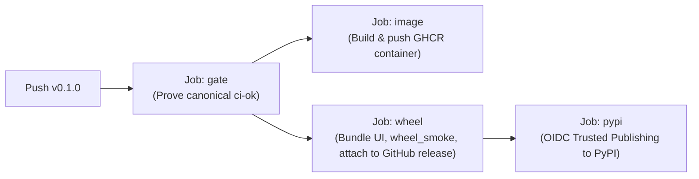

# Release Process & Standard Operating Procedure

This document describes how releases of **PII Guard** (`wattmind-pii-guard`) are versioned,
gated, published, and verified.

---

## 1. Release Philosophy

1. **Semantic Versioning ([SemVer 2.0.0](https://semver.org/))**:
   - `MAJOR` version increments for incompatible API, protocol, or cryptographic vault changes.
   - `MINOR` version increments for new features and backwards-compatible additions (e.g., new language packs, new detectors, new CLI tools).
   - `PATCH` version increments for backwards-compatible bug fixes and security patches.
2. **Tag-Driven Promotion**:
   - Merging to `main` updates the production codebase and runs the full test suite, but **never** triggers an artifact release or PyPI upload.
   - Releases are triggered exclusively by pushing an annotated git tag matching `v*` (e.g., `v0.1.0`).
3. **Fail-Closed CI Provenance Gate**:
   - The release pipeline (`.github/workflows/release.yml`) executes [`scripts/ci/release_gate.py`](../scripts/ci/release_gate.py).
   - The gate proves via the GitHub Actions API that the exact commit pointed to by the tag has already passed canonical branch CI (`ci-ok`) on `main` or `develop`.
   - Untested commits, failed builds, or arbitrary unverified git tags cannot be published.

---

## 2. Infrastructure & Prerequisites

Automated releases require the following one-time configurations:

| Component | Setting | Description |
|---|---|---|
| **PyPI Distribution** | `wattmind-pii-guard` | Package name on PyPI (the bare name `pii-guard` belongs to an unrelated project). |
| **PyPI Trusted Publisher** | GitHub Actions (OIDC) | Configured under PyPI project/account settings: Owner `watt-mind`, Repo `pii-guard`, Workflow `release.yml`, Environment `pypi`. Minted dynamically via OpenID Connect; no static API tokens are stored. |
| **GitHub Environment** | `pypi` | Created under repository Settings → Environments → `pypi`. |
| **GitHub Repo Variable** | `PYPI_PUBLISH = "true"` | Controls whether `.github/workflows/release.yml` executes the `pypi` job. |
| **Container Registry** | `ghcr.io/watt-mind/pii-guard` | Automated container image builds via GitHub Actions `packages: write` permission. |

---

## 3. Step-by-Step Release Procedure

### Step 1: Prepare the Release on `develop`

1. **Verify Version**:
   Check `version` in [`pyproject.toml`](../pyproject.toml):
   ```toml
   [project]
   name = "wattmind-pii-guard"
   version = "0.1.0"
   ```
2. **Update Changelog**:
   Edit [`CHANGELOG.md`](../CHANGELOG.md):
   - Move entries from `## [Unreleased]` into a new version header `## [X.Y.Z] - YYYY-MM-DD`.
   - Categorize entries under `Added`, `Changed`, `Deprecated`, `Removed`, `Fixed`, or `Security`.
   - Update comparison links at the bottom of the changelog.
3. **Run Local Checks**:
   ```bash
   make check         # lint, mypy types, tests, and eval gate
   make links         # validates internal markdown links and anchors
   make wheel         # builds bundled web console and validates size budget (< 5 MiB)
   make wheel-smoke   # validates throwaway install and isolated pii-guard up smoke test
   ```
4. **Submit PR to `develop`**:
   Commit changes and open a pull request into `develop`. Ensure all CI checks pass and merge.

---

### Step 2: Promote `develop` to `main`

1. Open a promotion PR from `develop` into `main`:
   ```bash
   gh pr create --base main --head develop --title "release: develop to main for vX.Y.Z"
   ```
2. Merge the promotion PR into `main`.
3. **Wait for CI to pass on `main`**:
   The full suite runs on `main` (`make test-all`, branch coverage, full Hypothesis runs).
   Verify that the push run for `main` has finished with `ci-ok` green:
   ```bash
   gh run list --branch main --workflow ci.yml --limit 1
   ```

---

### Step 3: Create and Push the Release Tag

Once the commit on `main` has passed CI, tag the exact commit and push:

```bash
# Fetch latest main
git fetch origin main

# Check out main or reference its SHA
git checkout origin/main

# Create an annotated release tag
git tag -a v0.1.0 -m "Release v0.1.0"

# Push the tag to GitHub
git push origin v0.1.0
```

---

### Step 4: Monitor the Release Pipeline

The push of `v*` activates [`.github/workflows/release.yml`](../.github/workflows/release.yml):



1. **`gate`**: Executes `scripts/ci/release_gate.py` to confirm the tagged commit has a completed `success` run for `ci-ok` on `main` or `develop`.
2. **`image`**: Builds the container image from scratch and pushes `ghcr.io/watt-mind/pii-guard:X.Y.Z`, `:X.Y`, and `:latest` with provenance attestations and SBOM.
3. **`wheel`**:
   - Builds web console assets (`pnpm build`).
   - Copies dist into `src/pii_guard/_ui/` and packages wheel + sdist.
   - Runs `scripts/ci/wheel_smoke.sh` ensuring the wheel size is under 5 MiB and smoke tests `pii-guard up`.
   - Creates or updates the GitHub Release with `.whl` and `.tar.gz`.
4. **`pypi`**:
   - Downloads the release artifacts.
   - Authenticates via GitHub Actions OIDC against PyPI Trusted Publishing.
   - Uploads distribution files with `uv publish`.

Monitor the release run via CLI:
```bash
gh run watch $(gh run list --workflow release.yml --limit 1 --json databaseId --jq '.[0].databaseId')
```

---

### Step 5: Post-Release Verification

After the release workflow completes, run end-to-end verification:

1. **Verify GitHub Release**:
   Check `https://github.com/watt-mind/pii-guard/releases/tag/vX.Y.Z` for attached assets (`.whl`, `.tar.gz`) and release notes.
2. **Verify PyPI Listing**:
   Check `https://pypi.org/project/wattmind-pii-guard/` to confirm version `X.Y.Z` is live.
3. **Test `uvx` Execution**:
   In an empty directory without a virtual environment:
   ```bash
   # Force refresh from PyPI and check version
   uvx --refresh wattmind-pii-guard --version

   # Test starting the gateway and console
   uvx wattmind-pii-guard up --help
   ```
4. **Test Docker Image**:
   ```bash
   docker run --rm ghcr.io/watt-mind/pii-guard:X.Y.Z pii-guard --version
   ```

---

## 4. Troubleshooting & Handling Failures

### Release Gate Refusal
- **Error**: `Refused("no successful ci.yml push run on main/develop for the tagged commit")`.
- **Cause**: The commit tagged has not completed a push run on `main` or `develop` where `ci-ok` succeeded.
- **Resolution**: Do not tag PR branches or local unpushed commits. Wait for `ci.yml` on `main` to turn green before pushing the tag.

### Pre-releases
- If a tag contains a hyphen (e.g. `v0.1.0-rc1`), the workflow builds the container image and GitHub Release assets, but **intentionally skips** PyPI publication (`if: vars.PYPI_PUBLISH == 'true' && !contains(github.ref_name, '-')`).

### Package Yanking (Incident Response)
- Never delete a released version from PyPI or git history.
- If a critical defect or security vulnerability is discovered after publication:
  1. Go to `https://pypi.org/manage/project/wattmind-pii-guard/releases/`.
  2. Select the affected version and click **Yank release**, providing a reason (e.g., "Critical security defect in vault session cleanup; upgrade to vX.Y.Z+1").
  3. Fix the issue on `develop`, promote to `main`, and release a new patch version `vX.Y.Z+1`.
